# STATES.md: every Kairos agent as a deterministic state machine

Generated by `backend/scripts/render_states.py` from `backend/kairos_backend/machines.py`; do not edit
the tables or diagrams by hand. `tests/fsm/test_states_md.py` fails when this file and the declarations
drift apart, and `tests/fsm/test_conformance_*.py` fail when the code takes a transition that is not
declared here.

## Deterministic AI in Kairos

Every agent in Kairos is a **finite-state machine**. It has a fixed list of states and a fixed list of
events. Each transition also names a guard and the policy rule behind it. Given the same state, event and
facts, a machine always takes the same transition. The machines are declared in code
(`kairos_backend/fsm.py`, `kairos_backend/machines.py`), and they are checked when they are built:

- every state can be reached;
- every state that is not final has a way out;
- a final state has no way out;
- when one state and one event could lead to more than one place, the guards must exclude each other,
  and this is proven from the guard text itself;
- an event the machine does not know is rejected.

### Where an LLM is allowed

An LLM may only **classify** a message or **phrase** a reply inside a state. It never decides what
happens next.

| Where | What the LLM does | What it cannot do |
|---|---|---|
| Ambiguous free-text replies (`k09.intent`, `kairos_backend/intent.py`) | Picks one value from a closed list of intents (`NEEDS_TIME`, `PTP`, `CLAIMS_PAID`, `CALLBACK`, `HARDSHIP`, `STOP`, `DISPUTE`, `WRONG_PERSON`, `OTHER`), with a summary of 160 characters or less. The model is `gpt-6-luna` with reasoning effort `none`, no tools and a strict JSON schema. Its input is redacted and cut to 500 characters, and it is called at most once per message. | It cannot run on DTMF digits, WhatsApp buttons or STOP keywords; those are always handled by rules. It cannot override a rules decision. Any error, refusal or bad output becomes `OTHER` with a review flag. Its answer is only an *event*: the K13 table, the Gate and the ledger decide what that event does. |
| Voice call outcome (Sarvam post-call variables, K17/K18) | Classifies the finished call into one of 16 dispositions with a confidence score (`k17.voice.disposition`). | It cannot decide what a disposition does. Kairos applies `policy/K17-voice-dispositions/thresholds.json`. A low-confidence STOP, hardship or abuse disposition still goes to a person. A low-confidence promise-to-pay, "already paid" or callback request never creates a hold or a payment. A call never marks an EMI paid. |
| CM-03 WhatsApp agent (`cm03.conversation`) | Classifies ambiguous free text through the same `k09.intent` classifier, and only when an API key is set. Every reply starts as a fixed English / Hindi template (`cm03/copy.py`) or K10 script chosen by the engine; see the `sarvam-105b-conversations` row for the only rewording allowed. | It cannot move the conversation to another state; the engine's code does that. It cannot cause any disclosure before OTP: `_reply` only allows `PRE_VERIFY_SAFE` templates while the conversation is unverified. |
| `sarvam-prism`, intent-stack tier 2b (`kairos_backend/intent_stack.py`, `sarvam/prism.py`; only with a Sarvam key) | After rules and the small model are unsure: picks one of the 17 intent labels with a confidence score, and answers yes / no / unknown on stop, hardship, self-harm and abuse. Input PII-scrubbed and every digit masked; 5 s timeout, circuit breaker, cache. Its answer is used only at prism's own probability >= 0.80 and only when it agrees with a rule candidate or the small model's top 2. | It never runs after a rule safety hit, so it cannot override one. A prism "yes" on a safety question only adds a person (`needs_human`, `<kind>_unconfirmed`). A prism-only STOP comes back as `UNKNOWN`, never `STOP`, so it cannot stop contact. Errors and schema violations fall through to the deterministic tiers. |
| `sarvam-prism`, low-confidence voice calls (`voice/ingest.py`) | Re-classifies the call summary when `disposition_confidence` is below the disposition's `accept_at`. | It cannot change the disposition or lower a confidence. It may raise the bot's confidence for the same disposition (prism >= 0.8, bot >= 0.4, at most +0.25; never STOP_REQUESTED, WRONG_PERSON, THIRD_PARTY) or add a human review. `thresholds.json` still decides. |
| `sarvam-105b-conversations`, CM-03 reply phrasing (`cm03/engine.py: _reply`, `sarvam/phrasing.py`) | Rewords the approved line the engine already chose, for small talk, clarification and empathy keys only (before verification: the identity prompts only), into English, Hinglish or Hindi. It sees the approved line and the language, never the borrower's message. | It cannot choose a reply, a state or an action. An output validator rejects new digits, links, amounts, dates, account words before verification, threat / consequence / third-party words, promises and changed intent; on any failure the approved line goes out verbatim. |
| `deepseekv4.1-flash-1017`, operator narratives (`sarvam/narrate.py`, `GET /ai/explain`, `GET /ai/case-summary/{id}`, `/reports/daily-segment?narrative=true`) | Writes the K05 summary, hand-off case summaries, "explain this decision" and the K26 daily ops paragraph from recorded facts, labelled AI-generated. | It decides nothing and replaces no record: the text sits next to the deterministic one. A fact check rejects PII, numbers not in the facts, missing key fields and advice; then the deterministic text is shown. |
| Sarvam voice bots, inside a call (see [Voice bots](#voice-bots-sarvam)) | The bot moves between script states with a `transition_to_next_state` tool call. The platform limits each state's `next_states`, but the LLM's reading of the caller picks which allowed state comes next. | This is phrasing scope only. Nothing the bot does inside a call changes Kairos state. Kairos acts only on the post-call disposition, through `k17.voice.disposition` and the thresholds. |

### Where an LLM is never used

- **Every transition** in every Kairos machine below. Each one is chosen by `Machine.step` or by the code
  the conformance tests hold to it. The Sarvam in-call script states are outside Kairos and change no Kairos
  state.
- **Every guardrail.** This covers the K01 Gate in `evaluation_order`, caps across campaigns, consent,
  STOP, quiet days and the contact window, stop-for-day, holds, budget and the campaign stop condition.
  The Gate runs at approval and again at send time.
- **Every decision about money or consent.** A payment counts only when D7 or the LMS verifies it
  (`Ledger.record_payment_verified`, `k17.payment_claim`). A STOP on any channel stops all channels, and
  opting back in is per channel with a consent version (`k01.consent`). Holds are applied by the ledger
  (`k13.hold.*`), and caps and budget are reserved atomically (`k06.touch`).
- **Learning.** The learner (`k09.learner.arm`) is a Beta-Bernoulli posterior. PRODUCTION ranks by the
  posterior mean. Seeded Thompson draws are used only in SANDBOX and SIMULATOR. It only ever ranks
  candidates the Gate has already allowed.

### How this is enforced

1. **Declarations are validated when they are built.** A machine that is ambiguous, has an unreachable
   state or has a dead end fails at import time (`tests/fsm/test_fsm_toolkit.py`).
2. **Conformance tests.** Seeded random event sequences drive the real ledger, executor, supervisor,
   gate, K13 table, outcome finalizer, learner and intent classifier. HITL, voice and CM-03 are included
   when those branches are merged. Before each call, the test predicts every state change from the declared
   machine using facts it reads itself. After the call, the database must match the prediction exactly.
   A second test requires every reachable declared transition to have been taken.
3. **Strict mode** (`KAIROS_FSM_STRICT=1`). SQLite triggers on `touches` refuse any status change that is
   not a declared `k06.touch` transition, whichever module tries to write it. The full backend suite
   (with HITL, voice and CM-03 merged) passes in strict mode. The two tests that used to fail there were
   findings FSM-F1 and FSM-F2, both now fixed.
4. **Audit.** `Machine.record()` turns each fired transition into a CRM-envelope-style record with the
   machine, version, from, event, guard, to and rule. The supervisor already emits `supervisor.decision`
   and `touch.dispatched` envelopes for its own transitions.
5. **Known gaps are tracked, not hidden.** A transition the code takes that contradicts a declaration
   is tracked as a strict `xfail` test until it is fixed; it then XPASSes and fails CI until the marker is
   removed. FSM-F1 to FSM-F7 are all fixed and have focused tests. See [Findings](#findings).

## Machines

| Machine | Version | States | Transitions | Declared from | Conformance |
|---|---|---|---|---|---|
| [`k06.touch`](#k06touch-v1) | 1 | 9 | 53 | this branch | tests/fsm/test_conformance_touch.py |
| [`k06.touch+hitl`](#k06touchhitl-v1) | 1 | 10 | 68 | this branch | tests/fsm/test_conformance_touch.py |
| [`k01.gate`](#k01gate-v111) | 1.1.1 | 24 | 41 | this branch | tests/fsm/test_conformance_gate.py |
| [`k06.supervisor.plan`](#k06supervisorplan-v1) | 1 | 7 | 15 | this branch | tests/fsm/test_conformance_supervisor.py |
| [`k06.supervisor.dispatch`](#k06supervisordispatch-v1) | 1 | 5 | 6 | this branch | tests/fsm/test_conformance_supervisor.py |
| [`k09.outcome`](#k09outcome-v1) | 1 | 6 | 30 | this branch | tests/fsm/test_conformance_outcome.py |
| [`k13.exception`](#k13exception-v100) | 1.0.0 | 18 | 21 | this branch | tests/fsm/test_conformance_k13.py |
| [`k13.hold.ptp`](#k13holdptp-v1) | 1 | 4 | 23 | this branch | tests/fsm/test_conformance_holds.py |
| [`k13.hold.hardship`](#k13holdhardship-v1) | 1 | 3 | 14 | this branch | tests/fsm/test_conformance_holds.py |
| [`k13.hold.callback`](#k13holdcallback-v1) | 1 | 2 | 8 | this branch | tests/fsm/test_conformance_holds.py |
| [`k13.hold.supervisor`](#k13holdsupervisor-v1) | 1 | 2 | 6 | this branch | tests/fsm/test_conformance_holds.py |
| [`k01.consent`](#k01consent-v1) | 1 | 3 | 13 | this branch | tests/fsm/test_conformance_holds.py |
| [`k09.intent`](#k09intent-v1) | 1 | 8 | 12 | this branch | tests/fsm/test_conformance_intent.py |
| [`k17.payment_claim`](#k17payment_claim-v020-draft) | 0.2.0-draft | 5 | 8 | origin/k17-k18/voice-engine | tests/fsm/test_conformance_voice.py |
| [`k06.hitl.approval`](#k06hitlapproval-v010) | 0.1.0 | 9 | 24 | origin/k06/hitl-control | tests/fsm/test_conformance_hitl.py |
| [`k17.voice.disposition`](#k17voicedisposition-v010-draft) | 0.1.0-draft | 15 | 46 | origin/k17-k18/voice-engine | tests/fsm/test_conformance_voice.py |
| [`k17.voice.call`](#k17voicecall-v1) | 1 | 4 | 7 | origin/k17-k18/voice-engine | tests/fsm/test_conformance_voice.py |
| [`cm03.conversation`](#cm03conversation-v1) | 1 | 8 | 61 | origin/cm03/whatsapp-servicing | tests/fsm/test_conformance_cm03.py |
| [`k09.learner.arm`](#k09learnerarm-v1) | 1 | 3 | 14 | this branch | tests/fsm/test_conformance_learner.py |

## Findings

These are real transitions found while declaring the machines and running the conformance tests. All
seven are **fixed** on `k06/fsm-fixes`; the declarations above describe the fixed behaviour and the
conformance tests hold the code to it.

| ID | Machine | What the code did | Fix | Proven by |
|---|---|---|---|---|
| FSM-F1 | `k06.touch` | `Ledger.record_provider_status` moved a never-dispatched **RESERVED** touch to SENT / DELIVERED / UNCERTAIN / FAILED (FAILED also released its budget), and accepted `RESERVED` / `DISPATCHING` as provider words, which stranded the touch. Reachable through `POST /provider-status/{id}`, `channels/normalize.py` and the K17 call-end webhook. The touch skipped the send-time re-check, wrote a false K03 `touch_sent`, and the real dispatch was SKIPPED. | A provider status applies only to a touch that is DISPATCHING or later. For a queued touch (RESERVED / PENDING_APPROVAL) it is an orphan / early receipt: audited as `PROVIDER_STATUS_ORPHAN`, touch unchanged. Only provider words are accepted; anything else is 422. `normalize.py` reports `NOT_DISPATCHED` and does not consume the dedupe key; a call outcome for a queued touch changes nothing; the email channel and the voice webhook follow the same rule (borrower intent such as STOP is still honoured). | `test_conformance_touch.py` (orphan loops exercised; `test_provider_callback_on_a_reserved_touch_is_an_orphan_receipt`, `test_internal_statuses_are_not_provider_words`), `test_channels.py`, `test_voice_engine.py::test_webhook_for_a_touch_never_dispatched_leaves_it_queued`, `test_api.py`. |
| FSM-F2 | `k06.touch+hitl`, `k06.hitl.approval` | `HITL.reschedule` canceled the touch first; if the new slot was refused, `_restore` moved the **CANCELED** touch back to RESERVED / PENDING_APPROVAL. | The new slot is checked first (`Ledger.preview(exclude=old)` plus the HITL vetoes). A refused move returns the refusal with `kept: true` and leaves the original untouched. `_restore` is gone; CANCELED is final. | `test_conformance_hitl.py::test_reschedule_refused_keeps_the_original_untouched`, `..._never_writes_canceled_to_live_in_strict_mode`; `test_hitl.py::test_cancel_and_reschedule` in strict mode. |
| FSM-F3 | `k06.hitl.approval` | When STOP, a hold, a payment or a pause canceled a PENDING_APPROVAL touch, `hitl_approvals.decision` stayed NULL forever. | `Ledger.cancel_hook` (installed by HITL) sets `decision='WITHDRAWN'` with the cancel reason and audits `APPROVAL_WITHDRAWN`. `cancel_next` on a pending send records `CANCELED`. | `test_conformance_hitl.py` (a NULL decision on a non-pending touch fails the harness; `test_system_cancel_withdraws_the_pending_approval_with_a_reason`). |
| FSM-F4 | `k17.payment_claim` | No **REJECTED** state: a known-fake claim (for example a reused UTR) paused reminders for the full 48 h and then EXPIRED. | REJECTED when there is fraud evidence (`Ledger.fraud_evidence`: a CM-03 `FRAUD_SUSPECT`, or a D7 payment refused because its bank reference belongs to another account). The claim's remaining pause days are lifted. VERIFIED stays ledger-only and takes precedence. | `test_conformance_voice.py` (harness drives reused references; `test_reused_reference_rejects_the_claim_and_lifts_the_pause` and others). |
| FSM-F5 | `k13.hold.hardship` | A later hardship report with no date, or a date within 4 days, cleared the supervisor flag an earlier "beyond 4 days" report set, and could shorten the hold. | Holds only tighten: while a hold runs, a later report can extend it or add the flag, never shorten it or drop the flag (`HARDSHIP_HOLD_KEPT` audited). Only a supervisor release clears the flag. | `test_conformance_holds.py::test_hardship_holds_only_tighten` and the seeded harness. |
| FSM-F6 | `k13.hold.ptp` | A PTP captured without an `obligation_id` could never be KEPT. | Capture resolves the EMI: the one given, else the borrower's oldest unpaid EMI; with none, capture is refused (422). KEPT when the promised EMI is paid, or verified payments on the borrower's covered EMIs from capture through the PTP date add up to the promised amount. | `test_conformance_holds.py` (`promise_kept` computed independently; `test_ptp_*`). |
| FSM-F7 | `k13.hold.callback` | `CALLBACK_DUE` (unanswered, retry left) created CALLBACK_PENDING even when no callback was requested. | It creates or keeps a callback only when one is open; otherwise it is a normal retry (`NO_OPEN_CALLBACK_NORMAL_RETRY`: no hold, no ticket). | `test_conformance_holds.py::test_callback_due_without_a_requested_callback_is_a_normal_retry` and the seeded harness. |

Other notes:
- A HARDSHIP date of `0` days means the hold lasts until *now*, so there is no hold at all.
- The K13 holds CALLBACK_PENDING and SUPERVISOR_HOLD are still placed in the Gate order by
  `gate.EXTRA_RULES_AFTER`, pending Product.
- FSM-F2: if the new slot passes the pre-check but the reservation is refused anyway (the world changed
  between the two transactions), the original stays CANCELED. It is never resurrected.
- FSM-F7: a `CALLBACK_DUE` whose second attempt was missed still sends the one "we tried to reach you"
  message, even when no callback was requested. The finding only covered the retry branch.

### `k06.touch` (v1)

**Purpose.** One touch = one reserved instruction for one EMI. Reserved touches count toward caps and budget immediately; the Gate runs at approval (reserve) and again at send time; a touch is dispatched at most once; an uncertain send is resolved by asking the provider, never resent.

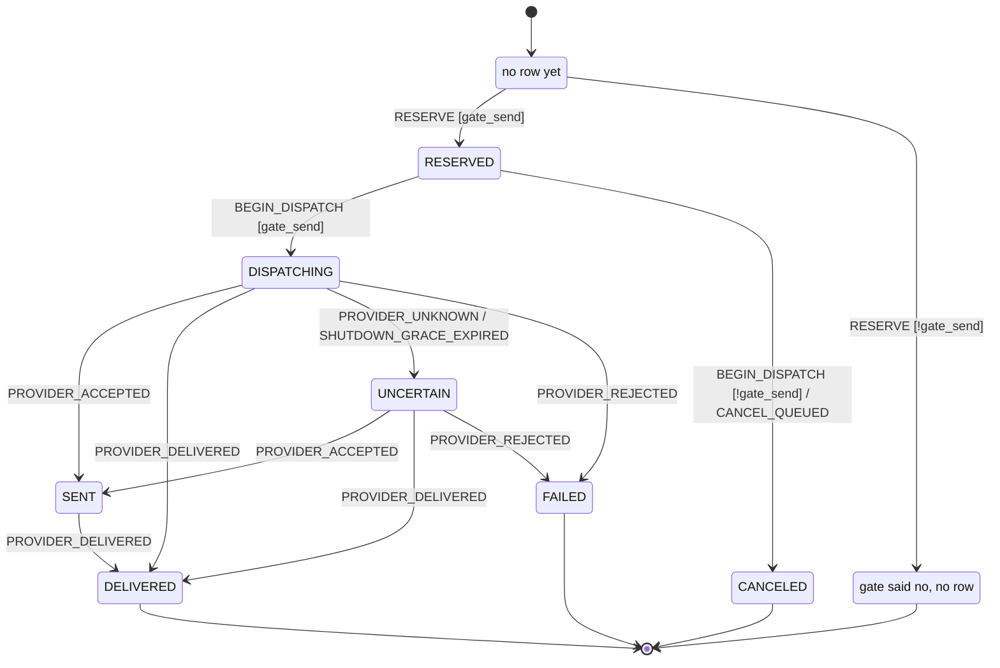

States: `PROPOSED`, `REFUSED`, `RESERVED`, `DISPATCHING`, `UNCERTAIN`, `SENT`, `DELIVERED`, `FAILED`, `CANCELED`. Initial: `PROPOSED`. Final: `CANCELED`, `DELIVERED`, `FAILED`, `REFUSED`. Fingerprint `16bb3d20d183`.

Transitions (self-loops are events that are accepted and change nothing):

| From | Event | Guard | To | Action | Rule / policy |
|---|---|---|---|---|---|
| PROPOSED | RESERVE | gate_send | RESERVED | reserve cap slot + cost | K06 Ledger.reserve: Gate (K01 evaluation_order) in one BEGIN IMMEDIATE tx |
| PROPOSED | RESERVE | !gate_send | REFUSED | audit DECISION, no row | K01 first failing rule (WAIT/CANCEL/HANDOFF) |
| RESERVED | RESERVE | — | RESERVED | — | K06 idempotency: same instruction_id is reserved once (ALREADY_RESERVED) |
| DISPATCHING | RESERVE | — | DISPATCHING | — | K06 idempotency: same instruction_id is reserved once (ALREADY_RESERVED) |
| UNCERTAIN | RESERVE | — | UNCERTAIN | — | K06 idempotency: same instruction_id is reserved once (ALREADY_RESERVED) |
| SENT | RESERVE | — | SENT | — | K06 idempotency: same instruction_id is reserved once (ALREADY_RESERVED) |
| DELIVERED | RESERVE | — | DELIVERED | — | K06 idempotency: same instruction_id is reserved once (ALREADY_RESERVED) |
| FAILED | RESERVE | — | FAILED | — | K06 idempotency: same instruction_id is reserved once (ALREADY_RESERVED) |
| CANCELED | RESERVE | — | CANCELED | — | K06 idempotency: same instruction_id is reserved once (ALREADY_RESERVED) |
| RESERVED | BEGIN_DISPATCH | gate_send | DISPATCHING | — | K06 send-time re-check (Ledger.begin_dispatch) |
| RESERVED | BEGIN_DISPATCH | !gate_send | CANCELED | release cost | K06 guardrails run twice: blocked at send time |
| DISPATCHING | BEGIN_DISPATCH | — | DISPATCHING | — | K06 dispatch once: NOT_DISPATCHABLE_<status> (Executor SKIPPED) |
| UNCERTAIN | BEGIN_DISPATCH | — | UNCERTAIN | — | K06 dispatch once: NOT_DISPATCHABLE_<status> (Executor SKIPPED) |
| SENT | BEGIN_DISPATCH | — | SENT | — | K06 dispatch once: NOT_DISPATCHABLE_<status> (Executor SKIPPED) |
| DELIVERED | BEGIN_DISPATCH | — | DELIVERED | — | K06 dispatch once: NOT_DISPATCHABLE_<status> (Executor SKIPPED) |
| FAILED | BEGIN_DISPATCH | — | FAILED | — | K06 dispatch once: NOT_DISPATCHABLE_<status> (Executor SKIPPED) |
| CANCELED | BEGIN_DISPATCH | — | CANCELED | — | K06 dispatch once: NOT_DISPATCHABLE_<status> (Executor SKIPPED) |
| RESERVED | CANCEL_QUEUED | — | CANCELED | release cost | STOP (all), verified payment (that EMI), K13 holds, stop-for-day (that day), outbound pause, campaign PAUSED/STOPPED |
| DISPATCHING | CANCEL_QUEUED | — | DISPATCHING | — | only queued work is canceled; an in-flight or sent touch is never recalled |
| UNCERTAIN | CANCEL_QUEUED | — | UNCERTAIN | — | only queued work is canceled; an in-flight or sent touch is never recalled |
| SENT | CANCEL_QUEUED | — | SENT | — | only queued work is canceled; an in-flight or sent touch is never recalled |
| DELIVERED | CANCEL_QUEUED | — | DELIVERED | — | only queued work is canceled; an in-flight or sent touch is never recalled |
| FAILED | CANCEL_QUEUED | — | FAILED | — | only queued work is canceled; an in-flight or sent touch is never recalled |
| CANCELED | CANCEL_QUEUED | — | CANCELED | — | only queued work is canceled; an in-flight or sent touch is never recalled |
| DISPATCHING | PROVIDER_ACCEPTED | — | SENT | K03 touch_sent event | provider ACCEPTED |
| DISPATCHING | PROVIDER_DELIVERED | — | DELIVERED | K03 touch_sent event | provider DELIVERED / READ (reach only) |
| DISPATCHING | PROVIDER_UNKNOWN | — | UNCERTAIN | keep cap slot + cost | no provider answer: never resend blindly |
| DISPATCHING | SHUTDOWN_GRACE_EXPIRED | — | UNCERTAIN | keep cap slot + cost; DISPATCH_UNCERTAIN audit | graceful shutdown: still in flight at the deadline (Ledger.mark_inflight_uncertain); never re-sent |
| DISPATCHING | PROVIDER_REJECTED | — | FAILED | release cost | provider REJECTED / NO_ADAPTER |
| UNCERTAIN | PROVIDER_ACCEPTED | — | SENT | K03 touch_sent event | resolve_uncertain: provider has it |
| UNCERTAIN | PROVIDER_DELIVERED | — | DELIVERED | K03 touch_sent event | resolve_uncertain: provider delivered it |
| UNCERTAIN | PROVIDER_REJECTED | — | FAILED | release cost | resolve_uncertain: NOT_FOUND |
| UNCERTAIN | PROVIDER_UNKNOWN | — | UNCERTAIN | — | still unknown: stays UNCERTAIN |
| SENT | PROVIDER_DELIVERED | — | DELIVERED | — | provider DELIVERED / READ (reach only) |
| SENT | PROVIDER_ACCEPTED | — | SENT | — | E04 never downgrade: a late / lower status is ignored |
| SENT | PROVIDER_UNKNOWN | — | SENT | — | E04 never downgrade: a late / lower status is ignored |
| SENT | PROVIDER_REJECTED | — | SENT | — | E04 never downgrade: a late / lower status is ignored |
| DELIVERED | PROVIDER_ACCEPTED | — | DELIVERED | — | final: provider callbacks change nothing |
| DELIVERED | PROVIDER_DELIVERED | — | DELIVERED | — | final: provider callbacks change nothing |
| DELIVERED | PROVIDER_UNKNOWN | — | DELIVERED | — | final: provider callbacks change nothing |
| DELIVERED | PROVIDER_REJECTED | — | DELIVERED | — | final: provider callbacks change nothing |
| FAILED | PROVIDER_ACCEPTED | — | FAILED | — | final: provider callbacks change nothing |
| FAILED | PROVIDER_DELIVERED | — | FAILED | — | final: provider callbacks change nothing |
| FAILED | PROVIDER_UNKNOWN | — | FAILED | — | final: provider callbacks change nothing |
| FAILED | PROVIDER_REJECTED | — | FAILED | — | final: provider callbacks change nothing |
| CANCELED | PROVIDER_ACCEPTED | — | CANCELED | — | final: provider callbacks change nothing |
| CANCELED | PROVIDER_DELIVERED | — | CANCELED | — | final: provider callbacks change nothing |
| CANCELED | PROVIDER_UNKNOWN | — | CANCELED | — | final: provider callbacks change nothing |
| CANCELED | PROVIDER_REJECTED | — | CANCELED | — | final: provider callbacks change nothing |
| RESERVED | PROVIDER_ACCEPTED | — | RESERVED | audit PROVIDER_STATUS_ORPHAN; touch unchanged | FSM-F1: not dispatched yet -> orphan receipt; the send-time re-check and dispatch still run |
| RESERVED | PROVIDER_DELIVERED | — | RESERVED | audit PROVIDER_STATUS_ORPHAN; touch unchanged | FSM-F1: not dispatched yet -> orphan receipt; the send-time re-check and dispatch still run |
| RESERVED | PROVIDER_UNKNOWN | — | RESERVED | audit PROVIDER_STATUS_ORPHAN; touch unchanged | FSM-F1: not dispatched yet -> orphan receipt; the send-time re-check and dispatch still run |
| RESERVED | PROVIDER_REJECTED | — | RESERVED | audit PROVIDER_STATUS_ORPHAN; touch unchanged | FSM-F1: not dispatched yet -> orphan receipt; the send-time re-check and dispatch still run |

**Enforced by:** `kairos_backend/ledger.py: Ledger.reserve / begin_dispatch / record_provider_status / _cancel_queued`; `kairos_backend/executor.py: Executor.dispatch / resolve_uncertain`; `kairos_backend/fsm_strict.py: KAIROS_FSM_STRICT=1 SQLite trigger rejects undeclared status changes`

**Proven by:** tests/fsm/test_conformance_touch.py (seeded random event sequences); tests/test_ledger.py (dispatch once, uncertain, STOP / payment scope)

### `k06.touch+hitl` (v1)

**Purpose.** One touch = one reserved instruction for one EMI. Reserved touches count toward caps and budget immediately; the Gate runs at approval (reserve) and again at send time; a touch is dispatched at most once; an uncertain send is resolved by asking the provider, never resent. With HITL, a send matching an approval rule waits in PENDING_APPROVAL (holding its cap slot and budget) until a person approves (Gate re-run), rejects, or it expires.

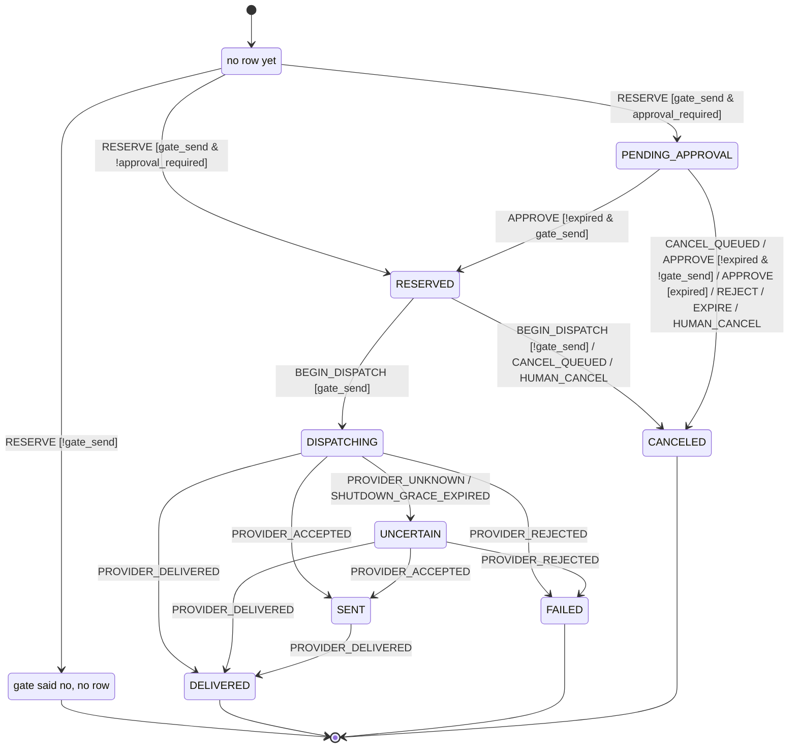

States: `PROPOSED`, `REFUSED`, `RESERVED`, `PENDING_APPROVAL`, `DISPATCHING`, `UNCERTAIN`, `SENT`, `DELIVERED`, `FAILED`, `CANCELED`. Initial: `PROPOSED`. Final: `CANCELED`, `DELIVERED`, `FAILED`, `REFUSED`. Fingerprint `31437621df38`.

Transitions (self-loops are events that are accepted and change nothing):

| From | Event | Guard | To | Action | Rule / policy |
|---|---|---|---|---|---|
| PROPOSED | RESERVE | gate_send & !approval_required | RESERVED | reserve cap slot + cost | K06 Ledger.reserve: Gate in one BEGIN IMMEDIATE tx; reserve_hook adds no rule |
| PROPOSED | RESERVE | gate_send & approval_required | PENDING_APPROVAL | reserve cap slot + cost | K06 HITL approval_policy.json approval_rules (reserve_hook) |
| PROPOSED | RESERVE | !gate_send | REFUSED | audit DECISION, no row | K01 first failing rule (WAIT/CANCEL/HANDOFF); HITL veto |
| RESERVED | RESERVE | — | RESERVED | — | K06 idempotency: same instruction_id is reserved once (ALREADY_RESERVED) |
| PENDING_APPROVAL | RESERVE | — | PENDING_APPROVAL | — | K06 idempotency: same instruction_id is reserved once (ALREADY_RESERVED) |
| DISPATCHING | RESERVE | — | DISPATCHING | — | K06 idempotency: same instruction_id is reserved once (ALREADY_RESERVED) |
| UNCERTAIN | RESERVE | — | UNCERTAIN | — | K06 idempotency: same instruction_id is reserved once (ALREADY_RESERVED) |
| SENT | RESERVE | — | SENT | — | K06 idempotency: same instruction_id is reserved once (ALREADY_RESERVED) |
| DELIVERED | RESERVE | — | DELIVERED | — | K06 idempotency: same instruction_id is reserved once (ALREADY_RESERVED) |
| FAILED | RESERVE | — | FAILED | — | K06 idempotency: same instruction_id is reserved once (ALREADY_RESERVED) |
| CANCELED | RESERVE | — | CANCELED | — | K06 idempotency: same instruction_id is reserved once (ALREADY_RESERVED) |
| RESERVED | BEGIN_DISPATCH | gate_send | DISPATCHING | — | K06 send-time re-check (Ledger.begin_dispatch) |
| RESERVED | BEGIN_DISPATCH | !gate_send | CANCELED | release cost | K06 guardrails run twice: blocked at send time |
| PENDING_APPROVAL | BEGIN_DISPATCH | — | PENDING_APPROVAL | — | K06 dispatch once: NOT_DISPATCHABLE_<status> (Executor SKIPPED) |
| DISPATCHING | BEGIN_DISPATCH | — | DISPATCHING | — | K06 dispatch once: NOT_DISPATCHABLE_<status> (Executor SKIPPED) |
| UNCERTAIN | BEGIN_DISPATCH | — | UNCERTAIN | — | K06 dispatch once: NOT_DISPATCHABLE_<status> (Executor SKIPPED) |
| SENT | BEGIN_DISPATCH | — | SENT | — | K06 dispatch once: NOT_DISPATCHABLE_<status> (Executor SKIPPED) |
| DELIVERED | BEGIN_DISPATCH | — | DELIVERED | — | K06 dispatch once: NOT_DISPATCHABLE_<status> (Executor SKIPPED) |
| FAILED | BEGIN_DISPATCH | — | FAILED | — | K06 dispatch once: NOT_DISPATCHABLE_<status> (Executor SKIPPED) |
| CANCELED | BEGIN_DISPATCH | — | CANCELED | — | K06 dispatch once: NOT_DISPATCHABLE_<status> (Executor SKIPPED) |
| RESERVED | CANCEL_QUEUED | — | CANCELED | release cost | STOP (all), verified payment (that EMI), K13 holds, stop-for-day (that day), outbound pause, campaign PAUSED/STOPPED |
| PENDING_APPROVAL | CANCEL_QUEUED | — | CANCELED | release cost | STOP (all), verified payment (that EMI), K13 holds, stop-for-day (that day), outbound pause, campaign PAUSED/STOPPED |
| DISPATCHING | CANCEL_QUEUED | — | DISPATCHING | — | only queued work is canceled; an in-flight or sent touch is never recalled |
| UNCERTAIN | CANCEL_QUEUED | — | UNCERTAIN | — | only queued work is canceled; an in-flight or sent touch is never recalled |
| SENT | CANCEL_QUEUED | — | SENT | — | only queued work is canceled; an in-flight or sent touch is never recalled |
| DELIVERED | CANCEL_QUEUED | — | DELIVERED | — | only queued work is canceled; an in-flight or sent touch is never recalled |
| FAILED | CANCEL_QUEUED | — | FAILED | — | only queued work is canceled; an in-flight or sent touch is never recalled |
| CANCELED | CANCEL_QUEUED | — | CANCELED | — | only queued work is canceled; an in-flight or sent touch is never recalled |
| PENDING_APPROVAL | APPROVE | !expired & gate_send | RESERVED | — | HITL.approve: Gate re-run atomically (APPROVED) |
| PENDING_APPROVAL | APPROVE | !expired & !gate_send | CANCELED | release cost | HITL.approve: guardrail wins (BLOCKED_AT_RECHECK) |
| PENDING_APPROVAL | APPROVE | expired | CANCELED | release cost | HITL approval expiry |
| PENDING_APPROVAL | REJECT | — | CANCELED | release cost | HITL.reject |
| PENDING_APPROVAL | EXPIRE | — | CANCELED | release cost | HITL.expire_due: END_OF_CONTACT_WINDOW |
| RESERVED | HUMAN_CANCEL | — | CANCELED | release cost | HITL cancel_scheduled / cancel_next / reschedule |
| PENDING_APPROVAL | HUMAN_CANCEL | — | CANCELED | release cost | HITL cancel_scheduled / cancel_next / reschedule |
| DISPATCHING | PROVIDER_ACCEPTED | — | SENT | K03 touch_sent event | provider ACCEPTED |
| DISPATCHING | PROVIDER_DELIVERED | — | DELIVERED | K03 touch_sent event | provider DELIVERED / READ (reach only) |
| DISPATCHING | PROVIDER_UNKNOWN | — | UNCERTAIN | keep cap slot + cost | no provider answer: never resend blindly |
| DISPATCHING | SHUTDOWN_GRACE_EXPIRED | — | UNCERTAIN | keep cap slot + cost; DISPATCH_UNCERTAIN audit | graceful shutdown: still in flight at the deadline (Ledger.mark_inflight_uncertain); never re-sent |
| DISPATCHING | PROVIDER_REJECTED | — | FAILED | release cost | provider REJECTED / NO_ADAPTER |
| UNCERTAIN | PROVIDER_ACCEPTED | — | SENT | K03 touch_sent event | resolve_uncertain: provider has it |
| UNCERTAIN | PROVIDER_DELIVERED | — | DELIVERED | K03 touch_sent event | resolve_uncertain: provider delivered it |
| UNCERTAIN | PROVIDER_REJECTED | — | FAILED | release cost | resolve_uncertain: NOT_FOUND |
| UNCERTAIN | PROVIDER_UNKNOWN | — | UNCERTAIN | — | still unknown: stays UNCERTAIN |
| SENT | PROVIDER_DELIVERED | — | DELIVERED | — | provider DELIVERED / READ (reach only) |
| SENT | PROVIDER_ACCEPTED | — | SENT | — | E04 never downgrade: a late / lower status is ignored |
| SENT | PROVIDER_UNKNOWN | — | SENT | — | E04 never downgrade: a late / lower status is ignored |
| SENT | PROVIDER_REJECTED | — | SENT | — | E04 never downgrade: a late / lower status is ignored |
| DELIVERED | PROVIDER_ACCEPTED | — | DELIVERED | — | final: provider callbacks change nothing |
| DELIVERED | PROVIDER_DELIVERED | — | DELIVERED | — | final: provider callbacks change nothing |
| DELIVERED | PROVIDER_UNKNOWN | — | DELIVERED | — | final: provider callbacks change nothing |
| DELIVERED | PROVIDER_REJECTED | — | DELIVERED | — | final: provider callbacks change nothing |
| FAILED | PROVIDER_ACCEPTED | — | FAILED | — | final: provider callbacks change nothing |
| FAILED | PROVIDER_DELIVERED | — | FAILED | — | final: provider callbacks change nothing |
| FAILED | PROVIDER_UNKNOWN | — | FAILED | — | final: provider callbacks change nothing |
| FAILED | PROVIDER_REJECTED | — | FAILED | — | final: provider callbacks change nothing |
| CANCELED | PROVIDER_ACCEPTED | — | CANCELED | — | final: provider callbacks change nothing |
| CANCELED | PROVIDER_DELIVERED | — | CANCELED | — | final: provider callbacks change nothing |
| CANCELED | PROVIDER_UNKNOWN | — | CANCELED | — | final: provider callbacks change nothing |
| CANCELED | PROVIDER_REJECTED | — | CANCELED | — | final: provider callbacks change nothing |
| RESERVED | PROVIDER_ACCEPTED | — | RESERVED | audit PROVIDER_STATUS_ORPHAN; touch unchanged | FSM-F1: not dispatched yet -> orphan receipt; the send-time re-check and dispatch still run |
| RESERVED | PROVIDER_DELIVERED | — | RESERVED | audit PROVIDER_STATUS_ORPHAN; touch unchanged | FSM-F1: not dispatched yet -> orphan receipt; the send-time re-check and dispatch still run |
| RESERVED | PROVIDER_UNKNOWN | — | RESERVED | audit PROVIDER_STATUS_ORPHAN; touch unchanged | FSM-F1: not dispatched yet -> orphan receipt; the send-time re-check and dispatch still run |
| RESERVED | PROVIDER_REJECTED | — | RESERVED | audit PROVIDER_STATUS_ORPHAN; touch unchanged | FSM-F1: not dispatched yet -> orphan receipt; the send-time re-check and dispatch still run |
| PENDING_APPROVAL | PROVIDER_ACCEPTED | — | PENDING_APPROVAL | audit PROVIDER_STATUS_ORPHAN; touch unchanged | FSM-F1: not dispatched yet -> orphan receipt; the send-time re-check and dispatch still run |
| PENDING_APPROVAL | PROVIDER_DELIVERED | — | PENDING_APPROVAL | audit PROVIDER_STATUS_ORPHAN; touch unchanged | FSM-F1: not dispatched yet -> orphan receipt; the send-time re-check and dispatch still run |
| PENDING_APPROVAL | PROVIDER_UNKNOWN | — | PENDING_APPROVAL | audit PROVIDER_STATUS_ORPHAN; touch unchanged | FSM-F1: not dispatched yet -> orphan receipt; the send-time re-check and dispatch still run |
| PENDING_APPROVAL | PROVIDER_REJECTED | — | PENDING_APPROVAL | audit PROVIDER_STATUS_ORPHAN; touch unchanged | FSM-F1: not dispatched yet -> orphan receipt; the send-time re-check and dispatch still run |

**Enforced by:** `kairos_backend/ledger.py: Ledger.reserve / begin_dispatch / record_provider_status / _cancel_queued`; `kairos_backend/executor.py: Executor.dispatch / resolve_uncertain`; `kairos_backend/hitl.py (k06/hitl-control): HITL._on_reserve / approve / reject / expire_due / cancel_scheduled`; `kairos_backend/fsm_strict.py: KAIROS_FSM_STRICT=1 SQLite trigger rejects undeclared status changes`

**Proven by:** tests/fsm/test_conformance_touch.py (seeded random event sequences); tests/test_ledger.py (dispatch once, uncertain, STOP / payment scope); tests/fsm/test_conformance_hitl.py (runs when kairos_backend.hitl is present)

### `k01.gate` (v1.1.1)

**Purpose.** May this touch be sent at this moment? The rules run in policy.json evaluation_order and the first hit wins; every decision carries the rule and policy_version. The Gate is pure: all state arrives as Facts computed atomically by the ledger.

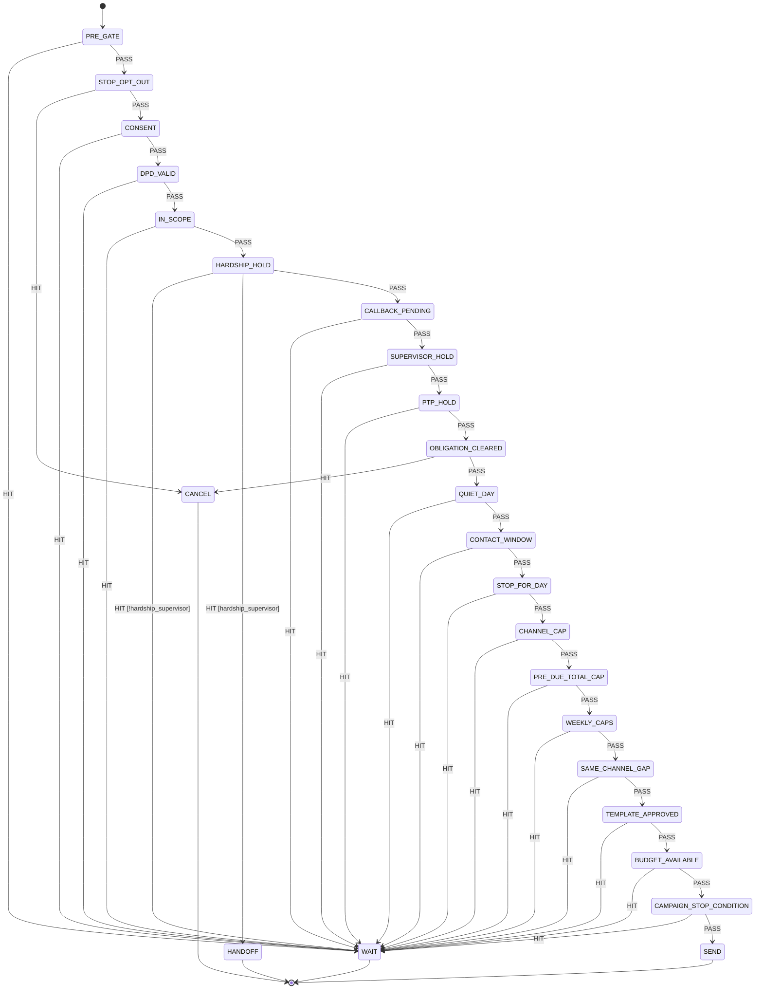

States: `PRE_GATE`, `STOP_OPT_OUT`, `CONSENT`, `DPD_VALID`, `IN_SCOPE`, `HARDSHIP_HOLD`, `CALLBACK_PENDING`, `SUPERVISOR_HOLD`, `PTP_HOLD`, `OBLIGATION_CLEARED`, `QUIET_DAY`, `CONTACT_WINDOW`, `STOP_FOR_DAY`, `CHANNEL_CAP`, `PRE_DUE_TOTAL_CAP`, `WEEKLY_CAPS`, `SAME_CHANNEL_GAP`, `TEMPLATE_APPROVED`, `BUDGET_AVAILABLE`, `CAMPAIGN_STOP_CONDITION`, `SEND`, `WAIT`, `CANCEL`, `HANDOFF`. Initial: `PRE_GATE`. Final: `CANCEL`, `HANDOFF`, `SEND`, `WAIT`. Fingerprint `ea208ab15280`.

Transitions (self-loops are events that are accepted and change nothing):

| From | Event | Guard | To | Action | Rule / policy |
|---|---|---|---|---|---|
| PRE_GATE | HIT | — | WAIT | — | Ledger._pre_gate CONTROL: OUTBOUND_PAUSED / CAMPAIGN_<status> / OUTSIDE_CAMPAIGN_PERIOD / NOT_ENROLLED |
| PRE_GATE | PASS | — | STOP_OPT_OUT | — | operational stops clear |
| STOP_OPT_OUT | HIT | — | CANCEL | — | K01 evaluation_order[0] |
| STOP_OPT_OUT | PASS | — | CONSENT | — | rule passes |
| CONSENT | HIT | — | WAIT | — | K01 evaluation_order[1] |
| CONSENT | PASS | — | DPD_VALID | — | rule passes |
| DPD_VALID | HIT | — | WAIT | — | K01 evaluation_order[2] |
| DPD_VALID | PASS | — | IN_SCOPE | — | rule passes |
| IN_SCOPE | HIT | — | WAIT | — | K01 evaluation_order[3] |
| IN_SCOPE | PASS | — | HARDSHIP_HOLD | — | rule passes |
| HARDSHIP_HOLD | HIT | !hardship_supervisor | WAIT | — | K01 evaluation_order[4]; K01 holds.HARDSHIP |
| HARDSHIP_HOLD | HIT | hardship_supervisor | HANDOFF | — | K01 evaluation_order[4]; K01 holds.HARDSHIP date beyond 4 days -> supervisor |
| HARDSHIP_HOLD | PASS | — | CALLBACK_PENDING | — | rule passes |
| CALLBACK_PENDING | HIT | — | WAIT | — | K13 hold placed by gate.EXTRA_RULES_AFTER (pending Product placement) |
| CALLBACK_PENDING | PASS | — | SUPERVISOR_HOLD | — | rule passes |
| SUPERVISOR_HOLD | HIT | — | WAIT | — | K13 hold placed by gate.EXTRA_RULES_AFTER (pending Product placement) |
| SUPERVISOR_HOLD | PASS | — | PTP_HOLD | — | rule passes |
| PTP_HOLD | HIT | — | WAIT | — | K01 evaluation_order[5] |
| PTP_HOLD | PASS | — | OBLIGATION_CLEARED | — | rule passes |
| OBLIGATION_CLEARED | HIT | — | CANCEL | — | K01 evaluation_order[6] |
| OBLIGATION_CLEARED | PASS | — | QUIET_DAY | — | rule passes |
| QUIET_DAY | HIT | — | WAIT | — | K01 evaluation_order[7] |
| QUIET_DAY | PASS | — | CONTACT_WINDOW | — | rule passes |
| CONTACT_WINDOW | HIT | — | WAIT | — | K01 evaluation_order[8] |
| CONTACT_WINDOW | PASS | — | STOP_FOR_DAY | — | rule passes |
| STOP_FOR_DAY | HIT | — | WAIT | — | K01 evaluation_order[9] |
| STOP_FOR_DAY | PASS | — | CHANNEL_CAP | — | rule passes |
| CHANNEL_CAP | HIT | — | WAIT | — | K01 evaluation_order[10] |
| CHANNEL_CAP | PASS | — | PRE_DUE_TOTAL_CAP | — | rule passes |
| PRE_DUE_TOTAL_CAP | HIT | — | WAIT | — | K01 evaluation_order[11] |
| PRE_DUE_TOTAL_CAP | PASS | — | WEEKLY_CAPS | — | rule passes |
| WEEKLY_CAPS | HIT | — | WAIT | — | K01 evaluation_order[12] |
| WEEKLY_CAPS | PASS | — | SAME_CHANNEL_GAP | — | rule passes |
| SAME_CHANNEL_GAP | HIT | — | WAIT | — | K01 evaluation_order[13] |
| SAME_CHANNEL_GAP | PASS | — | TEMPLATE_APPROVED | — | rule passes |
| TEMPLATE_APPROVED | HIT | — | WAIT | — | K01 evaluation_order[14] |
| TEMPLATE_APPROVED | PASS | — | BUDGET_AVAILABLE | — | rule passes |
| BUDGET_AVAILABLE | HIT | — | WAIT | — | K01 evaluation_order[15] |
| BUDGET_AVAILABLE | PASS | — | CAMPAIGN_STOP_CONDITION | — | rule passes |
| CAMPAIGN_STOP_CONDITION | HIT | — | WAIT | — | K01 evaluation_order[16] |
| CAMPAIGN_STOP_CONDITION | PASS | — | SEND | — | rule passes; all passed -> ELIGIBLE |

**Enforced by:** `kairos_backend/gate.py: evaluate() / rule_order()`; `kairos_backend/ledger.py: Ledger._pre_gate`

**Proven by:** tests/fsm/test_conformance_gate.py (seeded random Facts); tests/test_gate_k01.py (Ojas's K01 cases)

### `k06.supervisor.plan` (v1)

**Purpose.** Plan one touch for one EMI. Borrower-level holds first (policy order), then the full Gate per candidate, then the learner ranks only what is eligible, then an atomic reserve. The LLM is not in this path; the learner is a deterministic Beta-Bernoulli posterior mean in PRODUCTION.

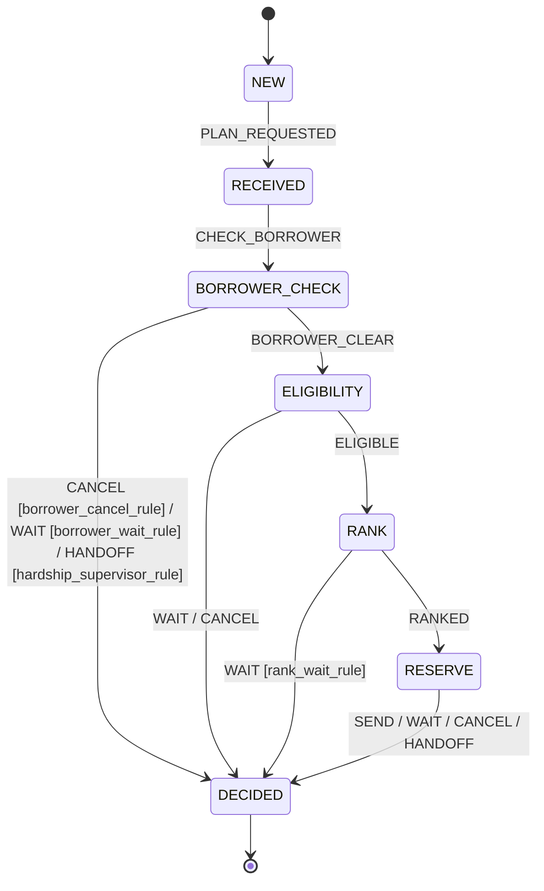

States: `NEW`, `RECEIVED`, `BORROWER_CHECK`, `ELIGIBILITY`, `RANK`, `RESERVE`, `DECIDED`. Initial: `NEW`. Final: `DECIDED`. Fingerprint `6d8459ebe454`.

Transitions (self-loops are events that are accepted and change nothing):

| From | Event | Guard | To | Action | Rule / policy |
|---|---|---|---|---|---|
| NEW | PLAN_REQUESTED | — | RECEIVED | — | SupervisorFSM.plan |
| RECEIVED | CHECK_BORROWER | — | BORROWER_CHECK | — | SupervisorFSM.plan: facts from the ledger (K03 spine) |
| BORROWER_CHECK | BORROWER_CLEAR | — | ELIGIBILITY | — | no borrower-level rule hits |
| BORROWER_CHECK | CANCEL | borrower_cancel_rule | DECIDED | CRM supervisor.decision | STOP_OPT_OUT \| OBLIGATION_CLEARED (policy order) |
| BORROWER_CHECK | WAIT | borrower_wait_rule | DECIDED | CRM supervisor.decision | HARDSHIP_HOLD \| CALLBACK_PENDING \| SUPERVISOR_HOLD \| PTP_HOLD |
| BORROWER_CHECK | HANDOFF | hardship_supervisor_rule | DECIDED | CRM supervisor.decision | HARDSHIP_HOLD with supervisor flag |
| ELIGIBILITY | ELIGIBLE | — | RANK | — | Ledger.preview: >= 1 candidate passes the full Gate |
| ELIGIBILITY | WAIT | — | DECIDED | CRM supervisor.decision | no eligible candidate: earliest rule in policy order (or NO_CANDIDATES / IDEMPOTENCY / SLOT_MISMATCH) |
| ELIGIBILITY | CANCEL | — | DECIDED | CRM supervisor.decision | no eligible candidate; earliest rule is a CANCEL (e.g. STOP on the other channels after a per-channel opt-in) |
| RANK | RANKED | — | RESERVE | — | learner ranks ONLY eligible candidates (replies per rupee) |
| RANK | WAIT | rank_wait_rule | DECIDED | CRM supervisor.decision | NO_BAND (DPD_VALID) \| LEARNER_WAIT \| LEARNER_CHOICE_NOT_ELIGIBLE (LEARNER) |
| RESERVE | SEND | — | DECIDED | touch RESERVED; CRM supervisor.decision | Ledger.reserve (atomic) |
| RESERVE | WAIT | — | DECIDED | CRM supervisor.decision | reserve lost a race (re-check in the write tx) |
| RESERVE | CANCEL | — | DECIDED | CRM supervisor.decision | reserve lost a race (re-check in the write tx) |
| RESERVE | HANDOFF | — | DECIDED | CRM supervisor.decision | reserve lost a race (re-check in the write tx) |

**Enforced by:** `kairos_backend/supervisor.py: SupervisorFSM.plan (records each Transition)`

**Proven by:** tests/fsm/test_conformance_supervisor.py (seeded random borrowers / candidates); tests/test_supervisor_fsm.py

### `k06.supervisor.dispatch` (v1)

**Purpose.** Dispatch one reserved touch through the Executor; the Gate runs again at send time.

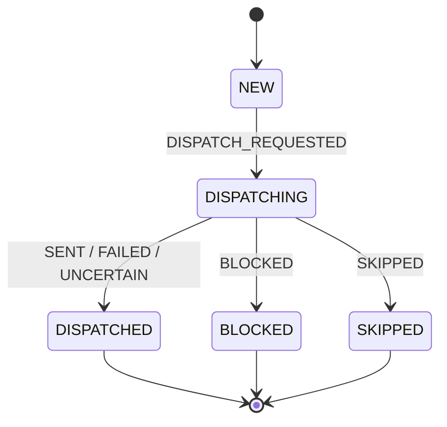

States: `NEW`, `DISPATCHING`, `DISPATCHED`, `BLOCKED`, `SKIPPED`. Initial: `NEW`. Final: `BLOCKED`, `DISPATCHED`, `SKIPPED`. Fingerprint `7e151e9f8af7`.

Transitions (self-loops are events that are accepted and change nothing):

| From | Event | Guard | To | Action | Rule / policy |
|---|---|---|---|---|---|
| NEW | DISPATCH_REQUESTED | — | DISPATCHING | — | SupervisorFSM.dispatch |
| DISPATCHING | SENT | — | DISPATCHED | CRM touch.dispatched | send-time Gate passed; provider ACCEPTED |
| DISPATCHING | FAILED | — | DISPATCHED | CRM touch.dispatched | send-time Gate passed; provider REJECTED |
| DISPATCHING | UNCERTAIN | — | DISPATCHED | CRM touch.dispatched | send-time Gate passed; no provider answer |
| DISPATCHING | BLOCKED | — | BLOCKED | CRM supervisor.decision CANCEL + touch.dispatched | send-time Gate failed, or the touch was canceled before dispatch |
| DISPATCHING | SKIPPED | — | SKIPPED | CRM touch.dispatched | already in flight / sent / failed: no second send |

**Enforced by:** `kairos_backend/supervisor.py: SupervisorFSM.dispatch`; `kairos_backend/executor.py: Executor.dispatch`

**Proven by:** tests/fsm/test_conformance_supervisor.py; tests/test_supervisor_fsm.py

### `k09.outcome` (v1)

**Purpose.** One FINAL learning outcome per executed touch, decided when its 24 h reply window closes. Delivery / read / click are reach, never a reply; a verified payment is tracked separately and never a reward; duplicates and late replies never change the reward; UNRESOLVED never reaches the learner.

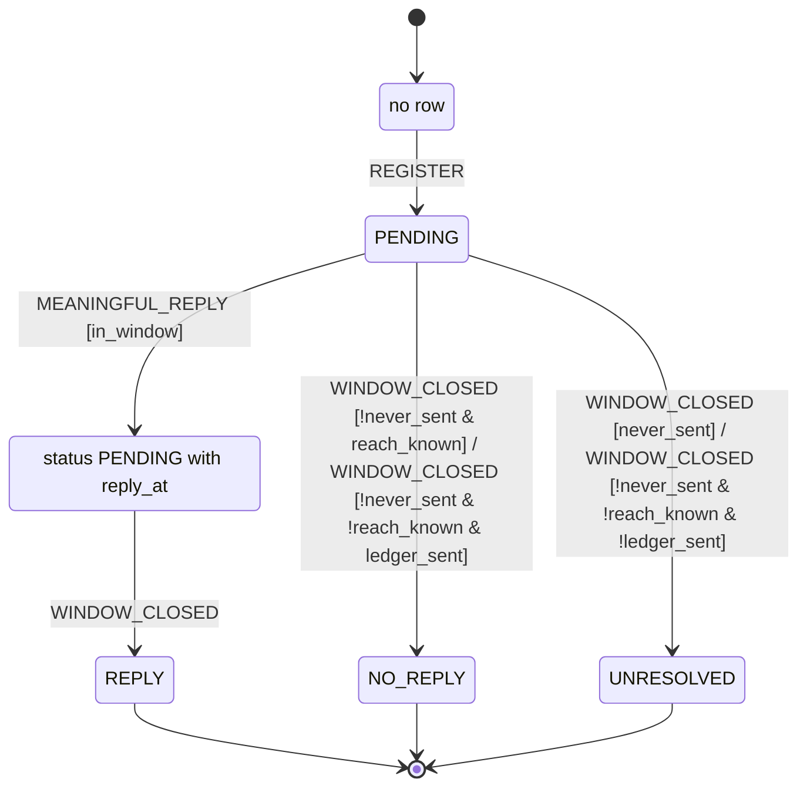

States: `NEW`, `PENDING`, `PENDING_REPLIED`, `REPLY`, `NO_REPLY`, `UNRESOLVED`. Initial: `NEW`. Final: `NO_REPLY`, `REPLY`, `UNRESOLVED`. Fingerprint `8bda07c9efea`.

Transitions (self-loops are events that are accepted and change nothing):

| From | Event | Guard | To | Action | Rule / policy |
|---|---|---|---|---|---|
| NEW | REGISTER | — | PENDING | window_end = executed_at + reply_window_hours | K01 reply_attribution.reply_window_hours |
| PENDING | MEANINGFUL_REPLY | in_window | PENDING_REPLIED | reply_at, reached=1 (REPLY_ATTRIBUTED) | K01 reply_attribution: most recent executed touch whose window contains it |
| PENDING | MEANINGFUL_REPLY | !in_window | PENDING | late_reply_at (LATE_REPLY), reward unchanged | K01 reply_attribution: outside the window never becomes a reward |
| PENDING | WINDOW_CLOSED | never_sent | UNRESOLVED | kept out of learning | outcomes._decide: ledger touch FAILED / CANCELED |
| PENDING | WINDOW_CLOSED | !never_sent & reach_known | NO_REPLY | learner.apply_outcome(0) once | outcomes._decide: provider confirmed delivered / not connected |
| PENDING | WINDOW_CLOSED | !never_sent & !reach_known & ledger_sent | NO_REPLY | learner.apply_outcome(0) once | outcomes._decide: ledger SENT / DELIVERED |
| PENDING | WINDOW_CLOSED | !never_sent & !reach_known & !ledger_sent | UNRESOLVED | kept out of learning | unresolved provider outcomes stay out of learning (UNCERTAIN, no provider info) |
| PENDING_REPLIED | WINDOW_CLOSED | — | REPLY | learner.apply_outcome(1) once | K01 reply_attribution.one_reward_per_touch |
| PENDING_REPLIED | MEANINGFUL_REPLY | — | PENDING_REPLIED | DUPLICATE | K01 reply_attribution.one_reward_per_touch |
| PENDING | REGISTER | — | PENDING | — | register_execution is idempotent |
| PENDING_REPLIED | REGISTER | — | PENDING_REPLIED | — | register_execution is idempotent |
| REPLY | REGISTER | — | REPLY | — | register_execution is idempotent |
| NO_REPLY | REGISTER | — | NO_REPLY | — | register_execution is idempotent |
| UNRESOLVED | REGISTER | — | UNRESOLVED | — | register_execution is idempotent |
| PENDING | REACH | — | PENDING | — | K01 reply_attribution.click_effect: reachability only, never a reply |
| PENDING | CLICK_OR_READ | — | PENDING | — | K01 reply_attribution.click_effect: reachability only, never a reply |
| PENDING_REPLIED | REACH | — | PENDING_REPLIED | — | K01 reply_attribution.click_effect: reachability only, never a reply |
| PENDING_REPLIED | CLICK_OR_READ | — | PENDING_REPLIED | — | K01 reply_attribution.click_effect: reachability only, never a reply |
| REPLY | REACH | — | REPLY | — | K01 reply_attribution.click_effect: reachability only, never a reply |
| REPLY | CLICK_OR_READ | — | REPLY | — | K01 reply_attribution.click_effect: reachability only, never a reply |
| NO_REPLY | REACH | — | NO_REPLY | — | K01 reply_attribution.click_effect: reachability only, never a reply |
| NO_REPLY | CLICK_OR_READ | — | NO_REPLY | — | K01 reply_attribution.click_effect: reachability only, never a reply |
| UNRESOLVED | REACH | — | UNRESOLVED | — | K01 reply_attribution.click_effect: reachability only, never a reply |
| UNRESOLVED | CLICK_OR_READ | — | UNRESOLVED | — | K01 reply_attribution.click_effect: reachability only, never a reply |
| REPLY | MEANINGFUL_REPLY | — | REPLY | LATE_REPLY / DUPLICATE | late reply / duplicate: recorded, reward unchanged |
| NO_REPLY | MEANINGFUL_REPLY | — | NO_REPLY | LATE_REPLY / DUPLICATE | late reply / duplicate: recorded, reward unchanged |
| UNRESOLVED | MEANINGFUL_REPLY | — | UNRESOLVED | LATE_REPLY / DUPLICATE | late reply / duplicate: recorded, reward unchanged |
| REPLY | WINDOW_CLOSED | — | REPLY | — | finalize_due is idempotent |
| NO_REPLY | WINDOW_CLOSED | — | NO_REPLY | — | finalize_due is idempotent |
| UNRESOLVED | WINDOW_CLOSED | — | UNRESOLVED | — | finalize_due is idempotent |

**Enforced by:** `kairos_backend/outcomes.py: OutcomeFinalizer.register_execution / record_reply / record_reach / finalize_due`; `kairos_backend/learner.py: apply_outcome idempotent on instruction_id`

**Proven by:** tests/fsm/test_conformance_outcome.py (seeded random replies / clocks); tests/test_outcomes.py

### `k13.exception` (v1.0.0)

**Purpose.** One borrower event (classified upstream — by rules, DTMF, a voice disposition, or the LLM for ambiguous free text) -> one (action, hold, queue) from exceptions.json. The table is pure; the ledger applies the hold. Note: the *_SUPERVISOR states are the same K13 action (CAPTURE_PTP / HOLD_UNTIL_DATE) with a supervisor ticket.

```mermaid
stateDiagram-v2
    [*] --> RECEIVED
    RECEIVED --> PUSH_PAYMENT_NOW : NEEDS_TIME [broken]
    RECEIVED --> ACK_ONLY : NEEDS_TIME [!broken & !in_window]
    RECEIVED --> REBUTTAL : NEEDS_TIME [!broken & in_window & rebuttals_left]
    RECEIVED --> ACCEPT_NO_DATE : NEEDS_TIME [!broken & in_window & !rebuttals_left]
    RECEIVED --> VERIFY_PAYMENT : PTP_OFFERED [broken & paid_now]
    RECEIVED --> RECORD_PTP_NO_HOLD : PTP_OFFERED [broken & !paid_now]
    RECEIVED --> CAPTURE_PTP : PTP_OFFERED [!broken & !far]
    RECEIVED --> CAPTURE_PTP_SUPERVISOR : PTP_OFFERED [!broken & far]
    RECEIVED --> CREATE_CALLBACK_TASK : CALLBACK_REQUEST
    RECEIVED --> CLOSE_CALLBACK_TASK : CALLBACK_DUE [answered]
    RECEIVED --> RETRY_CALLBACK_2H : CALLBACK_DUE [!answered & retry_left]
    RECEIVED --> SEND_MISSED_CALLBACK_MSG : CALLBACK_DUE [!answered & !retry_left]
    RECEIVED --> HOLD_2_DAYS : HARDSHIP [!has_date]
    RECEIVED --> HOLD_UNTIL_DATE : HARDSHIP [has_date & !beyond]
    RECEIVED --> HOLD_UNTIL_DATE_SUPERVISOR : HARDSHIP [has_date & beyond]
    RECEIVED --> CREATE_TICKET : DISPUTE / COMPLAINT / WAIVER_REQUEST
    RECEIVED --> END_CONVERSATION_AND_TICKET : ABUSIVE / LEGAL_THREAT / FRAUD_CLAIM
    PUSH_PAYMENT_NOW --> [*]
    ACK_ONLY --> [*]
    REBUTTAL --> [*]
    ACCEPT_NO_DATE --> [*]
    VERIFY_PAYMENT --> [*]
    RECORD_PTP_NO_HOLD --> [*]
    CAPTURE_PTP --> [*]
    CAPTURE_PTP_SUPERVISOR --> [*]
    CREATE_CALLBACK_TASK --> [*]
    CLOSE_CALLBACK_TASK --> [*]
    RETRY_CALLBACK_2H --> [*]
    SEND_MISSED_CALLBACK_MSG --> [*]
    HOLD_2_DAYS --> [*]
    HOLD_UNTIL_DATE --> [*]
    HOLD_UNTIL_DATE_SUPERVISOR --> [*]
    CREATE_TICKET --> [*]
    END_CONVERSATION_AND_TICKET --> [*]
```

States: `RECEIVED`, `PUSH_PAYMENT_NOW`, `ACK_ONLY`, `REBUTTAL`, `ACCEPT_NO_DATE`, `VERIFY_PAYMENT`, `RECORD_PTP_NO_HOLD`, `CAPTURE_PTP`, `CAPTURE_PTP_SUPERVISOR`, `CREATE_CALLBACK_TASK`, `CLOSE_CALLBACK_TASK`, `RETRY_CALLBACK_2H`, `SEND_MISSED_CALLBACK_MSG`, `HOLD_2_DAYS`, `HOLD_UNTIL_DATE`, `HOLD_UNTIL_DATE_SUPERVISOR`, `CREATE_TICKET`, `END_CONVERSATION_AND_TICKET`. Initial: `RECEIVED`. Final: `ACCEPT_NO_DATE`, `ACK_ONLY`, `CAPTURE_PTP`, `CAPTURE_PTP_SUPERVISOR`, `CLOSE_CALLBACK_TASK`, `CREATE_CALLBACK_TASK`, `CREATE_TICKET`, `END_CONVERSATION_AND_TICKET`, `HOLD_2_DAYS`, `HOLD_UNTIL_DATE`, `HOLD_UNTIL_DATE_SUPERVISOR`, `PUSH_PAYMENT_NOW`, `REBUTTAL`, `RECORD_PTP_NO_HOLD`, `RETRY_CALLBACK_2H`, `SEND_MISSED_CALLBACK_MSG`, `VERIFY_PAYMENT`. Fingerprint `33bc58f02620`.

Transitions (self-loops are events that are accepted and change nothing):

| From | Event | Guard | To | Action | Rule / policy |
|---|---|---|---|---|---|
| RECEIVED | NEEDS_TIME | broken | PUSH_PAYMENT_NOW | hold=NONE; queue=- | K13 exceptions.json broken_ptp >= 2 |
| RECEIVED | NEEDS_TIME | !broken & !in_window | ACK_ONLY | hold=STOP_FOR_DAY; queue=- | K13 exceptions.json needs_time.rebuttals_only_inside_contact_window |
| RECEIVED | NEEDS_TIME | !broken & in_window & rebuttals_left | REBUTTAL | hold=NONE; queue=- | K13 exceptions.json needs_time.max_rebuttals_by_band |
| RECEIVED | NEEDS_TIME | !broken & in_window & !rebuttals_left | ACCEPT_NO_DATE | hold=STOP_FOR_DAY; queue=- | K13 exceptions.json needs_time.no_date_after_rebuttals |
| RECEIVED | PTP_OFFERED | broken & paid_now | VERIFY_PAYMENT | hold=NONE; queue=- | K13 exceptions.json broken_ptp.if_paid_now |
| RECEIVED | PTP_OFFERED | broken & !paid_now | RECORD_PTP_NO_HOLD | hold=STOP_FOR_DAY; queue=- | K13 exceptions.json broken_ptp.if_not_paid_now |
| RECEIVED | PTP_OFFERED | !broken & !far | CAPTURE_PTP | hold=PTP_HOLD; queue=- | K13 exceptions.json promise_to_pay.auto_accept_max_days=7 |
| RECEIVED | PTP_OFFERED | !broken & far | CAPTURE_PTP_SUPERVISOR | hold=PTP_HOLD; queue=COLLECTIONS_SUPERVISOR | K13 exceptions.json promise_to_pay.beyond_auto_accept |
| RECEIVED | CALLBACK_REQUEST | — | CREATE_CALLBACK_TASK | hold=CALLBACK_PENDING; queue=COLLECTIONS_SUPERVISOR | K13 exceptions.json callback (E08) |
| RECEIVED | CALLBACK_DUE | answered | CLOSE_CALLBACK_TASK | hold=STOP_FOR_DAY; queue=- | K13 exceptions.json callback.if_answered |
| RECEIVED | CALLBACK_DUE | !answered & retry_left | RETRY_CALLBACK_2H | hold=CALLBACK_PENDING; queue=COLLECTIONS_SUPERVISOR | K13 exceptions.json callback.if_unanswered |
| RECEIVED | CALLBACK_DUE | !answered & !retry_left | SEND_MISSED_CALLBACK_MSG | hold=STOP_FOR_DAY; queue=- | K13 exceptions.json callback.if_second_attempt_missed |
| RECEIVED | HARDSHIP | !has_date | HOLD_2_DAYS | hold=HARDSHIP_HOLD; queue=- | K01 holds.HARDSHIP.if_no_date |
| RECEIVED | HARDSHIP | has_date & !beyond | HOLD_UNTIL_DATE | hold=HARDSHIP_HOLD; queue=- | K01 holds.HARDSHIP within 4 days |
| RECEIVED | HARDSHIP | has_date & beyond | HOLD_UNTIL_DATE_SUPERVISOR | hold=HARDSHIP_HOLD; queue=COLLECTIONS_SUPERVISOR | K01 holds.HARDSHIP beyond 4 days -> supervisor |
| RECEIVED | DISPUTE | — | CREATE_TICKET | hold=STOP_FOR_DAY; queue=COLLECTIONS_SUPERVISOR | K13 exceptions.json routed_exceptions (outreach continues) |
| RECEIVED | COMPLAINT | — | CREATE_TICKET | hold=STOP_FOR_DAY; queue=COLLECTIONS_SUPERVISOR | K13 exceptions.json routed_exceptions (outreach continues) |
| RECEIVED | WAIVER_REQUEST | — | CREATE_TICKET | hold=STOP_FOR_DAY; queue=COLLECTIONS_SUPERVISOR | K13 exceptions.json routed_exceptions (outreach continues) |
| RECEIVED | ABUSIVE | — | END_CONVERSATION_AND_TICKET | hold=SUPERVISOR_HOLD; queue=COLLECTIONS_SUPERVISOR | K13 exceptions.json routed_exceptions (paused until supervisor clears) |
| RECEIVED | LEGAL_THREAT | — | END_CONVERSATION_AND_TICKET | hold=SUPERVISOR_HOLD; queue=COLLECTIONS_SUPERVISOR | K13 exceptions.json routed_exceptions (paused until supervisor clears) |
| RECEIVED | FRAUD_CLAIM | — | END_CONVERSATION_AND_TICKET | hold=SUPERVISOR_HOLD; queue=COLLECTIONS_SUPERVISOR | K13 exceptions.json routed_exceptions (paused until supervisor clears) |

**Enforced by:** `kairos_backend/exceptions.py: handle()`; `kairos_backend/ledger.py: Ledger.apply_exception`

**Proven by:** tests/fsm/test_conformance_k13.py (every event x seeded random facts); tests/test_exceptions_k13.py

### `k13.hold.ptp` (v1)

**Purpose.** A borrower-wide promise-to-pay hold: no outbound activity on any channel through the PTP date. Kept = the promised EMI is verified paid (D7/LMS); broken = unpaid when the next day starts (BROKEN_PTP counted; at the threshold no new hold is granted). KEPT / BROKEN are the outcome of the last promise; a new promise starts a new hold. Every promise names an EMI: the one given, else the borrower's oldest unpaid EMI; with none, capture is refused. Kept also counts any verified payment on the borrower's covered EMIs from capture through the PTP date that adds up to the promised amount.

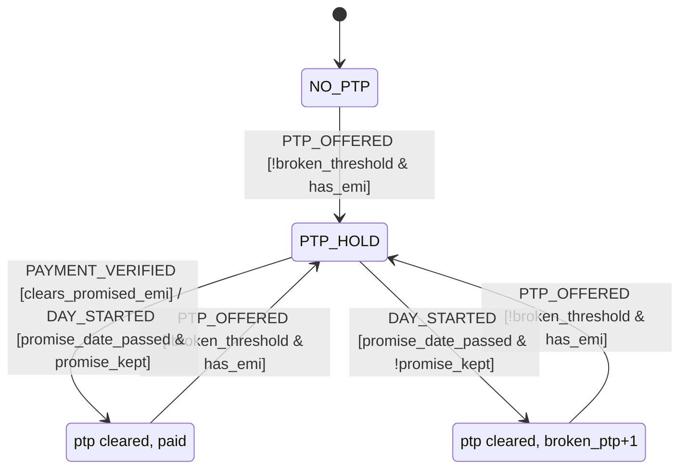

States: `NO_PTP`, `PTP_HOLD`, `PTP_KEPT`, `PTP_BROKEN`. Initial: `NO_PTP`. Final: none (the lifecycle repeats). Fingerprint `d9c15b4de3ea`.

Transitions (self-loops are events that are accepted and change nothing):

| From | Event | Guard | To | Action | Rule / policy |
|---|---|---|---|---|---|
| NO_PTP | PTP_OFFERED | !broken_threshold & has_emi | PTP_HOLD | ptp_date, ptp_obligation (given EMI, else oldest unpaid), captured_on, promised amount; stop-for-day today; cancel queued | K01 holds.PROMISE_TO_PAY (K13 CAPTURE_PTP) |
| NO_PTP | PTP_OFFERED | !broken_threshold & !has_emi | NO_PTP | capture refused (ValueError / 422); nothing written | FSM-F6: a promise must name an EMI it can be kept against (no unpaid EMI -> no hold) |
| NO_PTP | PTP_OFFERED | broken_threshold | NO_PTP | stop-for-day only | K13 broken_ptp >= threshold: RECORD_PTP_NO_HOLD |
| PTP_KEPT | PTP_OFFERED | !broken_threshold & has_emi | PTP_HOLD | ptp_date, ptp_obligation (given EMI, else oldest unpaid), captured_on, promised amount; stop-for-day today; cancel queued | K01 holds.PROMISE_TO_PAY (K13 CAPTURE_PTP) |
| PTP_KEPT | PTP_OFFERED | !broken_threshold & !has_emi | PTP_KEPT | capture refused (ValueError / 422); nothing written | FSM-F6: a promise must name an EMI it can be kept against (no unpaid EMI -> no hold) |
| PTP_KEPT | PTP_OFFERED | broken_threshold | PTP_KEPT | stop-for-day only | K13 broken_ptp >= threshold: RECORD_PTP_NO_HOLD |
| PTP_BROKEN | PTP_OFFERED | !broken_threshold & has_emi | PTP_HOLD | ptp_date, ptp_obligation (given EMI, else oldest unpaid), captured_on, promised amount; stop-for-day today; cancel queued | K01 holds.PROMISE_TO_PAY (K13 CAPTURE_PTP) |
| PTP_BROKEN | PTP_OFFERED | !broken_threshold & !has_emi | PTP_BROKEN | capture refused (ValueError / 422); nothing written | FSM-F6: a promise must name an EMI it can be kept against (no unpaid EMI -> no hold) |
| PTP_BROKEN | PTP_OFFERED | broken_threshold | PTP_BROKEN | stop-for-day only | K13 broken_ptp >= threshold: RECORD_PTP_NO_HOLD |
| PTP_HOLD | PTP_OFFERED | !broken_threshold & has_emi | PTP_HOLD | ptp_date, ptp_obligation (given EMI, else oldest unpaid), captured_on, promised amount; stop-for-day today; cancel queued | K01 holds.PROMISE_TO_PAY (K13 CAPTURE_PTP; replaces the open promise) |
| PTP_HOLD | PTP_OFFERED | !broken_threshold & !has_emi | PTP_HOLD | capture refused (ValueError / 422); nothing written | FSM-F6: a promise must name an EMI it can be kept against (no unpaid EMI -> no hold) |
| PTP_HOLD | PTP_OFFERED | broken_threshold | PTP_HOLD | stop-for-day only | K13 broken_ptp >= threshold: RECORD_PTP_NO_HOLD |
| PTP_HOLD | PAYMENT_VERIFIED | clears_promised_emi | PTP_KEPT | cancel that EMI's queued touches | K01 holds.PROMISE_TO_PAY.if_paid |
| PTP_HOLD | PAYMENT_VERIFIED | !clears_promised_emi | PTP_HOLD | — | another EMI, or partial: hold stays (E14); judged on the day after the PTP date |
| PTP_HOLD | DAY_STARTED | promise_date_passed & promise_kept | PTP_KEPT | audit PTP_KEPT | K01 holds.PROMISE_TO_PAY.on_ptp_date: promised EMI paid, or verified payments on the borrower's covered EMIs since capture >= the promised amount (FSM-F6) |
| PTP_HOLD | DAY_STARTED | promise_date_passed & !promise_kept | PTP_BROKEN | broken_ptp += 1 | K01 holds.PROMISE_TO_PAY.if_unpaid_by_end_of_ptp_date |
| PTP_HOLD | DAY_STARTED | !promise_date_passed | PTP_HOLD | — | hold runs through the PTP date (inclusive) |
| NO_PTP | PAYMENT_VERIFIED | — | NO_PTP | — | no open promise |
| NO_PTP | DAY_STARTED | — | NO_PTP | — | no open promise |
| PTP_KEPT | PAYMENT_VERIFIED | — | PTP_KEPT | — | no open promise |
| PTP_KEPT | DAY_STARTED | — | PTP_KEPT | — | no open promise |
| PTP_BROKEN | PAYMENT_VERIFIED | — | PTP_BROKEN | — | no open promise |
| PTP_BROKEN | DAY_STARTED | — | PTP_BROKEN | — | no open promise |

**Enforced by:** `kairos_backend/ledger.py: apply_exception (PTP_HOLD), record_payment_verified, start_day`; `kairos_backend/gate.py: PTP_HOLD rule`

**Proven by:** tests/fsm/test_conformance_holds.py; tests/test_ledger.py

### `k13.hold.hardship` (v1)

**Purpose.** Hardship pauses every channel (Gate WAIT, or HANDOFF when the borrower's date is beyond 4 days). Holds only tighten: while a hold runs, a new report can extend it or add the supervisor flag, never shorten it or drop the flag; only a supervisor release clears the flag.

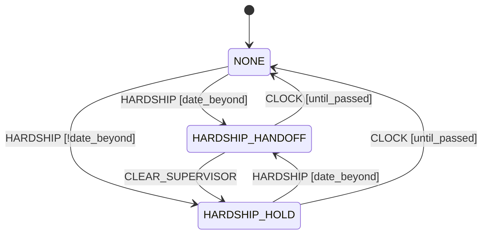

States: `NONE`, `HARDSHIP_HOLD`, `HARDSHIP_HANDOFF`. Initial: `NONE`. Final: none (the lifecycle repeats). Fingerprint `cf7b79a26e47`.

Transitions (self-loops are events that are accepted and change nothing):

| From | Event | Guard | To | Action | Rule / policy |
|---|---|---|---|---|---|
| NONE | HARDSHIP | date_beyond | HARDSHIP_HANDOFF | hardship_until=date, supervisor=1, ticket | K01 holds.HARDSHIP.if_borrower_gives_date_beyond_4_days |
| NONE | HARDSHIP | !date_beyond | HARDSHIP_HOLD | hardship_until=date or +2 days, supervisor=0 | K01 holds.HARDSHIP.if_no_date / within 4 days |
| HARDSHIP_HOLD | HARDSHIP | date_beyond | HARDSHIP_HANDOFF | hardship_until=date, supervisor=1, ticket (holds only tighten: until = max(current, new)) | K01 holds.HARDSHIP.if_borrower_gives_date_beyond_4_days |
| HARDSHIP_HOLD | HARDSHIP | !date_beyond | HARDSHIP_HOLD | hardship_until=date or +2 days, supervisor=0 (holds only tighten: until = max(current, new)) | K01 holds.HARDSHIP.if_no_date / within 4 days |
| HARDSHIP_HANDOFF | HARDSHIP | date_beyond | HARDSHIP_HANDOFF | hardship_until=date, supervisor=1, ticket (holds only tighten: until = max(current, new)) | K01 holds.HARDSHIP.if_borrower_gives_date_beyond_4_days |
| HARDSHIP_HANDOFF | HARDSHIP | !date_beyond | HARDSHIP_HANDOFF | keep the longer date and the supervisor flag; audit HARDSHIP_HOLD_KEPT | FSM-F5: a later, weaker report never clears an earlier flag or shortens the hold; only a supervisor release does (K01 holds.HARDSHIP: keep hold and flag to supervisor) |
| HARDSHIP_HOLD | CLOCK | until_passed | NONE | — | hold ends at hardship_until (Gate compares at send time) |
| HARDSHIP_HOLD | CLOCK | !until_passed | HARDSHIP_HOLD | — | still held |
| HARDSHIP_HANDOFF | CLOCK | until_passed | NONE | — | hold ends at hardship_until |
| HARDSHIP_HANDOFF | CLOCK | !until_passed | HARDSHIP_HANDOFF | — | still held (HANDOFF) |
| HARDSHIP_HANDOFF | CLEAR_SUPERVISOR | — | HARDSHIP_HOLD | hardship_supervisor=0 | Ledger.clear_supervisor_hold (a person): the date hold itself stays |
| NONE | CLOCK | — | NONE | — | nothing held |
| NONE | CLEAR_SUPERVISOR | — | NONE | — | no supervisor flag on this hold |
| HARDSHIP_HOLD | CLEAR_SUPERVISOR | — | HARDSHIP_HOLD | — | no supervisor flag on this hold |

**Enforced by:** `kairos_backend/ledger.py: apply_exception (HARDSHIP_HOLD), clear_supervisor_hold`; `kairos_backend/gate.py: HARDSHIP_HOLD rule`

**Proven by:** tests/fsm/test_conformance_holds.py

### `k13.hold.callback` (v1)

**Purpose.** A borrower asked for a person: all outbound nudges pause until the callback is answered or missed twice.

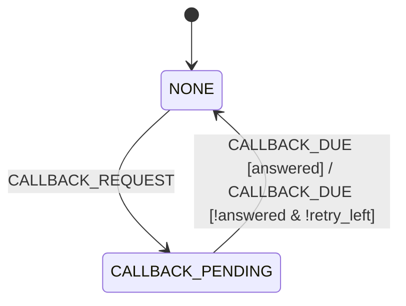

States: `NONE`, `CALLBACK_PENDING`. Initial: `NONE`. Final: none (the lifecycle repeats). Fingerprint `de73284d8a1b`.

Transitions (self-loops are events that are accepted and change nothing):

| From | Event | Guard | To | Action | Rule / policy |
|---|---|---|---|---|---|
| NONE | CALLBACK_REQUEST | — | CALLBACK_PENDING | ticket (deduped per day), pause all outbound | K13 callback (E08).while_pending |
| NONE | CALLBACK_DUE | answered | NONE | close task; stop-for-day | K13 callback (E08).if_answered |
| NONE | CALLBACK_DUE | !answered & !retry_left | NONE | one 'we tried to reach you' message; stop-for-day | K13 callback (E08).if_second_attempt_missed |
| CALLBACK_PENDING | CALLBACK_REQUEST | — | CALLBACK_PENDING | ticket (deduped per day), pause all outbound | K13 callback (E08).while_pending |
| CALLBACK_PENDING | CALLBACK_DUE | answered | NONE | close task; stop-for-day | K13 callback (E08).if_answered |
| CALLBACK_PENDING | CALLBACK_DUE | !answered & !retry_left | NONE | one 'we tried to reach you' message; stop-for-day | K13 callback (E08).if_second_attempt_missed |
| CALLBACK_PENDING | CALLBACK_DUE | !answered & retry_left | CALLBACK_PENDING | retry in 2 h | K13 callback (E08).if_unanswered |
| NONE | CALLBACK_DUE | !answered & retry_left | NONE | no hold, no ticket: normal retry at band caps | FSM-F7: only a requested callback is retried as a callback (NO_OPEN_CALLBACK_NORMAL_RETRY) |

**Enforced by:** `kairos_backend/ledger.py: apply_exception (CALLBACK_PENDING)`; `kairos_backend/gate.py: CALLBACK_PENDING rule`

**Proven by:** tests/fsm/test_conformance_holds.py

### `k13.hold.supervisor` (v1)

**Purpose.** Paused on every channel until a person clears it. Kairos never lifts it on its own.

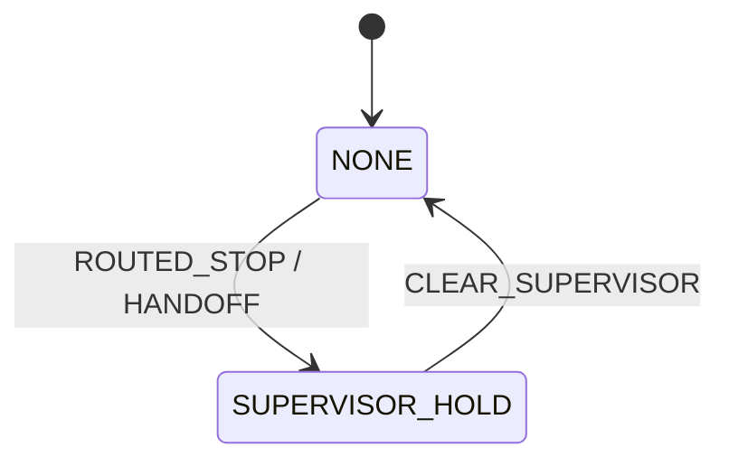

States: `NONE`, `SUPERVISOR_HOLD`. Initial: `NONE`. Final: none (the lifecycle repeats). Fingerprint `cf1774c66b45`.

Transitions (self-loops are events that are accepted and change nothing):

| From | Event | Guard | To | Action | Rule / policy |
|---|---|---|---|---|---|
| NONE | ROUTED_STOP | — | SUPERVISOR_HOLD | ticket; cancel queued | K13 routed_exceptions ABUSIVE / LEGAL_THREAT / FRAUD_CLAIM |
| NONE | HANDOFF | — | SUPERVISOR_HOLD | ticket; cancel queued | voice LedgerHandoff / HITL pause, hold, handoff (k17-k18, k06/hitl-control) |
| NONE | CLEAR_SUPERVISOR | — | NONE | supervisor_hold=0 | Ledger.clear_supervisor_hold (a person) |
| SUPERVISOR_HOLD | ROUTED_STOP | — | SUPERVISOR_HOLD | ticket; cancel queued | K13 routed_exceptions ABUSIVE / LEGAL_THREAT / FRAUD_CLAIM |
| SUPERVISOR_HOLD | HANDOFF | — | SUPERVISOR_HOLD | ticket; cancel queued | voice LedgerHandoff / HITL pause, hold, handoff (k17-k18, k06/hitl-control) |
| SUPERVISOR_HOLD | CLEAR_SUPERVISOR | — | NONE | supervisor_hold=0 | Ledger.clear_supervisor_hold (a person) |

**Enforced by:** `kairos_backend/ledger.py: apply_exception (SUPERVISOR_HOLD), clear_supervisor_hold`; `kairos_backend/gate.py: SUPERVISOR_HOLD rule`

**Proven by:** tests/fsm/test_conformance_holds.py

### `k01.consent` (v1)

**Purpose.** Contactability of one borrower on one channel, as the Gate sees it (STOP_OPT_OUT -> CANCEL, CONSENT -> WAIT). The initial state is whatever the K03 consents table says; CONTACTABLE is drawn as the start.

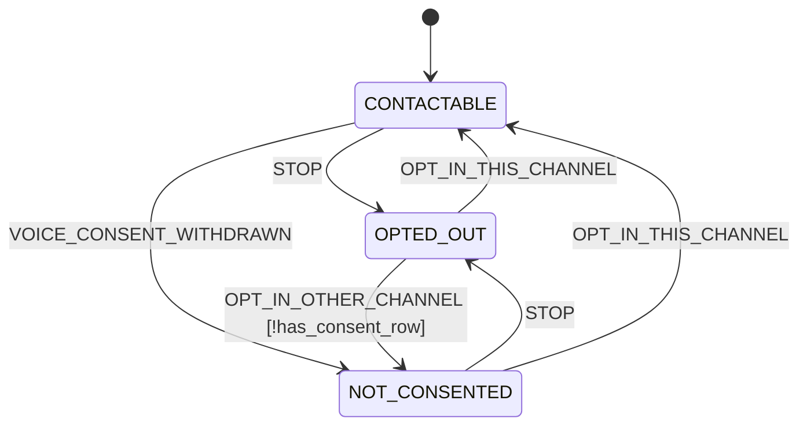

States: `CONTACTABLE`, `NOT_CONSENTED`, `OPTED_OUT`. Initial: `CONTACTABLE`. Final: none (the lifecycle repeats). Fingerprint `fb8178aa84e7`.

Transitions (self-loops are events that are accepted and change nothing):

| From | Event | Guard | To | Action | Rule / policy |
|---|---|---|---|---|---|
| CONTACTABLE | STOP | — | OPTED_OUT | cancel ALL queued sends; K03 consent_changed | K01 holds.STOP_OPT_OUT: STOP on any channel suppresses all channels |
| CONTACTABLE | OPT_IN_THIS_CHANNEL | — | CONTACTABLE | consent version recorded | K01 holds.STOP_OPT_OUT.re_entry (per channel) |
| CONTACTABLE | VOICE_CONSENT_WITHDRAWN | — | NOT_CONSENTED | consented=0 on voice channels | K17 WRONG_PERSON / THIRD_PARTY (k17-k18, voice channels only) |
| NOT_CONSENTED | STOP | — | OPTED_OUT | cancel ALL queued sends; K03 consent_changed | K01 holds.STOP_OPT_OUT: STOP on any channel suppresses all channels |
| NOT_CONSENTED | OPT_IN_THIS_CHANNEL | — | CONTACTABLE | consent version recorded | K01 holds.STOP_OPT_OUT.re_entry (per channel) |
| NOT_CONSENTED | VOICE_CONSENT_WITHDRAWN | — | NOT_CONSENTED | consented=0 on voice channels | K17 WRONG_PERSON / THIRD_PARTY (k17-k18, voice channels only) |
| OPTED_OUT | STOP | — | OPTED_OUT | cancel ALL queued sends; K03 consent_changed | K01 holds.STOP_OPT_OUT: STOP on any channel suppresses all channels |
| OPTED_OUT | OPT_IN_THIS_CHANNEL | — | CONTACTABLE | consent version recorded | K01 holds.STOP_OPT_OUT.re_entry (per channel) |
| OPTED_OUT | VOICE_CONSENT_WITHDRAWN | — | OPTED_OUT | consented=0 on voice channels | K17 WRONG_PERSON / THIRD_PARTY (k17-k18, voice channels only) |
| OPTED_OUT | OPT_IN_OTHER_CHANNEL | has_consent_row | OPTED_OUT | — | K01 holds.STOP_OPT_OUT.re_entry: other channels stay opted out |
| OPTED_OUT | OPT_IN_OTHER_CHANNEL | !has_consent_row | NOT_CONSENTED | — | no consent row for this channel: borrower stop flag lifted, still no consent (WAIT NO_CONSENT) |
| CONTACTABLE | OPT_IN_OTHER_CHANNEL | — | CONTACTABLE | — | other channel only |
| NOT_CONSENTED | OPT_IN_OTHER_CHANNEL | — | NOT_CONSENTED | — | other channel only |

**Enforced by:** `kairos_backend/ledger.py: record_stop / opt_in / facts_for`; `kairos_backend/gate.py: STOP_OPT_OUT, CONSENT`

**Proven by:** tests/fsm/test_conformance_holds.py

### `k09.intent` (v1)

**Purpose.** Classify one inbound borrower message into a closed intent enum. Deterministic rules first; at most ONE LLM call, only for free text the rules cannot decide. The LLM's answer is a *value* (an event for k13.exception / STOP / payment verification), never a transition: what the intent does is decided by the K13 table, the Gate and the ledger.

**LLM role:** classify only (an event value, never a transition).

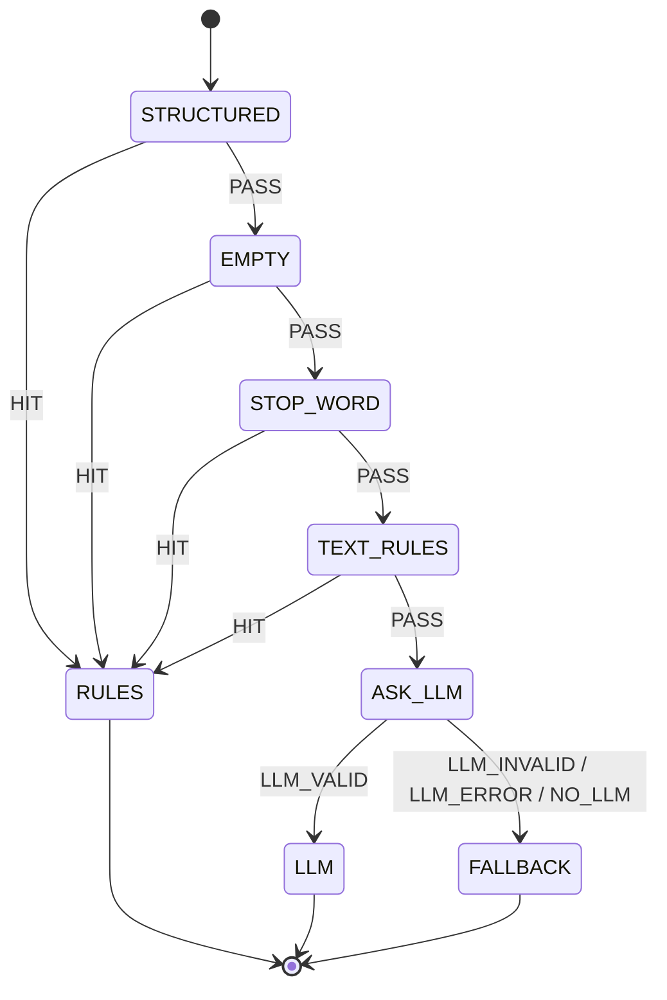

States: `STRUCTURED`, `EMPTY`, `STOP_WORD`, `TEXT_RULES`, `ASK_LLM`, `RULES`, `LLM`, `FALLBACK`. Initial: `STRUCTURED`. Final: `FALLBACK`, `LLM`, `RULES`. Fingerprint `53ed3b1d9ec3`.

Transitions (self-loops are events that are accepted and change nothing):

| From | Event | Guard | To | Action | Rule / policy |
|---|---|---|---|---|---|
| STRUCTURED | HIT | — | RULES | DTMF map / WhatsApp button map | kairos_backend/intent.py IntentClassifier.classify: structured input never reaches the LLM |
| STRUCTURED | PASS | — | EMPTY | — | no DTMF digits, no button payload |
| EMPTY | HIT | — | RULES | OTHER (ambiguous) | empty text |
| EMPTY | PASS | — | STOP_WORD | — | has text |
| STOP_WORD | HIT | — | RULES | STOP | K01 holds.STOP_OPT_OUT keywords on any channel: never the LLM |
| STOP_WORD | PASS | — | TEXT_RULES | — | not an opt-out |
| TEXT_RULES | HIT | — | RULES | one rule intent / bare date -> PTP / dated conflict -> PRECEDENCE | English + Hinglish keyword rules and date extraction |
| TEXT_RULES | PASS | — | ASK_LLM | redact + truncate (500 chars) | no rule matched, or rules conflict without a date |
| ASK_LLM | LLM_VALID | — | LLM | intent from the closed enum; summary <= 160 chars | gpt-6-luna, reasoning effort none, no tools, strict JSON schema, store=false |
| ASK_LLM | LLM_INVALID | — | FALLBACK | OTHER, ambiguous, needs review | schema / refusal / incomplete |
| ASK_LLM | LLM_ERROR | — | FALLBACK | OTHER, ambiguous, needs review | transport error never reaches the caller |
| ASK_LLM | NO_LLM | — | FALLBACK | OTHER, ambiguous, needs review | no LLM configured |

**Enforced by:** `kairos_backend/intent.py: IntentClassifier.classify / LunaClient / validate_llm_output`

**Proven by:** tests/fsm/test_conformance_intent.py (seeded random messages, spy LLM); tests/test_intent.py

### `k17.payment_claim` (v0.2.0-draft)

> Declared from `origin/k17-k18/voice-engine`. Its conformance test runs when that branch's code is present and is skipped otherwise.

**Purpose.** A borrower says they already paid. A claim is never a payment: reminders pause for 48 h while the ledger waits for D7/LMS; only Ledger.record_payment_verified clears an EMI (VERIFIED). Fraud evidence (a CM-03 FRAUD_SUSPECT or a reused bank reference) REJECTS the claim and ends the pause early; otherwise it EXPIRES.

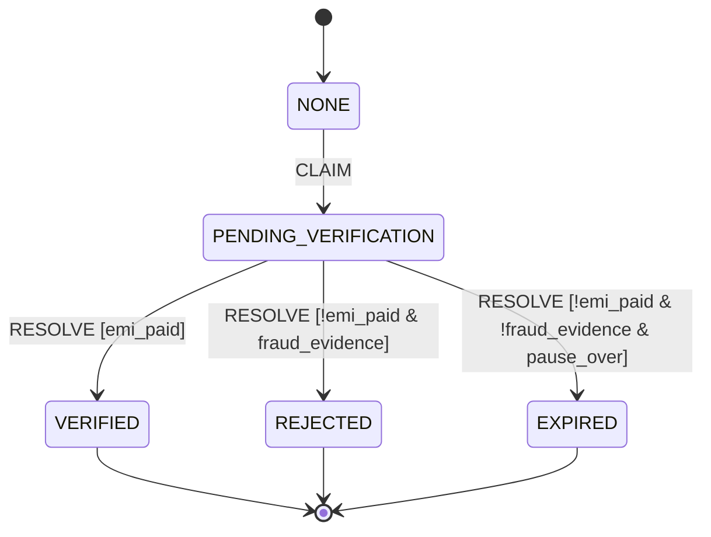

States: `NONE`, `PENDING_VERIFICATION`, `VERIFIED`, `REJECTED`, `EXPIRED`. Initial: `NONE`. Final: `EXPIRED`, `REJECTED`, `VERIFIED`. Fingerprint `4227e7e77b76`.

Transitions (self-loops are events that are accepted and change nothing):

| From | Event | Guard | To | Action | Rule / policy |
|---|---|---|---|---|---|
| NONE | CLAIM | — | PENDING_VERIFICATION | stop_for_day rows for every day the 48 h pause touches; cancel those days' queued touches; NEVER mark paid | K17 thresholds.json payment_claim (ALREADY_PAID >= accept_at) |
| PENDING_VERIFICATION | RESOLVE | emi_paid | VERIFIED | — | the ledger (D7/LMS via Ledger.record_payment_verified) shows the EMI fully paid — the only way to VERIFIED |
| PENDING_VERIFICATION | RESOLVE | !emi_paid & fraud_evidence | REJECTED | lift this claim's remaining PAYMENT_CLAIM_PENDING days (pause ends early); audit VOICE_PAYMENT_CLAIM_REJECTED | FSM-F4: Ledger.fraud_evidence — CM-03 FRAUD_SUSPECT, or a D7 payment refused for a bank reference already used by another account (REFERENCE_REUSED), from pause_hours before the claim to now |
| PENDING_VERIFICATION | RESOLVE | !emi_paid & !fraud_evidence & pause_over | EXPIRED | — | no verification within pause_hours: reminders resume on their own |
| PENDING_VERIFICATION | RESOLVE | !emi_paid & !fraud_evidence & !pause_over | PENDING_VERIFICATION | — | still waiting |
| VERIFIED | RESOLVE | — | VERIFIED | — | final: resolve_payment_claims only reads PENDING_VERIFICATION |
| REJECTED | RESOLVE | — | REJECTED | — | final: resolve_payment_claims only reads PENDING_VERIFICATION |
| EXPIRED | RESOLVE | — | EXPIRED | — | final: resolve_payment_claims only reads PENDING_VERIFICATION |

**Enforced by:** `kairos_backend/voice/ingest.py: VoiceIngester._payment_claim / resolve_payment_claims`; `kairos_backend/ledger.py: Ledger.fraud_evidence / record_payment_verified (PAYMENT_REFUSED)`

**Proven by:** tests/fsm/test_conformance_voice.py (runs when kairos_backend.voice is present)

### `k06.hitl.approval` (v0.1.0)

> Declared from `origin/k06/hitl-control`. Its conformance test runs when that branch's code is present and is skipped otherwise.

**Purpose.** A send that passed every guardrail but matches an approval rule waits for a person. Approval can only make outreach stricter: the Gate runs again at approval and at send time. A reschedule checks the new slot first and only then cancels the original; every final state records a decision (WITHDRAWN when a system event canceled the touch).

```mermaid
stateDiagram-v2
    [*] --> NEW
    WITHDRAWN : touch canceled by a system event; decision='WITHDRAWN' + reason
    NEW --> PENDING : RESERVE [gate_send & approval_required]
    PENDING --> EXPIRED : APPROVE [!maker_is_checker & expired] / EXPIRE_DUE [expired]
    PENDING --> APPROVED : APPROVE [!maker_is_checker & !expired & gate_send]
    PENDING --> BLOCKED_AT_RECHECK : APPROVE [!maker_is_checker & !expired & !gate_send]
    PENDING --> REJECTED : REJECT
    PENDING --> CANCELED : HUMAN_CANCEL
    PENDING --> RESCHEDULED : RESCHEDULE [new_slot_allowed]
    PENDING --> WITHDRAWN : CANCEL_QUEUED
    APPROVED --> [*]
    BLOCKED_AT_RECHECK --> [*]
    REJECTED --> [*]
    EXPIRED --> [*]
    CANCELED --> [*]
    RESCHEDULED --> [*]
    WITHDRAWN --> [*]
```

States: `NEW`, `PENDING`, `APPROVED`, `BLOCKED_AT_RECHECK`, `REJECTED`, `EXPIRED`, `CANCELED`, `RESCHEDULED`, `WITHDRAWN`. Initial: `NEW`. Final: `APPROVED`, `BLOCKED_AT_RECHECK`, `CANCELED`, `EXPIRED`, `REJECTED`, `RESCHEDULED`, `WITHDRAWN`. Fingerprint `a64521be43ec`.

Transitions (self-loops are events that are accepted and change nothing):

| From | Event | Guard | To | Action | Rule / policy |
|---|---|---|---|---|---|
| NEW | RESERVE | gate_send & approval_required | PENDING | touch PENDING_APPROVAL (holds cap slot + budget) | K06 HITL approval_policy.json approval_rules (VOICE_CHANNEL, STANDARD_INTENSITY_HIGH_DPD, FIRST_SEND_AFTER_HARDSHIP, MANUAL_DISPATCH) |
| PENDING | APPROVE | maker_is_checker | PENDING | HUMAN_ACTION_REFUSED audited | K06 HITL approval_policy.json approval.maker_checker |
| PENDING | APPROVE | !maker_is_checker & expired | EXPIRED | touch CANCELED, budget released | K06 HITL approval_policy.json approval.expiry END_OF_CONTACT_WINDOW |
| PENDING | APPROVE | !maker_is_checker & !expired & gate_send | APPROVED | touch RESERVED | Gate re-run atomically at approval; Executor re-checks again at send time |
| PENDING | APPROVE | !maker_is_checker & !expired & !gate_send | BLOCKED_AT_RECHECK | touch CANCELED, budget released | the guardrail wins, the approval cannot |
| PENDING | REJECT | — | REJECTED | touch CANCELED, budget released | HITL.reject |
| PENDING | EXPIRE_DUE | expired | EXPIRED | touch CANCELED, budget released | HITL.expire_due / tick |
| PENDING | EXPIRE_DUE | !expired | PENDING | — | not yet |
| PENDING | HUMAN_CANCEL | — | CANCELED | touch CANCELED, budget released | HITL.cancel_scheduled / cancel_next |
| PENDING | RESCHEDULE | new_slot_allowed | RESCHEDULED | touch CANCELED; a NEW instruction through the full Gate | HITL.reschedule: Ledger.preview(exclude=old) + HITL vetoes pass BEFORE anything is canceled (FSM-F2) |
| PENDING | RESCHEDULE | !new_slot_allowed | PENDING | refusal returned; original untouched (kept) | HITL.reschedule pre-check: CANCELED is final, so a refused move never cancels (FSM-F2) |
| PENDING | CANCEL_QUEUED | — | WITHDRAWN | touch CANCELED; decision='WITHDRAWN', decision_reason=<cancel reason>; APPROVAL_WITHDRAWN audited | STOP / holds / payment / pause cancel PENDING_APPROVAL like RESERVED (Ledger.cancel_hook, FSM-F3) |
| APPROVED | APPROVE | — | APPROVED | — | Conflict NOT_PENDING_<status>: nothing changes |
| APPROVED | REJECT | — | APPROVED | — | Conflict NOT_PENDING_<status>: nothing changes |
| BLOCKED_AT_RECHECK | APPROVE | — | BLOCKED_AT_RECHECK | — | Conflict NOT_PENDING_<status>: nothing changes |
| BLOCKED_AT_RECHECK | REJECT | — | BLOCKED_AT_RECHECK | — | Conflict NOT_PENDING_<status>: nothing changes |
| REJECTED | APPROVE | — | REJECTED | — | Conflict NOT_PENDING_<status>: nothing changes |
| REJECTED | REJECT | — | REJECTED | — | Conflict NOT_PENDING_<status>: nothing changes |
| EXPIRED | APPROVE | — | EXPIRED | — | Conflict NOT_PENDING_<status>: nothing changes |
| EXPIRED | REJECT | — | EXPIRED | — | Conflict NOT_PENDING_<status>: nothing changes |
| CANCELED | APPROVE | — | CANCELED | — | Conflict NOT_PENDING_<status>: nothing changes |
| CANCELED | REJECT | — | CANCELED | — | Conflict NOT_PENDING_<status>: nothing changes |
| WITHDRAWN | APPROVE | — | WITHDRAWN | — | Conflict NOT_PENDING_<status>: nothing changes |
| WITHDRAWN | REJECT | — | WITHDRAWN | — | Conflict NOT_PENDING_<status>: nothing changes |

**Enforced by:** `kairos_backend/hitl.py (k06/hitl-control): HITL._on_reserve / approve / reject / expire_due / cancel_scheduled / reschedule`

**Proven by:** tests/fsm/test_conformance_hitl.py (runs when kairos_backend.hitl is present)

### `k17.voice.disposition` (v0.1.0-draft)

> Declared from `origin/k17-k18/voice-engine`. Its conformance test runs when that branch's code is present and is skipped otherwise.

**Purpose.** The Sarvam bot (an LLM) only *classifies* the call into one of 16 dispositions with a confidence; Kairos — not the bot — decides what it does. Safety first: a low-confidence STOP / hardship / abuse still goes to a person; a low-confidence PTP / paid / callback never creates a hold or a payment.

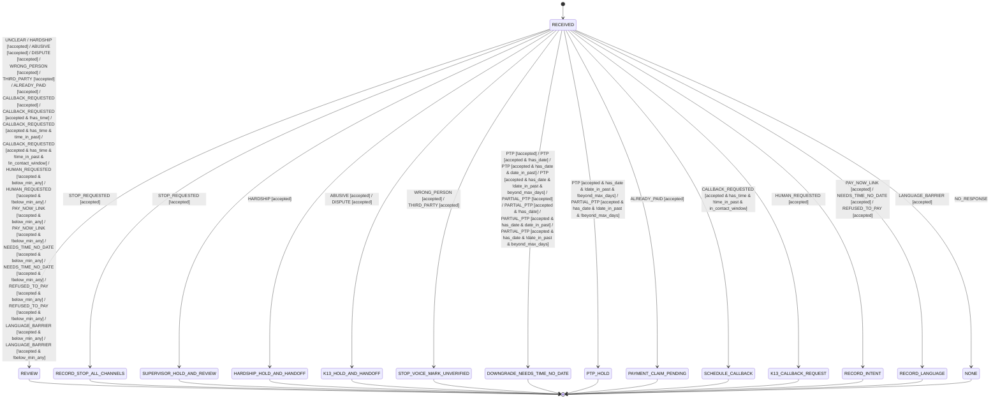

States: `RECEIVED`, `REVIEW`, `RECORD_STOP_ALL_CHANNELS`, `SUPERVISOR_HOLD_AND_REVIEW`, `HARDSHIP_HOLD_AND_HANDOFF`, `K13_HOLD_AND_HANDOFF`, `STOP_VOICE_MARK_UNVERIFIED`, `DOWNGRADE_NEEDS_TIME_NO_DATE`, `PTP_HOLD`, `PAYMENT_CLAIM_PENDING`, `SCHEDULE_CALLBACK`, `K13_CALLBACK_REQUEST`, `RECORD_INTENT`, `RECORD_LANGUAGE`, `NONE`. Initial: `RECEIVED`. Final: `DOWNGRADE_NEEDS_TIME_NO_DATE`, `HARDSHIP_HOLD_AND_HANDOFF`, `K13_CALLBACK_REQUEST`, `K13_HOLD_AND_HANDOFF`, `NONE`, `PAYMENT_CLAIM_PENDING`, `PTP_HOLD`, `RECORD_INTENT`, `RECORD_LANGUAGE`, `RECORD_STOP_ALL_CHANNELS`, `REVIEW`, `SCHEDULE_CALLBACK`, `STOP_VOICE_MARK_UNVERIFIED`, `SUPERVISOR_HOLD_AND_REVIEW`. Fingerprint `f28d6c193e56`.

Transitions (self-loops are events that are accepted and change nothing):

| From | Event | Guard | To | Action | Rule / policy |
|---|---|---|---|---|---|
| RECEIVED | UNCLEAR | — | REVIEW | human review ticket | K17 thresholds.json v0.1.0-draft: unknown disposition |
| RECEIVED | STOP_REQUESTED | accepted | RECORD_STOP_ALL_CHANNELS | — | K17 thresholds.json v0.1.0-draft rules.STOP_REQUESTED accept_at=0.5 |
| RECEIVED | STOP_REQUESTED | !accepted | SUPERVISOR_HOLD_AND_REVIEW | — | K17 thresholds.json v0.1.0-draft rules.STOP_REQUESTED accept_at=0.5 (below) |
| RECEIVED | HARDSHIP | accepted | HARDSHIP_HOLD_AND_HANDOFF | — | K17 thresholds.json v0.1.0-draft rules.HARDSHIP accept_at=0.5 |
| RECEIVED | HARDSHIP | !accepted | REVIEW | — | K17 thresholds.json v0.1.0-draft rules.HARDSHIP accept_at=0.5 (below) |
| RECEIVED | ABUSIVE | accepted | K13_HOLD_AND_HANDOFF | — | K17 thresholds.json v0.1.0-draft rules.ABUSIVE accept_at=0.6 |
| RECEIVED | ABUSIVE | !accepted | REVIEW | — | K17 thresholds.json v0.1.0-draft rules.ABUSIVE accept_at=0.6 (below) |
| RECEIVED | DISPUTE | accepted | K13_HOLD_AND_HANDOFF | — | K17 thresholds.json v0.1.0-draft rules.DISPUTE accept_at=0.6 |
| RECEIVED | DISPUTE | !accepted | REVIEW | — | K17 thresholds.json v0.1.0-draft rules.DISPUTE accept_at=0.6 (below) |
| RECEIVED | WRONG_PERSON | accepted | STOP_VOICE_MARK_UNVERIFIED | — | K17 thresholds.json v0.1.0-draft rules.WRONG_PERSON accept_at=0.8 |
| RECEIVED | WRONG_PERSON | !accepted | REVIEW | — | K17 thresholds.json v0.1.0-draft rules.WRONG_PERSON accept_at=0.8 (below) |
| RECEIVED | THIRD_PARTY | accepted | STOP_VOICE_MARK_UNVERIFIED | — | K17 thresholds.json v0.1.0-draft rules.THIRD_PARTY accept_at=0.8 |
| RECEIVED | THIRD_PARTY | !accepted | REVIEW | — | K17 thresholds.json v0.1.0-draft rules.THIRD_PARTY accept_at=0.8 (below) |
| RECEIVED | PTP | !accepted | DOWNGRADE_NEEDS_TIME_NO_DATE | treated as NEEDS_TIME_NO_DATE | K17 thresholds.json v0.1.0-draft rules.PTP accept_at=0.8 (LOW_CONFIDENCE) |
| RECEIVED | PTP | accepted & !has_date | DOWNGRADE_NEEDS_TIME_NO_DATE | treated as NEEDS_TIME_NO_DATE | K17 thresholds.json v0.1.0-draft rules.PTP accept_at=0.8 (NO_DATE) |
| RECEIVED | PTP | accepted & has_date & date_in_past | DOWNGRADE_NEEDS_TIME_NO_DATE | treated as NEEDS_TIME_NO_DATE | K17 thresholds.json v0.1.0-draft rules.PTP accept_at=0.8 (DATE_IN_PAST) |
| RECEIVED | PTP | accepted & has_date & !date_in_past & beyond_max_days | DOWNGRADE_NEEDS_TIME_NO_DATE | treated as NEEDS_TIME_NO_DATE | K17 thresholds.json v0.1.0-draft ptp.max_ptp_days_by_band / by_use_case (BEYOND_MAX_DAYS) |
| RECEIVED | PTP | accepted & has_date & !date_in_past & !beyond_max_days | PTP_HOLD | K13 PTP_OFFERED -> PTP hold + PTP_FOLLOW_UP | K17 thresholds.json v0.1.0-draft rules.PTP accept_at=0.8 |
| RECEIVED | PARTIAL_PTP | !accepted | DOWNGRADE_NEEDS_TIME_NO_DATE | treated as NEEDS_TIME_NO_DATE | K17 thresholds.json v0.1.0-draft rules.PARTIAL_PTP accept_at=0.8 (LOW_CONFIDENCE) |
| RECEIVED | PARTIAL_PTP | accepted & !has_date | DOWNGRADE_NEEDS_TIME_NO_DATE | treated as NEEDS_TIME_NO_DATE | K17 thresholds.json v0.1.0-draft rules.PARTIAL_PTP accept_at=0.8 (NO_DATE) |
| RECEIVED | PARTIAL_PTP | accepted & has_date & date_in_past | DOWNGRADE_NEEDS_TIME_NO_DATE | treated as NEEDS_TIME_NO_DATE | K17 thresholds.json v0.1.0-draft rules.PARTIAL_PTP accept_at=0.8 (DATE_IN_PAST) |
| RECEIVED | PARTIAL_PTP | accepted & has_date & !date_in_past & beyond_max_days | DOWNGRADE_NEEDS_TIME_NO_DATE | treated as NEEDS_TIME_NO_DATE | K17 thresholds.json v0.1.0-draft ptp.max_ptp_days_by_band / by_use_case (BEYOND_MAX_DAYS) |
| RECEIVED | PARTIAL_PTP | accepted & has_date & !date_in_past & !beyond_max_days | PTP_HOLD | K13 PTP_OFFERED -> PTP hold + PTP_FOLLOW_UP | K17 thresholds.json v0.1.0-draft rules.PARTIAL_PTP accept_at=0.8 |
| RECEIVED | ALREADY_PAID | accepted | PAYMENT_CLAIM_PENDING | — | K17 thresholds.json v0.1.0-draft rules.ALREADY_PAID accept_at=0.6 |
| RECEIVED | ALREADY_PAID | !accepted | REVIEW | — | K17 thresholds.json v0.1.0-draft rules.ALREADY_PAID accept_at=0.6 (below) |
| RECEIVED | CALLBACK_REQUESTED | !accepted | REVIEW | human review ticket | K17 thresholds.json v0.1.0-draft rules.CALLBACK_REQUESTED accept_at=0.7 |
| RECEIVED | CALLBACK_REQUESTED | accepted & !has_time | REVIEW | human review ticket | K17 thresholds.json v0.1.0-draft (CALLBACK_WITHOUT_TIME) |
| RECEIVED | CALLBACK_REQUESTED | accepted & has_time & time_in_past | REVIEW | human review ticket | K17 thresholds.json v0.1.0-draft callback.must_be_in_future |
| RECEIVED | CALLBACK_REQUESTED | accepted & has_time & !time_in_past & !in_contact_window | REVIEW | human review ticket | K17 thresholds.json v0.1.0-draft callback.must_be_inside_contact_window |
| RECEIVED | CALLBACK_REQUESTED | accepted & has_time & !time_in_past & in_contact_window | SCHEDULE_CALLBACK | Supervisor.decide voicebot touch (full Gate) | K17 thresholds.json v0.1.0-draft rules.CALLBACK_REQUESTED accept_at=0.7 |
| RECEIVED | HUMAN_REQUESTED | accepted | K13_CALLBACK_REQUEST | — | K17 thresholds.json v0.1.0-draft rules.HUMAN_REQUESTED accept_at=0.6 |
| RECEIVED | HUMAN_REQUESTED | !accepted & below_min_any | REVIEW | human review ticket (UNCLEAR) | K17 thresholds.json v0.1.0-draft min_confidence_any=0.6 |
| RECEIVED | HUMAN_REQUESTED | !accepted & !below_min_any | REVIEW | — | K17 thresholds.json v0.1.0-draft rules.HUMAN_REQUESTED accept_at=0.6 (below) |
| RECEIVED | PAY_NOW_LINK | accepted | RECORD_INTENT | — | K17 thresholds.json v0.1.0-draft rules.PAY_NOW_LINK accept_at=0.6 |
| RECEIVED | PAY_NOW_LINK | !accepted & below_min_any | REVIEW | human review ticket (UNCLEAR) | K17 thresholds.json v0.1.0-draft min_confidence_any=0.6 |
| RECEIVED | PAY_NOW_LINK | !accepted & !below_min_any | REVIEW | — | K17 thresholds.json v0.1.0-draft rules.PAY_NOW_LINK accept_at=0.6 (below) |
| RECEIVED | NEEDS_TIME_NO_DATE | accepted | RECORD_INTENT | — | K17 thresholds.json v0.1.0-draft rules.NEEDS_TIME_NO_DATE accept_at=0.6 |
| RECEIVED | NEEDS_TIME_NO_DATE | !accepted & below_min_any | REVIEW | human review ticket (UNCLEAR) | K17 thresholds.json v0.1.0-draft min_confidence_any=0.6 |
| RECEIVED | NEEDS_TIME_NO_DATE | !accepted & !below_min_any | REVIEW | — | K17 thresholds.json v0.1.0-draft rules.NEEDS_TIME_NO_DATE accept_at=0.6 (below) |
| RECEIVED | REFUSED_TO_PAY | accepted | RECORD_INTENT | — | K17 thresholds.json v0.1.0-draft rules.REFUSED_TO_PAY accept_at=0.6 |
| RECEIVED | REFUSED_TO_PAY | !accepted & below_min_any | REVIEW | human review ticket (UNCLEAR) | K17 thresholds.json v0.1.0-draft min_confidence_any=0.6 |
| RECEIVED | REFUSED_TO_PAY | !accepted & !below_min_any | REVIEW | — | K17 thresholds.json v0.1.0-draft rules.REFUSED_TO_PAY accept_at=0.6 (below) |
| RECEIVED | LANGUAGE_BARRIER | accepted | RECORD_LANGUAGE | — | K17 thresholds.json v0.1.0-draft rules.LANGUAGE_BARRIER accept_at=0.6 |
| RECEIVED | LANGUAGE_BARRIER | !accepted & below_min_any | REVIEW | human review ticket (UNCLEAR) | K17 thresholds.json v0.1.0-draft min_confidence_any=0.6 |
| RECEIVED | LANGUAGE_BARRIER | !accepted & !below_min_any | REVIEW | — | K17 thresholds.json v0.1.0-draft rules.LANGUAGE_BARRIER accept_at=0.6 (below) |
| RECEIVED | NO_RESPONSE | — | NONE | — | K17 thresholds.json v0.1.0-draft rules.NO_RESPONSE accept_at=0.0 |

**Enforced by:** `kairos_backend/voice/ingest.py (k17-k18/voice-engine): decide() + VoiceIngester._apply`

**Proven by:** tests/fsm/test_conformance_voice.py (runs when kairos_backend.voice is present)

### `k17.voice.call` (v1)

> Declared from `origin/k17-k18/voice-engine`. Its conformance test runs when that branch's code is present and is skipped otherwise.

**Purpose.** One Sarvam call-end webhook, processed exactly once.

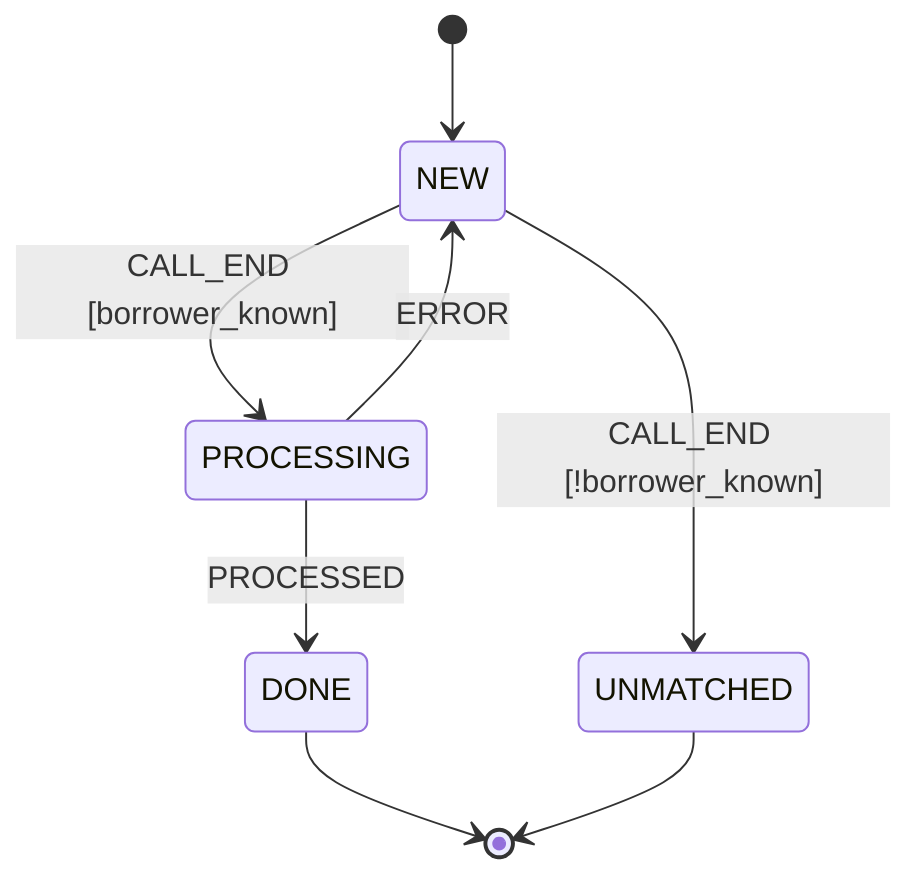

States: `NEW`, `PROCESSING`, `DONE`, `UNMATCHED`. Initial: `NEW`. Final: `DONE`, `UNMATCHED`. Fingerprint `1a58093c90da`.

Transitions (self-loops are events that are accepted and change nothing):

| From | Event | Guard | To | Action | Rule / policy |
|---|---|---|---|---|---|
| NEW | CALL_END | borrower_known | PROCESSING | insert voice_calls row | idempotent by call_id |
| NEW | CALL_END | !borrower_known | UNMATCHED | insert voice_calls row | no borrower for touch_id |
| PROCESSING | PROCESSED | — | DONE | ledger effects + CRM voice.call_disposition | VoiceIngester._process |
| PROCESSING | ERROR | — | NEW | row deleted so the same webhook can be retried | VoiceIngester.ingest |
| PROCESSING | CALL_END | — | PROCESSING | — | duplicate webhook: DUPLICATE, nothing changes |
| DONE | CALL_END | — | DONE | — | duplicate webhook: DUPLICATE, nothing changes |
| UNMATCHED | CALL_END | — | UNMATCHED | — | duplicate webhook: DUPLICATE, nothing changes |

**Enforced by:** `kairos_backend/voice/ingest.py (k17-k18/voice-engine): VoiceIngester.ingest`

**Proven by:** tests/fsm/test_conformance_voice.py (runs when kairos_backend.voice is present)

### `cm03.conversation` (v1)

> Declared from `origin/cm03/whatsapp-servicing`. Its conformance test runs when that branch's code is present and is skipped otherwise.

**Purpose.** One inbound WhatsApp servicing conversation. Nothing about the account is looked up for a reply before OTP verification; a request made before it is parked and served right after. Rules (and the k09 classifier, LLM only for ambiguous free text) name the event; the engine's code picks the transition and the tool calls. Idle for 30 minutes, or CLOSED, means the next message opens a new conversation.

**LLM role:** classify only (an event value, never a transition).

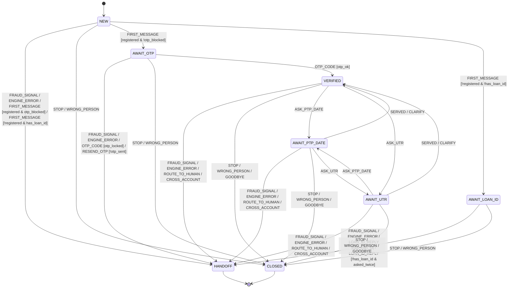

States: `NEW`, `AWAIT_LOAN_ID`, `AWAIT_OTP`, `VERIFIED`, `AWAIT_PTP_DATE`, `AWAIT_UTR`, `HANDOFF`, `CLOSED`. Initial: `NEW`. Final: `CLOSED`, `HANDOFF`. Fingerprint `adc6011b10d5`.

Transitions (self-loops are events that are accepted and change nothing):

| From | Event | Guard | To | Action | Rule / policy |
|---|---|---|---|---|---|
| NEW | FRAUD_SIGNAL | — | HANDOFF | refuse; FRAUD_SUSPECT ticket; nothing disclosed | cm03/engine.py ConversationEngine._step: fraud detectors run before anything else (injection, phishing, spoofing, OTP scam) |
| NEW | STOP | — | CLOSED | Ledger.record_stop (all channels) when it is the registered number | K01 holds.STOP_OPT_OUT: no OTP needed to opt out |
| NEW | WRONG_PERSON | — | CLOSED | WRONG_NUMBER_CLOSED; contact-data review | cm03/engine.py ConversationEngine: no disclosure |
| NEW | ENGINE_ERROR | — | HANDOFF | holding reply; a human picks it up | cm03/engine.py ConversationEngine.handle |
| AWAIT_LOAN_ID | FRAUD_SIGNAL | — | HANDOFF | refuse; FRAUD_SUSPECT ticket; nothing disclosed | cm03/engine.py ConversationEngine._step: fraud detectors run before anything else (injection, phishing, spoofing, OTP scam) |
| AWAIT_LOAN_ID | STOP | — | CLOSED | Ledger.record_stop (all channels) when it is the registered number | K01 holds.STOP_OPT_OUT: no OTP needed to opt out |
| AWAIT_LOAN_ID | WRONG_PERSON | — | CLOSED | WRONG_NUMBER_CLOSED; contact-data review | cm03/engine.py ConversationEngine: no disclosure |
| AWAIT_LOAN_ID | ENGINE_ERROR | — | HANDOFF | holding reply; a human picks it up | cm03/engine.py ConversationEngine.handle |
| AWAIT_OTP | FRAUD_SIGNAL | — | HANDOFF | refuse; FRAUD_SUSPECT ticket; nothing disclosed | cm03/engine.py ConversationEngine._step: fraud detectors run before anything else (injection, phishing, spoofing, OTP scam) |
| AWAIT_OTP | STOP | — | CLOSED | Ledger.record_stop (all channels) when it is the registered number | K01 holds.STOP_OPT_OUT: no OTP needed to opt out |
| AWAIT_OTP | WRONG_PERSON | — | CLOSED | WRONG_NUMBER_CLOSED; contact-data review | cm03/engine.py ConversationEngine: no disclosure |
| AWAIT_OTP | ENGINE_ERROR | — | HANDOFF | holding reply; a human picks it up | cm03/engine.py ConversationEngine.handle |
| VERIFIED | FRAUD_SIGNAL | — | HANDOFF | refuse; FRAUD_SUSPECT ticket; nothing disclosed | cm03/engine.py ConversationEngine._step: fraud detectors run before anything else (injection, phishing, spoofing, OTP scam) |
| VERIFIED | STOP | — | CLOSED | Ledger.record_stop (all channels) when it is the registered number | K01 holds.STOP_OPT_OUT: no OTP needed to opt out |
| VERIFIED | WRONG_PERSON | — | CLOSED | WRONG_NUMBER_CLOSED; contact-data review | cm03/engine.py ConversationEngine: no disclosure |
| VERIFIED | ENGINE_ERROR | — | HANDOFF | holding reply; a human picks it up | cm03/engine.py ConversationEngine.handle |
| AWAIT_PTP_DATE | FRAUD_SIGNAL | — | HANDOFF | refuse; FRAUD_SUSPECT ticket; nothing disclosed | cm03/engine.py ConversationEngine._step: fraud detectors run before anything else (injection, phishing, spoofing, OTP scam) |
| AWAIT_PTP_DATE | STOP | — | CLOSED | Ledger.record_stop (all channels) when it is the registered number | K01 holds.STOP_OPT_OUT: no OTP needed to opt out |
| AWAIT_PTP_DATE | WRONG_PERSON | — | CLOSED | WRONG_NUMBER_CLOSED; contact-data review | cm03/engine.py ConversationEngine: no disclosure |
| AWAIT_PTP_DATE | ENGINE_ERROR | — | HANDOFF | holding reply; a human picks it up | cm03/engine.py ConversationEngine.handle |
| AWAIT_UTR | FRAUD_SIGNAL | — | HANDOFF | refuse; FRAUD_SUSPECT ticket; nothing disclosed | cm03/engine.py ConversationEngine._step: fraud detectors run before anything else (injection, phishing, spoofing, OTP scam) |
| AWAIT_UTR | STOP | — | CLOSED | Ledger.record_stop (all channels) when it is the registered number | K01 holds.STOP_OPT_OUT: no OTP needed to opt out |
| AWAIT_UTR | WRONG_PERSON | — | CLOSED | WRONG_NUMBER_CLOSED; contact-data review | cm03/engine.py ConversationEngine: no disclosure |
| AWAIT_UTR | ENGINE_ERROR | — | HANDOFF | holding reply; a human picks it up | cm03/engine.py ConversationEngine.handle |
| NEW | FIRST_MESSAGE | registered & !otp_blocked | AWAIT_OTP | send OTP; park the request | CM-03: zero disclosure before verification (OTP) |
| NEW | FIRST_MESSAGE | registered & otp_blocked | HANDOFF | OTP_LOCKED / OTP_SEND_LIMIT | otp.py lockout / send limit |
| NEW | FIRST_MESSAGE | !registered & !has_loan_id | AWAIT_LOAN_ID | ask for the loan id | unregistered sender |
| NEW | FIRST_MESSAGE | !registered & has_loan_id | HANDOFF | UNREGISTERED_NUMBER (same answer either way) | no account enumeration before verification |
| AWAIT_LOAN_ID | LOAN_ID_REPLY | has_loan_id | HANDOFF | UNREGISTERED_NUMBER, or fraud on impersonation | no account enumeration before verification |
| AWAIT_LOAN_ID | LOAN_ID_REPLY | !has_loan_id & !asked_twice | AWAIT_LOAN_ID | ask again | cm03/engine.py ConversationEngine._pre_verify |
| AWAIT_LOAN_ID | LOAN_ID_REPLY | !has_loan_id & asked_twice | HANDOFF | UNIDENTIFIED | cm03/engine.py ConversationEngine._pre_verify |
| AWAIT_OTP | OTP_CODE | otp_ok | VERIFIED | bind sender + conversation + account; serve the parked request | OTP verified (the parked request is then served as a VERIFIED event in the same message) |
| AWAIT_OTP | OTP_CODE | otp_wrong | AWAIT_OTP | attempts left | otp.py |
| AWAIT_OTP | OTP_CODE | otp_expired | AWAIT_OTP | ask to resend | otp.py |
| AWAIT_OTP | OTP_CODE | otp_locked | HANDOFF | OTP_LOCKED | 3 wrong codes |
| AWAIT_OTP | RESEND_OTP | otp_sent | AWAIT_OTP | — | otp.py send limit |
| AWAIT_OTP | RESEND_OTP | !otp_sent | HANDOFF | OTP_LOCKED / OTP_SEND_LIMIT | otp.py send limit |
| AWAIT_OTP | OTHER_BEFORE_OTP | — | AWAIT_OTP | park it; PRE_VERIFY_SAFE copy only | cm03/engine.py ConversationEngine._reply disclosure guard |
| VERIFIED | SERVED | — | VERIFIED | balance / pay link / statement / NOC / loan details / claim / PTP recorded | audited tool calls; collection intents through K13 (exceptions.handle) |
| VERIFIED | ASK_PTP_DATE | — | AWAIT_PTP_DATE | needs time, or a date outside the window | K13 needs_time / promise_to_pay.auto_accept_max_days |
| VERIFIED | ASK_UTR | — | AWAIT_UTR | claim without a bank reference | a claim is never a payment |
| VERIFIED | ROUTE_TO_HUMAN | — | HANDOFF | ticket: callback / hardship / dispute / waiver / complaint / PTP beyond window / payment reversed / unknown twice | K13 routed_exceptions, callback, hardship |
| VERIFIED | CROSS_ACCOUNT | — | HANDOFF | FRAUD_SUSPECT | verified borrower asked about another borrower's loan |
| VERIFIED | GOODBYE | — | CLOSED | — | thanks |
| VERIFIED | CLARIFY | — | VERIFIED | clarify / menu / language | cm03/engine.py ConversationEngine._serve |
| AWAIT_PTP_DATE | SERVED | — | VERIFIED | balance / pay link / statement / NOC / loan details / claim / PTP recorded | audited tool calls; collection intents through K13 (exceptions.handle) |
| AWAIT_PTP_DATE | ASK_PTP_DATE | — | AWAIT_PTP_DATE | needs time, or a date outside the window | K13 needs_time / promise_to_pay.auto_accept_max_days |
| AWAIT_PTP_DATE | ASK_UTR | — | AWAIT_UTR | claim without a bank reference | a claim is never a payment |
| AWAIT_PTP_DATE | ROUTE_TO_HUMAN | — | HANDOFF | ticket: callback / hardship / dispute / waiver / complaint / PTP beyond window / payment reversed / unknown twice | K13 routed_exceptions, callback, hardship |
| AWAIT_PTP_DATE | CROSS_ACCOUNT | — | HANDOFF | FRAUD_SUSPECT | verified borrower asked about another borrower's loan |
| AWAIT_PTP_DATE | GOODBYE | — | CLOSED | — | thanks |
| AWAIT_PTP_DATE | CLARIFY | — | VERIFIED | clarify / menu / language | cm03/engine.py ConversationEngine._serve |
| AWAIT_UTR | SERVED | — | VERIFIED | balance / pay link / statement / NOC / loan details / claim / PTP recorded | audited tool calls; collection intents through K13 (exceptions.handle) |
| AWAIT_UTR | ASK_PTP_DATE | — | AWAIT_PTP_DATE | needs time, or a date outside the window | K13 needs_time / promise_to_pay.auto_accept_max_days |
| AWAIT_UTR | ASK_UTR | — | AWAIT_UTR | claim without a bank reference | a claim is never a payment |
| AWAIT_UTR | ROUTE_TO_HUMAN | — | HANDOFF | ticket: callback / hardship / dispute / waiver / complaint / PTP beyond window / payment reversed / unknown twice | K13 routed_exceptions, callback, hardship |
| AWAIT_UTR | CROSS_ACCOUNT | — | HANDOFF | FRAUD_SUSPECT | verified borrower asked about another borrower's loan |
| AWAIT_UTR | GOODBYE | — | CLOSED | — | thanks |
| AWAIT_UTR | CLARIFY | — | VERIFIED | clarify / menu / language | cm03/engine.py ConversationEngine._serve |
| HANDOFF | ANY_MESSAGE | — | HANDOFF | holding reply | a human owns the conversation |
| HANDOFF | STOP | — | HANDOFF | Ledger.record_stop; stays with the human | cm03/engine.py ConversationEngine._step |

**Enforced by:** `kairos_backend/cm03/engine.py (cm03/whatsapp-servicing): ConversationEngine._step / _pre_verify / _serve / _reply`

**Proven by:** tests/fsm/test_conformance_cm03.py (runs when kairos_backend.cm03 is present: the seeded CM-03 eval, every message's state change must be declared)

### `k09.learner.arm` (v1)

**Purpose.** Where one arm's (band x channel x slot) estimate comes from. Only FINAL REPLY / NO_REPLY outcomes move it, once per instruction_id. PRODUCTION ranks by the posterior mean (no randomness); seeded Thompson draws only in SANDBOX / SIMULATOR. On k09/optimize (not merged here) evidence decays with age, so a SEGMENT arm can fall back to POOLED when its weighted count drops below min_segment_obs: that DECAY transition is not declared until that branch lands.

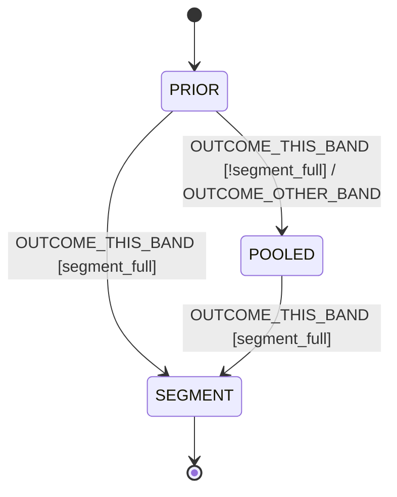

States: `PRIOR`, `POOLED`, `SEGMENT`. Initial: `PRIOR`. Final: `SEGMENT`. Fingerprint `f6d353e611d8`.

Transitions (self-loops are events that are accepted and change nothing):

| From | Event | Guard | To | Action | Rule / policy |
|---|---|---|---|---|---|
| PRIOR | OUTCOME_THIS_BAND | segment_full | SEGMENT | alpha/beta += reward | min_segment_obs reached |
| PRIOR | OUTCOME_THIS_BAND | !segment_full | POOLED | alpha/beta += reward | sparse segment: pooled channel x slot posterior |
| PRIOR | OUTCOME_OTHER_BAND | — | POOLED | — | pooled evidence for this channel x slot |
| POOLED | OUTCOME_THIS_BAND | segment_full | SEGMENT | alpha/beta += reward | min_segment_obs reached |
| POOLED | OUTCOME_THIS_BAND | !segment_full | POOLED | alpha/beta += reward | still sparse |
| POOLED | OUTCOME_OTHER_BAND | — | POOLED | — | pooled evidence grows |
| SEGMENT | OUTCOME_THIS_BAND | — | SEGMENT | alpha/beta += reward | segment posterior |
| SEGMENT | OUTCOME_OTHER_BAND | — | SEGMENT | — | segment posterior unaffected |
| PRIOR | DUPLICATE_OUTCOME | — | PRIOR | — | one update per instruction_id; PENDING / UNRESOLVED never reach the learner |
| PRIOR | NOT_LEARNABLE | — | PRIOR | — | one update per instruction_id; PENDING / UNRESOLVED never reach the learner |
| POOLED | DUPLICATE_OUTCOME | — | POOLED | — | one update per instruction_id; PENDING / UNRESOLVED never reach the learner |
| POOLED | NOT_LEARNABLE | — | POOLED | — | one update per instruction_id; PENDING / UNRESOLVED never reach the learner |
| SEGMENT | DUPLICATE_OUTCOME | — | SEGMENT | — | one update per instruction_id; PENDING / UNRESOLVED never reach the learner |
| SEGMENT | NOT_LEARNABLE | — | SEGMENT | — | one update per instruction_id; PENDING / UNRESOLVED never reach the learner |

**Enforced by:** `kairos_backend/learner.py: BetaBernoulliLearner.apply_outcome / _posteriors / rank`

**Proven by:** tests/fsm/test_conformance_learner.py; tests/test_learner.py

## Voice bots (Sarvam)

> These are the bots' *in-call script states*, configured on the Sarvam platform. The LLM moves between
> them with a tool call, limited to each state's `next_states`. That is phrasing scope: nothing here
> changes Kairos state. Kairos acts only on the post-call disposition (`k17.voice.disposition`,
> `k17.voice.call` above), and Kairos, not the bot, decides what the disposition does.


All six Kairos voice agents in the CreditNirvana Sarvam workspace run as multi-state agents. Each conversation phase is a named state with explicit transitions, following the pattern of the CreditNirvana production collections bots (CS Post-Due, TrueHome, AU, UGRO).

| Agent | Sarvam id | Voice | Committed version |
|---|---|---|---|
| Pre-Due Reminder | `Kairos---Pr-0282af37-ef9d` | Ritu | v3 |
| EMI Reminder 1-30 DPD | `Kairos---EM-15f2766f-4eba` | Ritu | v3 |
| Callback | `Kairos---Ca-f080ffa8-2d1d` | Advait | v2 |
| Mid-Bucket 31-90 DPD | `Kairos---Mi-edcd3099-61a2` | Advait | v2 |
| PTP Follow-up | `Kairos---PT-07a93e21-1a9b` | Ritu | v2 |
| Hardship Triage | `Kairos---Ha-1f02cd05-dfa0` | Advait | v2 |

### How it works

- **Global prompt** (`prompt_scope='global'`): Persona, Speaking style, Facts, State flow, Side routes, Guardrails (priority order, payment route, consequences, persuasion budget, self-harm, deceased borrower, abuse, confidentiality, closing rule).
- **State prompts** (`prompt_scope='state:<name>'`): each has Purpose, Steps, Rules (where needed) and Transitions. A transition is written `transition to state:<name>` followed by a space or a line break. The platform parser treats trailing punctuation as part of the state name. Each state's `next_states` lists exactly the states it may move to.
- **Runtime behaviour:** a transition is a `transition_to_next_state` tool call. The same turn continues in the new state, and only the new state's reply reaches the caller. Any acknowledgement meant for that turn therefore belongs in the new state's prompt.
- **Call end:** every terminal path ends with `call end_interaction`. Its `end_message` is the only text spoken in that final turn, so the closing line carries the acknowledgement, the next step and the goodbye together.
- **Single-prompt mode:** EMI Reminder and Callback were in single-prompt mode (`is_single_prompt_mode: true`), and the other four were not. While it is on, `prompt_scope='global'` writes land in the initial state. It was turned off on both agents as part of the conversion.
- **Unchanged:** input and post-call variables, `evaluation_config` call goal, voicemail detection and message, silence nudges, voice, languages and intro. Kairos code keeps its variable names.

#### Side routes (collections bots)

These routes are reachable from every main-flow state. Each side state ends the call itself.

| Trigger | Target |
|---|---|
| Not the borrower, wrong number, relative answering | `wrong_person` |
| Busy, driving, call later | `busy_callback` |
| Illness, hospitalisation, job or business loss, death in family, disaster | `hardship` |
| Dispute or fraud claim, wants person, branch or senior, settlement, waiver or foreclosure | `dispute_or_human` |
| Stop calling | `stop_request` |
| Says already paid | `already_paid` |

Inside the side states:

- `busy_callback`, `dispute_or_human` and `already_paid` can still move to `stop_request`.
- Mid-Bucket's `already_paid` can also return to `negotiation` after a contradiction check.
- Self-harm, deceased borrower, abuse and prompt-extraction attempts are handled by global guardrails in any state. Each ends with `end_interaction`.

#### Shared side-state behaviour

| State | Behaviour |
|---|---|
| `wrong_person` | **Wrong number or stranger:** one apology and end. **Relative:** says the call is from the lender for the borrower, asks for a better time between 9 AM and 7 PM, re-asks once if details are requested, then thanks and ends. Never discloses the loan, dues or dates. Never asks the person's relationship. |
| `busy_callback` | Asks for a time between 9 AM and 7 PM, proposes the nearest in-window time once, then confirms in the closing line and ends. |
| `hardship` | One turn: an empathetic clause, the senior team member who will reach out, and a goodbye, all in the end message. No payment, date or consequence. |
| `dispute_or_human` | **Dispute:** acknowledge, no waiver, the team will contact the user, end. **Person, branch or senior:** ask for a time between 9 AM and 7 PM, confirm, end. **Settlement, waiver or foreclosure:** an authorised team member will call back, end. |
| `stop_request` | One turn: the closing line says the stop request is noted, with no persuasion and no promise that calls stop. |
| `already_paid` | Asks once for whichever of date and mode is missing. Neither confirms nor denies. It will be checked, then end. |

#### Shared `commitment_readback`

1. **Exact date.** Relative words are resolved against `call_date`: kal is the next day, parso the day after, a weekday name the next such day.
2. **Limit check against `max_ptp_date`.** The limit is never spoken or hinted at, and no earlier date is suggested. When the date is beyond the limit, one consequence line and one ask for an earlier date follow. This ask happens at most once per call. If the user keeps the late date, it is accepted, a team member may follow up, and it is read back as a confirmed date.
3. **Read back** the date as day and month, then wait for confirmation. Confirmed goes to `closing`. A changed date re-runs steps 2 and 3. A withdrawn commitment goes to `closing`.

Earlier states never question a late date. Every exact date goes straight to `commitment_readback`.

---

### 1. Pre-Due Reminder (Ritu)

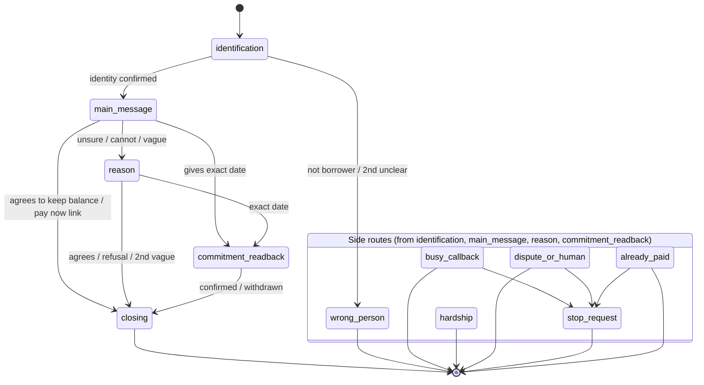

| State | Does | Transitions |
|---|---|---|
| `identification` | Confirms identity (haan, boliye, bolo, yes, tell me, speaking). Discloses nothing. Re-asks once. | **Confirmed:** `main_message`. **Not borrower or 2nd unclear:** `wrong_person`. **Busy:** `busy_callback`. **Stop:** `stop_request`. **Other side routes:** as listed above. |
| `main_message` | Quick reminder that the E M I is due on `emi_due_date`. Asks whether the amount can be kept a day before. | **Yes:** `closing`. **Pay now or link:** `closing`. **Any exact date:** `commitment_readback`. **Unsure, cannot or vague:** `reason`. **Side routes.** |
| `reason` | Asks once what makes it difficult. Gives one bounce-charge and credit-score line. Asks for a date. | **Exact date:** `commitment_readback`. **2nd vague, refusal or agrees:** `closing`. **Side routes.** |
| `commitment_readback` | Shared readback (above). | **Confirmed or withdrawn:** `closing`. **Side routes.** |
| `closing` | One line matched to the outcome, then `end_interaction`. | None |

### 2. EMI Reminder 1-30 DPD (Ritu)

```mermaid
stateDiagram-v2
    [*] --> identification
    identification --> permission: identity confirmed
    identification --> wrong_person: not borrower / 2nd unclear
    permission --> main_message: ok to talk / asks what it is about
    permission --> busy_callback: not now
    main_message --> closing: will pay today
    main_message --> commitment_readback: exact date
    main_message --> negotiation: needs time / auto-debit bounced / refuses / vague
    negotiation --> commitment_readback: exact date
    negotiation --> closing: pays today / 2nd refusal / budget used
    commitment_readback --> closing: confirmed / withdrawn
    closing --> [*]

    state "Side routes (from every main-flow state)" as side {
        wrong_person
        busy_callback
        hardship
        dispute_or_human
        stop_request
        already_paid
    }
    busy_callback --> stop_request
    dispute_or_human --> stop_request
    already_paid --> stop_request
```

| State | Does | Transitions |
|---|---|---|
| `identification` | As in Pre-Due. | **Confirmed:** `permission`. **Side routes.** |
| `permission` | Asks whether this is a good time for two minutes. | **Yes or asks what it is about:** `main_message`. **No or busy:** `busy_callback`. **Side routes.** |
| `main_message` | Says the E M I due on `emi_due_date` has not been received and that this sometimes happens by oversight. Asks to pay today by link. Acts at once on a date or reason given with the permission answer. | **Today:** `closing`. **Any exact date:** `commitment_readback`. **Needs time, auto-debit or technical, refuses or vague:** `negotiation`. **Side routes.** |
| `negotiation` | **Needs time:** reason, then exact date. **Auto-debit:** link clears this E M I and auto-debit continues, then when? **Refuses:** one consequence line and one ask. **Vague:** one exact-date ask. | **Exact date:** `commitment_readback`. **Today:** `closing`. **2nd refusal, 2nd vague or budget used:** `closing`. **Side routes.** |
| `commitment_readback` | Shared readback. | **Confirmed or withdrawn:** `closing`. |
| `closing` | **Today:** link after the call. **Date:** reminders for this E M I pause until then. **No date:** the team follows up. Then `end_interaction`. | None |

### 3. Callback (Advait)

```mermaid
stateDiagram-v2
    [*] --> identification
    identification --> permission: identity confirmed
    identification --> wrong_person: not borrower / 2nd unclear
    permission --> main_message: ok to talk
    permission --> busy_callback: not now
    main_message --> closing: will pay today
    main_message --> commitment_readback: exact date (near or far)
    main_message --> negotiation: reason / needs time / refuses / vague
    negotiation --> commitment_readback: exact date
    negotiation --> closing: pays today / no date after one ask / 2nd refusal
    commitment_readback --> closing: confirmed / withdrawn
    closing --> [*]

    state "Side routes (from every main-flow state)" as side {
        wrong_person
        busy_callback
        hardship
        dispute_or_human
        stop_request
        already_paid
    }
    busy_callback --> stop_request
    dispute_or_human --> stop_request
    already_paid --> stop_request
```

| State | Does | Transitions |
|---|---|---|
| `identification` | As in Pre-Due. | **Confirmed:** `permission`. **Side routes.** |
| `permission` | Says this is the call back the user asked for (`callback_reason` is in context). Asks whether now is good for two minutes. | **Yes:** `main_message`. **No:** `busy_callback`. **Side routes.** |
| `main_message` | Asks one open question about how the user wants to handle the E M I due on `emi_due_date`. Skips the question when a date, reason or refusal was already given. | **Today:** `closing`. **Any exact date:** `commitment_readback`. **Reason, needs time, refuses or vague:** `negotiation`. **Side routes.** |
| `negotiation` | Acknowledges in one clause and asks once for an exact date. **Refusal:** one consequence line and one ask. | **Exact date:** `commitment_readback`. **Today:** `closing`. **Still no date:** `closing`, with the team following up to agree a date. **Side routes.** |
| `commitment_readback` | Shared readback. | **Confirmed or withdrawn:** `closing`. |
| `closing` | **Date:** reminders pause and the payment is checked on that day. **No date:** the team follows up. Then `end_interaction`. | None |

Callback's `dispute_or_human` also covers a request for a team member after the automated-assistant disclosure.

### 4. Mid-Bucket 31-90 DPD (Advait)

This agent keeps partial-payment and contradiction handling.

```mermaid
stateDiagram-v2
    [*] --> identification
    identification --> permission: identity confirmed
    identification --> wrong_person: not borrower / 2nd unclear
    permission --> main_message: ok / asks what it is about
    permission --> busy_callback: not now
    main_message --> reason: gives a reason
    main_message --> commitment_readback: exact date
    main_message --> negotiation: part payment / refuses / vague
    main_message --> closing: pays today
    reason --> closing: pays today
    reason --> commitment_readback: exact date
    reason --> negotiation: no date / part payment / refusal / contradiction
    negotiation --> commitment_readback: full date, or part amount+date and rest date
    negotiation --> closing: pays today / 2nd refusal / budget used
    negotiation --> already_paid: contradiction resolved as paid
    commitment_readback --> negotiation: switches to part payment
    commitment_readback --> closing: confirmed / withdrawn
    already_paid --> negotiation: contradiction resolved as not paid
    closing --> [*]

    state "Side routes (from every main-flow state)" as side {
        wrong_person
        busy_callback
        hardship
        dispute_or_human
        stop_request
        already_paid
    }
    busy_callback --> stop_request
    dispute_or_human --> stop_request
    already_paid --> stop_request
```

| State | Does | Transitions |
|---|---|---|
| `identification` | As in Pre-Due. | **Confirmed:** `permission`. **Side routes.** |
| `permission` | Asks for one minute to discuss the E M I. | **Yes or asks:** `main_message`. **No:** `busy_callback`. **Side routes.** |
| `main_message` | Says the E M I due on `emi_due_date` is `overdue_days` days overdue. Asks what is holding the payment back. Firm tone: no apology, no extra thanks. | **Reason:** `reason`. **Today:** `closing`. **Any exact date:** `commitment_readback`. **Part, refuses or vague:** `negotiation`. **Side routes.** |
| `reason` | Acknowledges in one clause, with no sympathy for routine reasons. **No funds:** skips the today question and asks for an exact date. Otherwise asks about today. | **Today:** `closing`. **Exact date:** `commitment_readback`. **No date, part, refusal or contradiction:** `negotiation`. **Side routes.** |
| `negotiation` | **Part payment:** amount and date, then the date for the rest. **No date:** one ask, then a consequence line and a final shorter ask. **Refusal:** consequence line and one ask. **Contradiction:** points out the difference once and asks which is correct. | **Exact date or part plan:** `commitment_readback`. **Today:** `closing`. **2nd refusal or budget used (3 asks):** `closing`. **Paid after all:** `already_paid`. **Side routes.** |
| `commitment_readback` | Shared readback. The consequence line comes before the earlier-date ask. **Part payment:** reads back the part amount and date plus the date for the rest in one sentence. | **Confirmed or withdrawn:** `closing`. **Switch to part payment:** `negotiation`. |
| `already_paid` | Step 0 is a contradiction check when the user earlier said no funds or gave a date. | **Not paid:** `negotiation`. **Paid:** date and mode, then end. **Stop:** `stop_request`. |
| `closing` | **Today:** link. **Date or part plan:** thanks and link. **No date:** the team follows up. Then `end_interaction`. | None |

### 5. PTP Follow-up (Ritu)

This agent keeps the second-date framing.

```mermaid
stateDiagram-v2
    [*] --> identification
    identification --> main_message: identity confirmed
    identification --> wrong_person: not borrower / 2nd unclear
    main_message --> already_paid: says paid
    main_message --> reason: not yet
    main_message --> commitment_readback: gives new exact date
    main_message --> negotiation: refuses / vague
    main_message --> closing: pays today
    reason --> closing: pays today
    reason --> commitment_readback: new exact date
    reason --> negotiation: not today, no date / refusal / vague
    negotiation --> commitment_readback: new exact date
    negotiation --> closing: pays today / no date after final ask / refusal
    commitment_readback --> closing: confirmed / withdrawn
    closing --> [*]

    state "Side routes (from every main-flow state)" as side {
        wrong_person
        busy_callback
        hardship
        dispute_or_human
        stop_request
        already_paid
    }
    busy_callback --> stop_request
    dispute_or_human --> stop_request
    already_paid --> stop_request
```

| State | Does | Transitions |
|---|---|---|
| `identification` | As in Pre-Due. The earlier promise is never disclosed before identity is confirmed. | **Confirmed:** `main_message`. **Side routes.** |
| `main_message` | Mentions the plan to pay by `promise_date` and asks whether the payment was made. Asks, never accuses. | **Paid:** `already_paid`. **Not yet:** `reason`. **Today:** `closing`. **New date:** `commitment_readback`. **Refuses or vague:** `negotiation`. **Side routes.** |
| `reason` | Asks once what got in the way, acknowledges, asks about paying today by link. | **Today:** `closing`. **Date:** `commitment_readback`. **Not today:** `negotiation`. **Side routes.** |
| `negotiation` | Asks for a new exact date, noting gently that this is the second date so it should be one the user is sure of. **No date:** one consequence line and one final ask. | **Date:** `commitment_readback`. **Today:** `closing`. **None:** `closing`. **Side routes.** |
| `commitment_readback` | Shared readback against the shorter post-miss `max_ptp_date`. The earlier-date ask mentions that this is already the second date. | **Confirmed or withdrawn:** `closing`. |
| `closing` | **Today:** link. **New date:** thanks and link. **None:** the team follows up. Then `end_interaction`. | None |

### 6. Hardship Triage (Advait)

This agent has its own flow and never asks for payment, a commitment date, or mentions consequences.

```mermaid
stateDiagram-v2
    [*] --> identification
    identification --> purpose_permission: identity confirmed
    identification --> wrong_person: not borrower / 2nd unclear
    purpose_permission --> how_things_are: ok to talk / already describing
    purpose_permission --> busy_callback: not now / too upset
    how_things_are --> senior_callback: describes situation
    how_things_are --> closing: too upset to continue
    senior_callback --> looking_ahead: time agreed or declined, user calm
    senior_callback --> closing: time agreed or declined, user upset or short
    looking_ahead --> closing: any answer
    closing --> [*]

    state "Side routes (from every main-flow state)" as side {
        wrong_person
        busy_callback
        dispute_or_human
        stop_request
        already_paid
        volunteered_payment
    }
    busy_callback --> stop_request
    dispute_or_human --> stop_request
    already_paid --> stop_request
    volunteered_payment --> stop_request
```

| State | Does | Transitions |
|---|---|---|
| `identification` | As in the other agents. Nothing about the situation is said before confirmation. | **Confirmed:** `purpose_permission`. **Side routes.** |
| `purpose_permission` | Says the call follows up on what was shared earlier and that no payment is asked today. Asks whether it is an okay time. | **Yes or already describing:** `how_things_are`. **No or too upset:** `busy_callback`. **Side routes.** |
| `how_things_are` | Asks gently how things are. No probing for details. Transitions silently, because the empathy is spoken in the next state. | **Any description:** `senior_callback`. **Too upset:** `closing`. **Side routes.** |
| `senior_callback` | Opens with one empathetic clause. Asks whether a senior team member call would help. **Yes:** asks for a day and time between 9 AM and 7 PM. **No:** the call can be asked for anytime. | **Calm user:** `looking_ahead`. **Upset or short:** `closing`. **Side routes.** |
| `looking_ahead` | Confirms the agreed time. Asks softly, with no commitment, whether there is a rough sense of when E M I payments may resume, framed as prep for the senior team member. | **Any answer:** `closing`. |
| `closing` | Thanks the user for sharing and says the team will be in touch at the agreed time, then `end_interaction`. | None |
| `volunteered_payment` | Situation has passed and the user wants to pay. Says that is good to hear and the link comes by SMS after the call. **Volunteered date:** read back once. No date is ever asked for. | **End:** `end_interaction`. **Stop:** `stop_request`. |

Hardship side routes cover `wrong_person`, `busy_callback` (also used when the user is too upset), `dispute_or_human`, `stop_request`, `already_paid` and `volunteered_payment`. There is no `hardship` side state because the whole call is a hardship call.

---

### Test matrix (draft before commit, `send_chat` text runs)

| Agent | Happy + read-back | Wrong person | STOP | Hardship | Already paid | Far date | Extra |
|---|---|---|---|---|---|---|---|
| Pre-Due | Pass | Pass | Pass | Pass after fix | Pass | Pass | Agree-to-keep-balance path: pass. v3 re-test: wrong number and far date, pass. |
| EMI | Pass | Pass after fix | Pass | Pass | Pass | Pass | v3 re-test: date given with the permission answer, pass. |
| Callback | Pass | Pass | Pass | Pass | Pass | Pass after fix | |
| Mid-Bucket | Pass (part payment) | Pass | Pass | Pass | Pass | Pass | Contradiction path: pass. |
| PTP Follow-up | Pass (second-date framing) | Pass | Pass | Pass | Pass after fix | Pass | |
| Hardship Triage | Pass (no payment asked) | Pass | Pass | n/a (whole call) | Pass | Pass: volunteered late date, no pushback | |

What each fix changed:

- **Pre-Due hardship:** the end message dropped the empathy and handover. The fix puts everything for the final turn into the `end_interaction` message.
- **EMI wrong person:** a clear wrong number was asked for a callback time. It now gets an apology and the call ends.
- **Callback far date:** main_message sent the date to negotiation, which pushed twice and never read it back. Every exact date now goes to readback, and the push happens once.
- **PTP already paid:** the agent re-asked for the date the user had just given. It now asks only for missing details.
