# STATES.md: every Kairos agent as a deterministic state machine

Generated by `backend/scripts/render_states.py` from `backend/kairos_backend/machines.py`; do not edit
the tables or diagrams by hand. `tests/fsm/test_states_md.py` fails when this file and the declarations
drift apart, and `tests/fsm/test_conformance_*.py` fail when the code takes a transition that is not
declared here.

## Deterministic AI in Kairos

Every agent in Kairos is a **finite-state machine**. It has a fixed list of states and a fixed list of
events. Each transition also names a guard and the policy rule behind it. Given the same state, event and
facts, a machine always takes the same transition. The machines are declared in code
(`kairos_backend/fsm.py`, `kairos_backend/machines.py`), and they are checked when they are built:

- every state can be reached;
- every state that is not final has a way out;
- a final state has no way out;
- when one state and one event could lead to more than one place, the guards must exclude each other,
  and this is proven from the guard text itself;
- an event the machine does not know is rejected.

### Where an LLM is allowed

An LLM may only **classify** a message or **phrase** a reply inside a state. It never decides what
happens next.

| Where | What the LLM does | What it cannot do |
|---|---|---|
| Ambiguous free-text replies (`k09.intent`, `kairos_backend/intent.py`) | Picks one value from a closed list of intents (`NEEDS_TIME`, `PTP`, `CLAIMS_PAID`, `CALLBACK`, `HARDSHIP`, `STOP`, `DISPUTE`, `WRONG_PERSON`, `OTHER`), with a summary of 160 characters or less. The model is `gpt-6-luna` with reasoning effort `none`, no tools and a strict JSON schema. Its input is redacted and cut to 500 characters, and it is called at most once per message. | It cannot run on DTMF digits, WhatsApp buttons or STOP keywords; those are always handled by rules. It cannot override a rules decision. Any error, refusal or bad output becomes `OTHER` with a review flag. Its answer is only an *event*: the K13 table, the Gate and the ledger decide what that event does. |
| Voice calls (Sarvam bots, K17/K18) | Speaks the script inside one call state, then classifies the call into one of 16 dispositions with a confidence score (`k17.voice.disposition`). | It cannot decide what a disposition does. Kairos applies `policy/K17-voice-dispositions/thresholds.json`. A low-confidence STOP, hardship or abuse disposition still goes to a person. A low-confidence promise-to-pay, "already paid" or callback request never creates a hold or a payment. A call never marks an EMI paid. |
| CM-03 WhatsApp agent | Phrases replies inside a conversation state (see the CM-03 section). | It cannot disclose anything before OTP verification and cannot move the conversation to another state. |

### Where an LLM is never used

- **Every transition** in every machine below. Each one is chosen by `Machine.step` or by the code the
  conformance tests hold to it.
- **Every guardrail.** This covers the K01 Gate in `evaluation_order`, caps across campaigns, consent,
  STOP, quiet days and the contact window, stop-for-day, holds, budget and the campaign stop condition.
  The Gate runs at approval and again at send time.
- **Every decision about money or consent.** A payment counts only when D7 or the LMS verifies it
  (`Ledger.record_payment_verified`, `k17.payment_claim`). A STOP on any channel stops all channels, and
  opting back in is per channel with a consent version (`k01.consent`). Holds are applied by the ledger
  (`k13.hold.*`), and caps and budget are reserved atomically (`k06.touch`).
- **Learning.** The learner (`k09.learner.arm`) is a Beta-Bernoulli posterior. PRODUCTION ranks by the
  posterior mean. Seeded Thompson draws are used only in SANDBOX and SIMULATOR. It only ever ranks
  candidates the Gate has already allowed.

### How this is enforced

1. **Declarations are validated when they are built.** A machine that is ambiguous, has an unreachable
   state or has a dead end fails at import time (`tests/fsm/test_fsm_toolkit.py`).
2. **Conformance tests.** Seeded random event sequences drive the real ledger, executor, supervisor,
   gate, K13 table, outcome finalizer, learner and intent classifier. HITL and voice are included when
   those branches are merged. Before each call, the test predicts every state change from the declared
   machine using facts it reads itself. After the call, the database must match the prediction exactly.
   A second test requires every reachable declared transition to have been taken.
3. **Strict mode** (`KAIROS_FSM_STRICT=1`). SQLite triggers on `touches` refuse any status change that is
   not a declared `k06.touch` transition, whichever module tries to write it. The full backend suite on
   this branch passes in strict mode. On local merges with k06/hitl-control and k17-k18/voice-engine,
   exactly one existing test fails in each, and each failure is a finding (FSM-F2 and FSM-F1).
4. **Audit.** `Machine.record()` turns each fired transition into a CRM-envelope-style record with the
   machine, version, from, event, guard, to and rule. The supervisor already emits `supervisor.decision`
   and `touch.dispatched` envelopes for its own transitions.
5. **Known gaps are tracked, not hidden.** Transitions the code takes that contradict a declaration are
   strict `xfail` tests (FSM-F1, FSM-F2). Once fixed, they XPASS and fail CI until the marker is removed.
   See [Findings](#findings).

## Machines

| # | Machine | Version | States | Transitions | Declared from | Conformance |
|---|---|---|---|---|---|---|
| 1 | [`k06.touch`](#1-k06touch-v1) | 1 | 9 | 48 | this branch | tests/fsm/test_conformance_touch.py |
| 2 | [`k06.touch+hitl`](#2-k06touchhitl-v1) | 1 | 10 | 59 | this branch | tests/fsm/test_conformance_touch.py |
| 3 | [`k01.gate`](#3-k01gate-v110) | 1.1.0 | 24 | 41 | this branch | tests/fsm/test_conformance_gate.py |
| 4 | [`k06.supervisor.plan`](#4-k06supervisorplan-v1) | 1 | 7 | 15 | this branch | tests/fsm/test_conformance_supervisor.py |
| 5 | [`k06.supervisor.dispatch`](#5-k06supervisordispatch-v1) | 1 | 5 | 6 | this branch | tests/fsm/test_conformance_supervisor.py |
| 6 | [`k09.outcome`](#6-k09outcome-v1) | 1 | 6 | 30 | this branch | tests/fsm/test_conformance_outcome.py |
| 7 | [`k13.exception`](#7-k13exception-v100) | 1.0.0 | 18 | 21 | this branch | tests/fsm/test_conformance_k13.py |
| 8 | [`k13.hold.ptp`](#8-k13holdptp-v1) | 1 | 4 | 19 | this branch | tests/fsm/test_conformance_holds.py |
| 9 | [`k13.hold.hardship`](#9-k13holdhardship-v1) | 1 | 3 | 14 | this branch | tests/fsm/test_conformance_holds.py |
| 10 | [`k13.hold.callback`](#10-k13holdcallback-v1) | 1 | 2 | 8 | this branch | tests/fsm/test_conformance_holds.py |
| 11 | [`k13.hold.supervisor`](#11-k13holdsupervisor-v1) | 1 | 2 | 6 | this branch | tests/fsm/test_conformance_holds.py |
| 12 | [`k01.consent`](#12-k01consent-v1) | 1 | 3 | 13 | this branch | tests/fsm/test_conformance_holds.py |
| 13 | [`k09.intent`](#13-k09intent-v1) | 1 | 8 | 12 | this branch | tests/fsm/test_conformance_intent.py |
| 14 | [`k17.payment_claim`](#14-k17payment_claim-v010-draft) | 0.1.0-draft | 4 | 6 | origin/k17-k18/voice-engine | tests/fsm/test_conformance_voice.py |
| 15 | [`k06.hitl.approval`](#15-k06hitlapproval-v010) | 0.1.0 | 9 | 23 | origin/k06/hitl-control | tests/fsm/test_conformance_hitl.py |
| 16 | [`k17.voice.disposition`](#16-k17voicedisposition-v010-draft) | 0.1.0-draft | 15 | 46 | origin/k17-k18/voice-engine | tests/fsm/test_conformance_voice.py |
| 17 | [`k17.voice.call`](#17-k17voicecall-v1) | 1 | 4 | 7 | origin/k17-k18/voice-engine | tests/fsm/test_conformance_voice.py |
| 18 | [`k09.learner.arm`](#18-k09learnerarm-v1) | 1 | 3 | 14 | this branch | tests/fsm/test_conformance_learner.py |

## Findings

These are real transitions found while declaring the machines and running the conformance tests. Core
code was **not** changed to fix them, because several open branches touch `ledger.py`. Each one is
either tracked as a strict xfail or declared as-is with a note.

| ID | Machine | What the code does | Why it matters | Tracked by |
|---|---|---|---|---|
| FSM-F1 | `k06.touch` | `Ledger.record_provider_status` accepts a callback for a touch that is still **RESERVED** and was never dispatched. ACCEPTED or SENT moves it to SENT; DELIVERED or READ to DELIVERED; UNKNOWN to UNCERTAIN; FAILED or REJECTED to FAILED and releases the budget. It also accepts the words `RESERVED` and `DISPATCHING` as provider statuses. After `DISPATCHING`, the touch is stranded, because `begin_dispatch` needs RESERVED. The callback can come in through `POST /provider-status/{id}`, `channels/normalize.py` (k07-k08), and the K17 call-end webhook, which marks the call's touch DELIVERED whatever its status (k17-k18 `VoiceIngester._process`). | Nothing is sent. But the touch skips the send-time re-check, writes a K03 `touch_sent` event for a message that never went out, and makes the real dispatch SKIPPED. | `test_conformance_touch.py::test_provider_callback_on_a_reserved_touch_is_not_a_declared_transition` (strict xfail). In strict mode the database refuses the write; on a merge with k17-k18, `tests/test_voice_engine.py::test_api_registry_select_and_webhook` then fails. Suggested fix: refuse provider callbacks on RESERVED touches and limit the vocabulary to ACCEPTED, SENT, DELIVERED, READ, UNKNOWN, FAILED and REJECTED. |
| FSM-F2 | `k06.touch+hitl`, `k06.hitl.approval` | `HITL.reschedule` cancels the touch first. If the new slot is then refused, `_restore` moves the **CANCELED** touch back to RESERVED or PENDING_APPROVAL and commits its cost again (k06/hitl-control). | Everything else treats CANCELED as final: provider callbacks, `begin_dispatch` and the outcome finalizer. | `test_conformance_hitl.py::test_reschedule_refused_does_not_resurrect_a_canceled_touch` (strict xfail; runs once HITL is merged). In strict mode, `tests/test_hitl.py::test_cancel_and_reschedule` fails on the merge. Suggested fix: preview the new slot before canceling, or restore under a new instruction id. |
| FSM-F3 | `k06.hitl.approval` | When STOP, a hold, a payment or a pause cancels a PENDING_APPROVAL touch, `hitl_approvals.decision` stays NULL forever. | The approvals history shows no outcome. The state is declared as `WITHDRAWN`, which is worked out from the canceled touch. | Declared; `test_conformance_hitl.py`. |
| FSM-F4 | `k17.payment_claim` | There is no **REJECTED** state. A claim whose payment never verifies, for example because the bank reference was already used and `PaymentError` was raised, just **EXPIRES** after 48 h. A claim is VERIFIED whenever its EMI is fully paid, whichever payment paid it. A claim without an EMI can only expire. | The requested CLAIMED → VERIFIED / REJECTED / EXPIRED lifecycle is really PENDING_VERIFICATION → VERIFIED / EXPIRED. A known-fake claim pauses reminders for the full 48 h. | Declared from the code; `test_conformance_voice.py`. |
| FSM-F5 | `k13.hold.hardship` | A later HARDSHIP report with no date, or a date within 4 days, on a borrower in HARDSHIP_HANDOFF sets `hardship_supervisor=0` and replaces the date. | The supervisor flag from an earlier "beyond 4 days" report is silently dropped (HANDOFF → HOLD), and the hold can get shorter. This contradicts K01 `holds.HARDSHIP`: "keep hold and flag to supervisor". | Declared as-is (`HARDSHIP_HANDOFF --HARDSHIP[!date_beyond]--> HARDSHIP_HOLD`); the conformance tests exercise it. |
| FSM-F6 | `k13.hold.ptp` | A PTP captured without an `obligation_id` can never be KEPT: `start_day` counts it as BROKEN even if the borrower paid. This can come from `apply_exception(..., obligation_id=None)`, or from voice when the touch has no EMI. | This makes the broken-PTP count, and the "no new hold at 2 broken" rule, stricter than K13 intends. | Declared (the `promised_emi_paid` guard is false when there is no EMI); `test_conformance_holds.py`. |
| FSM-F7 | `k13.hold.callback` | `CALLBACK_DUE` (unanswered, retry left) sets CALLBACK_PENDING even when no callback was requested (NONE → CALLBACK_PENDING). | This is minor: the K13 table does not check that a callback is actually open. | Declared; `test_conformance_holds.py`. |

Other notes:
- A HARDSHIP date of `0` days means the hold lasts until *now*, so there is no hold at all.
- The K13 holds CALLBACK_PENDING and SUPERVISOR_HOLD are still placed in the Gate order by
  `gate.EXTRA_RULES_AFTER`, pending Product.

### 1. `k06.touch` (v1)

**Purpose.** One touch = one reserved instruction for one EMI. Reserved touches count toward caps and budget immediately; the Gate runs at approval (reserve) and again at send time; a touch is dispatched at most once; an uncertain send is resolved by asking the provider, never resent.

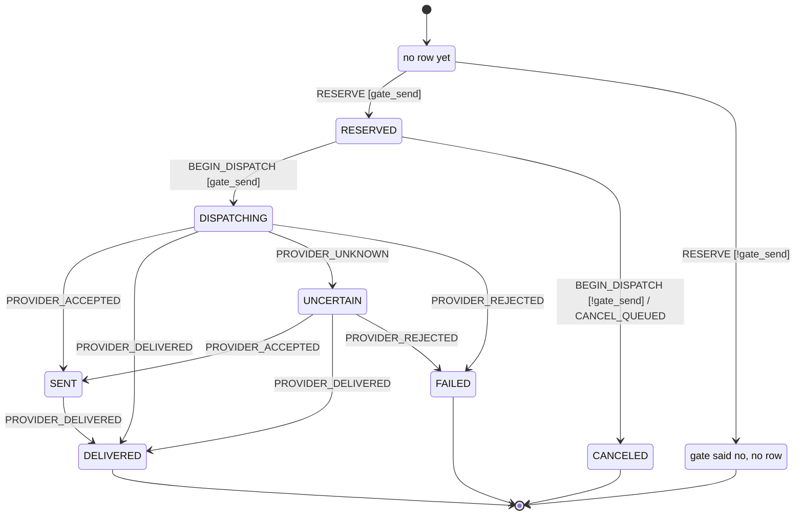

States: `PROPOSED`, `REFUSED`, `RESERVED`, `DISPATCHING`, `UNCERTAIN`, `SENT`, `DELIVERED`, `FAILED`, `CANCELED`. Initial: `PROPOSED`. Final: `CANCELED`, `DELIVERED`, `FAILED`, `REFUSED`. Fingerprint `e2d7eabc7c57`.

Transitions (self-loops are events that are accepted and change nothing):

| From | Event | Guard | To | Action | Rule / policy |
|---|---|---|---|---|---|
| PROPOSED | RESERVE | gate_send | RESERVED | reserve cap slot + cost | K06 Ledger.reserve: Gate (K01 evaluation_order) in one BEGIN IMMEDIATE tx |
| PROPOSED | RESERVE | !gate_send | REFUSED | audit DECISION, no row | K01 first failing rule (WAIT/CANCEL/HANDOFF) |
| RESERVED | RESERVE | — | RESERVED | — | K06 idempotency: same instruction_id is reserved once (ALREADY_RESERVED) |
| DISPATCHING | RESERVE | — | DISPATCHING | — | K06 idempotency: same instruction_id is reserved once (ALREADY_RESERVED) |
| UNCERTAIN | RESERVE | — | UNCERTAIN | — | K06 idempotency: same instruction_id is reserved once (ALREADY_RESERVED) |
| SENT | RESERVE | — | SENT | — | K06 idempotency: same instruction_id is reserved once (ALREADY_RESERVED) |
| DELIVERED | RESERVE | — | DELIVERED | — | K06 idempotency: same instruction_id is reserved once (ALREADY_RESERVED) |
| FAILED | RESERVE | — | FAILED | — | K06 idempotency: same instruction_id is reserved once (ALREADY_RESERVED) |
| CANCELED | RESERVE | — | CANCELED | — | K06 idempotency: same instruction_id is reserved once (ALREADY_RESERVED) |
| RESERVED | BEGIN_DISPATCH | gate_send | DISPATCHING | — | K06 send-time re-check (Ledger.begin_dispatch) |
| RESERVED | BEGIN_DISPATCH | !gate_send | CANCELED | release cost | K06 guardrails run twice: blocked at send time |
| DISPATCHING | BEGIN_DISPATCH | — | DISPATCHING | — | K06 dispatch once: NOT_DISPATCHABLE_<status> (Executor SKIPPED) |
| UNCERTAIN | BEGIN_DISPATCH | — | UNCERTAIN | — | K06 dispatch once: NOT_DISPATCHABLE_<status> (Executor SKIPPED) |
| SENT | BEGIN_DISPATCH | — | SENT | — | K06 dispatch once: NOT_DISPATCHABLE_<status> (Executor SKIPPED) |
| DELIVERED | BEGIN_DISPATCH | — | DELIVERED | — | K06 dispatch once: NOT_DISPATCHABLE_<status> (Executor SKIPPED) |
| FAILED | BEGIN_DISPATCH | — | FAILED | — | K06 dispatch once: NOT_DISPATCHABLE_<status> (Executor SKIPPED) |
| CANCELED | BEGIN_DISPATCH | — | CANCELED | — | K06 dispatch once: NOT_DISPATCHABLE_<status> (Executor SKIPPED) |
| RESERVED | CANCEL_QUEUED | — | CANCELED | release cost | STOP (all), verified payment (that EMI), K13 holds, stop-for-day (that day), outbound pause, campaign PAUSED/STOPPED |
| DISPATCHING | CANCEL_QUEUED | — | DISPATCHING | — | only queued work is canceled; an in-flight or sent touch is never recalled |
| UNCERTAIN | CANCEL_QUEUED | — | UNCERTAIN | — | only queued work is canceled; an in-flight or sent touch is never recalled |
| SENT | CANCEL_QUEUED | — | SENT | — | only queued work is canceled; an in-flight or sent touch is never recalled |
| DELIVERED | CANCEL_QUEUED | — | DELIVERED | — | only queued work is canceled; an in-flight or sent touch is never recalled |
| FAILED | CANCEL_QUEUED | — | FAILED | — | only queued work is canceled; an in-flight or sent touch is never recalled |
| CANCELED | CANCEL_QUEUED | — | CANCELED | — | only queued work is canceled; an in-flight or sent touch is never recalled |
| DISPATCHING | PROVIDER_ACCEPTED | — | SENT | K03 touch_sent event | provider ACCEPTED |
| DISPATCHING | PROVIDER_DELIVERED | — | DELIVERED | K03 touch_sent event | provider DELIVERED / READ (reach only) |
| DISPATCHING | PROVIDER_UNKNOWN | — | UNCERTAIN | keep cap slot + cost | no provider answer: never resend blindly |
| DISPATCHING | PROVIDER_REJECTED | — | FAILED | release cost | provider REJECTED / NO_ADAPTER |
| UNCERTAIN | PROVIDER_ACCEPTED | — | SENT | K03 touch_sent event | resolve_uncertain: provider has it |
| UNCERTAIN | PROVIDER_DELIVERED | — | DELIVERED | K03 touch_sent event | resolve_uncertain: provider delivered it |
| UNCERTAIN | PROVIDER_REJECTED | — | FAILED | release cost | resolve_uncertain: NOT_FOUND |
| UNCERTAIN | PROVIDER_UNKNOWN | — | UNCERTAIN | — | still unknown: stays UNCERTAIN |
| SENT | PROVIDER_DELIVERED | — | DELIVERED | — | provider DELIVERED / READ (reach only) |
| SENT | PROVIDER_ACCEPTED | — | SENT | — | E04 never downgrade: a late / lower status is ignored |
| SENT | PROVIDER_UNKNOWN | — | SENT | — | E04 never downgrade: a late / lower status is ignored |
| SENT | PROVIDER_REJECTED | — | SENT | — | E04 never downgrade: a late / lower status is ignored |
| DELIVERED | PROVIDER_ACCEPTED | — | DELIVERED | — | final: provider callbacks change nothing |
| DELIVERED | PROVIDER_DELIVERED | — | DELIVERED | — | final: provider callbacks change nothing |
| DELIVERED | PROVIDER_UNKNOWN | — | DELIVERED | — | final: provider callbacks change nothing |
| DELIVERED | PROVIDER_REJECTED | — | DELIVERED | — | final: provider callbacks change nothing |
| FAILED | PROVIDER_ACCEPTED | — | FAILED | — | final: provider callbacks change nothing |
| FAILED | PROVIDER_DELIVERED | — | FAILED | — | final: provider callbacks change nothing |
| FAILED | PROVIDER_UNKNOWN | — | FAILED | — | final: provider callbacks change nothing |
| FAILED | PROVIDER_REJECTED | — | FAILED | — | final: provider callbacks change nothing |
| CANCELED | PROVIDER_ACCEPTED | — | CANCELED | — | final: provider callbacks change nothing |
| CANCELED | PROVIDER_DELIVERED | — | CANCELED | — | final: provider callbacks change nothing |
| CANCELED | PROVIDER_UNKNOWN | — | CANCELED | — | final: provider callbacks change nothing |
| CANCELED | PROVIDER_REJECTED | — | CANCELED | — | final: provider callbacks change nothing |

**Enforced by:** `kairos_backend/ledger.py: Ledger.reserve / begin_dispatch / record_provider_status / _cancel_queued`; `kairos_backend/executor.py: Executor.dispatch / resolve_uncertain`; `kairos_backend/fsm_strict.py: KAIROS_FSM_STRICT=1 SQLite trigger rejects undeclared status changes`

**Proven by:** tests/fsm/test_conformance_touch.py (seeded random event sequences); tests/test_ledger.py (dispatch once, uncertain, STOP / payment scope)

### 2. `k06.touch+hitl` (v1)

**Purpose.** One touch = one reserved instruction for one EMI. Reserved touches count toward caps and budget immediately; the Gate runs at approval (reserve) and again at send time; a touch is dispatched at most once; an uncertain send is resolved by asking the provider, never resent. With HITL, a send matching an approval rule waits in PENDING_APPROVAL (holding its cap slot and budget) until a person approves (Gate re-run), rejects, or it expires.

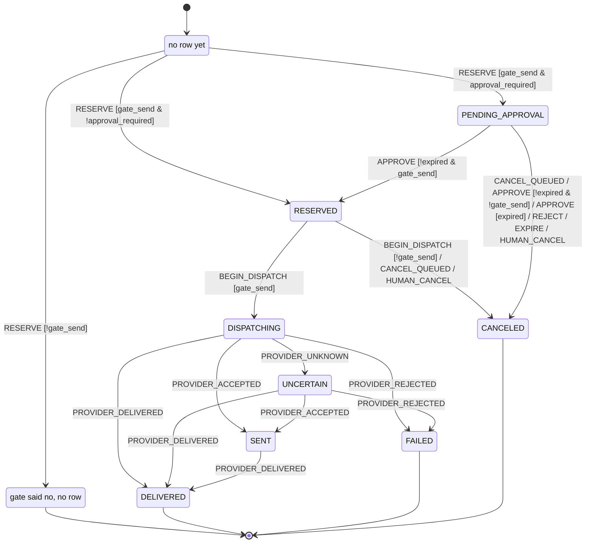

States: `PROPOSED`, `REFUSED`, `RESERVED`, `PENDING_APPROVAL`, `DISPATCHING`, `UNCERTAIN`, `SENT`, `DELIVERED`, `FAILED`, `CANCELED`. Initial: `PROPOSED`. Final: `CANCELED`, `DELIVERED`, `FAILED`, `REFUSED`. Fingerprint `954e8ee1263c`.

Transitions (self-loops are events that are accepted and change nothing):

| From | Event | Guard | To | Action | Rule / policy |
|---|---|---|---|---|---|
| PROPOSED | RESERVE | gate_send & !approval_required | RESERVED | reserve cap slot + cost | K06 Ledger.reserve: Gate in one BEGIN IMMEDIATE tx; reserve_hook adds no rule |
| PROPOSED | RESERVE | gate_send & approval_required | PENDING_APPROVAL | reserve cap slot + cost | K06 HITL approval_policy.json approval_rules (reserve_hook) |
| PROPOSED | RESERVE | !gate_send | REFUSED | audit DECISION, no row | K01 first failing rule (WAIT/CANCEL/HANDOFF); HITL veto |
| RESERVED | RESERVE | — | RESERVED | — | K06 idempotency: same instruction_id is reserved once (ALREADY_RESERVED) |
| PENDING_APPROVAL | RESERVE | — | PENDING_APPROVAL | — | K06 idempotency: same instruction_id is reserved once (ALREADY_RESERVED) |
| DISPATCHING | RESERVE | — | DISPATCHING | — | K06 idempotency: same instruction_id is reserved once (ALREADY_RESERVED) |
| UNCERTAIN | RESERVE | — | UNCERTAIN | — | K06 idempotency: same instruction_id is reserved once (ALREADY_RESERVED) |
| SENT | RESERVE | — | SENT | — | K06 idempotency: same instruction_id is reserved once (ALREADY_RESERVED) |
| DELIVERED | RESERVE | — | DELIVERED | — | K06 idempotency: same instruction_id is reserved once (ALREADY_RESERVED) |
| FAILED | RESERVE | — | FAILED | — | K06 idempotency: same instruction_id is reserved once (ALREADY_RESERVED) |
| CANCELED | RESERVE | — | CANCELED | — | K06 idempotency: same instruction_id is reserved once (ALREADY_RESERVED) |
| RESERVED | BEGIN_DISPATCH | gate_send | DISPATCHING | — | K06 send-time re-check (Ledger.begin_dispatch) |
| RESERVED | BEGIN_DISPATCH | !gate_send | CANCELED | release cost | K06 guardrails run twice: blocked at send time |
| PENDING_APPROVAL | BEGIN_DISPATCH | — | PENDING_APPROVAL | — | K06 dispatch once: NOT_DISPATCHABLE_<status> (Executor SKIPPED) |
| DISPATCHING | BEGIN_DISPATCH | — | DISPATCHING | — | K06 dispatch once: NOT_DISPATCHABLE_<status> (Executor SKIPPED) |
| UNCERTAIN | BEGIN_DISPATCH | — | UNCERTAIN | — | K06 dispatch once: NOT_DISPATCHABLE_<status> (Executor SKIPPED) |
| SENT | BEGIN_DISPATCH | — | SENT | — | K06 dispatch once: NOT_DISPATCHABLE_<status> (Executor SKIPPED) |
| DELIVERED | BEGIN_DISPATCH | — | DELIVERED | — | K06 dispatch once: NOT_DISPATCHABLE_<status> (Executor SKIPPED) |
| FAILED | BEGIN_DISPATCH | — | FAILED | — | K06 dispatch once: NOT_DISPATCHABLE_<status> (Executor SKIPPED) |
| CANCELED | BEGIN_DISPATCH | — | CANCELED | — | K06 dispatch once: NOT_DISPATCHABLE_<status> (Executor SKIPPED) |
| RESERVED | CANCEL_QUEUED | — | CANCELED | release cost | STOP (all), verified payment (that EMI), K13 holds, stop-for-day (that day), outbound pause, campaign PAUSED/STOPPED |
| PENDING_APPROVAL | CANCEL_QUEUED | — | CANCELED | release cost | STOP (all), verified payment (that EMI), K13 holds, stop-for-day (that day), outbound pause, campaign PAUSED/STOPPED |
| DISPATCHING | CANCEL_QUEUED | — | DISPATCHING | — | only queued work is canceled; an in-flight or sent touch is never recalled |
| UNCERTAIN | CANCEL_QUEUED | — | UNCERTAIN | — | only queued work is canceled; an in-flight or sent touch is never recalled |
| SENT | CANCEL_QUEUED | — | SENT | — | only queued work is canceled; an in-flight or sent touch is never recalled |
| DELIVERED | CANCEL_QUEUED | — | DELIVERED | — | only queued work is canceled; an in-flight or sent touch is never recalled |
| FAILED | CANCEL_QUEUED | — | FAILED | — | only queued work is canceled; an in-flight or sent touch is never recalled |
| CANCELED | CANCEL_QUEUED | — | CANCELED | — | only queued work is canceled; an in-flight or sent touch is never recalled |
| PENDING_APPROVAL | APPROVE | !expired & gate_send | RESERVED | — | HITL.approve: Gate re-run atomically (APPROVED) |
| PENDING_APPROVAL | APPROVE | !expired & !gate_send | CANCELED | release cost | HITL.approve: guardrail wins (BLOCKED_AT_RECHECK) |
| PENDING_APPROVAL | APPROVE | expired | CANCELED | release cost | HITL approval expiry |
| PENDING_APPROVAL | REJECT | — | CANCELED | release cost | HITL.reject |
| PENDING_APPROVAL | EXPIRE | — | CANCELED | release cost | HITL.expire_due: END_OF_CONTACT_WINDOW |
| RESERVED | HUMAN_CANCEL | — | CANCELED | release cost | HITL cancel_scheduled / cancel_next / reschedule |
| PENDING_APPROVAL | HUMAN_CANCEL | — | CANCELED | release cost | HITL cancel_scheduled / cancel_next / reschedule |
| DISPATCHING | PROVIDER_ACCEPTED | — | SENT | K03 touch_sent event | provider ACCEPTED |
| DISPATCHING | PROVIDER_DELIVERED | — | DELIVERED | K03 touch_sent event | provider DELIVERED / READ (reach only) |
| DISPATCHING | PROVIDER_UNKNOWN | — | UNCERTAIN | keep cap slot + cost | no provider answer: never resend blindly |
| DISPATCHING | PROVIDER_REJECTED | — | FAILED | release cost | provider REJECTED / NO_ADAPTER |
| UNCERTAIN | PROVIDER_ACCEPTED | — | SENT | K03 touch_sent event | resolve_uncertain: provider has it |
| UNCERTAIN | PROVIDER_DELIVERED | — | DELIVERED | K03 touch_sent event | resolve_uncertain: provider delivered it |
| UNCERTAIN | PROVIDER_REJECTED | — | FAILED | release cost | resolve_uncertain: NOT_FOUND |
| UNCERTAIN | PROVIDER_UNKNOWN | — | UNCERTAIN | — | still unknown: stays UNCERTAIN |
| SENT | PROVIDER_DELIVERED | — | DELIVERED | — | provider DELIVERED / READ (reach only) |
| SENT | PROVIDER_ACCEPTED | — | SENT | — | E04 never downgrade: a late / lower status is ignored |
| SENT | PROVIDER_UNKNOWN | — | SENT | — | E04 never downgrade: a late / lower status is ignored |
| SENT | PROVIDER_REJECTED | — | SENT | — | E04 never downgrade: a late / lower status is ignored |
| DELIVERED | PROVIDER_ACCEPTED | — | DELIVERED | — | final: provider callbacks change nothing |
| DELIVERED | PROVIDER_DELIVERED | — | DELIVERED | — | final: provider callbacks change nothing |
| DELIVERED | PROVIDER_UNKNOWN | — | DELIVERED | — | final: provider callbacks change nothing |
| DELIVERED | PROVIDER_REJECTED | — | DELIVERED | — | final: provider callbacks change nothing |
| FAILED | PROVIDER_ACCEPTED | — | FAILED | — | final: provider callbacks change nothing |
| FAILED | PROVIDER_DELIVERED | — | FAILED | — | final: provider callbacks change nothing |
| FAILED | PROVIDER_UNKNOWN | — | FAILED | — | final: provider callbacks change nothing |
| FAILED | PROVIDER_REJECTED | — | FAILED | — | final: provider callbacks change nothing |
| CANCELED | PROVIDER_ACCEPTED | — | CANCELED | — | final: provider callbacks change nothing |
| CANCELED | PROVIDER_DELIVERED | — | CANCELED | — | final: provider callbacks change nothing |
| CANCELED | PROVIDER_UNKNOWN | — | CANCELED | — | final: provider callbacks change nothing |
| CANCELED | PROVIDER_REJECTED | — | CANCELED | — | final: provider callbacks change nothing |

**Enforced by:** `kairos_backend/ledger.py: Ledger.reserve / begin_dispatch / record_provider_status / _cancel_queued`; `kairos_backend/executor.py: Executor.dispatch / resolve_uncertain`; `kairos_backend/hitl.py (k06/hitl-control): HITL._on_reserve / approve / reject / expire_due / cancel_scheduled`; `kairos_backend/fsm_strict.py: KAIROS_FSM_STRICT=1 SQLite trigger rejects undeclared status changes`

**Proven by:** tests/fsm/test_conformance_touch.py (seeded random event sequences); tests/test_ledger.py (dispatch once, uncertain, STOP / payment scope); tests/fsm/test_conformance_hitl.py (runs when kairos_backend.hitl is present)

### 3. `k01.gate` (v1.1.0)

**Purpose.** May this touch be sent at this moment? The rules run in policy.json evaluation_order and the first hit wins; every decision carries the rule and policy_version. The Gate is pure: all state arrives as Facts computed atomically by the ledger.

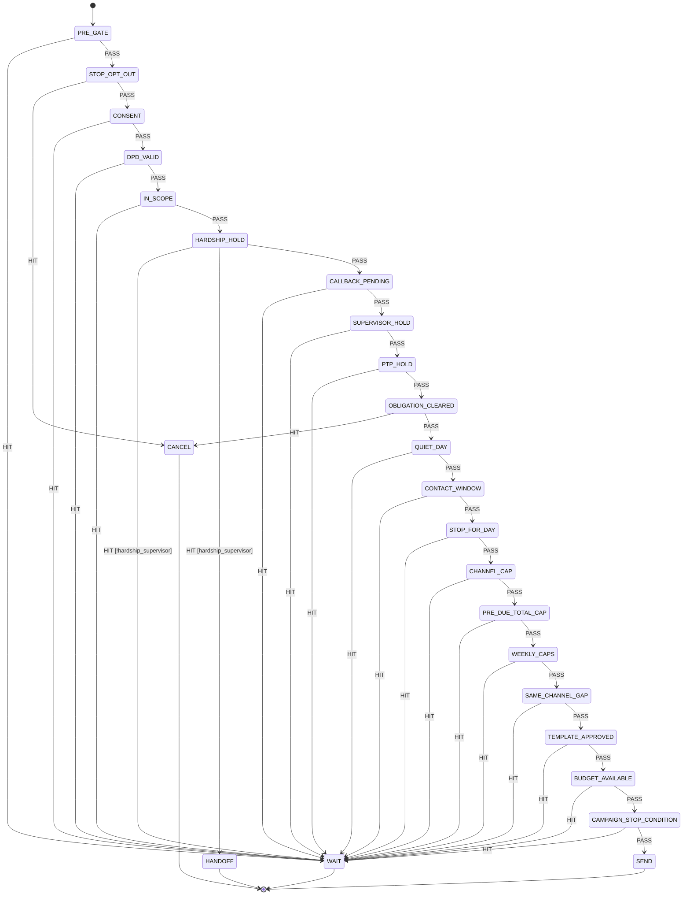

States: `PRE_GATE`, `STOP_OPT_OUT`, `CONSENT`, `DPD_VALID`, `IN_SCOPE`, `HARDSHIP_HOLD`, `CALLBACK_PENDING`, `SUPERVISOR_HOLD`, `PTP_HOLD`, `OBLIGATION_CLEARED`, `QUIET_DAY`, `CONTACT_WINDOW`, `STOP_FOR_DAY`, `CHANNEL_CAP`, `PRE_DUE_TOTAL_CAP`, `WEEKLY_CAPS`, `SAME_CHANNEL_GAP`, `TEMPLATE_APPROVED`, `BUDGET_AVAILABLE`, `CAMPAIGN_STOP_CONDITION`, `SEND`, `WAIT`, `CANCEL`, `HANDOFF`. Initial: `PRE_GATE`. Final: `CANCEL`, `HANDOFF`, `SEND`, `WAIT`. Fingerprint `e8b58670462a`.

Transitions (self-loops are events that are accepted and change nothing):

| From | Event | Guard | To | Action | Rule / policy |
|---|---|---|---|---|---|
| PRE_GATE | HIT | — | WAIT | — | Ledger._pre_gate CONTROL: OUTBOUND_PAUSED / CAMPAIGN_<status> / OUTSIDE_CAMPAIGN_PERIOD / NOT_ENROLLED |
| PRE_GATE | PASS | — | STOP_OPT_OUT | — | operational stops clear |
| STOP_OPT_OUT | HIT | — | CANCEL | — | K01 evaluation_order[0] |
| STOP_OPT_OUT | PASS | — | CONSENT | — | rule passes |
| CONSENT | HIT | — | WAIT | — | K01 evaluation_order[1] |
| CONSENT | PASS | — | DPD_VALID | — | rule passes |
| DPD_VALID | HIT | — | WAIT | — | K01 evaluation_order[2] |
| DPD_VALID | PASS | — | IN_SCOPE | — | rule passes |
| IN_SCOPE | HIT | — | WAIT | — | K01 evaluation_order[3] |
| IN_SCOPE | PASS | — | HARDSHIP_HOLD | — | rule passes |
| HARDSHIP_HOLD | HIT | !hardship_supervisor | WAIT | — | K01 evaluation_order[4]; K01 holds.HARDSHIP |
| HARDSHIP_HOLD | HIT | hardship_supervisor | HANDOFF | — | K01 evaluation_order[4]; K01 holds.HARDSHIP date beyond 4 days -> supervisor |
| HARDSHIP_HOLD | PASS | — | CALLBACK_PENDING | — | rule passes |
| CALLBACK_PENDING | HIT | — | WAIT | — | K13 hold placed by gate.EXTRA_RULES_AFTER (pending Product placement) |
| CALLBACK_PENDING | PASS | — | SUPERVISOR_HOLD | — | rule passes |
| SUPERVISOR_HOLD | HIT | — | WAIT | — | K13 hold placed by gate.EXTRA_RULES_AFTER (pending Product placement) |
| SUPERVISOR_HOLD | PASS | — | PTP_HOLD | — | rule passes |
| PTP_HOLD | HIT | — | WAIT | — | K01 evaluation_order[5] |
| PTP_HOLD | PASS | — | OBLIGATION_CLEARED | — | rule passes |
| OBLIGATION_CLEARED | HIT | — | CANCEL | — | K01 evaluation_order[6] |
| OBLIGATION_CLEARED | PASS | — | QUIET_DAY | — | rule passes |
| QUIET_DAY | HIT | — | WAIT | — | K01 evaluation_order[7] |
| QUIET_DAY | PASS | — | CONTACT_WINDOW | — | rule passes |
| CONTACT_WINDOW | HIT | — | WAIT | — | K01 evaluation_order[8] |
| CONTACT_WINDOW | PASS | — | STOP_FOR_DAY | — | rule passes |
| STOP_FOR_DAY | HIT | — | WAIT | — | K01 evaluation_order[9] |
| STOP_FOR_DAY | PASS | — | CHANNEL_CAP | — | rule passes |
| CHANNEL_CAP | HIT | — | WAIT | — | K01 evaluation_order[10] |
| CHANNEL_CAP | PASS | — | PRE_DUE_TOTAL_CAP | — | rule passes |
| PRE_DUE_TOTAL_CAP | HIT | — | WAIT | — | K01 evaluation_order[11] |
| PRE_DUE_TOTAL_CAP | PASS | — | WEEKLY_CAPS | — | rule passes |
| WEEKLY_CAPS | HIT | — | WAIT | — | K01 evaluation_order[12] |
| WEEKLY_CAPS | PASS | — | SAME_CHANNEL_GAP | — | rule passes |
| SAME_CHANNEL_GAP | HIT | — | WAIT | — | K01 evaluation_order[13] |
| SAME_CHANNEL_GAP | PASS | — | TEMPLATE_APPROVED | — | rule passes |
| TEMPLATE_APPROVED | HIT | — | WAIT | — | K01 evaluation_order[14] |
| TEMPLATE_APPROVED | PASS | — | BUDGET_AVAILABLE | — | rule passes |
| BUDGET_AVAILABLE | HIT | — | WAIT | — | K01 evaluation_order[15] |
| BUDGET_AVAILABLE | PASS | — | CAMPAIGN_STOP_CONDITION | — | rule passes |
| CAMPAIGN_STOP_CONDITION | HIT | — | WAIT | — | K01 evaluation_order[16] |
| CAMPAIGN_STOP_CONDITION | PASS | — | SEND | — | rule passes; all passed -> ELIGIBLE |

**Enforced by:** `kairos_backend/gate.py: evaluate() / rule_order()`; `kairos_backend/ledger.py: Ledger._pre_gate`

**Proven by:** tests/fsm/test_conformance_gate.py (seeded random Facts); tests/test_gate_k01.py (Ojas's K01 cases)

### 4. `k06.supervisor.plan` (v1)

**Purpose.** Plan one touch for one EMI. Borrower-level holds first (policy order), then the full Gate per candidate, then the learner ranks only what is eligible, then an atomic reserve. The LLM is not in this path; the learner is a deterministic Beta-Bernoulli posterior mean in PRODUCTION.

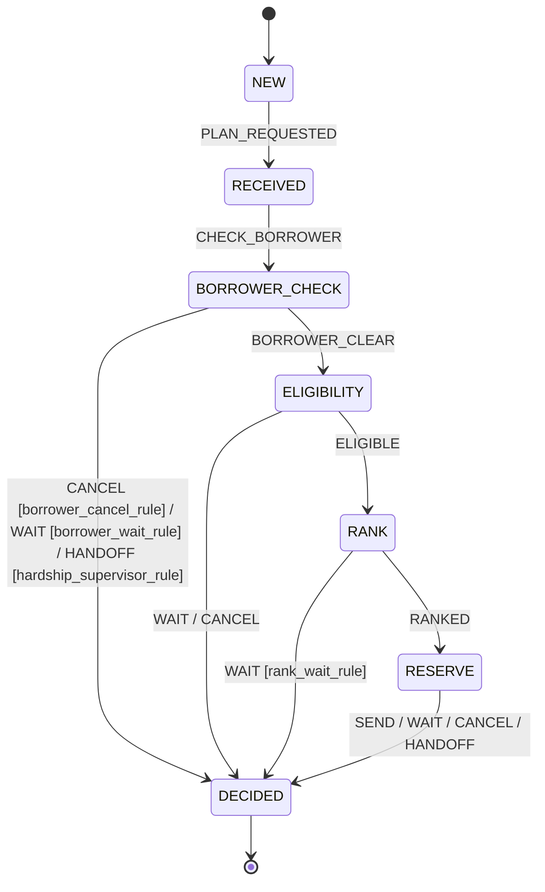

States: `NEW`, `RECEIVED`, `BORROWER_CHECK`, `ELIGIBILITY`, `RANK`, `RESERVE`, `DECIDED`. Initial: `NEW`. Final: `DECIDED`. Fingerprint `6d8459ebe454`.

Transitions (self-loops are events that are accepted and change nothing):

| From | Event | Guard | To | Action | Rule / policy |
|---|---|---|---|---|---|
| NEW | PLAN_REQUESTED | — | RECEIVED | — | SupervisorFSM.plan |
| RECEIVED | CHECK_BORROWER | — | BORROWER_CHECK | — | SupervisorFSM.plan: facts from the ledger (K03 spine) |
| BORROWER_CHECK | BORROWER_CLEAR | — | ELIGIBILITY | — | no borrower-level rule hits |
| BORROWER_CHECK | CANCEL | borrower_cancel_rule | DECIDED | CRM supervisor.decision | STOP_OPT_OUT \| OBLIGATION_CLEARED (policy order) |
| BORROWER_CHECK | WAIT | borrower_wait_rule | DECIDED | CRM supervisor.decision | HARDSHIP_HOLD \| CALLBACK_PENDING \| SUPERVISOR_HOLD \| PTP_HOLD |
| BORROWER_CHECK | HANDOFF | hardship_supervisor_rule | DECIDED | CRM supervisor.decision | HARDSHIP_HOLD with supervisor flag |
| ELIGIBILITY | ELIGIBLE | — | RANK | — | Ledger.preview: >= 1 candidate passes the full Gate |
| ELIGIBILITY | WAIT | — | DECIDED | CRM supervisor.decision | no eligible candidate: earliest rule in policy order (or NO_CANDIDATES / IDEMPOTENCY / SLOT_MISMATCH) |
| ELIGIBILITY | CANCEL | — | DECIDED | CRM supervisor.decision | no eligible candidate; earliest rule is a CANCEL (e.g. STOP on the other channels after a per-channel opt-in) |
| RANK | RANKED | — | RESERVE | — | learner ranks ONLY eligible candidates (replies per rupee) |
| RANK | WAIT | rank_wait_rule | DECIDED | CRM supervisor.decision | NO_BAND (DPD_VALID) \| LEARNER_WAIT \| LEARNER_CHOICE_NOT_ELIGIBLE (LEARNER) |
| RESERVE | SEND | — | DECIDED | touch RESERVED; CRM supervisor.decision | Ledger.reserve (atomic) |
| RESERVE | WAIT | — | DECIDED | CRM supervisor.decision | reserve lost a race (re-check in the write tx) |
| RESERVE | CANCEL | — | DECIDED | CRM supervisor.decision | reserve lost a race (re-check in the write tx) |
| RESERVE | HANDOFF | — | DECIDED | CRM supervisor.decision | reserve lost a race (re-check in the write tx) |

**Enforced by:** `kairos_backend/supervisor.py: SupervisorFSM.plan (records each Transition)`

**Proven by:** tests/fsm/test_conformance_supervisor.py (seeded random borrowers / candidates); tests/test_supervisor_fsm.py

### 5. `k06.supervisor.dispatch` (v1)

**Purpose.** Dispatch one reserved touch through the Executor; the Gate runs again at send time.

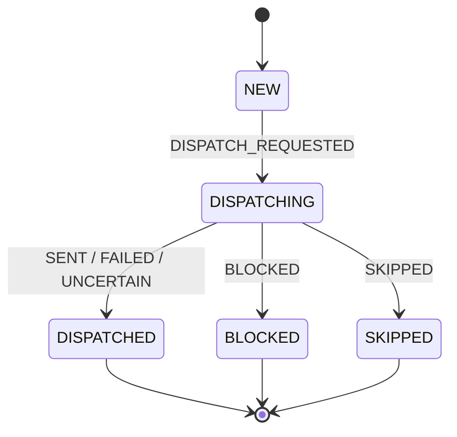

States: `NEW`, `DISPATCHING`, `DISPATCHED`, `BLOCKED`, `SKIPPED`. Initial: `NEW`. Final: `BLOCKED`, `DISPATCHED`, `SKIPPED`. Fingerprint `7e151e9f8af7`.

Transitions (self-loops are events that are accepted and change nothing):

| From | Event | Guard | To | Action | Rule / policy |
|---|---|---|---|---|---|
| NEW | DISPATCH_REQUESTED | — | DISPATCHING | — | SupervisorFSM.dispatch |
| DISPATCHING | SENT | — | DISPATCHED | CRM touch.dispatched | send-time Gate passed; provider ACCEPTED |
| DISPATCHING | FAILED | — | DISPATCHED | CRM touch.dispatched | send-time Gate passed; provider REJECTED |
| DISPATCHING | UNCERTAIN | — | DISPATCHED | CRM touch.dispatched | send-time Gate passed; no provider answer |
| DISPATCHING | BLOCKED | — | BLOCKED | CRM supervisor.decision CANCEL + touch.dispatched | send-time Gate failed, or the touch was canceled before dispatch |
| DISPATCHING | SKIPPED | — | SKIPPED | CRM touch.dispatched | already in flight / sent / failed: no second send |

**Enforced by:** `kairos_backend/supervisor.py: SupervisorFSM.dispatch`; `kairos_backend/executor.py: Executor.dispatch`

**Proven by:** tests/fsm/test_conformance_supervisor.py; tests/test_supervisor_fsm.py

### 6. `k09.outcome` (v1)

**Purpose.** One FINAL learning outcome per executed touch, decided when its 24 h reply window closes. Delivery / read / click are reach, never a reply; a verified payment is tracked separately and never a reward; duplicates and late replies never change the reward; UNRESOLVED never reaches the learner.

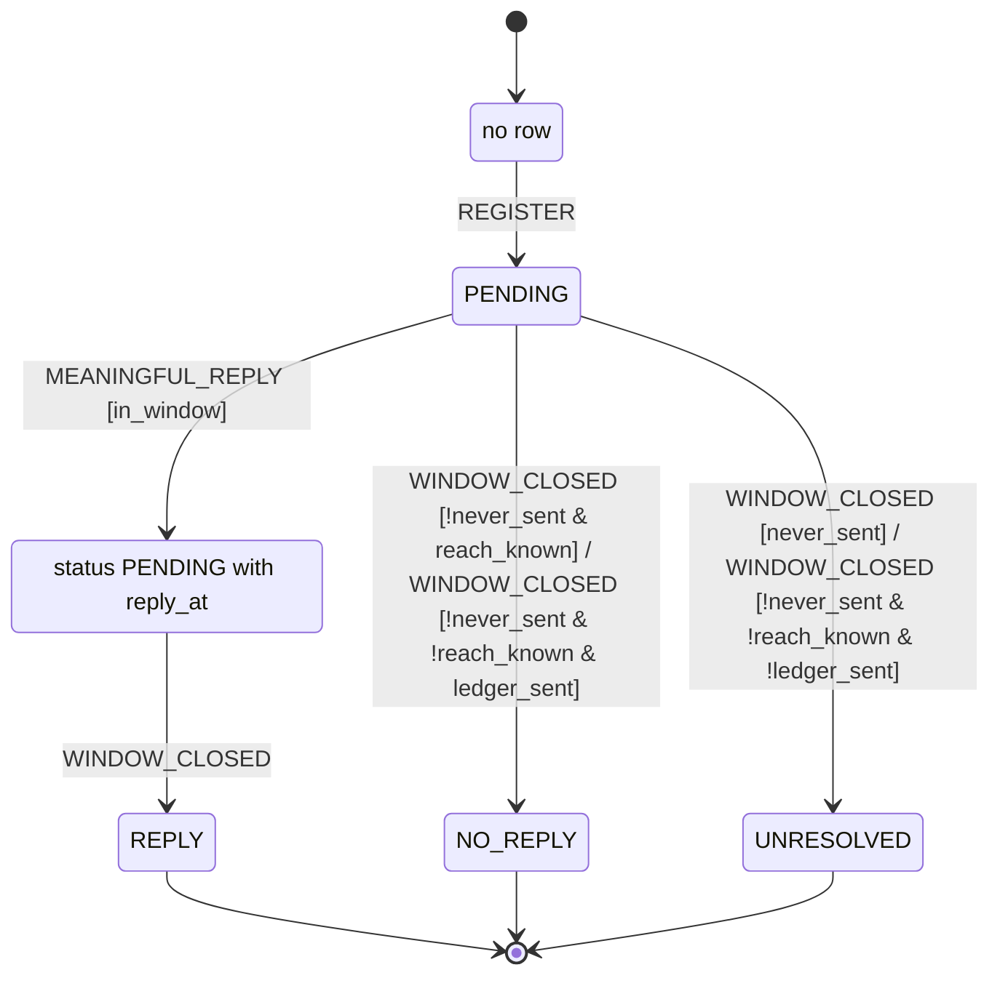

States: `NEW`, `PENDING`, `PENDING_REPLIED`, `REPLY`, `NO_REPLY`, `UNRESOLVED`. Initial: `NEW`. Final: `NO_REPLY`, `REPLY`, `UNRESOLVED`. Fingerprint `8bda07c9efea`.

Transitions (self-loops are events that are accepted and change nothing):

| From | Event | Guard | To | Action | Rule / policy |
|---|---|---|---|---|---|
| NEW | REGISTER | — | PENDING | window_end = executed_at + reply_window_hours | K01 reply_attribution.reply_window_hours |
| PENDING | MEANINGFUL_REPLY | in_window | PENDING_REPLIED | reply_at, reached=1 (REPLY_ATTRIBUTED) | K01 reply_attribution: most recent executed touch whose window contains it |
| PENDING | MEANINGFUL_REPLY | !in_window | PENDING | late_reply_at (LATE_REPLY), reward unchanged | K01 reply_attribution: outside the window never becomes a reward |
| PENDING | WINDOW_CLOSED | never_sent | UNRESOLVED | kept out of learning | outcomes._decide: ledger touch FAILED / CANCELED |
| PENDING | WINDOW_CLOSED | !never_sent & reach_known | NO_REPLY | learner.apply_outcome(0) once | outcomes._decide: provider confirmed delivered / not connected |
| PENDING | WINDOW_CLOSED | !never_sent & !reach_known & ledger_sent | NO_REPLY | learner.apply_outcome(0) once | outcomes._decide: ledger SENT / DELIVERED |
| PENDING | WINDOW_CLOSED | !never_sent & !reach_known & !ledger_sent | UNRESOLVED | kept out of learning | unresolved provider outcomes stay out of learning (UNCERTAIN, no provider info) |
| PENDING_REPLIED | WINDOW_CLOSED | — | REPLY | learner.apply_outcome(1) once | K01 reply_attribution.one_reward_per_touch |
| PENDING_REPLIED | MEANINGFUL_REPLY | — | PENDING_REPLIED | DUPLICATE | K01 reply_attribution.one_reward_per_touch |
| PENDING | REGISTER | — | PENDING | — | register_execution is idempotent |
| PENDING_REPLIED | REGISTER | — | PENDING_REPLIED | — | register_execution is idempotent |
| REPLY | REGISTER | — | REPLY | — | register_execution is idempotent |
| NO_REPLY | REGISTER | — | NO_REPLY | — | register_execution is idempotent |
| UNRESOLVED | REGISTER | — | UNRESOLVED | — | register_execution is idempotent |
| PENDING | REACH | — | PENDING | — | K01 reply_attribution.click_effect: reachability only, never a reply |
| PENDING | CLICK_OR_READ | — | PENDING | — | K01 reply_attribution.click_effect: reachability only, never a reply |
| PENDING_REPLIED | REACH | — | PENDING_REPLIED | — | K01 reply_attribution.click_effect: reachability only, never a reply |
| PENDING_REPLIED | CLICK_OR_READ | — | PENDING_REPLIED | — | K01 reply_attribution.click_effect: reachability only, never a reply |
| REPLY | REACH | — | REPLY | — | K01 reply_attribution.click_effect: reachability only, never a reply |
| REPLY | CLICK_OR_READ | — | REPLY | — | K01 reply_attribution.click_effect: reachability only, never a reply |
| NO_REPLY | REACH | — | NO_REPLY | — | K01 reply_attribution.click_effect: reachability only, never a reply |
| NO_REPLY | CLICK_OR_READ | — | NO_REPLY | — | K01 reply_attribution.click_effect: reachability only, never a reply |
| UNRESOLVED | REACH | — | UNRESOLVED | — | K01 reply_attribution.click_effect: reachability only, never a reply |
| UNRESOLVED | CLICK_OR_READ | — | UNRESOLVED | — | K01 reply_attribution.click_effect: reachability only, never a reply |
| REPLY | MEANINGFUL_REPLY | — | REPLY | LATE_REPLY / DUPLICATE | late reply / duplicate: recorded, reward unchanged |
| NO_REPLY | MEANINGFUL_REPLY | — | NO_REPLY | LATE_REPLY / DUPLICATE | late reply / duplicate: recorded, reward unchanged |
| UNRESOLVED | MEANINGFUL_REPLY | — | UNRESOLVED | LATE_REPLY / DUPLICATE | late reply / duplicate: recorded, reward unchanged |
| REPLY | WINDOW_CLOSED | — | REPLY | — | finalize_due is idempotent |
| NO_REPLY | WINDOW_CLOSED | — | NO_REPLY | — | finalize_due is idempotent |
| UNRESOLVED | WINDOW_CLOSED | — | UNRESOLVED | — | finalize_due is idempotent |

**Enforced by:** `kairos_backend/outcomes.py: OutcomeFinalizer.register_execution / record_reply / record_reach / finalize_due`; `kairos_backend/learner.py: apply_outcome idempotent on instruction_id`

**Proven by:** tests/fsm/test_conformance_outcome.py (seeded random replies / clocks); tests/test_outcomes.py

### 7. `k13.exception` (v1.0.0)

**Purpose.** One borrower event (classified upstream — by rules, DTMF, a voice disposition, or the LLM for ambiguous free text) -> one (action, hold, queue) from exceptions.json. The table is pure; the ledger applies the hold. Note: the *_SUPERVISOR states are the same K13 action (CAPTURE_PTP / HOLD_UNTIL_DATE) with a supervisor ticket.

```mermaid
stateDiagram-v2
    [*] --> RECEIVED
    RECEIVED --> PUSH_PAYMENT_NOW : NEEDS_TIME [broken]
    RECEIVED --> ACK_ONLY : NEEDS_TIME [!broken & !in_window]
    RECEIVED --> REBUTTAL : NEEDS_TIME [!broken & in_window & rebuttals_left]
    RECEIVED --> ACCEPT_NO_DATE : NEEDS_TIME [!broken & in_window & !rebuttals_left]
    RECEIVED --> VERIFY_PAYMENT : PTP_OFFERED [broken & paid_now]
    RECEIVED --> RECORD_PTP_NO_HOLD : PTP_OFFERED [broken & !paid_now]
    RECEIVED --> CAPTURE_PTP : PTP_OFFERED [!broken & !far]
    RECEIVED --> CAPTURE_PTP_SUPERVISOR : PTP_OFFERED [!broken & far]
    RECEIVED --> CREATE_CALLBACK_TASK : CALLBACK_REQUEST
    RECEIVED --> CLOSE_CALLBACK_TASK : CALLBACK_DUE [answered]
    RECEIVED --> RETRY_CALLBACK_2H : CALLBACK_DUE [!answered & retry_left]
    RECEIVED --> SEND_MISSED_CALLBACK_MSG : CALLBACK_DUE [!answered & !retry_left]
    RECEIVED --> HOLD_2_DAYS : HARDSHIP [!has_date]
    RECEIVED --> HOLD_UNTIL_DATE : HARDSHIP [has_date & !beyond]
    RECEIVED --> HOLD_UNTIL_DATE_SUPERVISOR : HARDSHIP [has_date & beyond]
    RECEIVED --> CREATE_TICKET : DISPUTE / COMPLAINT / WAIVER_REQUEST
    RECEIVED --> END_CONVERSATION_AND_TICKET : ABUSIVE / LEGAL_THREAT / FRAUD_CLAIM
    PUSH_PAYMENT_NOW --> [*]
    ACK_ONLY --> [*]
    REBUTTAL --> [*]
    ACCEPT_NO_DATE --> [*]
    VERIFY_PAYMENT --> [*]
    RECORD_PTP_NO_HOLD --> [*]
    CAPTURE_PTP --> [*]
    CAPTURE_PTP_SUPERVISOR --> [*]
    CREATE_CALLBACK_TASK --> [*]
    CLOSE_CALLBACK_TASK --> [*]
    RETRY_CALLBACK_2H --> [*]
    SEND_MISSED_CALLBACK_MSG --> [*]
    HOLD_2_DAYS --> [*]
    HOLD_UNTIL_DATE --> [*]
    HOLD_UNTIL_DATE_SUPERVISOR --> [*]
    CREATE_TICKET --> [*]
    END_CONVERSATION_AND_TICKET --> [*]
```

States: `RECEIVED`, `PUSH_PAYMENT_NOW`, `ACK_ONLY`, `REBUTTAL`, `ACCEPT_NO_DATE`, `VERIFY_PAYMENT`, `RECORD_PTP_NO_HOLD`, `CAPTURE_PTP`, `CAPTURE_PTP_SUPERVISOR`, `CREATE_CALLBACK_TASK`, `CLOSE_CALLBACK_TASK`, `RETRY_CALLBACK_2H`, `SEND_MISSED_CALLBACK_MSG`, `HOLD_2_DAYS`, `HOLD_UNTIL_DATE`, `HOLD_UNTIL_DATE_SUPERVISOR`, `CREATE_TICKET`, `END_CONVERSATION_AND_TICKET`. Initial: `RECEIVED`. Final: `ACCEPT_NO_DATE`, `ACK_ONLY`, `CAPTURE_PTP`, `CAPTURE_PTP_SUPERVISOR`, `CLOSE_CALLBACK_TASK`, `CREATE_CALLBACK_TASK`, `CREATE_TICKET`, `END_CONVERSATION_AND_TICKET`, `HOLD_2_DAYS`, `HOLD_UNTIL_DATE`, `HOLD_UNTIL_DATE_SUPERVISOR`, `PUSH_PAYMENT_NOW`, `REBUTTAL`, `RECORD_PTP_NO_HOLD`, `RETRY_CALLBACK_2H`, `SEND_MISSED_CALLBACK_MSG`, `VERIFY_PAYMENT`. Fingerprint `33bc58f02620`.

Transitions (self-loops are events that are accepted and change nothing):

| From | Event | Guard | To | Action | Rule / policy |
|---|---|---|---|---|---|
| RECEIVED | NEEDS_TIME | broken | PUSH_PAYMENT_NOW | hold=NONE; queue=- | K13 exceptions.json broken_ptp >= 2 |
| RECEIVED | NEEDS_TIME | !broken & !in_window | ACK_ONLY | hold=STOP_FOR_DAY; queue=- | K13 exceptions.json needs_time.rebuttals_only_inside_contact_window |
| RECEIVED | NEEDS_TIME | !broken & in_window & rebuttals_left | REBUTTAL | hold=NONE; queue=- | K13 exceptions.json needs_time.max_rebuttals_by_band |
| RECEIVED | NEEDS_TIME | !broken & in_window & !rebuttals_left | ACCEPT_NO_DATE | hold=STOP_FOR_DAY; queue=- | K13 exceptions.json needs_time.no_date_after_rebuttals |
| RECEIVED | PTP_OFFERED | broken & paid_now | VERIFY_PAYMENT | hold=NONE; queue=- | K13 exceptions.json broken_ptp.if_paid_now |
| RECEIVED | PTP_OFFERED | broken & !paid_now | RECORD_PTP_NO_HOLD | hold=STOP_FOR_DAY; queue=- | K13 exceptions.json broken_ptp.if_not_paid_now |
| RECEIVED | PTP_OFFERED | !broken & !far | CAPTURE_PTP | hold=PTP_HOLD; queue=- | K13 exceptions.json promise_to_pay.auto_accept_max_days=7 |
| RECEIVED | PTP_OFFERED | !broken & far | CAPTURE_PTP_SUPERVISOR | hold=PTP_HOLD; queue=COLLECTIONS_SUPERVISOR | K13 exceptions.json promise_to_pay.beyond_auto_accept |
| RECEIVED | CALLBACK_REQUEST | — | CREATE_CALLBACK_TASK | hold=CALLBACK_PENDING; queue=COLLECTIONS_SUPERVISOR | K13 exceptions.json callback (E08) |
| RECEIVED | CALLBACK_DUE | answered | CLOSE_CALLBACK_TASK | hold=STOP_FOR_DAY; queue=- | K13 exceptions.json callback.if_answered |
| RECEIVED | CALLBACK_DUE | !answered & retry_left | RETRY_CALLBACK_2H | hold=CALLBACK_PENDING; queue=COLLECTIONS_SUPERVISOR | K13 exceptions.json callback.if_unanswered |
| RECEIVED | CALLBACK_DUE | !answered & !retry_left | SEND_MISSED_CALLBACK_MSG | hold=STOP_FOR_DAY; queue=- | K13 exceptions.json callback.if_second_attempt_missed |
| RECEIVED | HARDSHIP | !has_date | HOLD_2_DAYS | hold=HARDSHIP_HOLD; queue=- | K01 holds.HARDSHIP.if_no_date |
| RECEIVED | HARDSHIP | has_date & !beyond | HOLD_UNTIL_DATE | hold=HARDSHIP_HOLD; queue=- | K01 holds.HARDSHIP within 4 days |
| RECEIVED | HARDSHIP | has_date & beyond | HOLD_UNTIL_DATE_SUPERVISOR | hold=HARDSHIP_HOLD; queue=COLLECTIONS_SUPERVISOR | K01 holds.HARDSHIP beyond 4 days -> supervisor |
| RECEIVED | DISPUTE | — | CREATE_TICKET | hold=STOP_FOR_DAY; queue=COLLECTIONS_SUPERVISOR | K13 exceptions.json routed_exceptions (outreach continues) |
| RECEIVED | COMPLAINT | — | CREATE_TICKET | hold=STOP_FOR_DAY; queue=COLLECTIONS_SUPERVISOR | K13 exceptions.json routed_exceptions (outreach continues) |
| RECEIVED | WAIVER_REQUEST | — | CREATE_TICKET | hold=STOP_FOR_DAY; queue=COLLECTIONS_SUPERVISOR | K13 exceptions.json routed_exceptions (outreach continues) |
| RECEIVED | ABUSIVE | — | END_CONVERSATION_AND_TICKET | hold=SUPERVISOR_HOLD; queue=COLLECTIONS_SUPERVISOR | K13 exceptions.json routed_exceptions (paused until supervisor clears) |
| RECEIVED | LEGAL_THREAT | — | END_CONVERSATION_AND_TICKET | hold=SUPERVISOR_HOLD; queue=COLLECTIONS_SUPERVISOR | K13 exceptions.json routed_exceptions (paused until supervisor clears) |
| RECEIVED | FRAUD_CLAIM | — | END_CONVERSATION_AND_TICKET | hold=SUPERVISOR_HOLD; queue=COLLECTIONS_SUPERVISOR | K13 exceptions.json routed_exceptions (paused until supervisor clears) |

**Enforced by:** `kairos_backend/exceptions.py: handle()`; `kairos_backend/ledger.py: Ledger.apply_exception`

**Proven by:** tests/fsm/test_conformance_k13.py (every event x seeded random facts); tests/test_exceptions_k13.py

### 8. `k13.hold.ptp` (v1)

**Purpose.** A borrower-wide promise-to-pay hold: no outbound activity on any channel through the PTP date. Kept = the promised EMI is verified paid (D7/LMS); broken = unpaid when the next day starts (BROKEN_PTP counted; at the threshold no new hold is granted). KEPT / BROKEN are the outcome of the last promise; a new promise starts a new hold.

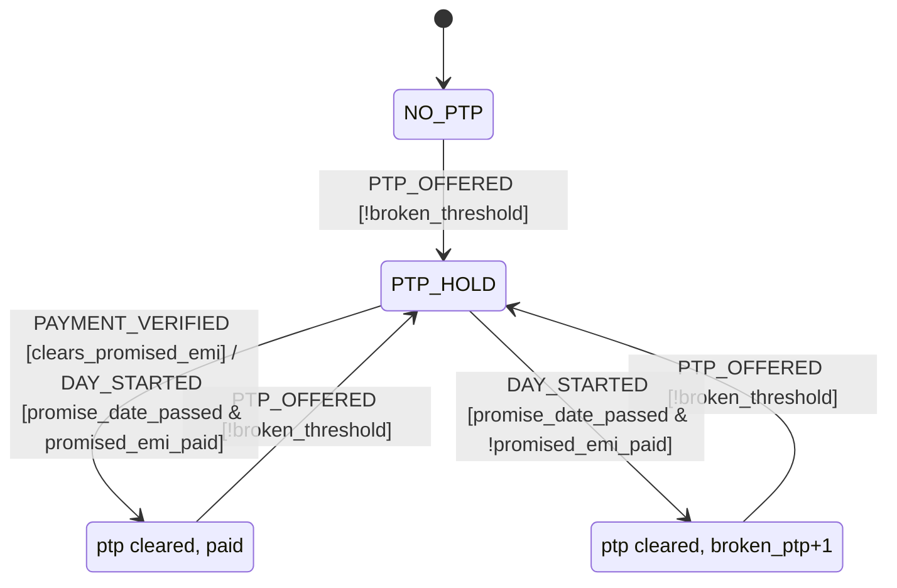

States: `NO_PTP`, `PTP_HOLD`, `PTP_KEPT`, `PTP_BROKEN`. Initial: `NO_PTP`. Final: none (the lifecycle repeats). Fingerprint `7fdaba524dac`.

Transitions (self-loops are events that are accepted and change nothing):

| From | Event | Guard | To | Action | Rule / policy |
|---|---|---|---|---|---|
| NO_PTP | PTP_OFFERED | !broken_threshold | PTP_HOLD | ptp_date, ptp_obligation; stop-for-day today; cancel queued | K01 holds.PROMISE_TO_PAY (K13 CAPTURE_PTP) |
| NO_PTP | PTP_OFFERED | broken_threshold | NO_PTP | stop-for-day only | K13 broken_ptp >= threshold: RECORD_PTP_NO_HOLD |
| PTP_KEPT | PTP_OFFERED | !broken_threshold | PTP_HOLD | ptp_date, ptp_obligation; stop-for-day today; cancel queued | K01 holds.PROMISE_TO_PAY (K13 CAPTURE_PTP) |
| PTP_KEPT | PTP_OFFERED | broken_threshold | PTP_KEPT | stop-for-day only | K13 broken_ptp >= threshold: RECORD_PTP_NO_HOLD |
| PTP_BROKEN | PTP_OFFERED | !broken_threshold | PTP_HOLD | ptp_date, ptp_obligation; stop-for-day today; cancel queued | K01 holds.PROMISE_TO_PAY (K13 CAPTURE_PTP) |
| PTP_BROKEN | PTP_OFFERED | broken_threshold | PTP_BROKEN | stop-for-day only | K13 broken_ptp >= threshold: RECORD_PTP_NO_HOLD |
| PTP_HOLD | PTP_OFFERED | !broken_threshold | PTP_HOLD | ptp_date, ptp_obligation; stop-for-day today; cancel queued | K01 holds.PROMISE_TO_PAY (K13 CAPTURE_PTP; replaces the open promise) |
| PTP_HOLD | PTP_OFFERED | broken_threshold | PTP_HOLD | stop-for-day only | K13 broken_ptp >= threshold: RECORD_PTP_NO_HOLD |
| PTP_HOLD | PAYMENT_VERIFIED | clears_promised_emi | PTP_KEPT | cancel that EMI's queued touches | K01 holds.PROMISE_TO_PAY.if_paid |
| PTP_HOLD | PAYMENT_VERIFIED | !clears_promised_emi | PTP_HOLD | — | another EMI, or partial: hold stays (E14) |
| PTP_HOLD | DAY_STARTED | promise_date_passed & promised_emi_paid | PTP_KEPT | — | K01 holds.PROMISE_TO_PAY.on_ptp_date |
| PTP_HOLD | DAY_STARTED | promise_date_passed & !promised_emi_paid | PTP_BROKEN | broken_ptp += 1 | K01 holds.PROMISE_TO_PAY.if_unpaid_by_end_of_ptp_date |
| PTP_HOLD | DAY_STARTED | !promise_date_passed | PTP_HOLD | — | hold runs through the PTP date (inclusive) |
| NO_PTP | PAYMENT_VERIFIED | — | NO_PTP | — | no open promise |
| NO_PTP | DAY_STARTED | — | NO_PTP | — | no open promise |
| PTP_KEPT | PAYMENT_VERIFIED | — | PTP_KEPT | — | no open promise |
| PTP_KEPT | DAY_STARTED | — | PTP_KEPT | — | no open promise |
| PTP_BROKEN | PAYMENT_VERIFIED | — | PTP_BROKEN | — | no open promise |
| PTP_BROKEN | DAY_STARTED | — | PTP_BROKEN | — | no open promise |

**Enforced by:** `kairos_backend/ledger.py: apply_exception (PTP_HOLD), record_payment_verified, start_day`; `kairos_backend/gate.py: PTP_HOLD rule`

**Proven by:** tests/fsm/test_conformance_holds.py; tests/test_ledger.py

### 9. `k13.hold.hardship` (v1)

**Purpose.** Hardship pauses every channel (Gate WAIT, or HANDOFF when the borrower's date is beyond 4 days).

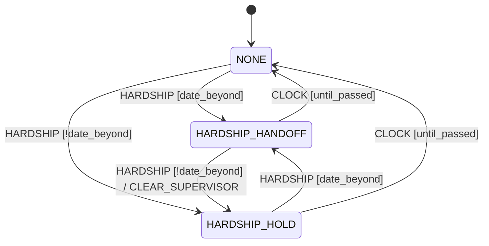

States: `NONE`, `HARDSHIP_HOLD`, `HARDSHIP_HANDOFF`. Initial: `NONE`. Final: none (the lifecycle repeats). Fingerprint `60a6a4eb54e3`.

Transitions (self-loops are events that are accepted and change nothing):

| From | Event | Guard | To | Action | Rule / policy |
|---|---|---|---|---|---|
| NONE | HARDSHIP | date_beyond | HARDSHIP_HANDOFF | hardship_until=date, supervisor=1, ticket | K01 holds.HARDSHIP.if_borrower_gives_date_beyond_4_days |
| NONE | HARDSHIP | !date_beyond | HARDSHIP_HOLD | hardship_until=date or +2 days, supervisor=0 | K01 holds.HARDSHIP.if_no_date / within 4 days |
| HARDSHIP_HOLD | HARDSHIP | date_beyond | HARDSHIP_HANDOFF | hardship_until=date, supervisor=1, ticket | K01 holds.HARDSHIP.if_borrower_gives_date_beyond_4_days |
| HARDSHIP_HOLD | HARDSHIP | !date_beyond | HARDSHIP_HOLD | hardship_until=date or +2 days, supervisor=0 | K01 holds.HARDSHIP.if_no_date / within 4 days |
| HARDSHIP_HANDOFF | HARDSHIP | date_beyond | HARDSHIP_HANDOFF | hardship_until=date, supervisor=1, ticket | K01 holds.HARDSHIP.if_borrower_gives_date_beyond_4_days |
| HARDSHIP_HANDOFF | HARDSHIP | !date_beyond | HARDSHIP_HOLD | hardship_until=date or +2 days, supervisor=0 | K01 holds.HARDSHIP.if_no_date / within 4 days |
| HARDSHIP_HOLD | CLOCK | until_passed | NONE | — | hold ends at hardship_until (Gate compares at send time) |
| HARDSHIP_HOLD | CLOCK | !until_passed | HARDSHIP_HOLD | — | still held |
| HARDSHIP_HANDOFF | CLOCK | until_passed | NONE | — | hold ends at hardship_until |
| HARDSHIP_HANDOFF | CLOCK | !until_passed | HARDSHIP_HANDOFF | — | still held (HANDOFF) |
| HARDSHIP_HANDOFF | CLEAR_SUPERVISOR | — | HARDSHIP_HOLD | hardship_supervisor=0 | Ledger.clear_supervisor_hold (a person): the date hold itself stays |
| NONE | CLOCK | — | NONE | — | nothing held |
| NONE | CLEAR_SUPERVISOR | — | NONE | — | no supervisor flag on this hold |
| HARDSHIP_HOLD | CLEAR_SUPERVISOR | — | HARDSHIP_HOLD | — | no supervisor flag on this hold |

**Enforced by:** `kairos_backend/ledger.py: apply_exception (HARDSHIP_HOLD), clear_supervisor_hold`; `kairos_backend/gate.py: HARDSHIP_HOLD rule`

**Proven by:** tests/fsm/test_conformance_holds.py

### 10. `k13.hold.callback` (v1)

**Purpose.** A borrower asked for a person: all outbound nudges pause until the callback is answered or missed twice.

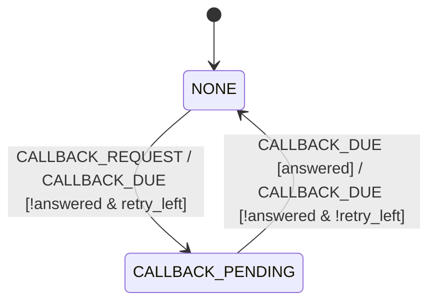

States: `NONE`, `CALLBACK_PENDING`. Initial: `NONE`. Final: none (the lifecycle repeats). Fingerprint `3f48c157b155`.

Transitions (self-loops are events that are accepted and change nothing):

| From | Event | Guard | To | Action | Rule / policy |
|---|---|---|---|---|---|
| NONE | CALLBACK_REQUEST | — | CALLBACK_PENDING | ticket (deduped per day), pause all outbound | K13 callback (E08).while_pending |
| NONE | CALLBACK_DUE | answered | NONE | close task; stop-for-day | K13 callback (E08).if_answered |
| NONE | CALLBACK_DUE | !answered & retry_left | CALLBACK_PENDING | retry in 2 h | K13 callback (E08).if_unanswered |
| NONE | CALLBACK_DUE | !answered & !retry_left | NONE | one 'we tried to reach you' message; stop-for-day | K13 callback (E08).if_second_attempt_missed |
| CALLBACK_PENDING | CALLBACK_REQUEST | — | CALLBACK_PENDING | ticket (deduped per day), pause all outbound | K13 callback (E08).while_pending |
| CALLBACK_PENDING | CALLBACK_DUE | answered | NONE | close task; stop-for-day | K13 callback (E08).if_answered |
| CALLBACK_PENDING | CALLBACK_DUE | !answered & retry_left | CALLBACK_PENDING | retry in 2 h | K13 callback (E08).if_unanswered |
| CALLBACK_PENDING | CALLBACK_DUE | !answered & !retry_left | NONE | one 'we tried to reach you' message; stop-for-day | K13 callback (E08).if_second_attempt_missed |

**Enforced by:** `kairos_backend/ledger.py: apply_exception (CALLBACK_PENDING)`; `kairos_backend/gate.py: CALLBACK_PENDING rule`

**Proven by:** tests/fsm/test_conformance_holds.py

### 11. `k13.hold.supervisor` (v1)

**Purpose.** Paused on every channel until a person clears it. Kairos never lifts it on its own.

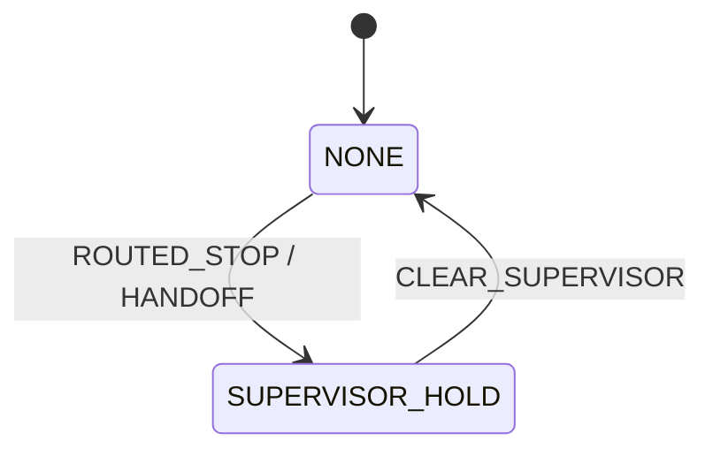

States: `NONE`, `SUPERVISOR_HOLD`. Initial: `NONE`. Final: none (the lifecycle repeats). Fingerprint `cf1774c66b45`.

Transitions (self-loops are events that are accepted and change nothing):

| From | Event | Guard | To | Action | Rule / policy |
|---|---|---|---|---|---|
| NONE | ROUTED_STOP | — | SUPERVISOR_HOLD | ticket; cancel queued | K13 routed_exceptions ABUSIVE / LEGAL_THREAT / FRAUD_CLAIM |
| NONE | HANDOFF | — | SUPERVISOR_HOLD | ticket; cancel queued | voice LedgerHandoff / HITL pause, hold, handoff (k17-k18, k06/hitl-control) |
| NONE | CLEAR_SUPERVISOR | — | NONE | supervisor_hold=0 | Ledger.clear_supervisor_hold (a person) |
| SUPERVISOR_HOLD | ROUTED_STOP | — | SUPERVISOR_HOLD | ticket; cancel queued | K13 routed_exceptions ABUSIVE / LEGAL_THREAT / FRAUD_CLAIM |
| SUPERVISOR_HOLD | HANDOFF | — | SUPERVISOR_HOLD | ticket; cancel queued | voice LedgerHandoff / HITL pause, hold, handoff (k17-k18, k06/hitl-control) |
| SUPERVISOR_HOLD | CLEAR_SUPERVISOR | — | NONE | supervisor_hold=0 | Ledger.clear_supervisor_hold (a person) |

**Enforced by:** `kairos_backend/ledger.py: apply_exception (SUPERVISOR_HOLD), clear_supervisor_hold`; `kairos_backend/gate.py: SUPERVISOR_HOLD rule`

**Proven by:** tests/fsm/test_conformance_holds.py

### 12. `k01.consent` (v1)

**Purpose.** Contactability of one borrower on one channel, as the Gate sees it (STOP_OPT_OUT -> CANCEL, CONSENT -> WAIT). The initial state is whatever the K03 consents table says; CONTACTABLE is drawn as the start.

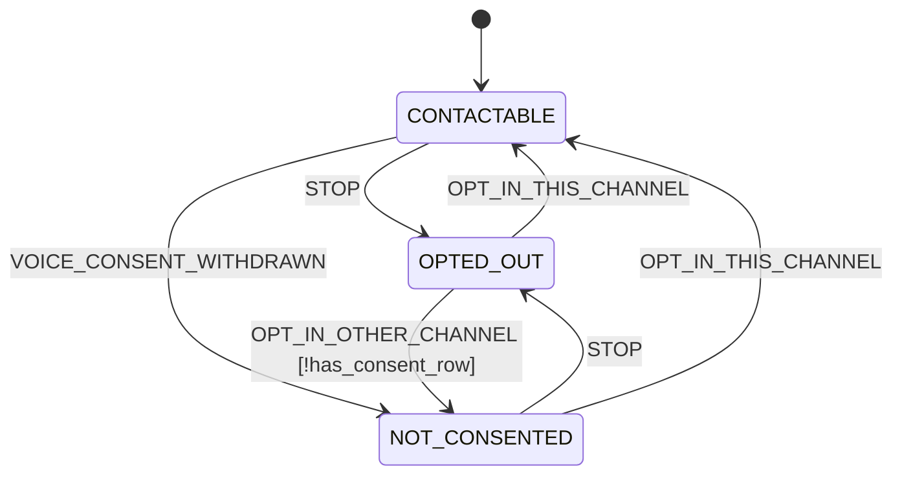

States: `CONTACTABLE`, `NOT_CONSENTED`, `OPTED_OUT`. Initial: `CONTACTABLE`. Final: none (the lifecycle repeats). Fingerprint `fb8178aa84e7`.

Transitions (self-loops are events that are accepted and change nothing):

| From | Event | Guard | To | Action | Rule / policy |
|---|---|---|---|---|---|
| CONTACTABLE | STOP | — | OPTED_OUT | cancel ALL queued sends; K03 consent_changed | K01 holds.STOP_OPT_OUT: STOP on any channel suppresses all channels |
| CONTACTABLE | OPT_IN_THIS_CHANNEL | — | CONTACTABLE | consent version recorded | K01 holds.STOP_OPT_OUT.re_entry (per channel) |
| CONTACTABLE | VOICE_CONSENT_WITHDRAWN | — | NOT_CONSENTED | consented=0 on voice channels | K17 WRONG_PERSON / THIRD_PARTY (k17-k18, voice channels only) |
| NOT_CONSENTED | STOP | — | OPTED_OUT | cancel ALL queued sends; K03 consent_changed | K01 holds.STOP_OPT_OUT: STOP on any channel suppresses all channels |
| NOT_CONSENTED | OPT_IN_THIS_CHANNEL | — | CONTACTABLE | consent version recorded | K01 holds.STOP_OPT_OUT.re_entry (per channel) |
| NOT_CONSENTED | VOICE_CONSENT_WITHDRAWN | — | NOT_CONSENTED | consented=0 on voice channels | K17 WRONG_PERSON / THIRD_PARTY (k17-k18, voice channels only) |
| OPTED_OUT | STOP | — | OPTED_OUT | cancel ALL queued sends; K03 consent_changed | K01 holds.STOP_OPT_OUT: STOP on any channel suppresses all channels |
| OPTED_OUT | OPT_IN_THIS_CHANNEL | — | CONTACTABLE | consent version recorded | K01 holds.STOP_OPT_OUT.re_entry (per channel) |
| OPTED_OUT | VOICE_CONSENT_WITHDRAWN | — | OPTED_OUT | consented=0 on voice channels | K17 WRONG_PERSON / THIRD_PARTY (k17-k18, voice channels only) |
| OPTED_OUT | OPT_IN_OTHER_CHANNEL | has_consent_row | OPTED_OUT | — | K01 holds.STOP_OPT_OUT.re_entry: other channels stay opted out |
| OPTED_OUT | OPT_IN_OTHER_CHANNEL | !has_consent_row | NOT_CONSENTED | — | no consent row for this channel: borrower stop flag lifted, still no consent (WAIT NO_CONSENT) |
| CONTACTABLE | OPT_IN_OTHER_CHANNEL | — | CONTACTABLE | — | other channel only |
| NOT_CONSENTED | OPT_IN_OTHER_CHANNEL | — | NOT_CONSENTED | — | other channel only |

**Enforced by:** `kairos_backend/ledger.py: record_stop / opt_in / facts_for`; `kairos_backend/gate.py: STOP_OPT_OUT, CONSENT`

**Proven by:** tests/fsm/test_conformance_holds.py

### 13. `k09.intent` (v1)

**Purpose.** Classify one inbound borrower message into a closed intent enum. Deterministic rules first; at most ONE LLM call, only for free text the rules cannot decide. The LLM's answer is a *value* (an event for k13.exception / STOP / payment verification), never a transition: what the intent does is decided by the K13 table, the Gate and the ledger.

**LLM role:** classify only (an event value, never a transition).

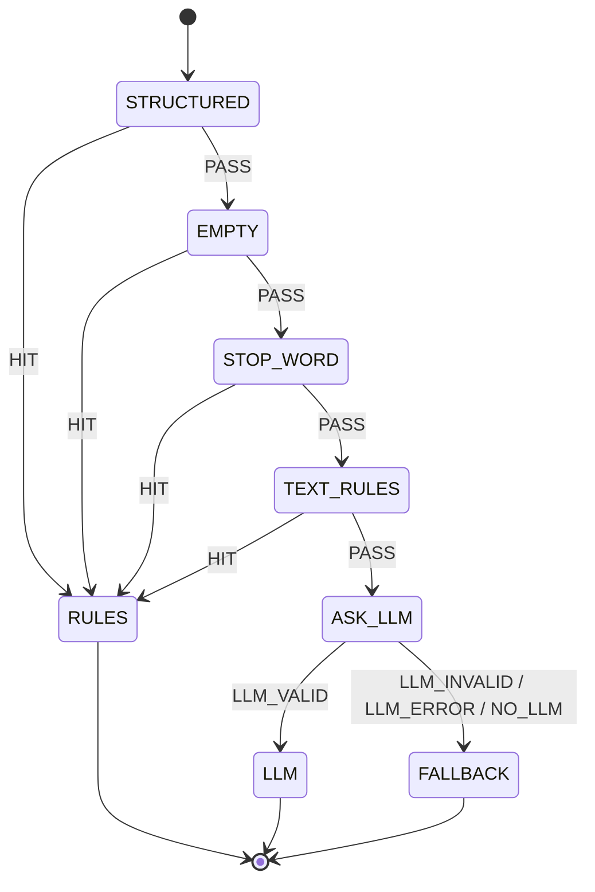

States: `STRUCTURED`, `EMPTY`, `STOP_WORD`, `TEXT_RULES`, `ASK_LLM`, `RULES`, `LLM`, `FALLBACK`. Initial: `STRUCTURED`. Final: `FALLBACK`, `LLM`, `RULES`. Fingerprint `53ed3b1d9ec3`.

Transitions (self-loops are events that are accepted and change nothing):

| From | Event | Guard | To | Action | Rule / policy |
|---|---|---|---|---|---|
| STRUCTURED | HIT | — | RULES | DTMF map / WhatsApp button map | kairos_backend/intent.py IntentClassifier.classify: structured input never reaches the LLM |
| STRUCTURED | PASS | — | EMPTY | — | no DTMF digits, no button payload |
| EMPTY | HIT | — | RULES | OTHER (ambiguous) | empty text |
| EMPTY | PASS | — | STOP_WORD | — | has text |
| STOP_WORD | HIT | — | RULES | STOP | K01 holds.STOP_OPT_OUT keywords on any channel: never the LLM |
| STOP_WORD | PASS | — | TEXT_RULES | — | not an opt-out |
| TEXT_RULES | HIT | — | RULES | one rule intent / bare date -> PTP / dated conflict -> PRECEDENCE | English + Hinglish keyword rules and date extraction |
| TEXT_RULES | PASS | — | ASK_LLM | redact + truncate (500 chars) | no rule matched, or rules conflict without a date |
| ASK_LLM | LLM_VALID | — | LLM | intent from the closed enum; summary <= 160 chars | gpt-6-luna, reasoning effort none, no tools, strict JSON schema, store=false |
| ASK_LLM | LLM_INVALID | — | FALLBACK | OTHER, ambiguous, needs review | schema / refusal / incomplete |
| ASK_LLM | LLM_ERROR | — | FALLBACK | OTHER, ambiguous, needs review | transport error never reaches the caller |
| ASK_LLM | NO_LLM | — | FALLBACK | OTHER, ambiguous, needs review | no LLM configured |

**Enforced by:** `kairos_backend/intent.py: IntentClassifier.classify / LunaClient / validate_llm_output`

**Proven by:** tests/fsm/test_conformance_intent.py (seeded random messages, spy LLM); tests/test_intent.py

### 14. `k17.payment_claim` (v0.1.0-draft)

> Declared from `origin/k17-k18/voice-engine`, which is not merged here. Its conformance test runs once that branch is merged.

**Purpose.** A borrower says they already paid. A claim is never a payment: reminders pause for 48 h while the ledger waits for D7/LMS; only Ledger.record_payment_verified clears an EMI. There is no REJECTED state in the code: a fake claim simply EXPIRES (see findings).

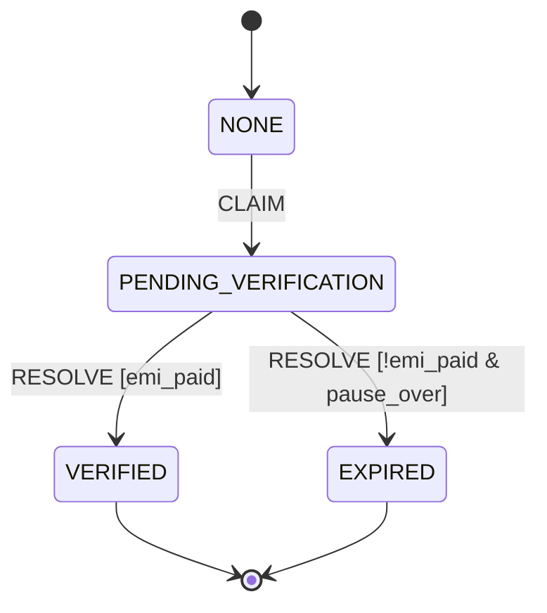

States: `NONE`, `PENDING_VERIFICATION`, `VERIFIED`, `EXPIRED`. Initial: `NONE`. Final: `EXPIRED`, `VERIFIED`. Fingerprint `0faf9fb32659`.

Transitions (self-loops are events that are accepted and change nothing):

| From | Event | Guard | To | Action | Rule / policy |
|---|---|---|---|---|---|
| NONE | CLAIM | — | PENDING_VERIFICATION | stop_for_day rows for every day the 48 h pause touches; cancel those days' queued touches; NEVER mark paid | K17 thresholds.json payment_claim (ALREADY_PAID >= accept_at) |
| PENDING_VERIFICATION | RESOLVE | emi_paid | VERIFIED | — | the ledger (D7/LMS via Ledger.record_payment_verified) shows the EMI fully paid |
| PENDING_VERIFICATION | RESOLVE | !emi_paid & pause_over | EXPIRED | — | no verification within pause_hours: reminders resume on their own |
| PENDING_VERIFICATION | RESOLVE | !emi_paid & !pause_over | PENDING_VERIFICATION | — | still waiting |
| VERIFIED | RESOLVE | — | VERIFIED | — | final: resolve_payment_claims only reads PENDING_VERIFICATION |
| EXPIRED | RESOLVE | — | EXPIRED | — | final: resolve_payment_claims only reads PENDING_VERIFICATION |

**Enforced by:** `kairos_backend/voice/ingest.py (k17-k18/voice-engine): VoiceIngester._payment_claim / resolve_payment_claims`

**Proven by:** tests/fsm/test_conformance_voice.py (runs when kairos_backend.voice is present)

### 15. `k06.hitl.approval` (v0.1.0)

> Declared from `origin/k06/hitl-control`, which is not merged here. Its conformance test runs once that branch is merged.

**Purpose.** A send that passed every guardrail but matches an approval rule waits for a person. Approval can only make outreach stricter: the Gate runs again at approval and at send time. RESCHEDULED is final here; the code can restore it when the new slot is refused (see findings).

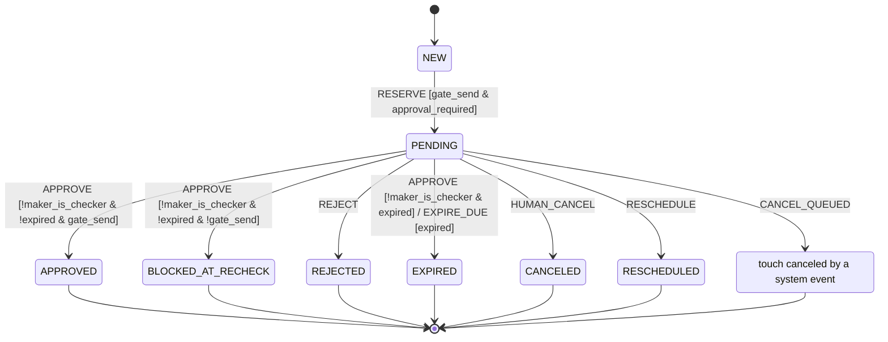

States: `NEW`, `PENDING`, `APPROVED`, `BLOCKED_AT_RECHECK`, `REJECTED`, `EXPIRED`, `CANCELED`, `RESCHEDULED`, `WITHDRAWN`. Initial: `NEW`. Final: `APPROVED`, `BLOCKED_AT_RECHECK`, `CANCELED`, `EXPIRED`, `REJECTED`, `RESCHEDULED`, `WITHDRAWN`. Fingerprint `bfca9c7776c5`.

Transitions (self-loops are events that are accepted and change nothing):

| From | Event | Guard | To | Action | Rule / policy |
|---|---|---|---|---|---|
| NEW | RESERVE | gate_send & approval_required | PENDING | touch PENDING_APPROVAL (holds cap slot + budget) | K06 HITL approval_policy.json approval_rules (VOICE_CHANNEL, STANDARD_INTENSITY_HIGH_DPD, FIRST_SEND_AFTER_HARDSHIP, MANUAL_DISPATCH) |
| PENDING | APPROVE | maker_is_checker | PENDING | HUMAN_ACTION_REFUSED audited | K06 HITL approval_policy.json approval.maker_checker |
| PENDING | APPROVE | !maker_is_checker & expired | EXPIRED | touch CANCELED, budget released | K06 HITL approval_policy.json approval.expiry END_OF_CONTACT_WINDOW |
| PENDING | APPROVE | !maker_is_checker & !expired & gate_send | APPROVED | touch RESERVED | Gate re-run atomically at approval; Executor re-checks again at send time |
| PENDING | APPROVE | !maker_is_checker & !expired & !gate_send | BLOCKED_AT_RECHECK | touch CANCELED, budget released | the guardrail wins, the approval cannot |
| PENDING | REJECT | — | REJECTED | touch CANCELED, budget released | HITL.reject |
| PENDING | EXPIRE_DUE | expired | EXPIRED | touch CANCELED, budget released | HITL.expire_due / tick |
| PENDING | EXPIRE_DUE | !expired | PENDING | — | not yet |
| PENDING | HUMAN_CANCEL | — | CANCELED | touch CANCELED, budget released | HITL.cancel_scheduled / cancel_next |
| PENDING | RESCHEDULE | — | RESCHEDULED | touch CANCELED; a NEW instruction through the full Gate | HITL.reschedule |
| PENDING | CANCEL_QUEUED | — | WITHDRAWN | touch CANCELED; approval decision left NULL | STOP / holds / payment / pause cancel PENDING_APPROVAL like RESERVED |
| APPROVED | APPROVE | — | APPROVED | — | Conflict NOT_PENDING_<status>: nothing changes |
| APPROVED | REJECT | — | APPROVED | — | Conflict NOT_PENDING_<status>: nothing changes |
| BLOCKED_AT_RECHECK | APPROVE | — | BLOCKED_AT_RECHECK | — | Conflict NOT_PENDING_<status>: nothing changes |
| BLOCKED_AT_RECHECK | REJECT | — | BLOCKED_AT_RECHECK | — | Conflict NOT_PENDING_<status>: nothing changes |
| REJECTED | APPROVE | — | REJECTED | — | Conflict NOT_PENDING_<status>: nothing changes |
| REJECTED | REJECT | — | REJECTED | — | Conflict NOT_PENDING_<status>: nothing changes |
| EXPIRED | APPROVE | — | EXPIRED | — | Conflict NOT_PENDING_<status>: nothing changes |
| EXPIRED | REJECT | — | EXPIRED | — | Conflict NOT_PENDING_<status>: nothing changes |
| CANCELED | APPROVE | — | CANCELED | — | Conflict NOT_PENDING_<status>: nothing changes |
| CANCELED | REJECT | — | CANCELED | — | Conflict NOT_PENDING_<status>: nothing changes |
| WITHDRAWN | APPROVE | — | WITHDRAWN | — | Conflict NOT_PENDING_<status>: nothing changes |
| WITHDRAWN | REJECT | — | WITHDRAWN | — | Conflict NOT_PENDING_<status>: nothing changes |

**Enforced by:** `kairos_backend/hitl.py (k06/hitl-control): HITL._on_reserve / approve / reject / expire_due / cancel_scheduled / reschedule`

**Proven by:** tests/fsm/test_conformance_hitl.py (runs when kairos_backend.hitl is present)

### 16. `k17.voice.disposition` (v0.1.0-draft)

> Declared from `origin/k17-k18/voice-engine`, which is not merged here. Its conformance test runs once that branch is merged.

**Purpose.** The Sarvam bot (an LLM) only *classifies* the call into one of 16 dispositions with a confidence; Kairos — not the bot — decides what it does. Safety first: a low-confidence STOP / hardship / abuse still goes to a person; a low-confidence PTP / paid / callback never creates a hold or a payment.

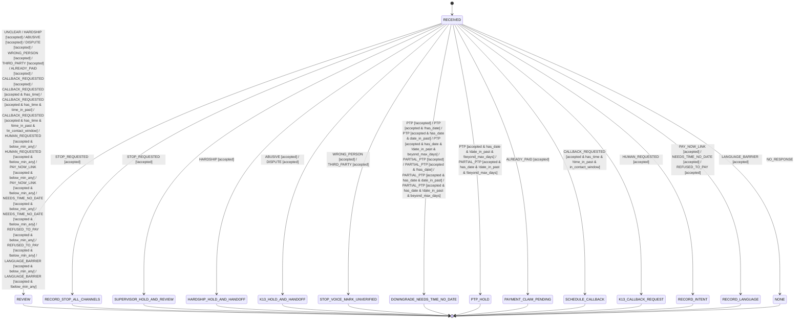

States: `RECEIVED`, `REVIEW`, `RECORD_STOP_ALL_CHANNELS`, `SUPERVISOR_HOLD_AND_REVIEW`, `HARDSHIP_HOLD_AND_HANDOFF`, `K13_HOLD_AND_HANDOFF`, `STOP_VOICE_MARK_UNVERIFIED`, `DOWNGRADE_NEEDS_TIME_NO_DATE`, `PTP_HOLD`, `PAYMENT_CLAIM_PENDING`, `SCHEDULE_CALLBACK`, `K13_CALLBACK_REQUEST`, `RECORD_INTENT`, `RECORD_LANGUAGE`, `NONE`. Initial: `RECEIVED`. Final: `DOWNGRADE_NEEDS_TIME_NO_DATE`, `HARDSHIP_HOLD_AND_HANDOFF`, `K13_CALLBACK_REQUEST`, `K13_HOLD_AND_HANDOFF`, `NONE`, `PAYMENT_CLAIM_PENDING`, `PTP_HOLD`, `RECORD_INTENT`, `RECORD_LANGUAGE`, `RECORD_STOP_ALL_CHANNELS`, `REVIEW`, `SCHEDULE_CALLBACK`, `STOP_VOICE_MARK_UNVERIFIED`, `SUPERVISOR_HOLD_AND_REVIEW`. Fingerprint `f28d6c193e56`.

Transitions (self-loops are events that are accepted and change nothing):

| From | Event | Guard | To | Action | Rule / policy |
|---|---|---|---|---|---|
| RECEIVED | UNCLEAR | — | REVIEW | human review ticket | K17 thresholds.json v0.1.0-draft: unknown disposition |
| RECEIVED | STOP_REQUESTED | accepted | RECORD_STOP_ALL_CHANNELS | — | K17 thresholds.json v0.1.0-draft rules.STOP_REQUESTED accept_at=0.5 |
| RECEIVED | STOP_REQUESTED | !accepted | SUPERVISOR_HOLD_AND_REVIEW | — | K17 thresholds.json v0.1.0-draft rules.STOP_REQUESTED accept_at=0.5 (below) |
| RECEIVED | HARDSHIP | accepted | HARDSHIP_HOLD_AND_HANDOFF | — | K17 thresholds.json v0.1.0-draft rules.HARDSHIP accept_at=0.5 |
| RECEIVED | HARDSHIP | !accepted | REVIEW | — | K17 thresholds.json v0.1.0-draft rules.HARDSHIP accept_at=0.5 (below) |
| RECEIVED | ABUSIVE | accepted | K13_HOLD_AND_HANDOFF | — | K17 thresholds.json v0.1.0-draft rules.ABUSIVE accept_at=0.6 |
| RECEIVED | ABUSIVE | !accepted | REVIEW | — | K17 thresholds.json v0.1.0-draft rules.ABUSIVE accept_at=0.6 (below) |
| RECEIVED | DISPUTE | accepted | K13_HOLD_AND_HANDOFF | — | K17 thresholds.json v0.1.0-draft rules.DISPUTE accept_at=0.6 |
| RECEIVED | DISPUTE | !accepted | REVIEW | — | K17 thresholds.json v0.1.0-draft rules.DISPUTE accept_at=0.6 (below) |
| RECEIVED | WRONG_PERSON | accepted | STOP_VOICE_MARK_UNVERIFIED | — | K17 thresholds.json v0.1.0-draft rules.WRONG_PERSON accept_at=0.8 |
| RECEIVED | WRONG_PERSON | !accepted | REVIEW | — | K17 thresholds.json v0.1.0-draft rules.WRONG_PERSON accept_at=0.8 (below) |
| RECEIVED | THIRD_PARTY | accepted | STOP_VOICE_MARK_UNVERIFIED | — | K17 thresholds.json v0.1.0-draft rules.THIRD_PARTY accept_at=0.8 |
| RECEIVED | THIRD_PARTY | !accepted | REVIEW | — | K17 thresholds.json v0.1.0-draft rules.THIRD_PARTY accept_at=0.8 (below) |
| RECEIVED | PTP | !accepted | DOWNGRADE_NEEDS_TIME_NO_DATE | treated as NEEDS_TIME_NO_DATE | K17 thresholds.json v0.1.0-draft rules.PTP accept_at=0.8 (LOW_CONFIDENCE) |
| RECEIVED | PTP | accepted & !has_date | DOWNGRADE_NEEDS_TIME_NO_DATE | treated as NEEDS_TIME_NO_DATE | K17 thresholds.json v0.1.0-draft rules.PTP accept_at=0.8 (NO_DATE) |
| RECEIVED | PTP | accepted & has_date & date_in_past | DOWNGRADE_NEEDS_TIME_NO_DATE | treated as NEEDS_TIME_NO_DATE | K17 thresholds.json v0.1.0-draft rules.PTP accept_at=0.8 (DATE_IN_PAST) |
| RECEIVED | PTP | accepted & has_date & !date_in_past & beyond_max_days | DOWNGRADE_NEEDS_TIME_NO_DATE | treated as NEEDS_TIME_NO_DATE | K17 thresholds.json v0.1.0-draft ptp.max_ptp_days_by_band / by_use_case (BEYOND_MAX_DAYS) |
| RECEIVED | PTP | accepted & has_date & !date_in_past & !beyond_max_days | PTP_HOLD | K13 PTP_OFFERED -> PTP hold + PTP_FOLLOW_UP | K17 thresholds.json v0.1.0-draft rules.PTP accept_at=0.8 |
| RECEIVED | PARTIAL_PTP | !accepted | DOWNGRADE_NEEDS_TIME_NO_DATE | treated as NEEDS_TIME_NO_DATE | K17 thresholds.json v0.1.0-draft rules.PARTIAL_PTP accept_at=0.8 (LOW_CONFIDENCE) |
| RECEIVED | PARTIAL_PTP | accepted & !has_date | DOWNGRADE_NEEDS_TIME_NO_DATE | treated as NEEDS_TIME_NO_DATE | K17 thresholds.json v0.1.0-draft rules.PARTIAL_PTP accept_at=0.8 (NO_DATE) |
| RECEIVED | PARTIAL_PTP | accepted & has_date & date_in_past | DOWNGRADE_NEEDS_TIME_NO_DATE | treated as NEEDS_TIME_NO_DATE | K17 thresholds.json v0.1.0-draft rules.PARTIAL_PTP accept_at=0.8 (DATE_IN_PAST) |
| RECEIVED | PARTIAL_PTP | accepted & has_date & !date_in_past & beyond_max_days | DOWNGRADE_NEEDS_TIME_NO_DATE | treated as NEEDS_TIME_NO_DATE | K17 thresholds.json v0.1.0-draft ptp.max_ptp_days_by_band / by_use_case (BEYOND_MAX_DAYS) |
| RECEIVED | PARTIAL_PTP | accepted & has_date & !date_in_past & !beyond_max_days | PTP_HOLD | K13 PTP_OFFERED -> PTP hold + PTP_FOLLOW_UP | K17 thresholds.json v0.1.0-draft rules.PARTIAL_PTP accept_at=0.8 |
| RECEIVED | ALREADY_PAID | accepted | PAYMENT_CLAIM_PENDING | — | K17 thresholds.json v0.1.0-draft rules.ALREADY_PAID accept_at=0.6 |
| RECEIVED | ALREADY_PAID | !accepted | REVIEW | — | K17 thresholds.json v0.1.0-draft rules.ALREADY_PAID accept_at=0.6 (below) |
| RECEIVED | CALLBACK_REQUESTED | !accepted | REVIEW | human review ticket | K17 thresholds.json v0.1.0-draft rules.CALLBACK_REQUESTED accept_at=0.7 |
| RECEIVED | CALLBACK_REQUESTED | accepted & !has_time | REVIEW | human review ticket | K17 thresholds.json v0.1.0-draft (CALLBACK_WITHOUT_TIME) |
| RECEIVED | CALLBACK_REQUESTED | accepted & has_time & time_in_past | REVIEW | human review ticket | K17 thresholds.json v0.1.0-draft callback.must_be_in_future |
| RECEIVED | CALLBACK_REQUESTED | accepted & has_time & !time_in_past & !in_contact_window | REVIEW | human review ticket | K17 thresholds.json v0.1.0-draft callback.must_be_inside_contact_window |
| RECEIVED | CALLBACK_REQUESTED | accepted & has_time & !time_in_past & in_contact_window | SCHEDULE_CALLBACK | Supervisor.decide voicebot touch (full Gate) | K17 thresholds.json v0.1.0-draft rules.CALLBACK_REQUESTED accept_at=0.7 |
| RECEIVED | HUMAN_REQUESTED | accepted | K13_CALLBACK_REQUEST | — | K17 thresholds.json v0.1.0-draft rules.HUMAN_REQUESTED accept_at=0.6 |
| RECEIVED | HUMAN_REQUESTED | !accepted & below_min_any | REVIEW | human review ticket (UNCLEAR) | K17 thresholds.json v0.1.0-draft min_confidence_any=0.6 |
| RECEIVED | HUMAN_REQUESTED | !accepted & !below_min_any | REVIEW | — | K17 thresholds.json v0.1.0-draft rules.HUMAN_REQUESTED accept_at=0.6 (below) |
| RECEIVED | PAY_NOW_LINK | accepted | RECORD_INTENT | — | K17 thresholds.json v0.1.0-draft rules.PAY_NOW_LINK accept_at=0.6 |
| RECEIVED | PAY_NOW_LINK | !accepted & below_min_any | REVIEW | human review ticket (UNCLEAR) | K17 thresholds.json v0.1.0-draft min_confidence_any=0.6 |
| RECEIVED | PAY_NOW_LINK | !accepted & !below_min_any | REVIEW | — | K17 thresholds.json v0.1.0-draft rules.PAY_NOW_LINK accept_at=0.6 (below) |
| RECEIVED | NEEDS_TIME_NO_DATE | accepted | RECORD_INTENT | — | K17 thresholds.json v0.1.0-draft rules.NEEDS_TIME_NO_DATE accept_at=0.6 |
| RECEIVED | NEEDS_TIME_NO_DATE | !accepted & below_min_any | REVIEW | human review ticket (UNCLEAR) | K17 thresholds.json v0.1.0-draft min_confidence_any=0.6 |
| RECEIVED | NEEDS_TIME_NO_DATE | !accepted & !below_min_any | REVIEW | — | K17 thresholds.json v0.1.0-draft rules.NEEDS_TIME_NO_DATE accept_at=0.6 (below) |
| RECEIVED | REFUSED_TO_PAY | accepted | RECORD_INTENT | — | K17 thresholds.json v0.1.0-draft rules.REFUSED_TO_PAY accept_at=0.6 |
| RECEIVED | REFUSED_TO_PAY | !accepted & below_min_any | REVIEW | human review ticket (UNCLEAR) | K17 thresholds.json v0.1.0-draft min_confidence_any=0.6 |
| RECEIVED | REFUSED_TO_PAY | !accepted & !below_min_any | REVIEW | — | K17 thresholds.json v0.1.0-draft rules.REFUSED_TO_PAY accept_at=0.6 (below) |
| RECEIVED | LANGUAGE_BARRIER | accepted | RECORD_LANGUAGE | — | K17 thresholds.json v0.1.0-draft rules.LANGUAGE_BARRIER accept_at=0.6 |
| RECEIVED | LANGUAGE_BARRIER | !accepted & below_min_any | REVIEW | human review ticket (UNCLEAR) | K17 thresholds.json v0.1.0-draft min_confidence_any=0.6 |
| RECEIVED | LANGUAGE_BARRIER | !accepted & !below_min_any | REVIEW | — | K17 thresholds.json v0.1.0-draft rules.LANGUAGE_BARRIER accept_at=0.6 (below) |
| RECEIVED | NO_RESPONSE | — | NONE | — | K17 thresholds.json v0.1.0-draft rules.NO_RESPONSE accept_at=0.0 |

**Enforced by:** `kairos_backend/voice/ingest.py (k17-k18/voice-engine): decide() + VoiceIngester._apply`

**Proven by:** tests/fsm/test_conformance_voice.py (runs when kairos_backend.voice is present)

### 17. `k17.voice.call` (v1)

> Declared from `origin/k17-k18/voice-engine`, which is not merged here. Its conformance test runs once that branch is merged.

**Purpose.** One Sarvam call-end webhook, processed exactly once.

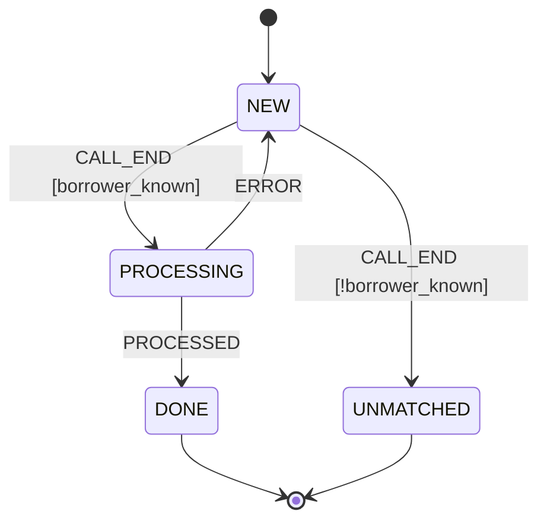

States: `NEW`, `PROCESSING`, `DONE`, `UNMATCHED`. Initial: `NEW`. Final: `DONE`, `UNMATCHED`. Fingerprint `1a58093c90da`.

Transitions (self-loops are events that are accepted and change nothing):

| From | Event | Guard | To | Action | Rule / policy |
|---|---|---|---|---|---|
| NEW | CALL_END | borrower_known | PROCESSING | insert voice_calls row | idempotent by call_id |
| NEW | CALL_END | !borrower_known | UNMATCHED | insert voice_calls row | no borrower for touch_id |
| PROCESSING | PROCESSED | — | DONE | ledger effects + CRM voice.call_disposition | VoiceIngester._process |
| PROCESSING | ERROR | — | NEW | row deleted so the same webhook can be retried | VoiceIngester.ingest |
| PROCESSING | CALL_END | — | PROCESSING | — | duplicate webhook: DUPLICATE, nothing changes |
| DONE | CALL_END | — | DONE | — | duplicate webhook: DUPLICATE, nothing changes |
| UNMATCHED | CALL_END | — | UNMATCHED | — | duplicate webhook: DUPLICATE, nothing changes |

**Enforced by:** `kairos_backend/voice/ingest.py (k17-k18/voice-engine): VoiceIngester.ingest`

**Proven by:** tests/fsm/test_conformance_voice.py (runs when kairos_backend.voice is present)

### 18. `k09.learner.arm` (v1)

**Purpose.** Where one arm's (band x channel x slot) estimate comes from. Only FINAL REPLY / NO_REPLY outcomes move it, once per instruction_id. PRODUCTION ranks by the posterior mean (no randomness); seeded Thompson draws only in SANDBOX / SIMULATOR. On k09/optimize (not merged here) evidence decays with age, so a SEGMENT arm can fall back to POOLED when its weighted count drops below min_segment_obs: that DECAY transition is not declared until that branch lands.

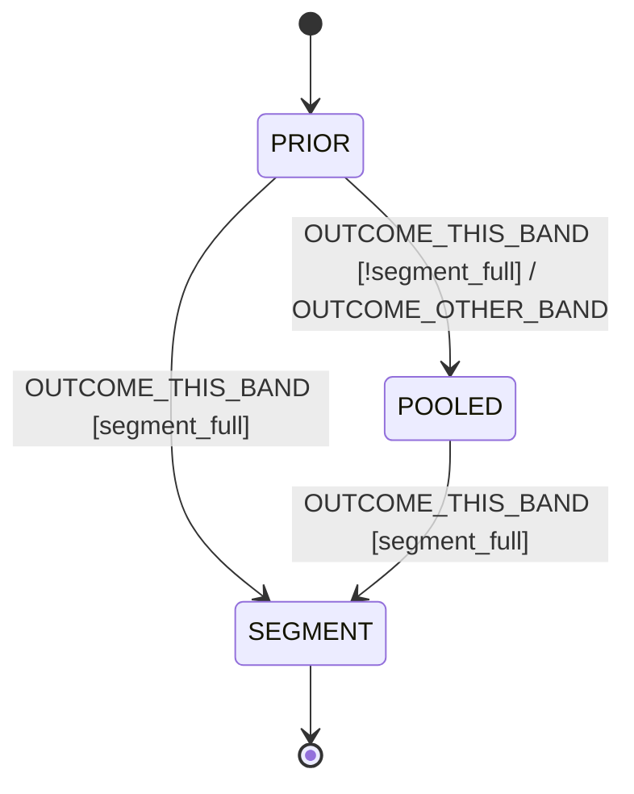

States: `PRIOR`, `POOLED`, `SEGMENT`. Initial: `PRIOR`. Final: `SEGMENT`. Fingerprint `f6d353e611d8`.

Transitions (self-loops are events that are accepted and change nothing):

| From | Event | Guard | To | Action | Rule / policy |
|---|---|---|---|---|---|
| PRIOR | OUTCOME_THIS_BAND | segment_full | SEGMENT | alpha/beta += reward | min_segment_obs reached |
| PRIOR | OUTCOME_THIS_BAND | !segment_full | POOLED | alpha/beta += reward | sparse segment: pooled channel x slot posterior |
| PRIOR | OUTCOME_OTHER_BAND | — | POOLED | — | pooled evidence for this channel x slot |
| POOLED | OUTCOME_THIS_BAND | segment_full | SEGMENT | alpha/beta += reward | min_segment_obs reached |
| POOLED | OUTCOME_THIS_BAND | !segment_full | POOLED | alpha/beta += reward | still sparse |
| POOLED | OUTCOME_OTHER_BAND | — | POOLED | — | pooled evidence grows |
| SEGMENT | OUTCOME_THIS_BAND | — | SEGMENT | alpha/beta += reward | segment posterior |
| SEGMENT | OUTCOME_OTHER_BAND | — | SEGMENT | — | segment posterior unaffected |
| PRIOR | DUPLICATE_OUTCOME | — | PRIOR | — | one update per instruction_id; PENDING / UNRESOLVED never reach the learner |
| PRIOR | NOT_LEARNABLE | — | PRIOR | — | one update per instruction_id; PENDING / UNRESOLVED never reach the learner |
| POOLED | DUPLICATE_OUTCOME | — | POOLED | — | one update per instruction_id; PENDING / UNRESOLVED never reach the learner |
| POOLED | NOT_LEARNABLE | — | POOLED | — | one update per instruction_id; PENDING / UNRESOLVED never reach the learner |
| SEGMENT | DUPLICATE_OUTCOME | — | SEGMENT | — | one update per instruction_id; PENDING / UNRESOLVED never reach the learner |
| SEGMENT | NOT_LEARNABLE | — | SEGMENT | — | one update per instruction_id; PENDING / UNRESOLVED never reach the learner |

**Enforced by:** `kairos_backend/learner.py: BetaBernoulliLearner.apply_outcome / _posteriors / rank`

**Proven by:** tests/fsm/test_conformance_learner.py; tests/test_learner.py

## Voice bots (Sarvam)

_Placeholder._ The voice-bot conversation states (the per-call script states of the six "Kairos - ..."
Sarvam agents) are being written by another agent and were not available when this file was generated.
Regenerate with `python scripts/render_states.py --voice-states <path>` to include them.

What already holds today: the bot only phrases the conversation inside a call and classifies the outcome.
What Kairos does with that classification is `k17.voice.disposition` and `k17.voice.call` below.

## CM-03 WhatsApp servicing agent

_Placeholder._ The CM-03 inbound WhatsApp agent is being built on `cm03/whatsapp-servicing`, which had
not been pushed when this file was generated. Its conversation machine (verification gate → OTP →
servicing intents → handoff) will be declared in `machines.py` and rendered here once the branch lands.
Regenerate with `python scripts/render_states.py --cm03 <path>`.

Rules it must keep, which are already enforced elsewhere: no disclosure before OTP verification, STOP
on WhatsApp suppresses all channels (`k01.consent`), and "already paid" is a claim, never a payment.
