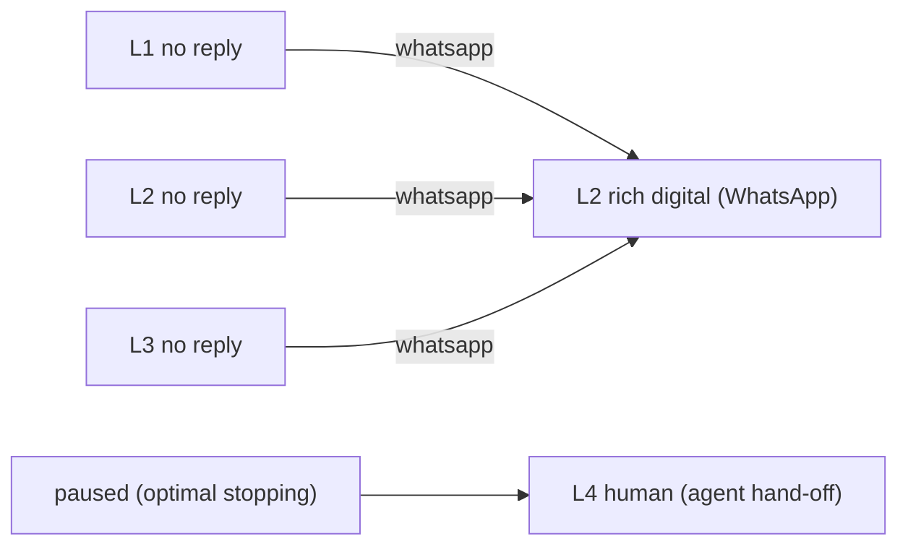

# backend/ — K06 guardrails + executor on the K03 spine

Python service that decides whether a touch **may** be sent, reserves it atomically, dispatches it once, and cancels queued work when the borrower's situation changes. Rules come from [`../policy`](../policy/README.md); borrowers, loans, EMIs, consent and payments come from the **K03 spine**.

## Run

```bash
cd backend
python -m venv .venv
.venv/Scripts/activate            # Windows  (macOS/Linux: source .venv/bin/activate)
pip install -e ".[dev]"
pytest                            # K01 + K13 cases, K06 ledger/executor/API/SupervisorFSM/HITL, K03 spine + K15 replay, K09, K17/K18 voice, K26 reports, K07/K08 channels + Android SMS gateway, K22 templates + compliance checklist, K20 email, red-team (open findings = strict xfail)
python scripts/run_redteam.py     # guardrail red-team: PASS/FAIL per attack -> reports/redteam_report.json (see redteam/README.md)
uvicorn kairos_backend.api:app --reload    # http://127.0.0.1:8000/docs
python scripts/bench_ledger.py 50000       # 50k decisions on K03's synthetic dataset
python scripts/report_pack.py              # K26: seeded SIMULATED campaign -> reports/report_pack/*.csv
```

K03 / K15 scripts (Varun): `python scripts/spine_report.py`, `scripts/make_dataset.py`, `scripts/load_dataset.py`, `scripts/run_replay.py` — see [`spine/README.md`](spine/README.md).

K09 replay (SIMULATED): `python3 scripts/run_k09_replay.py --borrowers 600 --days 7` — see [K09 replay](#k09-replay-simulated).

Environment: `KAIROS_POLICY_DIR` (default `../policy`), `KAIROS_DB` (default `backend/kairos.db`).

## Layout

| Package | Task | Owner | What it does |
|---|---|---|---|
| `spine/` | K03 | Varun | Borrowers, consents, loans, EMIs (obligations), payments, events. Money in paise. Dataset importer + synthetic 50k generator. |
| `replay/` | K15 | Varun | Campaign replay: baseline vs learning policy, dev simulator, 500-chat load test. |
| `kairos_backend/` | K06 | Rehan | Gate, ledger, supervisor (`executor.Supervisor` + `supervisor.SupervisorFSM`), executor, API — reads the spine, never copies it. |
| `kairos_backend/` | K09 | Rehan / Varun | `contracts` (shared types), `learner` (Beta–Bernoulli band × channel × slot), `outcomes` (24 h reply window → one outcome per touch), `borrower_context` (engagement × recency multipliers), `intent` (rules + gpt-6-luna), `intent_stack` (rules → small model → local LLM → cloud LLM, see [Intent stack](#intent-stack-rules--small-model--local-llm--cloud-llm)), `propensity` (demo). |
| `replay/k09.py`, `replay/cn10.py` | K09 | Rehan | K09 replay on the full stack; CN10 cohort-cadence baseline. |
| `redteam/` | — | — | Guardrail red-team suite: 49 adversarial attacks on K01/K13/K06/K03 guardrails, PASS/FAIL report, open findings. [`redteam/README.md`](redteam/README.md) |
| `kairos_backend/channels/` | K07/K08 | Rehan | SIMULATED sms/whatsapp/ivr/voicebot providers, callback normalizer, phone-demo adapters (see [Channels](#channels)). |
| `kairos_backend/templates.py`, `template_compliance.py` | K22 | Yuval | Approved-template selector over `policy/K22-template-catalog/catalog.json` (`sync_to_ledger` feeds the Gate's `TEMPLATE_APPROVED` check) and the 14-rule collections-compliance checklist (see [K22 template selector](#k22-template-selector)). |
| `kairos_backend/email_channel.py` | K20 | Yuval | Email channel: sandbox-only SMTP adapter, labelled REPLAY provider, delivery/bounce/unsubscribe callbacks → ledger (see [Email channel](#email-channel-k20)). |

## How K06 uses the spine

One SQLite file holds both. K03 owns *who / what is owed / what was paid*; K06 owns *campaigns, holds, reservations, audit*.

| Gate fact | Comes from |
|---|---|
| DPD + band | Live from the loan's oldest unpaid EMI due date (K03 rule). Negative = PRE_DUE. Dataset loan with no DPD → HOLD. |
| DPD fresh? | Hours since the spine was last synced (`mark_spine_synced`; `start_day` in simulations) or the loan's `dpd_as_of`. > 24 h → HOLD. |
| Consent / opt-out | K03 `consents` (per channel). STOP sets `opted_out` on every channel; opt-in is per channel. |
| Obligation cleared | That EMI's `amount_paid_paise >= amount_due_paise`. |
| Verified overdue | EMI past its due date and not fully paid. |
| Pool | `budget_per_case_paise` × loans enrolled in the campaign. |
| Collection target | Verified paise collected ÷ overdue at enrolment; loans cured ÷ loans enrolled. Reversals roll back. |

K06 writes back to the spine: `touch_sent` when a send is confirmed, `reply_received` on a reply, `consent_changed` on STOP/opt-in, and payments go through K03's `apply_payment` / `reverse_payment` (one EMI of one loan, never over the amount due, a bank reference used once).

## Flow

```
agent recommendation ──► Supervisor.decide() ──► Ledger.reserve()  ── one write transaction ──┐
                                                   │ facts from K03 spine + K06 holds/counters  │
                                                   │ Gate.evaluate(): K01 rules in policy order │
                                                   └► SEND → touch RESERVED + cost reserved ◄──┘
Executor.dispatch() ──► Ledger.begin_dispatch()  (re-check at send time; else CANCEL + release)
                    ──► Provider.send()          ACCEPTED → SENT · REJECTED → FAILED (release)
                                                 no answer → UNCERTAIN → resolve_uncertain() asks the provider
borrower events (reply, call >10 s, STOP, payment, reversal, K13 exceptions) ──► cancel queued work in scope
```

## Channels

`kairos_backend/channels/` gives the Executor a provider for every outbound channel and turns provider callbacks into ledger updates. Email is K20's (`email_channel.py`); until it lands, `email` is a `FakeProvider`.

```python
from kairos_backend.channels import build_providers, apply_all
providers = build_providers("mock", seed=42, profile="realistic")   # or "phone-demo"; default from $KAIROS_CHANNELS
ex = Executor(ledger, providers)
res = ex.dispatch(instruction_id)
envelopes = apply_all(ledger, providers[channel].callbacks(instruction_id))   # replay the provider's callbacks
```

| Module | What it does |
|---|---|
| `mock.py` | `MockChannelProvider(channel, seed, profile)` for sms / whatsapp / ivr / voicebot, `provenance="SIMULATED"`. Deterministic per (seed, instruction_id). Profiles `realistic` (default), `perfect`, `chaos`, or a dict of overrides (`delivery_rate`, `read_rate`, `click_rate`, `reply_rate`, `stop_rate`, `answer_rate`, `busy_rate`, `valid_digit_rate`, `invalid_digit_rate`, `intent_rate`, `decline_rate`, `duplicate_rate`, `late_rate`, `timeout_rate`, `timeout_lost_share`, `reject_rate`). `callbacks(iid)` returns normalized events in arrival order, duplicates and out-of-order arrivals included. |
| `normalize.py` | `apply_callback(ledger, event)` → envelope `{event_type: provider.delivery / borrower.message / call.outcome, dedupe_key, provenance, applied, duplicate, ignored_reason, counts_as_reply, read_status, reachability, outcome, intent, stop, canceled, touch_status, …}`. Idempotent (claims each `dedupe_key` in a `channel_events` table in the same SQLite file). |
| `phone_demo.py` | `MessagesAppSmsProvider`, `WhatsAppCloudTestProvider`, `click_to_chat_url()`. OFF unless env flags are set; dry-run by default. |
| `android_sms.py` | `AndroidSmsGatewayProvider`: SMS from a team member's Android phone via the open-source SMS Gateway for Android app ([sms-gate.app](https://sms-gate.app), Apache-2.0). Same rails; dry-run by default. |
| `demo_recipients.py` | Runtime allow-list (`~/.kairos/demo_recipients.json`, outside the repo), merged with `KAIROS_DEMO_ALLOWLIST`. |

**Callback rules** (K01 `reply_attribution`, edge cases E02/E04/E06/E10):
- Delivery, read and link-click are never replies. A click only updates reachability (E06).
- SMS read is always `UNKNOWN` — never inferred from delivery (E04).
- Status only moves forward (`ledger.RANK`); a late `SENT` after `DELIVERED`, or any duplicate, changes nothing (E04). A `FAILED` receipt after the touch is `SENT` stays `SENT` in the ledger (it still counts toward caps) and the envelope says `UNREACHABLE`.
- Inbound text: `STOP`/`UNSUBSCRIBE`/`STOPALL`/`CANCEL`/`END`/`QUIT`/`OPT OUT`/`रोकें`/`बंद`, or text starting with `STOP ` → `record_stop` (all channels, all queued work — E02). Other text → `record_response` (stop for the day).
- Calls: one normalized outcome per instruction; a duplicate completion is ignored (E10). Pickup → `record_call` (stop for the day over 10 s). Only a valid IVR digit (demo menu `1` payment link, `2` callback, `9` STOP) or a voicebot structured intent counts as a captured response. Invalid digit, no input, no-answer, busy and decline are not replies; no intent is invented. Voicebot `PROMISE_TO_PAY` is reported in the envelope (`intent_detail`) but does **not** set a PTP hold — that stays with K13/K06.

### Phone demo (team member's own phone, no number purchase)

Every demo adapter refuses unless **all** of these hold: env flag set, recipient in the allow-list (`KAIROS_DEMO_ALLOWLIST` ∪ `~/.kairos/demo_recipients.json`), text from an approved demo template id, credentials in env (never in code). They default to **dry run**: the exact osascript command / HTTP request is built and kept in `provider.dry_runs` (numbers and token masked), and `send()` returns `REJECTED("DRY_RUN")` so the ledger releases the budget. Logs mask phone numbers to the last 4 digits. The recipient is `touch["to"]`, or the borrower's `phone` in the K03 spine when `build_providers(..., ledger=ledger)`.

**Which SMS provider?** In `phone-demo` mode the `sms` channel is picked by env, first match wins (`channels.select_sms_provider`):
1. `KAIROS_DEMO_ANDROID_SMS=1` → `AndroidSmsGatewayProvider` (your Android phone, section 0)
2. `KAIROS_DEMO_SMS=1` → `MessagesAppSmsProvider` (your Mac + iPhone, section 1)
3. neither → the SIMULATED sms mock (nothing leaves the machine)

**0. Android: send SMS from your own phone**

The free, open-source app *SMS Gateway for Android* ([sms-gate.app](https://sms-gate.app), Apache-2.0) turns your phone into a small SMS server. Kairos asks it to send one approved demo text; your phone sends a normal SMS from your own SIM (your normal SMS charges apply).

1. **Install the app** (Android 5.0 or newer). On the phone, open [github.com/capcom6/android-sms-gateway/releases](https://github.com/capcom6/android-sms-gateway/releases) (also linked as *Download App* on sms-gate.app), download the latest `app-release.apk` and open it. Android will ask to allow installs from your browser: allow it for this install. This is the only source the official docs name (checked 2026-11-19); they don't list Google Play or F-Droid, so avoid copies from other sites.
2. **Grant permissions.** Open the app and allow **SMS** (sending is required). Allowing **Phone** lets you pick a SIM; allowing receiving SMS lets replies come back as webhooks (optional).
3. **Turn on Local Server.** Put the phone on the **same Wi-Fi** as your laptop. In the app's **Home** tab, switch on **Local Server**, then tap **Start Service**. The Local Server card now shows the phone's **local address** (like `192.168.1.23`, port `8080`), a **username** and a **password**. Write them down. (Optional check: open `http://<that address>:8080/docs` on the laptop. A login box means the laptop can reach the phone.)
4. **Set the env vars** in the terminal you'll run Kairos from (values from step 3, never commit them):
   ```bash
   export KAIROS_DEMO_ANDROID_SMS=1
   export SMSGATE_MODE=local
   export SMSGATE_URL=http://192.168.1.23:8080      # the address the app shows, with :8080
   export SMSGATE_USER=...                         # username from the app
   export SMSGATE_PASSWORD=...                     # password from the app
   # optional: export SMSGATE_SIM=2   (dual SIM)    export SMSGATE_TTL_S=3600   (unsent messages expire; 0 = never)
   ```
5. **Add the receiving number to the demo recipients** (only numbers on this list can ever get a demo SMS). Either use the frontend's *Demo recipients* panel / `curl -X POST http://127.0.0.1:8000/demo/recipients -H 'Content-Type: application/json' -d '{"number":"98XXXXXXXX"}'` (saved only on this machine in `~/.kairos/demo_recipients.json`), or `export KAIROS_DEMO_ALLOWLIST=+9198XXXXXXXX`.
6. **Dry run** (nothing is sent; prints the exact request with the number and password masked). From `backend/`:
   ```bash
   python scripts/send_demo_sms.py --to <last 4 digits> --template DEMO_SMS_HELLO
   ```
   `python scripts/send_demo_sms.py --list` shows the approved templates and the masked allow-list.
7. **Real send:** the same command with `--live`. The phone sends the SMS; the command prints `result: ACCEPTED provider_ref=DEMO-CLI-…`. Then ask the phone what happened:
   ```bash
   python scripts/send_demo_sms.py --to <last 4 digits> --template DEMO_SMS_HELLO --live
   python scripts/send_demo_sms.py --status DEMO-CLI-…      # Pending/Processed -> ACCEPTED, Sent, Delivered, Failed
   ```

*Phone and laptop not on the same Wi-Fi?* Use **cloud mode**: in the app switch on **Cloud Server** instead, tap **Start Service** → **Sign Up**; it shows a generated username and password. Set `SMSGATE_MODE=cloud` and those credentials, and leave `SMSGATE_URL` unset (it uses `https://api.sms-gate.app/3rdparty/v1`). Messages then pass through SMSGate's public relay, so the number and text leave your network; prefer local mode for real numbers.

*Troubleshooting:* `SMSGATE_UNREACHABLE` or a timeout → the service is stopped, the phone is asleep or on another network, or the Wi-Fi blocks devices from talking to each other (guest networks often do). `SMSGATE_401` → username/password don't match the app. `SMSGATE_404` on send → update the app (older versions only had `/message`).

*What Kairos sends* (from the SMSGate API spec): `POST {SMSGATE_URL}/messages` (cloud: `https://api.sms-gate.app/3rdparty/v1/messages`), HTTP Basic auth, body `{"id": "<instruction_id>", "textMessage": {"text": "..."}, "phoneNumbers": ["+91..."], "withDeliveryReport": true, "ttl": 3600}`. `202` → `ACCEPTED` (`provider_ref` = the id). The id is the instruction id, so a resend gets `409` (treated as already accepted, never sent twice) and `status()` can look a send up after a timeout (`GET /messages/{id}`).

*Receipts and replies (optional):* the app can POST `sms:sent` / `sms:delivered` / `sms:failed` / `sms:received` webhooks. Pass each JSON body to `provider.ingest_webhook(payload)` (or `raw_body=..., headers=...`) and the events to `apply_all(ledger, ...)`: sent/delivered/failed only update reach (never a reply); an inbound SMS is a reply on the last demo SMS sent to that number, and `STOP` opts the borrower out on every channel. Register one webhook per event, e.g. `curl -u "$SMSGATE_USER:$SMSGATE_PASSWORD" -X POST "$SMSGATE_URL/webhooks" -H 'Content-Type: application/json' -d '{"id":"kairos-delivered","url":"https://<your-https-endpoint>/smsgate","event":"sms:delivered"}'`. The app only calls HTTPS URLs (or `http://127.0.0.1`, e.g. through `adb reverse`); Kairos has no webhook HTTP route yet. To check signatures, copy *Settings → Webhooks → Signing Key* from the app into `SMSGATE_WEBHOOK_SIGNING_KEY`; then unsigned or stale (> 5 min) webhooks are refused. Without webhooks, use `--status`.

*Have an iPhone instead?* The iPhone can't run a gateway app, so the iPhone path goes through your Mac (section 1). On the iPhone: **Settings → Apps → Messages → Text Message Forwarding** (older iOS: Settings → Messages → Text Message Forwarding) and switch on your Mac. Both devices must be signed in to the same Apple Account in Messages. Then on the Mac `export KAIROS_DEMO_SMS=1` (and *not* `KAIROS_DEMO_ANDROID_SMS`, which takes priority) and use the same `send_demo_sms.py` commands. The first live send asks macOS to let your terminal control Messages; allow it in System Settings → Privacy & Security → Automation.

**1. SMS through your Mac + iPhone (macOS only)**
1. iPhone: Settings → Apps → Messages → **Text Message Forwarding** → enable your Mac. Sign in to the same Apple Account in Messages on the Mac. Send yourself one SMS by hand from Messages to confirm it goes green.
2. The first real run asks macOS to allow your terminal to control Messages (System Settings → Privacy & Security → Automation). Accept it there yourself.
3. Env:
   ```bash
   export KAIROS_DEMO_SMS=1
   export KAIROS_DEMO_ALLOWLIST=+9198XXXXXXXX          # your own phone(s), comma-separated E.164
   # optional: export KAIROS_DEMO_SMS_IMESSAGE_FALLBACK=1   # use iMessage only if the SMS account fails
   ```
4. Approved demo templates: `DEMO_SMS_HELLO`, `DEMO_SMS_REMINDER_EN` (`phone_demo.DEMO_SMS_TEMPLATES`). Register the id in the ledger too (`ledger.upsert_template("DEMO_SMS_HELLO", "sms", "en")`) so the gate's TEMPLATE_APPROVED rule passes.
5. No delivery receipts: AppleScript can't see them. A successful send is `SENT`; delivery and read stay `UNKNOWN`.

**2. WhatsApp through Meta's free test number**
1. developers.facebook.com → My Apps → Create app (type Business) → add the **WhatsApp** product. Meta gives you a **test business phone number** and its **Phone number ID** on *WhatsApp → API Setup*.
2. On API Setup, add your phone in the **To** list and confirm it with the code WhatsApp sends you (the test number can only message verified recipients).
3. Generate an access token (the API Setup temporary token expires in about a day; for longer demos create a System User token in Business Settings).
4. Template: every new WhatsApp Business account has the pre-approved `hello_world` (`en_US`) template, mapped to touch template id `DEMO_WA_HELLO`. Add your own approved templates to `DEMO_WA_TEMPLATES` (`{"name", "language", "body_params": [...]}`), and register the id in the ledger (`upsert_template("DEMO_WA_HELLO", "whatsapp", "en")`).
5. Env:
   ```bash
   export KAIROS_DEMO_WHATSAPP=1
   export KAIROS_DEMO_ALLOWLIST=+9198XXXXXXXX
   export WA_TOKEN=...                 # never commit it
   export WA_PHONE_NUMBER_ID=...       # numeric id from API Setup
   # optional: export WA_GRAPH_VERSION=v23.0
   ```
6. Request sent: `POST https://graph.facebook.com/{WA_GRAPH_VERSION}/{WA_PHONE_NUMBER_ID}/messages`, `Authorization: Bearer $WA_TOKEN`, body `{"messaging_product":"whatsapp","recipient_type":"individual","to":"<digits>","type":"template","template":{"name":"hello_world","language":{"code":"en_US"}},"biz_opaque_callback_data":"<instruction_id>"}`. A 200 with `messages[0].id` (a `wamid`) is `SENT`. Delivery/read arrive only by webhook: pass the webhook JSON to `provider.ingest_webhook(payload)` and the events to `apply_all(ledger, ...)`.
7. Zero-setup fallback: `click_to_chat_url("+9198XXXXXXXX", text)` → `https://wa.me/9198XXXXXXXX?text=...`; a human opens it and taps Send (nothing is sent automatically, nothing is recorded as sent).

**3. One dry run, then one real send**
```python
from kairos_backend.channels import build_providers
p = build_providers("phone-demo")                       # dry_run=True
t = {"instruction_id": "DEMO-1", "borrower_id": "B1", "template_id": "DEMO_SMS_HELLO", "to": "+9198XXXXXXXX"}
print(p["sms"].send(t), p["sms"].dry_runs[-1])          # REJECTED DRY_RUN + the masked osascript command
p = build_providers("phone-demo", dry_run=False)        # only now does anything leave the machine
print(p["sms"].send(t))                                 # ACCEPTED -> check your phone
print(p["whatsapp"].send({**t, "template_id": "DEMO_WA_HELLO", "instruction_id": "DEMO-2"}))
```
Through the full stack, pass `ledger=ledger` so the recipient comes from the spine, and put the demo borrower's phone = your allow-listed phone.

### How to continue (K07/K08 real adapters — Rehan)

The mocks fix the contract the real adapters must meet: implement `send(touch) -> ProviderResult` (`ACCEPTED` with `provider_ref` and actual `cost_paise`, `REJECTED` with a reason, or raise / `UNKNOWN` on timeout) and `status(instruction_id, provider_ref)` that really asks the provider (the Executor calls it before any retry). Translate each provider webhook into the normalized event dict (`channel, instruction_id, provider_ref, status, at|occurred_at, dtmf, duration_s, text, intent, provenance="LIVE", event_id`) and call `apply_callback` — dedupe, ordering, STOP and reply attribution are already handled and tested there. Carry the `instruction_id` through the provider (WhatsApp `biz_opaque_callback_data`, SMS gateway custom ref / DLT `msg_id` mapping) so callbacks need no lookup. For WhatsApp, `WhatsAppCloudTestProvider` already builds the production request shape; swapping the test number for a real one is an env change plus webhook signature verification (`X-Hub-Signature-256`) on an HTTPS endpoint. For SMS in India, a DLT-registered sender/template with a gateway (e.g. K08's choice) replaces the Messages app adapter; keep `read_status` UNKNOWN. Open items: wire `apply_callback` into an API webhook route, map voicebot `PROMISE_TO_PAY` into K13's PTP flow, and replace the demo IVR menu with K17's.

## K22 template selector

```python
from kairos_backend.templates import TemplateCatalog
cat = TemplateCatalog.load()                     # policy/K22-template-catalog/catalog.json (KAIROS_POLICY_DIR aware)
cat.sync_to_ledger(ledger)                       # once at startup: Gate checks the same catalog
c = cat.select("whatsapp", "hi", None, "STANDARD", policy.band_for(dpd), intent="NEEDS_TIME")
c.decision, c.template_id, c.reason, c.catalog_version   # ("SEND", "WA_ASKDATE_HI_01", "DE_ESCALATED", "0.2.0-placeholder")
cat.select("sms", "en", "REMINDER", "STANDARD", "B2", tier=4).template_id   # "SMS_FINAL_EN_01" (T4 is B2+ only)
cat.tier_ladder("whatsapp", "hi", "B2")         # {1: "WA_REMIND_HI_SOFT_02", 2: "WA_LATEFEE_HI_01", 3: "WA_PAYLINK_HI_01", 4: "WA_FINAL_HI_01"}
cat.select_for_channels(["whatsapp", "ivr"], "hi", "REMINDER", {"whatsapp": "LOW", "ivr": "WAIT"}, "B2")  # WAIT is per channel
```

Approved only. The language must be a K01 language and match exactly (no fallback). Intensity `WAIT` → WAIT. `LOW` never escalates, `STANDARD` may de-escalate to `LOW`. The band must be listed on the template. REMINDER templates carry a CN tone tier (T1/T2 LOW, T3/T4 STANDARD). Without `tier` the least intense fitting tier wins. At PRE_DUE a REMINDER is served by `PRE_DUE_REMINDER`. `PAYMENT_RECEIVED` needs a verified payment. Ties go to (tier, lowest id). Every template carries an `approval` block from the compliance checklist; `approved` must agree with it. Unknown channel/purpose/intensity/band ids raise `ValueError`, while a genuine "nothing fits" returns WAIT with a reason. **The catalog is a synthetic PLACEHOLDER until the official D13 file arrives.** See [`policy/K22-template-catalog/README.md`](../policy/K22-template-catalog/README.md) for the swap steps. Tests: `pytest tests/test_templates.py tests/test_template_compliance.py`.

## Guarantees and how they're tested

| K06 "done when" | Mechanism | Test |
|---|---|---|
| Parallel workers stay within caps and budget | `BEGIN IMMEDIATE` around facts → Gate → insert; reserved touches count immediately | `test_parallel_workers_*` (repeated 20× without a flake) |
| Same instruction never dispatched twice | Stable `instruction_id`; RESERVED → DISPATCHING once | `test_same_instruction_reserved_once`, `test_dispatch_once_*` |
| Check uncertain sends before retry | UNCERTAIN keeps its cap slot and cost; `resolve_uncertain` asks the provider | `test_uncertain_*` |
| STOP / verified payment cancel pending work within scope | STOP → all channels; payment → that EMI only; partial payment keeps it open | `test_stop_*`, `test_verified_payment_clears_only_that_emi`, `test_partial_payment_keeps_emi_open` |
| Reconcile actual charge once | `reconciled` flag | `test_reconcile_exactly_once` |
| Zero cap breaches | Gate at approval + send time; independent `cap_breaches()` recount | concurrency tests, K03 dataset test, `/cap-breaches` |
| 50k decisions < 10 min | ~51 s for 50,000 full atomic decisions on K03's synthetic dataset | `scripts/bench_ledger.py` |

## Human in the loop

`kairos_backend/hitl.py` + [`../policy/K06-human-in-the-loop/approval_policy.json`](../policy/K06-human-in-the-loop/README.md) (**DRAFT, pending Ojas**). Everything a person can do to Kairos, deterministic and audited. A person can always make outreach **stricter**; nobody can make it looser than K01.

| What | How it works |
|---|---|
| **Approval queue** | After the Gate says SEND, `reserve()` asks the HITL hook. If an approval rule matches (IVR/voicebot · STANDARD template above 60 DPD · first send after a hardship hold · any manual send) the touch is stored as **`PENDING_APPROVAL`**: it holds its cap slot and budget like `RESERVED` (nothing can overbook), and the Executor never sends it (`begin_dispatch` only moves `RESERVED`). **Approve** re-runs the full Gate atomically (STOP/consent/caps/window/budget/template) → `RESERVED`, or cancels if the world changed; the Executor checks again at send time. **Reject** cancels and releases budget. Unanswered approvals **expire** at the end of the contact window (`tick`). Maker-checker: whoever scheduled a manual send can't approve it. |
| **Borrower actions** | `pause` / `resume` · `hold` until a datetime (payment re-checked when it ends, like a PTP) · `cancel_next` · `handoff` to a queue (ticket via the existing table, idempotent per day; pauses outreach) · `assign` to an agent · `dnc` (= STOP on every channel). Each needs actor + role + **reason** and writes **one** audit row. Holds set K06's `supervisor_hold`, so the Gate enforces them everywhere. Resuming a hold a person didn't place (a K13 abusive/legal/fraud hold) needs a supervisor. |
| **Locked by guardrails** | `override_stop`, `override_consent`, `exceed_cap`, `bypass_quiet_hours`, `bypass_contact_window`, `send_unregistered_template`, `force_send`, `undo_dnc`: refused for **every** role and audited as `HUMAN_ACTION_REFUSED`. A manual send the Gate refuses (cap, window, quiet day, no consent, unregistered template…) is refused and audited the same way. DNC is undone only by `record_opt_in` for **one** channel with the borrower's consent version (supervisor). |
| **Manual scheduler** | `schedule_manual(borrower or list, channel, template, at, …)` goes through the same Gate + atomic reserve as automated sends, plus a dedupe rule: one live send per EMI + channel + day, automated or manual. `preview_manual` shows the rendered template (masked for the role), the Gate verdict and the approval need, without reserving. `cancel_scheduled` / `reschedule` (= cancel + new reservation; if the new slot is refused the original is restored, re-checked). |
| **Case queue** | Open tickets by queue with SLA due / breached; `claim`, `resolve` (resolution code), `reopen` (supervisor). Resolving never lifts a hold unless `lift_hold=true` (supervisor): hardship → ends the hold now (the first send after it still needs approval), callback → clears callback pending, handoff → releases its hold, K13 routed-stop → lifts the supervisor hold. |
| **Roles + masking** | `viewer`, `operator`, `supervisor`, `policy_owner`; permission table in `approval_policy.json`. `mask(record, role)`: viewer sees initials, last 2 phone digits, no amounts or emails; others see last 4 phone digits. Audit rows hold borrower ids only; free-text reasons and handoff summaries are scrubbed of phone numbers and emails before storage. |
| **Audit** | The K06 `audit` table (SQLite, durable) with indexes on borrower, type and actor. `GET /hitl/audit` filters by borrower, actor, type (repeatable), instruction, since/until, human_only. Human rows: `HUMAN_ACTION`, `HUMAN_ACTION_REFUSED`, `APPROVAL_GRANTED/BLOCKED/REJECTED`, `MANUAL_SCHEDULED`, `SCHEDULE_CANCELED/RESCHEDULED`, `CASE_CLAIMED/RESOLVED/REOPENED`, `TEMPLATE_META_SET`; system rows `APPROVAL_EXPIRED`, `HOLD_RELEASED`. |

**Routes** (role in header `X-Kairos-Role`, default `viewer` — **a demo switch, not authentication**; put SSO + server-side roles in front before real use). Write bodies carry `actor`, `reason` and an optional `now` (demo clock).

| Route | Does |
|---|---|
| `GET /hitl/policy` | approval policy + what this role may do |
| `GET /hitl/approvals?status=PENDING\|ALL` · `POST /hitl/approvals/{id}/approve` · `…/reject` | approval queue |
| `GET /hitl/borrowers/{id}` · `POST /hitl/borrowers/{id}/actions` | holds/assignment/DNC + `{action, reason, until?, days?, queue?, summary?, agent?, channel?, consent_version?}` |
| `POST /hitl/manual/preview` · `POST /hitl/manual` · `DELETE /hitl/manual/{id}?actor=&reason=` · `POST /hitl/manual/{id}/reschedule` | manual scheduler |
| `GET /hitl/cases?queue=&status=OPEN\|CLAIMED\|RESOLVED\|ALL` · `POST /hitl/cases/{ticket}/claim\|resolve\|reopen` | case queue |
| `GET /hitl/audit` | audit search |
| `PUT /hitl/templates/{id}` | template intensity (LOW/STANDARD) + body for preview (policy_owner) |
| `POST /hitl/tick?now=` | expire approvals, release manual holds whose date came |

Errors: 403 role not permitted / maker-checker, 409 locked by guardrails or wrong state (`detail.code`), 422 missing reason or bad input, 404 unknown id.

**How to continue.** *Ojas* must confirm in `approval_policy.json`: which sends need approval (the four rules, and the 60-DPD threshold — the Control Room toggle says "60+"), who may approve (today supervisor + policy owner, not operator) and whether operators may DNC, the expiry (end of contact window), maker-checker, the manual dedupe scope, the handoff SLA (4 h) and the resolution codes; then flip `status` and `approved_on`. *Frontend:* the Control Room should poll `GET /hitl/approvals` for the "Needs approval" filter and the Inbox "Approvals" tab, and call approve/reject with the reason from `ReasonDialog`; `GET /hitl/cases` feeds "Needs a human" (Claim → `/claim`, Resolve → `/resolve` with a resolution code and, for supervisors, a "lift hold" checkbox). `CrmAccount` "Borrower actions" map 1:1 to `POST /hitl/borrowers/{id}/actions` (`pause`/`resume`/`hold` with `days: 2`/`cancel_next`/`handoff`/`assign`/`dnc`); the "Locked by guardrails" buttons can call the same route with `override_stop` / `exceed_cap` to show the audited refusal. Queue row cancel/reschedule → `DELETE /hitl/manual/{id}` / `…/reschedule` (works for automated touches too). Add a `supervisor` option to the role switch (store has operator / policy only) and send it as `X-Kairos-Role`. Call `POST /hitl/tick` on each simulated day/hour advance. Global pause stays `POST /control/outbound` (it now also cancels pending approvals). Not built yet: segment (band) pause and the Control Room approval-mode toggles writing back to the policy (they should go through Ojas's file, not the UI).

**Ledger changes for HITL (all additive):** `PENDING_APPROVAL` added to `LIVE` (counts toward caps and budget) · new `QUEUED = (RESERVED, PENDING_APPROVAL)` used by `_cancel_queued`, so STOP / holds / payments / global pause also cancel pending approvals and release their budget · `Instruction.origin` (`auto`/`manual`, default `auto`) · `Ledger.reserve_hook` (default `None`) called inside `reserve()`'s transaction after the Gate allowed the touch; it can only hold the touch as `PENDING_APPROVAL` or veto it. With no hook installed the ledger behaves exactly as before.

## Interpretations (flag if wrong)

- **PTP hold is borrower-wide** — K01 says "no activity on any channel".
- **K13 holds not in K01's order** (`CALLBACK_PENDING`, `SUPERVISOR_HOLD`) run right after `HARDSHIP_HOLD` until Product places them (`gate.EXTRA_RULES_AFTER`).
- **Verified payment cancels that EMI's queued touches immediately**, even during a PTP hold, and ends the PTP hold if it was for that EMI.
- **Daily pacing is a hard limit** (floored to whole paise). Toggle with setting `enforce_daily_pacing`.
- **Weekly caps use a rolling 7 days** (stricter than a calendar week).
- **Any hold cancels the borrower's queued touches** so their budget returns to the pool.
- **A case = a loan** (K01 "accounts"): pool and cure rate count enrolled loans.
- `budget_per_case` and collection targets are K01 REQUIRED_INPUTs — supplied per campaign, never defaulted.
- **K22: an unsupported language is a WAIT, not a fallback.** K01 says "no suitable template → WAIT". A Marathi speaker gets WAIT, not an English or Hindi template.
- **K22: K13 routed-stop intents** (`ABUSIVE`, `LEGAL_THREAT`, `FRAUD_CLAIM`) and `STOP` map to no template (WAIT `INTENT_NOT_AUTOMATED`) instead of the default REMINDER. `PAYMENT_VERIFIED` maps to `PAYMENT_RECEIVED`. A borrower's unverified `PAID` claim maps to no template (WAIT `PAYMENT_NOT_VERIFIED`): no reminder and no receipt until D7/LMS confirms.
- **K22: `sync_to_ledger` withdraws ledger templates that are not in the catalog** (`withdraw_missing=True`), so placeholder ids stop passing the Gate after the D13 swap.

## K09 on the spine

| Piece | What it uses from the spine / K06 |
|---|---|
| `SupervisorFSM.plan` | One plan per EMI (spine obligation). `band=None` → live band from the loan's oldest unpaid EMI. Each candidate is checked with `Ledger.preview`; the learner ranks only eligible ones; `Ledger.reserve` is atomic. CRM envelopes carry the real `loan_id` and the `obligation_id`. |
| `Ledger.preview(ins, exclude=)` | `exclude` names one live touch to leave out of caps / same-channel gap (as `begin_dispatch` does for itself) and returns its reserved paise to the budget when it is the same campaign and day — so re-planning the identical stable-id touch is an idempotent replay, never a self-block. |
| `SupervisorFSM.dispatch` | `Executor.dispatch` → `begin_dispatch` re-check; a payment (K03 `apply_payment` clears the EMI) or STOP (spine consents opted out) before dispatch → `CANCEL` with the gate rule. |
| Learner / outcomes | Costs in integer paise (`contracts.SYNTHETIC_COSTS` = `replay.settings.COST_PAISE`, one table); ranking by expected replies per rupee. Posterior mean in PRODUCTION; seeded Thompson only in SANDBOX / SIMULATOR. `decision_scores` with `model_version`. |

## K09 replay (SIMULATED)

```bash
python3 scripts/run_k09_replay.py --borrowers 600 --days 7                 # CN10 baseline vs K09
python3 scripts/run_k09_replay.py --borrowers 600 --days 7 --baseline both # + the K15 placeholder schedule
python3 scripts/run_k09_replay.py --no-explore --no-context --no-drift --check-determinism
```

Every arm runs through the same stack (spine import → SupervisorFSM → executor → K15 DEV simulator →
ledger events → outcome finalizer) on the same borrowers: K03's synthetic generator (same seed → same
borrowers as `make_dataset.py`), with Bounce Date anchored at the replay start so the spine's live
DPD equals the file DPD on day 1 (`--dataset` uses a K03 file as-is). Caps are matched (K01 + K15
placeholder caps as lender override `replay/k15_lender_caps.json` + K15's 2-day cross-channel gap as a
pre-filter), and so is money: the pool defaults to what the baseline spends in an unconstrained
calibration run. Report: `reports/k09_replay_report.json` (gitignored).

**Baselines.** `cn10` (default) is CreditNirvana's own *Personal Loan — 10-Day Post-Due Digital
Collections Strategy* (HDFC project): cohorts C1–C5 from the dataset's Risk Tagging (else the bounce
string), a fixed 10-day calendar per cohort with message tiers T1–T4 (`CN10_{WA|SMS|IVR}_T{n}_{EN|HI}`
templates), repeating after day 10 (setting in `replay/cn10.py`). It is a **stand-in until the
official fixed-cadence policy file (K02) arrives**. Same-day multi-channel steps are planned one by
one and the matched 1/day cap blocks the extras, exactly as for K09. CN's IVR is a one-way blast; the
DEV simulator lets IVR produce replies and the replay follows the simulator (flagged in the report).
`k15` is the K15 placeholder schedule.


### Multi-seed result (CM-02 check, SIMULATED)

1,500 borrowers × 14 days, WhatsApp drift from day 7, budget pool matched to CN10's unconstrained
spend, K15 caps on every arm, K09 ranking by posterior mean (`--explore` adds Thompson draws; on the
tune seeds it gave +8.1%, +10.6%, −12.4%, +2.9%, so exploration stays in SANDBOX/SIMULATOR learning runs).

> **Current replay default = the PR #17 configuration below + `stop_penalty=25`** (opt-out risk priced
> into the value; see *Opt-out (STOP) risk* at the end of this section, which has its own tune / held-out /
> final table). The tables directly below are the PR #17 step (`--kairos-opts '{"stop_penalty": 0}'`).

**PR #17 configuration (k09/optimize, step 1):** posterior mean + borrower context, plus two Kairos-side options
(`replay.k09.KairosOptions`), both built only from the ledger:

* `decay=0.7` discounts arm evidence by 0.7 per day since the touch was executed, so the band ×
  channel × slot posterior follows the E17 WhatsApp drift in a few days instead of staying anchored to
  week 1.
* `value_floor_rel=0.5` is a marginal-value spending rule. After 200 finalized touches, a candidate
  whose borrower-adjusted expected replies per rupee is below 0.5 × the campaign's realized replies
  per rupee so far WAITs. K01 pacing carries the unspent money forward. It spends 90–95% of the pool
  (93–100% of what CN10 itself spends) instead of about 100%.

`--legacy-k09` runs the default from before k09/optimize. `--kairos-opts '{...}'` overrides single options.

**Protocol.** Options were tuned on seeds 7, 42, 99 and 2026 and validated on held-out seeds 11, 123
and 555. The final configuration was then run once on unseen seeds 31337, 8080 and 4242, next to the
previous default. The baseline, budget matching, caps and simulator are unchanged: the CN10 columns
are identical in both runs. Change = K09 replies/₹1,000 vs CN10 replies/₹1,000.

| Set | Seed | CN10 replies/₹1k | Previous default | **New default** | Replies CN10 / prev / new | Verified payments CN10 / prev / new | Spend ₹ CN10 / prev / new | K01 breaches / K15 violations |
|---|---|---|---|---|---|---|---|---|
| tune | 7 | 56.18 | 78.30 (+39.4%) | **89.21 (+58.8%)** | 163 / 236 / 242 | 35 / 60 / 59 | 2,901 / 3,014 / 2,713 | 0 / 0 |
| tune | 42 | 58.79 | 74.54 (+26.8%) | **86.50 (+47.1%)** | 169 / 228 / 242 | 53 / 62 / 62 | 2,875 / 3,059 / 2,798 | 0 / 0 |
| tune | 99 | 65.27 | 77.85 (+19.3%) | **88.03 (+34.9%)** | 191 / 237 / 249 | 45 / 62 / 65 | 2,926 / 3,044 / 2,829 | 0 / 0 |
| tune | 2026 | 64.87 | 87.91 (+35.5%) | **92.72 (+42.9%)** | 186 / 265 / 265 | 53 / 69 / 69 | 2,867 / 3,014 / 2,858 | 0 / 0 |
| held-out | 11 | 55.17 | 66.06 (+19.7%) | **82.12 (+48.8%)** | 163 / 207 / 231 | 39 / 48 / 56 | 2,954 / 3,134 / 2,813 | 0 / 0 |
| held-out | 123 | 67.38 | 89.24 (+32.4%) | **97.18 (+44.2%)** | 197 / 269 / 276 | 61 / 72 / 76 | 2,924 / 3,014 / 2,840 | 0 / 0 |
| held-out | 555 | 66.42 | 76.95 (+15.9%) | **86.67 (+30.5%)** | 192 / 232 / 245 | 48 / 65 / 72 | 2,891 / 3,015 / 2,827 | 0 / 0 |
| final | 31337 | 60.93 | 75.67 (+24.2%) | **90.10 (+47.9%)** | 178 / 227 / 245 | 50 / 52 / 57 | 2,921 / 3,000 / 2,719 | 0 / 0 |
| final | 8080 | 60.95 | 89.69 (+47.2%) | **98.23 (+61.2%)** | 179 / 273 / 276 | 41 / 67 / 65 | 2,937 / 3,044 / 2,810 | 0 / 0 |
| final | 4242 | 61.95 | 86.18 (+39.1%) | **96.67 (+56.0%)** | 182 / 265 / 282 | 43 / 76 / 81 | 2,938 / 3,075 / 2,917 | 0 / 0 |

Mean / minimum change vs CN10, previous → new default: tune +30.2% / +19.3% → +45.9% / +34.9%;
held-out +22.7% / +15.9% → +41.2% / +30.5%; final +36.8% / +24.2% → +55.0% / +47.9%. On every
seed the new default gets at least as many replies as the previous one and more than CN10. Verified
payments are higher than CN10 on every seed, but on seeds 7 and 8080 they are slightly lower than
the previous default (60 → 59 and 67 → 65). The new default spends 5–10% less than the previous
default. The ratio still rises when spend is held fixed: `decay` alone uses the whole pool and
reaches +36.1% / +25.3% on the tune seeds. STOP opt-outs are higher than CN10 for both K09 defaults
(e.g. final seeds CN10 10 / 18 / 18, previous 22 / 25 / 23, new 22 / 30 / 27). The replies/₹ bar
does not count this cost.

**What was tried.** Each option was run alone on the tune seeds, change vs CN10 in replies/₹. Spend is
about the same as the previous default unless a spend figure is given:

| Option (alone unless noted) | 7 | 42 | 99 | 2026 | Mean / min | Note |
|---|---|---|---|---|---|---|
| previous default | +39.4 | +26.8 | +19.3 | +35.5 | +30.2 / +19.3 | |
| `decay` 0.9 | +44.1 | +31.8 | +22.3 | +37.6 | +34.0 / +22.3 | |
| `decay` 0.8 | +42.3 | +32.9 | +22.8 | +37.6 | +33.9 / +22.8 | |
| `decay` 0.7 | +44.1 | +39.6 | +25.3 | +35.5 | +36.1 / +25.3 | held-out +29.1 / +15.9 |
| `decay` 0.6 | +46.5 | +37.2 | +31.1 | +45.1 | +40.0 / +31.1 | combined with the floor it did worse than 0.7 (below) |
| `recency: gap` (finer fatigue feature) | +41.7 | +28.4 | +22.8 | +38.1 | +32.8 / +22.8 | adds nothing on top of decay 0.7 (+36.9 / +25.3) |
| `affinity_strength` 10 (borrower × channel) | +40.5 | +27.9 | +19.8 | – | – | within noise; stopped after 3 seeds |
| `hier_strength` 50 (slots pooled across bands) | +34.6 | +20.7 | +18.8 | – | – | worse on all 3; stopped |
| `payment_lambda` 0.1 (demo propensity rule) | – | +38.4 | +0.2 | – | – | unstable; stopped |
| `min_reply_prob` 0.02 (lets email in) | – | +29.6 | +8.7 | – | – | unstable; stopped |
| `min_replies_per_inr` 0.15 (absolute floor) | – | +84.8 | +66.5 | – | – | spends 65% of CN10, payments 51 / 53 (below previous default); rejected |
| `value_floor_rel` 0.5 | +70.8 | +53.1 | +33.6 | +51.2 | +52.2 / +33.6 | spends 83–94% of CN10; 42: replies 216 vs 228 |
| `value_floor_rel` 0.75 / 1.0 | – | +58.5 / +66.2 | +37.2 / +46.1 | +61.2 / – | – | spend falls further (74–91% of CN10) |
| **decay 0.7 + value_floor_rel 0.5** | +58.8 | +47.1 | +34.9 | +42.9 | **+45.9 / +34.9** | chosen; held-out +41.2 / +30.5 |
| decay 0.7 + value_floor_rel 0.75 | +56.2 | +48.3 | +33.7 | +43.7 | +45.5 / +33.7 | held-out +41.1 / +30.5 |
| decay 0.6 + value_floor_rel 0.5 | +53.4 | +40.5 | +34.0 | +46.5 | +43.6 / +34.0 | held-out +40.5 / +25.1 |

Selection rule, set on the tune seeds: best tune mean and minimum replies/₹, with verified payments
and replies at or above CN10 on every tune seed. The held-out seeds only validated candidates. The
two floor levels with decay 0.7 tied there, and 0.5 was kept for its better tune mean. Absolute floors raise replies/₹ mainly by
not spending: about a third of the pool goes unspent and payments fall. So they stay behind a flag.

Reproduce one seed (current default, the PR #17 step, then the default from before k09/optimize):

```bash
python3 scripts/run_k09_replay.py --borrowers 1500 --days 14 --seed 42 --baseline both
python3 scripts/run_k09_replay.py --borrowers 1500 --days 14 --seed 42 --kairos-opts '{"stop_penalty": 0}'
python3 scripts/run_k09_replay.py --borrowers 1500 --days 14 --seed 42 --legacy-k09
```

#### Opt-out (STOP) risk (k09/optimize, step 2: the current default)

The PR #17 configuration drew more STOPs than CN10: 89 vs 61 on the tune seeds. Every STOP was charged
to the touch whose 24 h reply window held it.

**Where the STOPs come from.** Totals over the 4 tune seeds, per touch:

| | CN10 STOPs / touches | K09 (PR #17) STOPs / touches | STOPs per 100 replies, CN10 / K09 |
|---|---|---|---|
| WhatsApp | 37 / 13,662 (2.7‰) | 69 / 22,420 (3.1‰) | 7.8 / 8.6 |
| SMS | 22 / 9,065 (2.4‰) | 19 / 8,425 (2.3‰) | 11.2 / 9.9 |
| IVR | 2 / 2,559 (0.8‰) | 1 / 82 | 5.4 / – |
| borrower's 1st touch | 9 / 5,825 | 15 / 5,840 | 3.2 / 4.1 |
| 2nd touch | 21 / 5,646 | 27 / 5,723 | 10.7 / 11.2 |
| 3rd+ touch | 31 / 13,815 | 47 / 19,364 | 13.5 / 12.0 |
| days 1–6 (before drift) | 35 / 12,709 | 63 / 16,604 | – |
| days 8–13 | 26 / 12,577 | 26 / 14,323 | – |

Two patterns stand out:

* Per reply, CN10 and K09 draw about the same STOPs (8.6 vs 8.9 per 100 replies). K09's excess comes
  from sending about 22% more touches, mostly cheap WhatsApp in week 1.
* A borrower's 2nd and later touches draw about 3× more STOPs per reply than the first.

So STOPs cannot be cut for free. The lever is fewer repeat touches to people who have not replied.

**What was added.** `kairos_backend/stop_risk.py` (`StopRiskModel`) learns P(STOP | touch) per channel ×
contact number (n0, n1, n2, n3+) from the ledger. Its inputs are the spine `events` STOP records
(`record_stop`) and `touch_outcomes`. It uses hierarchical Beta shrinkage (pooled → channel → segment)
and counts only touches whose reply window has closed. `ContextualLearner(stop_penalty=μ)` values each
arm at (p_reply − μ·P(STOP)) per rupee, and the budget order and the relative value floor both use that
value. `stop_max` is a hard WAIT above a risk cap.

**Frontier on the tune seeds** (sums over 7 / 42 / 99 / 2026; CN10: 61 STOPs, 709 replies, 186
payments). Change is the replies/₹ change vs CN10:

| K09 configuration | STOPs | Replies | Payments | Spend vs CN10 | Change mean / min |
|---|---|---|---|---|---|
| PR #17 (μ = 0) | 89 | 998 | 255 | 94–100% | +45.9% / +34.9% |
| μ = 10 | 86 | 978 | 252 | 83–99% | +53.4% / +29.2% |
| μ = 15 | 75 | 896 | 218 | 67–79% | +73.1% / +42.2% |
| μ = 20 | 64 | 845 | 207 | 50–83% | +81.3% / +38.2% |
| **μ = 25 (chosen)** | **61** | **795** | **193** | **49–68%** | **+93.9% / +58.8%** |
| μ = 30 | 53 | 732 | 180 | 49–62% | +95.5% / +74.7% |
| μ = 40 | 44 | 602 | 145 | 33–46% | +110.8% / +74.7% |
| μ = 20, shrinkage 500 / 5000 | 66 / 65 | 850 / 816 | 211 / 202 | 49–83% | +84.5% / +42.1%, +83.2% / +49.4% |
| control: absolute floor 0.15 replies/₹, no STOP model | 78 | 970 | 245 | 79–90% | +65.0% / +40.4% |
| control: absolute floor 0.25 replies/₹, no STOP model | 74 | 877 | 223 | 57–68% | +90.6% / +75.0% |
| `stop_max` 0.004 (seeds 42, 99 only) | 39 (CN10 31) | 488 | 129 | 95–100% | +39.5% / +36.0% |
| `stop_max` 0.003 (seeds 42, 99 only) | 13 (CN10 31) | 180 | 54 | 17–27% | – (replies far below CN10) |

The controls cut spend without pricing STOPs. At similar replies, μ = 20–25 draws fewer STOPs than a
blunt cut (7.7 vs 8.4 STOPs per 100 replies), so the risk model adds something beyond spending less.
Most of the STOP reduction, though, comes from contacting less.

The selection rule, set on the tune seeds, was: the smallest μ whose tune STOPs are ≤ CN10's, with
replies ≥ CN10 on every tune seed. That gives μ = 25. The default rule (held-out mean STOPs must fall,
and every held-out and final seed must stay ≥ +20% replies/₹) passed, so `stop_penalty=25` is now the
replay default.

**Result** (PR #17 step vs current default, per seed). Breaches and K15 violations were 0 / 0 for every arm on every seed:

| Set | Seed | CN10 replies/₹1k | PR #17 | **Current (μ = 25)** | STOPs CN10 / #17 / now | Replies CN10 / #17 / now | Payments CN10 / #17 / now | Spend ₹ CN10 / #17 / now |
|---|---|---|---|---|---|---|---|---|
| tune | 7 | 56.18 | 89.21 (+58.8%) | **110.32 (+96.4%)** | 11 / 23 / 14 | 163 / 242 / 219 | 35 / 59 / 46 | 2,901 / 2,713 / 1,985 |
| tune | 42 | 58.79 | 86.50 (+47.1%) | **116.02 (+97.3%)** | 15 / 21 / 12 | 169 / 242 / 180 | 53 / 62 / 46 | 2,875 / 2,798 / 1,552 |
| tune | 99 | 65.27 | 88.03 (+34.9%) | **103.68 (+58.8%)** | 16 / 18 / 14 | 191 / 249 / 194 | 45 / 65 / 50 | 2,926 / 2,829 / 1,871 |
| tune | 2026 | 64.87 | 92.72 (+42.9%) | **144.86 (+123.3%)** | 19 / 27 / 21 | 186 / 265 / 202 | 53 / 69 / 51 | 2,867 / 2,858 / 1,394 |
| held-out | 11 | 55.17 | 82.12 (+48.8%) | **95.64 (+73.4%)** | 16 / 28 / 18 | 163 / 231 / 180 | 39 / 56 / 39 | 2,954 / 2,813 / 1,882 |
| held-out | 123 | 67.38 | 97.18 (+44.2%) | **141.99 (+110.7%)** | 23 / 30 / 22 | 197 / 276 / 203 | 61 / 76 / 56 | 2,924 / 2,840 / 1,430 |
| held-out | 555 | 66.42 | 86.67 (+30.5%) | **101.31 (+52.5%)** | 15 / 19 / 13 | 192 / 245 / 202 | 48 / 72 / 62 | 2,891 / 2,827 / 1,994 |
| final | 2718 | 66.56 | 80.16 (+20.4%) | **109.86 (+65.1%)** | 11 / 14 / 12 | 194 / 231 / 207 | 58 / 63 / 52 | 2,915 / 2,882 / 1,884 |
| final | 1618 | 53.76 | 76.16 (+41.7%) | **109.10 (+102.9%)** | 11 / 19 / 12 | 156 / 214 / 172 | 43 / 61 / 54 | 2,902 / 2,810 / 1,577 |
| final | 9001 | 59.15 | 82.45 (+39.4%) | **101.43 (+71.5%)** | 9 / 25 / 16 | 176 / 238 / 202 | 48 / 56 / 50 | 2,976 / 2,887 / 1,992 |

**STOPs**, CN10 / PR #17 / now:

* tune: 61 / 89 / 61 (parity)
* held-out: 54 / 77 / 53 (parity)
* final (unseen): 31 / 58 / 40. That is 31% below PR #17 but still 29% above CN10, so parity was not
  reached on the final seeds.

**Replies/₹ change vs CN10**, mean / min, PR #17 → now: held-out +41.2 / +30.5 → +78.9 / +52.5;
final +33.8 / +20.4 → +79.8 / +65.1.

**The cost:**

* Spend falls to 49–69% of CN10's, because the penalty mostly withholds repeat touches.
* Replies fall 15–22% vs PR #17, but stay above CN10 on every seed.
* Verified payments fall 13–24% vs PR #17. They are below CN10 on 42, 2026, 123 and 2718 (e.g. 46
  vs 53) and equal on 11.

If payments matter more than opt-outs, `{"stop_penalty": 20}` or `{"stop_penalty": 0}` (PR #17) are
the points to use. The trade-off is set by μ, and the frontier above is the menu.

## Live collections view (`/demo/live`, SIMULATED)

A projector page that plays the K09 replay in scaled real time: **Kairos (K09, current replay
default)** vs **CN10 fixed cadence**, on the same synthetic borrowers, seed, caps and matched budget,
through the same stack as `replay/k09.py` (`StackRun`: K03 spine → K06 SupervisorFSM plan/dispatch →
executor → DEV simulator with the day-7 WhatsApp drift → ledger → OutcomeFinalizer → learner).

| Endpoint | What |
|---|---|
| `GET /demo/live` | The page (`kairos_backend/static/live.html`): plain HTML/CSS/JS, no build, no CDN |
| `POST /demo/live/start {seed=42, borrowers=300, days=14, speed=1}` | Starts a run in a background thread on a fresh temp dir. 409 while one runs, 503 while shutting down |
| `GET /demo/live/state?cursor=&limit=` | Events after `cursor`, plus counters per arm (₹ spent, ₹ recovered, replies, verified payments, STOP opt-outs, cap breaches, borrowers by stage, sends by channel), the daily series, the learner snapshot and the day/clock |
| `POST /demo/live/control {speed?, paused?}` | Display pacing only. The results do not change |
| `POST /demo/live/stop` | Stops between steps, closes SQLite and removes the temp dir. SIGTERM does the same through `Lifecycle` (`LiveLoop`) |

**Pacing.** Each simulated day is computed in one go, then its events are released over
`12 s / speed`. Planning fills the first third of the day; sends and outcomes follow by clock time.
Counters are built **only from released events**, so the page and `/state` always agree. The run also
starts with a CN10 calibration run (unconstrained) to set the matched budget, exactly as
`run_comparison` does. That takes about 3 s at 300 borrowers.

**Events** (`kind`): `decision` (SEND, channel, send time, plain-English why from the chosen arm's
posterior), `wait` (`REST` = the K15 two-day gap; `LEARNER` = queue filter or ranker WAIT),
`blocked` (gate rule → short label, `stage` plan or send), `sent`, `delivered` / `not_delivered`,
`reply`, `promise`, `paid` (verified EMI ₹ from the spine), `stop`, `handoff`, `learner` (largest
posterior moves today), `learning` (channel bars), `switch` (top channel by send mix changed), `world`
(the day-7 drift notice) and `day_end` (cap breaches from `ledger.cap_breaches()`). Every event says
`provenance: "SIMULATED"`.

Seed 42, 300 × 14: Kairos ₹1,76,723 recovered / ₹471.05 spent / 49 replies / 11 payments / 2 STOPs; CN10
₹17,938 / ₹575 / 23 / 2 / 2. Cap breaches 0 on both sides. These equal `StackRun.report()` exactly.

### Context for Claude / how to continue

- **Read first:** the `replay/live.py` docstring. `LiveStackRun` **only watches** a `StackRun`. It
  wraps `fsm.plan`, `fsm.dispatch` and `simulator.run_day` on the instance and overrides
  `_plan_queue` / `run_day` just to emit events, then calls `super()`. Never change a decision here.
  Change the replay, and the view follows. `tests/test_demo_live.py` asserts that the counters equal
  `StackRun.report()`, so drift is caught.
- **Mappings that are display choices, not stack facts** (flag if wrong):
  - DEV-simulator `payment_claimed` is shown as **promise to pay**.
  - A claim that is not verified becomes a **handoff** event ("a person reviews it"). No HITL ticket
    is written: the replay has no HITL hook. On the page, the "decision needs you" card is display-only.
  - `read` receipts are not modelled by the DEV simulator, so there is no `read` event.
  - Real plan-time `HANDOFF` decisions would show if the gate returned them. In this replay it doesn't.
- **Quiet hours** never fire, because every candidate slot is inside the contact window. The blocks
  you will see are quiet day (Sunday), weekly and daily caps, budget, no consent and STOP
  (mostly on CN10, which keeps scheduling opted-out borrowers).
- **Kairos `decisions.WAIT`** in `/state` counts the pre-filter waits too (REST and the ranker queue
  filter), so it is larger than `report()["decisions"]["WAIT"]`, which only counts `fsm.plan` results.
- **Display name:** the K06 Supervisor / Gate is "Aladdin" in the event texts and the page. Code
  identifiers are unchanged.
- **No PII:** `BRW-<loan id>` and the K03 generator's synthetic first name only. No phone, surname,
  e-mail or POS. `test_no_pii_in_payloads` guards this.
- **Page:** a single file. Story view (hero, decision river, why-ticker, learning bars, two SVG charts)
  and Scoreboard view (cricket score bug, template commentary, "the worm"). Presenter mode makes
  Scoreboard the default. `prefers-reduced-motion` turns off dots and animations. No LLM anywhere:
  commentary is templates over event fields.
- **Frontend:** `Shell.jsx` links to it ("Live collections", new tab) via `LIVE_COLLECTIONS_URL`.
  `npm run build` is not verified here (no Node).

## Voice engine (K17/K18)

Kairos side of the Sarvam voice bots: **which** bot / voice / language a call uses, and what Kairos
does with the bot's post-call disposition. Selection never decides **whether** a call may happen —
that stays with the K01 Gate (Supervisor → `Ledger.reserve`). Everything here is SIMULATED until a
live Sarvam webhook is wired (envelopes say `SIMULATED` unless `KAIROS_VOICE_PROVENANCE` is set).

| File | What |
|---|---|
| `kairos_backend/voice/registry.json` | Six use cases → Sarvam agent id + default voice (Ritu / Advait internal ids), supported languages, state → language map, lender overrides, A/B experiment (off). Registry version `0.2.0`, DRAFT. |
| `kairos_backend/voice/registry.py` | `select_bot(borrower, obligation, context)` (pure, deterministic) and `inputs_from_ledger()` (spine + K06 state → the three dicts). |
| `kairos_backend/voice/dispositions.py` | Unified post-call schema, strict parsing, PRD report ordinal. |
| `../policy/K17-voice-dispositions/thresholds.json` | Confidence thresholds, PTP max days, 48 h payment-claim pause, meaningful-reply set. `0.1.0-draft`, pending Ojas. |
| `kairos_backend/voice/ingest.py` | `decide()` (pure) + `VoiceIngester.ingest(payload)` (ledger effects, reward, CRM envelope). |
| `kairos_backend/voice/store.py` | Voice-only tables: `voice_calls`, `voice_preferences`, `voice_payment_claims`, `voice_followups`, `voice_contact_flags`. |

API: `POST /webhooks/sarvam/call-end` (idempotent by `attempt_id` / inbound `interaction_id`; optional `SARVAM_WEBHOOK_SECRET` →
header `X-Kairos-Webhook-Secret`), `GET /voice/registry`, `POST /voice/select` (`{borrower_id, at?,
obligation_id?, touch_id?, lender_name?, human_approved?}`), `GET /voice/calls/{call_id}` (the attempt id).

**Webhook payload.** Matches `sarvam://schemas/webhook-payload` (read 2026-11-19): `anyOf`
**outbound** (campaign attempt, sent whether or not it connected; told apart by `campaign_id`) and
**inbound** (call to a deployment; `deployment_id`). The REQUIRED fields of the shape that applies are
checked, with their types; missing or wrong → 422 (the message names fields, never values).

| Field | Kairos |
|---|---|
| outbound required: `app_id`, `app_version` (int), `attempt_id`, `campaign_id`, `cohort_id`, `completion_status` (failed / partial / completed), `user_identifier`, `user_phone_number` | validated; `app_id` → use case via the registry (so PTP_FOLLOW_UP / CALLBACK follow-ups close) |
| inbound required: `app_id`, `app_version`, `deployment_id`, `interaction_id`, `user_phone_number`, `agent_phone_number` | validated; connected by definition |
| `attempt_id` (outbound) / `interaction_id` (inbound) | idempotency key (`voice_calls.call_id`); a repeat → `DUPLICATE`. `retry_attempt` > 0 is suffixed (`<attempt_id>#r<n>`) so a retry is never swallowed as a duplicate |
| `next_action_status` | non-null = Sarvam will retry: recorded as an attempt only (`ATTEMPT_RECORDED`): no reach, no learner NO_RESPONSE, no follow-up closed. Only a terminal attempt (null) finalizes. Exception: a connected attempt where the bot captured a borrower intent (e.g. STOP on a `short_duration_retry`) is acted on at once |
| `connectivity_status` (busy / failed / connected / no_answer) + `completion_status` | `connected` → reached; busy / failed / no_answer → reach-only NO_RESPONSE (no reward, no intent from stale variables, a due follow-up stays due) |
| `duration` | number or null (strings tolerated) |
| `executed_at` | offset kept as sent; `start_datetime` / `end_datetime` are UTC (a naive value is read as UTC) |
| `output_agent_variables` → `final_agent_variables` → `initial_agent_variables` | merged, earlier wins; objects (a JSON string is tolerated) |
| join | `initial_agent_variables.touch_id`, then `user_identifier`, then `metadata.touch_id`: the first that is a Kairos touch. **Our campaign export should set `user_identifier` to the touch id** |
| `failure_reason` | stored (phones / emails masked) and sent in the CRM envelope |
| `metadata` | echoed campaign webhook metadata: stored and passed through |
| `experiment.variant_id` / `experiment_id`, `app_version` | stored (`voice_calls.variant_id`, `attempt_detail`) and in the envelope, for A/B |
| `user_phone_number`, `agent_phone_number`, `recording_url` | **never stored or logged** |
| `interaction_transcript` | text never stored; turn count only (no PII scrubber on this branch) |

**Fallbacks (not in the schema, kept working):** (1) the body CN's live workflow report node posts —
`status` / `connectivity_status`, string `duration`, `final_agent_variables` as a JSON string, `event`
(`before_call` gate → 200 `IGNORED`, nothing recorded); (2) the first inferred shapes — `call_id` /
`interaction_id` / `call.id` / `id`, nested `call` / `interaction`, `*_variables`, `ended_at` /
`end_time`, `duration_seconds`, status aliases (`no-answer`, `voicemail`, `rejected`, …). A payload with
neither `campaign_id` nor `deployment_id` takes this path. Confidence thresholds are unchanged.

**Selection.** Use case: hardship (only with `human_approved`) → `HARDSHIP_TRIAGE`; callback pending →
`CALLBACK`; promise date reached → `PTP_FOLLOW_UP`; else by band (PRE_DUE → `PRE_DUE_REMINDER`,
B1 → `EMI_REMINDER_EARLY`, B2/B3 → `MID_BUCKET_RESOLUTION`; B4 → no bot). Language: explicit
preference → K03 `borrowers.language` (except the schema default `en`, which every import writes) →
language observed by an earlier bot → state map → Hindi; an unsupported language always ends in Hindi.
Voice: registry default → A/B arm (sha256(borrower_id|experiment_id) mod 2, when enabled) → lender
override → borrower preference. Call-start variables: `user_name` (first name only), `lender_name`,
`emi_due_date` / `max_ptp_date` (spoken, "24 November"), `call_date` (YYYY-MM-DD IST), `touch_id`,
`preferred_language`, plus `overdue_days` (MID_BUCKET), `promise_date` (PTP_FOLLOW_UP),
`callback_reason` (CALLBACK). `check_variables()` blanks anything carrying a 3+ digit run, a currency
marker, `@` or `+<digit>`; only `call_date`, `overdue_days` and `touch_id` have fixed formats.

**Thresholds** (fail closed):

| Disposition | Accept at | Accepted → | Below → |
|---|---|---|---|
| STOP_REQUESTED | 0.5 | `Ledger.record_stop` (all channels) | supervisor hold + handoff/review |
| HARDSHIP | 0.5 | K13 hardship hold + handoff | review ticket |
| ABUSIVE / DISPUTE | 0.6 | K13 (`apply_exception`) + handoff | review ticket |
| WRONG_PERSON / THIRD_PARTY | 0.8 | voice consent withdrawn (voicebot + ivr), contact UNVERIFIED, re-verify ticket | review ticket |
| PTP / PARTIAL_PTP | 0.8 and date within max days (PRE_DUE/B1 7, B2 5, B3/B4 3; PTP_FOLLOW_UP calls 3) | K13 PTP hold through the promise date; `PTP_FOLLOW_UP` due the day after | downgraded to NEEDS_TIME_NO_DATE (no hold) |
| ALREADY_PAID | 0.6 | claim pending; ledger `stop_for_day` rows (trigger `PAYMENT_CLAIM_PENDING`) for every day the 48 h touch; **never** a payment | review ticket |
| CALLBACK_REQUESTED | 0.7 and `callback_at` future + inside 08:00–19:00 | `Supervisor.decide` voicebot touch; refused → WAIT with the gate's reason | review ticket |
| HUMAN_REQUESTED | 0.6 | K13 CALLBACK_REQUEST (callback task + pause) | UNCLEAR → review |
| other (PAY_NOW_LINK, NEEDS_TIME_NO_DATE, REFUSED_TO_PAY, LANGUAGE_BARRIER) | 0.6 | intent recorded (LANGUAGE_BARRIER stores the observed language) | UNCLEAR → review |
| unknown enum | — | UNCLEAR, confidence 0 → review, no automated action | |

Learner reward: `OutcomeFinalizer.record_reply(meaningful=True)` only for PTP, PARTIAL_PTP,
PAY_NOW_LINK, ALREADY_PAID, NEEDS_TIME_NO_DATE, CALLBACK_REQUESTED, HARDSHIP, DISPUTE,
HUMAN_REQUESTED at ≥ 0.6 (after any downgrade). Reach (call connected → touch DELIVERED,
`record_reach`; answered > 10 s → `Ledger.record_call`) is recorded separately and is never a reply.

### Context for Claude / how to continue

- **Read first:** `voice/ingest.py` docstring, then `thresholds.json`. `decide()` is pure — change
  behaviour in the JSON (accept_at / accept / below) before touching code; an action name the code
  does not implement raises.
- **Ledger semantics are untouched.** Effects go through `record_stop`, `apply_exception`,
  `record_response`, `record_call`, `record_provider_status`, `Supervisor.decide`. Where no public
  ledger method exists the ingester uses the same private primitives `apply_exception` and the HITL
  module use (`_set_state`, `_cancel_queued`, `_ticket`, `_audit`) inside `ledger.tx()`.
- **HITL (k06/hitl-control, unmerged):** pass `hitl=HITL(ledger)` to `VoiceIngester` (the API picks
  up a module-level `hitl` if one exists) and handoffs call `hitl.act(..., "handoff", role="operator")`.
  Without it, `LedgerHandoff` places a SUPERVISOR_HOLD + `HUMAN_HANDOFF` ticket; a person clears it
  with `/control/supervisor-clear/{borrower_id}`.
- **Interpretations to confirm with Ojas:** (1) any voice reply triggers K01 stop-for-day, so a
  same-day callback is refused (`STOP_FOR_DAY`); (2) a callback more than 24 h after the last LMS
  refresh fails K01 `DPD_VALID` at request time — it is kept in `voice_followups` and
  `select_bot` picks `CALLBACK` on that day; (3) the 48 h claim pause rounds up to whole local
  days; (4) wrong person withdraws voice consent only (SMS/WhatsApp to the same number continue);
  (5) DISPUTE handoff pauses outreach (K13 alone would let it continue); (6) B4 has no voice bot.
- **Not done:** no Sarvam client places calls from here (agents are configured in the Sarvam
  console / MCP); `resolve_payment_claims(now)` and `due_followups(day)` need a scheduler tick;
  the gate template `VB_KAIROS_CALLBACK` (voicebot, `hi`) must be registered via `PUT /templates`.
- Tests: `tests/test_voice_engine.py` (every threshold both sides of its boundary, idempotency,
  language / voice / A/B, no PII in variables, Sarvam payloads per the schema — outbound connected /
  no answer / busy / failed, non-terminal vs terminal retries, inbound, join order, duplicate
  `attempt_id`, variables as object / string, metadata, phones never stored, missing required → 422 —
  the live-workflow / legacy fallbacks, and the API).
- **For the `k27/auto-churn` owner (not edited here):** `churn/sarvam_export.cohort_upload()` maps
  `user_identifier` to its `touch_id` column, but that value is `K27-<borrower>-<day>`, not a ledger
  touch (`instruction_id`), and the phone column is a `PHONE_REF:<borrower>` token. The voice engine joins
  on `initial_agent_variables.touch_id` → `user_identifier` → `metadata.touch_id` and only accepts a value
  that is a Kairos touch, so K27 rows would arrive UNMATCHED until the export puts the reserved touch's
  `instruction_id` there.

## Reports (K26)

`kairos_backend/reports.py` builds the lender's five operational sheets (column names exactly as in
"HDFC Reports.xlsx") and the CM-02 daily per-segment report ("spend, response and learning per segment
each day"). Read-only over the one SQLite file; every output is labelled **SIMULATED**.

| Sheet | Columns | One row per |
|---|---|---|
| AICI | Customer, Channel, Attempted Intensity, Connected Intensity | customer × channel |
| Data Dump | Customer, Channel, Date, Time, Disposition | disposition event (IST) |
| Trails | Customer, Channel, Disposition | customer × channel: `Sent > Delivered > Responded` |
| FTD | Customer, Channel, Latest Best Disposition | customer × channel |
| Hourly Report | Customer, Time, Channel | attempt, `Time` = IST hour bucket `2026-11-20 10:00-11:00` |

**Disposition = ordinal (CreditNirvana PRD).** Messages: No data < Sent < Delivered < Read < Clicked <
Responded. Calls (ivr, voicebot): Attempted < No answer < Busy < Connected. A touch's disposition is the
highest label any source reports; a lower or older status never overwrites it (as `ledger.RANK`, E04).
Payments and STOP are separate facts, never dispositions. The full table is `reports.DISPOSITION_MAP`:

| Source | Value | Message | Call |
|---|---|---|---|
| `touches.status` | RESERVED / CANCELED | — (not an attempt) | — |
| | DISPATCHING / UNCERTAIN | No data | No data |
| | FAILED | Failed (ranks with No data) | Failed |
| | SENT | Sent | Attempted |
| | DELIVERED (ledger folds READ in) | Delivered | Attempted (answered ≠ connected) |
| spine `events` | touch_sent | Sent | Attempted |
| | reply_received (not a STOP keyword) | Responded | Connected |
| | payment_received / payment_reversed / consent_changed | — (facts) | — |
| `audit` CALL_RESULT | answered_seconds > K01 threshold (10 s) / ≤ | — | Connected / No answer |
| `channel_events` (K07/K08, optional) | ACCEPTED, SENT / DELIVERED / READ / CLICKED / REPLY | Sent / Delivered / Read (never SMS) / Clicked / Responded | Attempted / Attempted / — / — / Connected |
| | ANSWERED, COMPLETED / NO_ANSWER / BUSY, DECLINED / FAILED / UNKNOWN | — | Connected if duration > 10 s else No answer / No answer / Busy / Failed / No data |

**Daily per-segment report** — `daily_segment_report(ledger, campaign_id, day)`: per DPD band × channel
and per risk cohort (C1–C5 from `loans.risk_tag`, when present) × channel: attempts, reach, meaningful
replies, responders, spend reserved / actual / committed (paise and ₹), unreconciled sends, replies per
₹1,000 committed, cap breaches. Verified payments and reversals are separate (per band / cohort, never per
channel). If K09's tables exist (`learner_arms`, `decision_scores`, `learner_context`) a `learning`
section adds posterior mean + n per arm and the day's decision share per arm; absent tables never fail.

API (additive): `GET /reports/{aici|data-dump|trails|ftd|hourly}?start=&end=&format=json|csv&campaign_id=&hash_ids=`
and `GET /reports/daily-segment?campaign_id=&day=&format=json|csv`. Python: `reports.report_pack(...)`,
`reports.export_csv(rows, path)`, `reports.export_pack({name: rows}, folder)`.

Interpretations (flag if wrong):
- **Attempted Intensity** = touches dispatched to a provider in the period (DISPATCHING, UNCERTAIN, SENT,
  DELIVERED, FAILED; plus spine-only `touch_sent`). A provider rejection is still an attempt; a queued or
  canceled reservation is not. **Connected Intensity** = those whose best disposition reached the borrower
  (Delivered/Read/Clicked/Responded; Connected for calls), judged on every outcome known now.
- **Period**: a date = the whole IST day, end date inclusive; a datetime = exact instant, `[start, end)`.
- **Replies / calls are attributed** to the borrower's latest attempted touch on that channel at or before
  them. Under a `campaign_id` filter, events that cannot be tied to that campaign's touches are dropped.
- **The ledger keeps the slot time, not receipt times**: Sent/Delivered rows show the scheduled time unless
  `channel_events` carries the receipt time.
- **Short pickup** (≤ 10 s) = No answer; **DECLINED** = Busy; a reply on a call channel = Connected.
- **Band in the daily report** = DPD band at 00:00 IST that day (that day's payments rolled back), so a
  payment never moves its own day's activity to CLEARED. Verified payments = paid that day and not reversed.
- **Customer = borrower id** only. `hash_ids=True` gives `CUST-` + HMAC-SHA256(salt, id); set
  `KAIROS_REPORT_SALT` per external share.

**How to continue.** When the K07/K08 adapters merge, `channel_events` is picked up automatically
(Read/Clicked/Busy and receipt times appear without code changes); when K09 merges, the learning section
fills from its tables — adjust `_learning()` if `learner_context` gets a documented schema (today only its
row count and columns are reported). If the lender confirms a different reading of "Attempted/Connected
Intensity" or wants "No data" rows for enrolled-but-untouched customers, change `aici()` / `ftd()` and the
matching tests in `tests/test_reports.py`. For a real lender share, send the `export_pack` folder with
`hash_ids=True` and a fresh salt; generated CSVs live in `backend/reports/` (gitignored).

## Email channel (K20)

`kairos_backend/email_channel.py` adds email as a channel behind the same Gate and Executor. It does not send live borrower mail.

| Piece | What it does |
|---|---|
| `ReplayEmailProvider` (default) | Deterministic and labelled `provenance="REPLAY"`. It accepts the send, then scripts the callback per instruction id, per recipient, or by a tag at the start of the local part (`hard_bounce.x@example.test`): `delivered`, `soft_bounce`, `hard_bounce`, `unsubscribe` (delivered first, then unsubscribe). `rejected` and `timeout` test the send-time paths. `drain()` returns the scripted callbacks. |
| `SmtpSandboxProvider` | Built only when `KAIROS_SMTP_HOST`, `KAIROS_SMTP_PORT`, `KAIROS_SMTP_USER`, `KAIROS_SMTP_PASSWORD` and `KAIROS_SMTP_FROM` are set **and** `KAIROS_SMTP_SANDBOX=1`. Before connecting, it refuses any recipient outside `KAIROS_SMTP_ALLOWED_DOMAINS` (comma list, default `example.test`, subdomains allowed). It builds an `EmailMessage` with `Message-ID <instruction_id@kairos.sandbox>` and `X-Kairos-Environment: SANDBOX`. SMTP 250 becomes ACCEPTED. A refusal, a failed login or a rejected DATA becomes REJECTED. A network error becomes UNKNOWN, never "delivered". Optional `KAIROS_SMTP_STARTTLS` defaults to 1, or 0 on port 465, which uses SMTP_SSL. |
| `email_provider_from_env(resolve_address)` | Returns the SMTP provider when it is fully configured, otherwise REPLAY. `resolve_address` is a `borrower_id → address` callable or mapping. |
| `EmailEvents(ledger).apply(EmailEvent)` | Applies one callback to the ledger and returns a CRM envelope (`event_type`, `event_id`, `occurred_at`, `borrower_id`, `instruction_id`, `channel`, `provenance`, `policy_version`, `payload`, `applied`, `duplicate`). |
| `email_eligible(ledger, borrower_id, address=None)` | Returns `(bool, reason)`. Reasons, in check order: `STOP_OPT_OUT`, `EMAIL_UNSUBSCRIBED`, `EMAIL_HARD_BOUNCE`, `NO_CONSENT`, `EMAIL_ADDRESS_SUPPRESSED`, `ELIGIBLE`. |
| `restore_email_consent(ledger, borrower_id, address, consent_version, at)` | Per-channel email re-entry with a recorded consent version. It refuses an address that hard-bounced for this borrower, and it refuses after STOP (use `Ledger.opt_in` for that). |

Callback semantics (E19). Each callback that is applied writes exactly one audit row (`EMAIL_DELIVERED`, `EMAIL_SOFT_BOUNCE`, `EMAIL_HARD_BOUNCE` or `EMAIL_UNSUBSCRIBE`). A repeated callback writes nothing and returns the original envelope with `duplicate: true`. The dedupe key is the provider's `event_id`, or `kind:instruction_id|borrower_id:address_hash` when there is no `event_id`, so real webhooks should always pass `event_id`. A callback never counts as a reply, so the envelope carries `counts_as_reply: false` and `reward: null`.

| Callback | Envelope `event_type` | Ledger effect |
|---|---|---|
| `delivered` | `provider.delivery` | The touch moves to DELIVERED, under the same never-downgrade rule as `record_provider_status`. It counts as reach only. There is no stop-for-day and no reply reward, because K01 `reply_attribution.does_not_count_as_reply` includes "email delivery". |
| `soft_bounce` | `provider.delivery` | Audit and envelope only. The touch keeps its status and is not marked FAILED. FAILED would release the cap slot and budget for a message the relay may still deliver on retry, and the ledger never downgrades SENT anyway. |
| `hard_bounce` | `provider.delivery` | Inserts `email_suppression(borrower_id, address_hash, 'HARD_BOUNCE', at)`. Only an HMAC-SHA256 of the normalized address is stored, keyed by `KAIROS_EMAIL_HASH_KEY`. Email consent is set to false with `consent_version.email = "hard_bounce@<iso>"`, unless email was already withdrawn, in which case the earlier reason is kept. The borrower's queued EMAIL touches are canceled and their budget released. The bounced touch itself stays SENT. |
| `unsubscribe` (scope `email`, the default) | `consent.changed` | Email consent is set to false with `consent_version.email = "unsubscribed@<iso>"`. Queued EMAIL touches are canceled. SMS, WhatsApp and IVR are untouched. |
| `unsubscribe` (scope `all`) | `consent.changed` | K01 STOP: `opted_out=1` and every queued touch is canceled. |

After a hard bounce or an unsubscribe, the Gate's existing CONSENT rule answers `WAIT / NO_CONSENT` for email, while other channels stay eligible. The Supervisor replans at the next allowed touch. To refuse a blocked address at send time as well (for example, when the CRM still returns it), pass `is_suppressed=suppression_check(ledger)` to either provider.

**Ledger change:** none to `ledger.py`. The module adds three tables (`email_suppression`, `email_events` and `email_consent_versions`) to the ledger's SQLite file with `CREATE TABLE IF NOT EXISTS`. On the K03 spine, email consent is the `consents` row for `email` (the Gate's CONSENT rule reads it); STOP is `borrower_state.stopped` plus `consents.opted_out`, as in `Ledger.record_stop`; the spine has no consent-version column, so the email version (`unsubscribed@…`, `hard_bounce@…`, re-entry version) lives in `email_consent_versions`, and every change also writes a spine `consent_changed` event. It runs inside `ledger.tx()` and reuses the ledger's `_audit` and `_cancel_queued` helpers.

Interpretations (flag if wrong):

- **A List-Unsubscribe is email-scoped.** It is not treated as a K01 STOP. A borrower who writes STOP still goes through `Ledger.record_stop`, or through `unsubscribe` with `scope="all"`.
- **A hard bounce turns off the email consent flag.** That flag is the switch the Gate reads. The reason is kept in `consent_version` and in the suppression table, and a new address can re-enter through `restore_email_consent`.
- **A bounce does not change the touch's status.** That includes UNCERTAIN: `Executor.resolve_uncertain` still asks the provider.
- **SMTP status lookups come from memory.** `status()` returns ACCEPTED when the relay said 250. It returns NOT_FOUND when the connection never got past login, so `resolve_uncertain` releases the slot. In every other case it returns UNKNOWN and the touch stays UNCERTAIN. That status memory is held in the process and is lost on restart, which errs toward keeping the touch UNCERTAIN.

### How to continue

Real sandbox delivery needs approved sandbox SMTP credentials: `KAIROS_SMTP_HOST`, `KAIROS_SMTP_PORT`, `KAIROS_SMTP_USER`, `KAIROS_SMTP_PASSWORD`, `KAIROS_SMTP_FROM`, `KAIROS_SMTP_SANDBOX=1`, and, if the sandbox inbox domain is not `example.test`, `KAIROS_SMTP_ALLOWED_DOMAINS`. Also set `KAIROS_EMAIL_HASH_KEY` in any shared environment. With those set, `email_provider_from_env` switches sends to the relay. Delivery, bounce and unsubscribe callbacks stay REPLAY until two things exist: the sandbox's webhook or DSN feed, and a List-Unsubscribe endpoint. Each one only needs to build an `EmailEvent` with the provider's `event_id` and `provenance="SANDBOX_SMTP"` and call `EmailEvents.apply`. `api.py` still wires every channel to `FakeProvider`. Hooking email into the API (provider plus a callback endpoint) and supplying a `resolve_address` from the borrower master are the next steps. Address lookup is deliberately injected, because the ledger never stores raw addresses.

## CM-03 WhatsApp servicing (SIMULATED)

Inbound WhatsApp servicing agent: **greet → identify → OTP → intent → resolve or hand off → close**, one
deterministic state machine per conversation, on the same SQLite file as the K03 spine and K06 ledger.
Everything is SIMULATED: synthetic borrowers (`Synthetic Borrower <id>`, `+910…` numbers), a synthetic D7
bank feed, and a WhatsApp adapter in dry-run (nothing leaves the machine).

| File | What |
|---|---|
| `kairos_backend/cm03/engine.py` | `ConversationEngine.handle(sender, text, attachment, button, message_id)`: state machine, disclosure guard, hand-offs, D7 recheck, metrics |
| `kairos_backend/cm03/otp.py` | 6 digits, 5-min expiry, 3 attempts → 30-min lockout (per borrower, across chats) + hand-off; HMAC-SHA256 hash only; bound to conversation + borrower + sender; single use |
| `kairos_backend/cm03/fraud.py` | Deterministic detectors, each with a reason: injection, phishing link, spoofed lender, OTP social engineering, other people's data, impersonation, cross-account, UTR format / reused (normalised key) / other borrower / amount mismatch / not in feed after T+2, doctored screenshot (edit software, modified after capture, date before loan or in future, wrong payee, instructions in image text) |
| `kairos_backend/cm03/nlu.py` | Servicing intents (balance, link, statement, NOC, loan details, waiver, complaint, dispute phrasing, language, menu) on top of K09 `intent.py`; one-edit typo tolerance; reference / amount / OTP / claimed-date extractors |
| `kairos_backend/cm03/tools.py` | The audited tool calls (below) + `DryRunWhatsAppAdapter` + HMAC-signed link tokens |
| `kairos_backend/cm03/copy.py` | English + Hindi copy (K22 tone); `PRE_VERIFY_SAFE` = the only messages allowed before OTP |
| `kairos_backend/cm03/api.py`, `static/console.html` | `/cm03/*` routes and the operator console |
| `kairos_backend/cm03/evaluation.py`, `scripts/run_cm03_eval.py` | Seeded eval + 500-concurrency runs → `reports/cm03_eval.json` (gitignored) |
| `tests/test_cm03_*.py` | Engine flows, red-team attacks (`test_cm03_redteam.py`), HTTP route, small seeded eval (70 tests) |

**Tools** (each one a TOOL_CALL envelope on the CRM timeline with provenance, redacted args, result and ms):
`lookup_account`, `account_summary` (K03 `borrower_summary`), `send_otp` / `verify_otp`, `create_payment_link`,
`get_document`, `check_payment_d7`, `record_payment_claim`, `apply_verified_payment` (K06 `record_payment_verified` →
K03 `apply_payment`, only for a D7-SETTLED credit), `create_ptp` (K06 `apply_exception(PTP_OFFERED)` → K13 PTP hold),
`record_stop` (K06 `record_stop` → every channel opted out), `create_ticket` (K13 routed exception or supervisor ticket),
`send_whatsapp_reply`. Envelope kinds: INBOUND, TOOL_CALL, REPLY, STATE, OUTCOME, HANDOFF, FRAUD_SUSPECT, GUARD_BLOCK, ERROR.

**Rules the engine enforces**
- Before OTP: only `PRE_VERIFY_SAFE` copy (who we are + verification, STOP / wrong-number / refusal acks). Any other
  key is swapped for "please verify" and logged as GUARD_BLOCK. A request made before OTP is parked and answered after.
  An unregistered number gets the same answer whether or not the loan id it names exists (no enumeration).
- Payment claims never mark anything paid. Only a SETTLED row in the D7 feed is applied to the spine; PENDING is
  recorded and re-checked (`POST /cm03/d7/recheck`); the receipt is sent when it settles (E14). Partial payments keep
  the EMI open and say what is left; other loans stay independent (E15). Repeated receipt requests reuse the payment id (E16).
- Every fake → refuse, FRAUD_SUSPECT envelope + audit row, supervisor ticket, hand-off; the conversation stays with
  humans (holding reply only; STOP still honoured).
- STOP from the registered number is honoured without OTP, on all channels (K03 consents + K06 `stopped`).
- LLM: only K09's path for ambiguous free text (gpt-6-luna on redacted text), used only when `OPENAI_API_KEY` is set.
  Without a key, unmatched text gets one clarify menu, then a hand-off.

**Defaults chosen where the brief is silent (flag if wrong)**
- *Resolved* = at least one request fulfilled or a correct terminal outcome (balance shared, link sent, PTP recorded,
  claim verified **or recorded as pending with auto-recheck**, document sent, NOC info, STOP honoured, wrong number
  closed) **and** no hand-off. Hardship, dispute, waiver, callback, fraud, OTP lockout, unknown-after-clarify and PTP
  beyond 7 days are hand-offs: correct, but counted against automation.
- *Seeded fake* = the 13 kinds in `FAKE_MIX` (fake / reused / mismatched / never-arrived UTRs, doctored and
  instruction-carrying screenshots, impersonation, prompt injection, phishing link, OTP scam, spoofed lender,
  cross-account, other borrower's data).
- PTP window = K13 `auto_accept_max_days` (7); beyond it the bot asks once for an earlier date, then refers.
- Any URL that is not ours (`pay.kairos.example`, `docs.kairos.example`) is treated as phishing.
- Unregistered sender naming a loan → hand-off (UNREGISTERED_NUMBER); naming a loan **and** asking for its data → fraud.

### Measured result (SIMULATED, seed 20261120, commit 614d3f4)

`python scripts/run_cm03_eval.py --check-determinism` (1,000 conversations sequentially, then 500 at once through
the engine and 500 at once through `POST /cm03/whatsapp/inbound`; about 50 s on a laptop):

| Bar | Result | |
|---|---|---|
| ≥ 70% resolved without a human | **73.2%** (732 / 1,000) | PASS, thin margin: see below |
| Every seeded fake caught | **127 / 127**, 0 false positives on 873 genuine | PASS |
| Zero disclosure before OTP | **0** replies with account tokens before the VERIFIED event (independent scan) | PASS |
| First reply < 30 s | engine p50 0.6 ms, p95 2.4 ms, max 73 ms; 0 over 30 s | PASS (excludes WhatsApp network time) |
| 500 concurrent conversations | engine: 1,490 msgs in 7.2 s, turn p95 3.5 s, first reply p95 1.7 s; HTTP: 7.8 s, turn p95 3.4 s, first reply p95 1.3 s; 0 errors, 0 cross-talk, outcomes identical to the sequential run | PASS |
| Deterministic given a seed | outcome digest `e839b536ca56e4fc` twice | PASS |

Where the 26.8% goes (all hand-offs, by design): fraud 12.7%, hardship 3.8%, dispute 2.9%, callback 2.8%,
unknown after clarify 2.1%, OTP lockout 1.0%, waiver 0.9%. Resolution is 83.9% of genuine conversations and 99.5% of
the conversations a bot should close; route accuracy (bot / human / fraud as labelled) is 99.6%.

**Honest caveats.** (1) The 73.2% depends on the conversation mix (`LEGIT_MIX` / `FAKE_MIX` in `evaluation.py`,
13% fakes, 14% human-by-design); with the hidden mix unknown, more hardship / dispute / fakes would push it below
70%. (2) 5.9 points come from payment claims that are *recorded with a status reply and auto-rechecked* but not yet
verified (39 pending + 20 without reference); counting only verified payments the rate is 67.3%. (3) Latency is engine
processing (and in-process HTTP); WhatsApp delivery time is not included. (4) The scripted borrowers come from the
same team that wrote the rules; typos are one-edit only, so real free text will be harder. Without an LLM key,
unmatched free text goes to clarify, then to a human.

### Demo

```bash
cd backend
KAIROS_CM03_DEMO_INBOX=1 KAIROS_DB=/tmp/cm03-demo.db uvicorn kairos_backend.api:app --reload
# open http://127.0.0.1:8000/cm03/console  (seeds B-1042 / B-2001 / B-3003; the right panel shows the simulated
# phone's OTP, the state, the verified flag and every envelope)
#   B-1042: "Kal EMI pay kar di thi" -> OTP -> "UTR 512345678901" -> receipt, reminder stopped, 2nd loan still open
#   B-2001: "UTR 612345678902" -> pending; POST /cm03/demo/settle {"reference":"612345678902"} -> receipt
#   "Edited screenshot" / "Injection" / "OTP scam" buttons -> refusal + FRAUD_SUSPECT + ticket
python scripts/run_cm03_eval.py                 # full eval (≈ 50 s)
pytest tests/test_cm03_redteam.py -q            # CM-03 red-team attacks
```

### Context for Claude / how to continue

- Entry point is `ConversationEngine.handle`; read `engine.py`'s docstring for the order of checks. New intents: add
  a rule to `nlu._SERVICING` (or K09 `intent.py`), a handler in `_serve`, copy in `copy.py` (en + hi), an outcome in
  `RESOLVED_OUTCOMES` only if no human is needed, and a scenario in `evaluation.py`.
- Never add an account field to a `PRE_VERIFY_SAFE` message; `test_cm03_redteam.py` and the eval's independent token
  scan will fail if you do.
- Not merged here, wire when available: HITL (`origin/k06/hitl-control`, `hitl.py`) for the ticket queue UI; the K07
  phone-demo WhatsApp adapter (`origin/k07-k08/channel-adapters`) only sends approved templates, so free-text replies
  stay dry-run; `spine.ledger.reference_key` from `origin/redteam/fix-high` (used automatically when present; CM-03
  has the same normalisation in `store.reference_key`); the red-team runner on `origin/redteam/guardrail-suite`
  (these attacks live in `tests/test_cm03_redteam.py` because that package is not on this base).
- Known gaps: media download / OCR / voice-note transcription are simulated (OCR fields arrive on the payload);
  verification is per conversation with a 30-min idle session; one process (per-sender locks are in memory);
  `/cm03/*` has no operator auth (same as the rest of the API).

## Intent stack (rules → small model → local LLM → cloud LLM)

`kairos_backend/intent_stack.py` classifies free text from borrower replies (SMS / WhatsApp / email),
CM-03 WhatsApp servicing turns and free-text voice-call summaries into 17 labels:
`PAY_NOW, PTP (+date), NEEDS_TIME, ALREADY_PAID, CALLBACK, HARDSHIP, DISPUTE, STOP, WRONG_NUMBER, HUMAN,
BALANCE_QUERY, LINK_REQUEST, STATEMENT_REQUEST, LANGUAGE_CHANGE, ABUSIVE, GREETING (greetings / small talk), UNKNOWN`.
It **only classifies**. What a label does stays with Kairos code (K13 `exceptions.handle`,
`Ledger.record_stop`, the CM-03 flow); no model ever picks an action.

| Tier | What | Runs when | Deterministic because |
|---|---|---|---|
| 1 `rules` | Regexes in English, Devanagari Hindi and Hinglish after typo / transliteration canonicalisation (`nhi→nahi`, `pymnt→payment`, `pleeease→please`, Devanagari digits). Dates: `kal`, `parso`, `25 tareekh`, `next Monday`, `कल`, `२५ तारीख`, `2 din me`, `month end`; hints `after_salary`, `after_festival`, `next_week`, `next_month`; amount type FULL / PARTIAL. | Always first | Pure functions |
| — safety | STOP (any language, plus legacy `is_stop`), HARDSHIP incl. **self-harm** (`needs_human`, flag `self_harm`), ABUSIVE. Precedence STOP > self-harm > hardship > abuse. | Before anything else | A safety hit returns at once: **no lower tier runs, so none can override it** |
| 2 `small_model` | Multinomial Naive Bayes, word 1–2-grams + char 2–4-grams, pure Python. Weights `kairos_backend/data/intent_nb_v1.json` (183 KB: version, training seed 1729, calibration seed, temperature, sha). Temperature fitted on *held-out templates* (4 template folds) so it is not over-confident on new phrasing. When rules found several candidates, the model only picks **among them**. | No rule answered with ≥ 0.85 | Seeded corpus, fixed weights |
| 3 `local_llm` | Ollama `/api/chat`, `temperature 0`, fixed `seed`, `top_k 1`, `format` = strict JSON schema `{label, confidence}`, 4 s timeout, input with every digit, phone, e-mail, id and name masked (`redact_for_llm`). Schema violation / timeout / HTTP error → falls through. | Tier 2's top real-label probability < 0.70, and the server + model answer `GET /api/tags` | temperature 0 + seed + cache |
| 4 `cloud_llm` | The existing `intent.LunaClient` (`gpt-6-luna`, reasoning `none`, strict JSON schema, no tools, `store: false`) on the same masked text. OTHER or `ambiguous: true` → not accepted. | Tiers 1–3 still unsure **and** `OPENAI_API_KEY` set | Strict schema + cache |
| 5 `abstain` | `UNKNOWN`, `needs_human: true`, evidence lists what each tier said. | Every tier unsure | Never a guess |

Every result is `{label, confidence, tier_used, evidence (rule ids / model version + top features /
LLM output), entities (date, date_explicit, date_hint, amount_type), needs_human, safety_flags}` and
is cached by `sha256(normalised text | reference day | stack version)`, so the same input gives the
same output. A safety label that only a model (not a rule) produced is still returned but always
`needs_human: true` (`evidence.safety_unconfirmed_by_rules`).

### Evaluation (`scripts/eval_intent.py` → `reports/intent_eval.json`)

```bash
python scripts/train_intent_model.py   # rebuild the weights (byte-identical for the same seed)
python scripts/eval_intent.py          # gold + held-out synthetic test, offline (no LLM calls)
```

SIMULATED / hand-written data only. **Gold** = `tests/data/intent_gold.jsonl`, 160 hand-written
messages (Hinglish, Devanagari, code-mixed, typos, sarcasm, voice-summary style, deliberately
ambiguous ones whose right answer is UNKNOWN), written independently of the training templates.
**Synthetic test** = the generator with seed 9001 (training uses 1729): same templates, so it only
checks plumbing. Reference day 2026-11-19.

| Gold (n = 160) | Intent stack | Current rules (`IntentClassifier`, no LLM) |
|---|---|---|
| Accuracy | **95.0%** | 33.8% |
| Macro-F1 | **95.6%** | 26.5% |
| Accuracy on the 9 legacy intents (projection) | **95.6%** | 59.4% |
| STOP recall | **100%** (16/16) | 56.3% |
| HARDSHIP recall (incl. 4 self-harm) | **100%** (16/16) | 43.8% |
| ABUSIVE recall | 100% (5/5) | 0% (no such intent) |
| Answered by tier 1 rules | 80.6% (acc 97.7%) | — |
| Answered by tier 2 small model | 10.0% (acc 100%) | — |
| Abstain → would reach an LLM tier | 9.4% (15 msgs; 10 of them are gold UNKNOWN, so abstaining was right) | — |
| Date entity exact match | 24 / 25 | — |
| Latency per message (this laptop) | p50 ≈ 0.5 ms, p95 < 20 ms; cached ≈ 0.01 ms | — |

Synthetic test (n = 1,020): 98.9% accuracy, rules 84.2% / model 9.4% / abstain 6.4%, STOP and
HARDSHIP recall 100%. The first gold run (before fixing seven rule gaps it exposed, e.g. "expired"
matching a payment link, "lost my father", "link bhi bhejo", "haath tang", emoji-only "👍") scored
91.9%; remaining errors are listed in the report. Known trade-off: STOP is high-recall, so
"paying now, don't call again today" is read as STOP (safe direction: it suppresses contact).

**Decision:** the stack beats the current rules on every criterion (accuracy, macro-F1, legacy
projection, STOP / HARDSHIP recall), so the **reply-ingestion path defaults to it**
(`intent_stack.STACK_DEFAULT_FOR_INGESTION = True`; `KAIROS_INTENT_STACK=0` switches back).
`intent.IntentClassifier` keeps its old behaviour unless `use_stack=True` (or `KAIROS_INTENT_STACK=1`),
because CM-03 is being built against its current outputs; its public API is unchanged
(`IntentResult.stack` and the `"model"` source are additive).

### Wiring

* **Reply ingestion (CM-02):** `OutcomeFinalizer.record_text_reply(borrower_id, at, text, channel)`
  classifies, then calls `record_reply(meaningful=...)`; meaningful = any reply except STOP and
  WRONG_NUMBER (K01 `reply_attribution`). Returns `(code, StackResult)`; the caller still routes
  STOP to `Ledger.record_stop` and K13 labels to `exceptions.handle`.
* **CM-03 (WhatsApp servicing):** keep calling `IntentClassifier(llm=LunaClient(), use_stack=True)
  .classify(InboundMessage(...))`. Buttons / DTMF / STOP keywords are handled exactly as before; free
  text goes through the stack with `llm` as the cloud tier and the borrower id redacted. Use
  `result.intent` for the 9-intent contract and `result.stack["label"]` for the 17 labels
  (BALANCE_QUERY, LINK_REQUEST, STATEMENT_REQUEST, LANGUAGE_CHANGE, HUMAN, ...). Treat
  `result.stack["needs_human"]` as the hand-off signal; never disclose before OTP whatever the label.
* **Voice summaries (K17/K18):** the Sarvam post-call `disposition` stays primary. Only when
  `disposition_confidence` is below the `policy/K17-voice-dispositions` threshold, or the
  disposition is free text, call `intent_stack.classify_reply(call_summary, at=call_end,
  channel="voice")` and use its label / `entities.date` (PTP date) / `needs_human`. The rules
  understand third-person summary style ("Borrower promised to pay on 25th").

### Optional: enable a local LLM (tier 3)

Nothing requires it — without it the stack runs rules + small model + (if a key is set) the cloud
tier. To try it on a dev machine:

```bash
brew install ollama            # or the installer from https://ollama.com/download
ollama serve &                 # listens on 127.0.0.1:11434
ollama pull qwen2.5:3b         # or: ollama pull llama3.2:3b
export OLLAMA_HOST=http://127.0.0.1:11434
export KAIROS_LOCAL_LLM_MODEL=qwen2.5:3b
python scripts/eval_intent.py  # offline eval ignores LLM tiers; use IntentStack.from_env() to try it
```

`IntentStack.from_env()` (also used by `classify_reply` and `IntentClassifier(use_stack=True)`)
probes `GET /api/tags` once; if the server or the model is missing, tier 3 is simply skipped.

### Context for Claude / how to continue

* Files: `kairos_backend/intent_stack.py` (tiers, rules, entities, redaction, Ollama adapter, cache),
  `kairos_backend/intent_corpus.py` (templates, seeded generator, trainer), `scripts/train_intent_model.py`,
  `scripts/eval_intent.py`, `tests/test_intent_stack.py`, `tests/data/intent_gold.jsonl`.
* Adding a phrase: add a regex to the label's `_r(...)` list (Devanagari without `\b`), add a gold
  line if it is a new kind of message, run `pytest tests/test_intent_stack.py` and `scripts/eval_intent.py`.
  Never weaken a safety rule to fix a precision error elsewhere.
* Adding training phrasing: edit `T` in `intent_corpus.py`, re-run `scripts/train_intent_model.py`
  (the test checks the committed weights reproduce byte for byte), then re-run the eval and commit
  the report. Keep train seed 1729 / test seed 9001 / calibration seed 2718 distinct.
* Thresholds (`RULE_ACCEPT`, `MODEL_ACCEPT`, `LOCAL_LLM_BELOW`, ...) are part of the deterministic
  contract: change them only with a new `STACK_VERSION` and a fresh eval.
* LLM rules (CLAUDE.md): classification only, temperature 0 / reasoning none, strict schema, no
  tools, masked input. The cloud tier reuses `LunaClient`; do not add a second cloud path.
* Open follow-ups: a real LLM-tier eval (needs Ollama or a key; the report counts how many messages
  would reach one), a held-out half of the gold set for future rule tuning, and wiring
  `record_text_reply` into the CM-03 inbound webhook once that lands.

## Auto-churn engine (K27)

`kairos_backend/churn/` is CreditNirvana's event-driven cohort and risk engine (CN "Collection
Orchestration Engine" PRD v3): live outcomes from **every** channel (SMS, WhatsApp, email, IVR, the
Sarvam voicebot, payments, CM-03 WhatsApp intents, K13 holds) move a borrower between cohorts, and so
between omnichannel journeys. Policy (all DRAFT): [`../policy/K27-auto-churn`](../policy/K27-auto-churn/README.md).
Sarvam findings: [`../docs/sarvam-campaigns-notes.md`](../docs/sarvam-campaigns-notes.md).

```
normalized event (any channel) ──► dedupe by event_id ──► fold into features (older events never overwrite newer)
   ──► RISK engine (risk_rules.json: tier LOW..CRITICAL, cooldown 48 h, hysteresis 120 h, hardship freeze)
   ──► COHORT engine (reassign_rules.json: STOP / paid / hardship / K13 hold ALWAYS win → override → rules → pin)
   ──► journey entry (CN10: continue at DPD cycle day; behaviour journeys: restart at day 1)
   ──► LIFECYCLE (stop rules: ACTIVE, PAUSED_PTP, PAUSED_CLAIM, PAUSED_HOLD, HARDSHIP_HUMAN,
                  EXHAUSTED_CAMPAIGN, STOPPED_OPT_OUT, PAID_EXIT; transition table churn/fsm.py)
   ──► LAYER rules (L1 SMS/email · L2 WhatsApp · L3 IVR/voicebot · L4 human)
daily tick ──► PTP due (KEPT / BROKEN), hold / claim / pin expiry, tick rules, cohort-size snapshot
journey step of the day ──► allowed_channels(borrower, day) ──► K09 ranks (Rechurn / RL v2) ──► K06 Supervisor gates
```

| Module | What |
|---|---|
| `dsl.py` | Condition language: `= ≠ > < ≥ ≤ contains between in not_in exists`, `all/any/not`, PRD left-to-right `chain`; ordinal status fields; scope by campaign / cohort / region |
| `state.py` | `ChurnEvent` (kinds: delivery, reply, stop, opt_in, call, intent, ptp, payment, hold, attempt), `BorrowerState.apply` (time-ordered, per-touch max level, SMS read never tracked, STOP is not a reply), lazy `Features` + `FEATURE_CATALOGUE` |
| `cohorts.py` | `CohortSet`: first-match membership, `UNASSIGNED` live orphans, coverage (counts, overlaps, orphan ids), frozen orphan snapshot |
| `risk_rules.py` / `reassign_rules.py` | The two independent rule engines |
| `journeys.py` | Journeys (CN10 C1–C5 verbatim + behaviour journeys), layer gating, layer rules, `recommend_layer` acceptance, stop rules + `stop_policy` hook |
| `fsm.py` | Lifecycle `STATES` and `TRANSITIONS` (terminal states exit only on their own trigger) |
| `engine.py` | `ChurnEngine`: enroll (from K03 spine), process, tick, allowed_channels, recommend_layer, maker-checker overrides, manual schedule, start_campaign, borrower, trace, coverage, analytics (by campaign / cohort / region / layer) |
| `sarvam_export.py` | DRY RUN: `upload_cohort` (only borrowers with a reserved voice touch; `user_identifier` = `touch_id` = the ledger `instruction_id`, others listed as `skipped` with the gate's reason; phone stays a `PHONE_REF:` token, resolved at dial time outside the repo) + `configure_campaign` bodies with a K01-safe retry plan, CN AICC gate replies, Sarvam webhook → normalized events |
| `api.py` | `/churn/*` routes (mounted in `kairos_backend.api`) |

API: `GET/PUT /churn/cohorts`, `GET /churn/coverage`, `POST /churn/enroll`, `GET /churn/borrowers/{id}`,
`GET /churn/borrowers/{id}/trace`, `GET /churn/borrowers/{id}/allowed?day=`, `POST
/churn/borrowers/{id}/recommend-layer`, `POST /churn/events`, `POST /churn/tick`, `GET /churn/analytics`
(`?campaign=&region=&cohort=&layer=`), `POST /churn/overrides`, `POST /churn/overrides/{id}/decision`,
`POST /churn/manual`, `GET /churn/fsm`, `POST /churn/sarvam/webhook`, `POST /churn/sarvam/gate`,
`GET /churn/sarvam/export?day=`. Env `KAIROS_CHURN_DB` (default `backend/kairos_churn.db`, gitignored).
Actor via `X-Kairos-Actor` header (demo only, not real auth).

Example event (`POST /churn/events`):

```json
{"event_id": "wa:INS-1:reply:abc", "borrower_id": "BRW-SL100001", "kind": "intent", "channel": "whatsapp",
 "occurred_at": "2026-11-23T10:05:00+05:30", "intent": "PTP", "ptp_date": "2026-11-26", "provenance": "SIMULATED"}
```

Replay (SIMULATED): `python3 scripts/run_k09_replay.py --borrowers 1500 --days 14 --seed 42 --journeys both`
runs CN10 (unchanged), K09 alone and K09 + K27 on the same seed, borrowers, budget and caps, using only
ledger-visible outcomes (delivery, reply, STOP, claim, verified payment).

| Seed (1,500 × 14 days, matched budget/caps) | CN10 replies/₹1k | K09 | K09 + K27 | STOP opt-outs CN10 / K09 / K09+K27 | Verified payments | Cap breaches |
|---|---|---|---|---|---|---|
| 42 | 58.79 | 74.54 (+26.8%) | 67.00 (+14.0%) | 15 / 17 / 17 | 53 / 62 / 51 | 0 / 0 / 0 |
| 7 | 56.18 | 78.30 (+39.4%) | 63.69 (+13.4%) | 11 / 24 / 12 | 35 / 60 / 47 | 0 / 0 / 0 |

Reading (SIMULATED): K27's default journeys keep CN10's contact calendar (a day with no step = no contact,
~4,000 waits) and gate voice by layer, so K09 has fewer days to spend on: replies/₹ stays above CN10 but
below K09 alone. On seed 7 it halves K09's STOP opt-outs back to CN10's level. The DEV simulator produces no
PTP / hardship / dispute outcomes, so those cohorts are exercised by tests, not by this replay. Tuning the
journeys (e.g. more step days for WhatsApp-responsive borrowers) is open; never tune against the simulator's
hidden parameters.

### Context for Claude / how to continue

- **Read first:** `policy/K27-auto-churn/README.md` (open decisions defaulted, all DRAFT), `churn/engine.py`
  docstring (pipeline order), `tests/test_churn.py` (one test per behaviour).
- **Determinism:** no wall clock or randomness inside decisions: `at` = max(event time, last event time),
  `as_of` = max(event day, last tick). Same events + same policy files ⇒ same transitions (tested).
- **Never** let an override, pin, RL recommendation or journey beat STOP / verified payment / hardship /
  K13 holds — `reassign_rules.json` precedence and the lifecycle FSM enforce it; keep that order.
- **Interfaces for K09 RL v2 (`k09/rl-v2`):** `ChurnEngine.allowed_channels(borrower_id, day, consented)`
  (channels ordered step-first, `avoid_slots`, step purpose/tier/intensity), `recommend_layer(borrower_id,
  {"layer", "source", "recommendation_id"}, {"n_obs", "expected_lift"})` → accepted / rejected with a rule
  id, and `ChurnEngine(stop_policy=fn)` where `fn(features, state) -> {"budget": int, "source": str}` is
  the learned no-response stopping threshold. Do not edit `learner.py` from here.
- **HITL (`k06/hitl-control`):** pass `ChurnEngine(hitl=HITL(...))` to hand EXHAUSTED borrowers to a person
  (`hitl.act(..., "handoff", ...)`); overrides are already maker-checker.
- **K17/K18 voice engine:** the webhook join takes the first of `initial_agent_variables.touch_id`, `user_identifier`, `metadata.touch_id`
  that is a ledger touch; the export therefore sends the reserved `instruction_id` in both. Map Sarvam payloads with `sarvam_export.webhook_to_events`; the fields the voice
  engine still misses are listed in `sarvam_export.VOICE_ENGINE_DIFFS`.
- **When `origin/k06/deterministic-states` lands:** declare `churn/fsm.py` there (`STATES`, `TRANSITIONS`).
- **Adding a cohort / rule:** edit the JSON (fields must be in `FEATURE_CATALOGUE`; validation refuses
  unknown fields or operators), add a test, bump `policy_version`.
## K09 RL v2 (cost-optimal collections policy)

`--policy rl2` (`kairos_backend/rl/`). SIMULATED like everything above: DEV simulator, synthetic dataset,
placeholder costs and caps. The CN10 baseline, budget matching, caps, simulator and Supervisor gate are
unchanged; the policy only proposes, and the K01 gate re-checks every send.

### In plain words (for judges)

Each morning Kairos asks, for every borrower it may contact: *how likely is a reply on each channel and
time, how likely is a payment after a reply, how big is the EMI, and how likely is an opt-out?* It turns
that into one value in "reply units", divides by the channel's cost, and spends money only where value
per rupee beats a learned **price of money**. Everything it knows comes from the ledger: who replied,
who paid (verified, inside the touch's reply window), who sent STOP, plus spine facts (DPD band, CN10
cohort, state, EMI) and channel costs.

The estimates come from one **hierarchical Bayesian model**. Every level is shrunk toward the one above
it, and the data decides how much (empirical Bayes, below):

```
global channel x slot -> DPD band                       (decayed 0.7/day: follows the WhatsApp drift)
  x fatigue (touches in the previous 6 days)            (over-contact lowers response)
  x channel transition (previous layer + outcome -> this channel) -> per cohort
  x campaign -> cohort (CN10 C1-C5) -> region (cohort x state)
  x borrower -> borrower x channel -> borrower x slot   (the borrower's own counts, shrunk to the above)
```

`P(pay | reply)` (global → campaign → cohort → region → band) and `P(STOP)` (reply propensity × stop
share → fatigue → cohort → region) use the same machinery. Every finalized outcome updates the counts
the moment it is finalized (`apply_outcome`); the levels are refit lazily before the next decision.

### Method

* **Empirical-Bayes levels** (`rl/hier.py`). For each level, the levels above give every finalized touch
  an expected reply count E; the group's multiplier is `m = (O + κ) / (E + κ)` (Gamma(κ, κ) prior, mean 1).
  κ is estimated per level by the method of moments from the between-group spread of O/E beyond Poisson
  noise (decay-weighted counts use Σw²·E as the noise term). A level whose groups do not differ beyond
  noise gets κ → ∞ and collapses onto its parent: that is how the model says "no regional effect".
  Levels are backfitted twice, so the fatigue effect is not confounded with the borrower effect (repeat
  touches go to people who did not reply).
* **Collections value** (`rl/value.py`): `V = P(reply) × (1 + α × P(pay | reply) × EMI / mean EMI) − μ × P(STOP)`.
* **Price of money** (`rl/pacing.py`, bandits with knapsacks). `pacing="dual"`: λ starts at the
  value/cost where day 1's K01 allowance would run out, then `λ ← λ·exp(η·(spent/target − 1))` daily
  (target = ρ × K01 allowance); never below the ratio guard φ × realized replies per paisa (the previous
  relative floor, `pacing="floor"`); on the last contact day only the guard applies (spend-down). Touches
  with `V − λ·cost ≥ 0` go to the Supervisor in order of V / cost, so K01's daily allowance funds the
  best value per rupee first, with the borrower's top 3 arms as fallbacks for the gate.
* **Contact vs wait** (`rl/lookahead.py`): wait a day when a recent touch leaves the 6-day window
  tomorrow and `(1 − 1/days_left)·(V_tomorrow − λc) > V_today − λc`, with the learned fatigue effect.
* **Optimal stopping**: pause a borrower for the rest of the campaign (hand to the next campaign or a
  human, layer L4) when the one-step value-of-information continuation value is ≤ 0 even at the guard
  price: `V = (v·m − λc) + (k−1)·[q·max(0, v·m⁺ − λc) + (1−q)·max(0, v·m⁻ − λc)]`, with m the borrower's
  Gamma posterior, m⁺/m⁻ after a reply / a silence, k the touches still possible. No fixed "k misses"
  constant: the threshold comes from the learned price and posterior. A reply resumes the borrower.
* **Layers** (`rl/report.py`): L1 cheap digital (SMS, email), L2 rich digital (WhatsApp), L3 voice (IVR,
  voicebot), L4 human. The learned rule per cohort is "after a no-reply / undelivered touch at layer L,
  the next channel with the best transition-adjusted replies per ₹"; printed as a table and a mermaid
  diagram by `--report-levels`.
* **Warm start** (`rl/warmstart.py`): at cohort close, export population posteriors only (arm means with
  effective sample size ≤ 200, level counts with E ≤ 30 per group; never borrower level).

Every quantity is deterministic (no rng, sorted iteration); `--check-determinism` compares two runs.

### Protocol and constraints

1,500 borrowers × 14 days, WhatsApp drift from day 7, pool matched to CN10's unconstrained spend, K15
caps and the 2-day gap on every arm (as above). Tuned on seeds 7 / 42 / 99 / 2026, validated on held-out
11 / 123 / 555, then run once on unseen seeds 271828 / 161803 / 141421. The CN10 arm is identical in every
run (`scripts/rl2_sweep.py` caches it per seed; the final seed was re-run with the real script).

The target, per seed: replies/₹ ≥ +20% vs CN10, STOPs ≤ CN10, verified payments ≥ CN10, spend close to the
pool. **Selection rule, fixed on the tune seeds before held-out was run:** among configurations with
replies/₹ ≥ +20% and payments ≥ CN10 on every tune seed, take the one with the smallest total STOP excess
over CN10 (Σ max(0, STOPs − CN10)). No configuration met the spend target, so spend is reported, not used.

### Isolated effects and the frontier (tune seeds, sums over 7 / 42 / 99 / 2026)

Change = replies/₹ vs CN10. "Failing" lists every seed that misses a constraint (r/₹ < +20%, pay < CN10,
STOP above CN10, spend < 85% of pool). `rl2` rows add one option to "R2 base" (hierarchy + relative floor
0.5, α = μ = 0).

| Configuration | STOPs (CN10) | Replies (CN10) | Payments (CN10) | ₹ recovered / ₹ spent (CN10) | Spend vs pool | Change mean / min | Seeds failing a constraint |
|---|---|---|---|---|---|---|---|
| current default (`stop_penalty` 25) | 61 (61) | 795 (709) | 193 (186) | 373 (223) | 46–66% | +94.0% / +58.8% | 7: STOP+3; 42: pay; 2026: pay, STOP+2 |
| R2 base | 69 (61) | 901 (709) | 227 (186) | 315 (223) | 72–85% | +57.5% / +31.8% | 7: STOP+6; 42: STOP+1; 2026: STOP+2 |
| R2 without cohort / region / transition levels | 80 (61) | 957 (709) | 231 (186) | 309 (223) | 79–82% | +60.3% / +42.7% | STOP excess on all 4 |
| R2 ratio guard φ 0.3 (spend more) | 72 (61) | 926 (709) | 232 (186) | 285 (223) | 84–95% | +43.8% / +17.1% | 99: r/₹; STOP excess on 3 |
| **R2 dual price (`pacing: dual`) — selected** | **58 (61)** | **816 (709)** | **219 (186)** | **347 (223)** | **61–70%** | **+68.3% / +56.1%** | **7: STOP+1; 42: STOP+1** |
| R2 μ 5 (STOP term) | 66 (61) | 894 (709) | 223 (186) | 316 (223) | 70–84% | +61.5% / +31.9% | 7: STOP+4; 42, 2026: STOP+1 |
| R2 lookahead (contact vs wait) | 70 (61) | 899 (709) | 226 (186) | 314 (223) | 72–85% | +57.3% / +31.8% | as base (rarely triggers) |
| R2 optimal stopping | 68 (61) | 868 (709) | 219 (186) | 321 (223) | 71–76% | +60.2% / +38.7% | 42: pay; STOP excess on 3 |
| R2 α 1 (payment × EMI term) | 74 (61) | 890 (709) | 240 (186) | 317 (223) | 72–80% | +54.9% / +22.8% | STOP excess on 3 |
| R2 α 1 + μ 5 + lookahead + stopping | 72 (61) | 839 (709) | 225 (186) | 337 (223) | 66–69% | +66.7% / +33.3% | STOP excess on 3 |
| … + dual price | 57 (61) | 715 (709) | 180 (186) | 367 (223) | 52–59% | +73.3% / +37.3% | pay on 3 seeds |
| … + φ 0.3 | 74 (61) | 854 (709) | 231 (186) | 323 (223) | 71–80% | +55.8% / +26.0% | STOP excess on 3 |
| R2 base, warm start from another tune seed | 62 (61) | 745 (709) | 166 (186) | 226 (223) | 60–100% | +33.2% / −12.4% | 99, 2026: r/₹ and pay |
| R2 α1 μ5 look stop, warm start | 66 (61) | 708 (709) | 189 (186) | 341 (223) | 41–73% | +71.7% / +14.5% | 42: r/₹ and pay |

What each method did, alone:

* **Hierarchy.** It learns what is really there and switches off what is not. Fitted κ on a full run:
  band × channel × slot ≈ 5–15 (B3/B4 WhatsApp ×0.8–0.9), fatigue ≈ 5–9 (1 prior touch ×0.43–0.58,
  2+ ×0.31–0.34, relative to a first touch ×0.64), channel transition ≈ 8 when present, borrower ≈ 0.5–0.7
  (borrowers differ a lot). Cohort, region (cohort × state), cohort × transition, borrower × channel and
  borrower × slot collapse onto their parents (κ → ∞) on every seed. That is correct for this simulator,
  whose hidden traits do not depend on cohort or state. The drill-down sentences ("WhatsApp morning works
  1.6× in Bihar B1") come out shrunk toward 1 (κ ≈ 2–5), and on most runs they collapse entirely. Turning
  the population segment and transition levels off gave more replies and more STOPs. Keeping them is the
  safer default, because they cost nothing when they collapse.
* **Pacing.** The dual price spends less in week 1, when the most repeat touches and STOPs happen. It
  starts at the price where day 1's allowance runs out, about 0.6 replies/₹ on the WhatsApp prior, and
  decays toward the realized ratio by day 10. It was the only single change that cut STOPs below CN10 on
  the tune total while keeping payments ≥ CN10 on every tune seed. Spending more by lowering the guard
  (φ 0.3, or no price at all) bought almost no replies. In round 1, with no price, spend went from 79% to
  100% and replies went from 232 to 235. The binding resources here are the contact caps and STOP risk,
  not money.
* **Collections value.** α = 1 raised payments (240 vs 227) and STOPs (74 vs 69). α = 3 (round 1) cost
  replies/₹ without more payments. P(pay | reply) is flat at about 0.24 in this simulator (one rate for
  every band), so the α term mostly moves money toward larger EMIs.
* **μ (STOP term)** lowers STOPs a little at μ = 5. In round 1, μ = 10 cut spend to 61–79%.
* **Lookahead** almost never fires. The learned fatigue effect is real, but under the 2-day gap and the
  3-per-7-days cap, waiting a day rarely beats contacting today once the end-of-campaign hazard is priced.
* **Optimal stopping** paused only a few borrowers (0–40 per run). It raised replies/₹, cost payments
  on seed 42, and did not cut STOPs.
* **Warm start** hurt. The exported week-2 posteriors include the drift, which makes WhatsApp look poor
  on the next cohort's day 1. On seed 99 it also overspent early (100% of the pool, −12.4%). It stays
  behind `warm_start=` as a "second campaign onwards" experiment and is not claimed.
* **Not done:** a cheaper-channel ladder when confidence bounds overlap (6), and per-borrower channel
  affinity beyond the hierarchy's borrower × channel level (5, which collapses).

### Held-out and final seeds

Selected configuration: `--policy rl2 --rl2-opts '{"pacing": "dual"}'`. Held-out results:

| Seed | CN10 r/₹1k | Current default | **RL v2 (dual)** | STOPs CN10 / default / rl2 | Replies | Payments | ₹ recovered per ₹ spent | Spend ₹ CN10 / default / rl2 |
|---|---|---|---|---|---|---|---|---|
| 555 | 66.42 | 101.31 (+52.5%) | **84.39 (+27.1%)** | 15 / 13 / **10** | 192 / 202 / 184 | 48 / 62 / 55 | 246 / 448 / 358 | 2,891 / 1,994 / 2,180 |
| 11 | 55.17 | 95.64 (+73.4%) | **91.80 (+66.4%)** | 16 / 18 / **16** | 163 / 180 / 154 | 39 / 39 / 40 | 186 / 302 / 356 | 2,954 / 1,882 / 1,678 |
| 123 | 67.38 | 141.99 (+110.7%) | **110.74 (+64.4%)** | 23 / 22 / **17** | 197 / 203 / 204 | 61 / 56 / 56 | 246 / 531 / 402 | 2,924 / 1,430 / 1,842 |

On held-out, RL v2 (dual) had STOPs ≤ CN10 on all three seeds (43 vs CN10 54, current default 53), and
replies/₹ ≥ +27%. Payments were ≥ CN10 on 555 and 11 but below on 123 (56 vs 61).

**Final unseen seeds, run once** (CN10 / current default / RL v2 dual). K01 breaches and K15 violations were 0 / 0 everywhere:

| Seed | CN10 r/₹1k | Current default | **RL v2 (dual)** | STOPs | Replies | Payments | ₹ recovered per ₹ spent | Spend ₹ |
|---|---|---|---|---|---|---|---|---|
| 271828 | 66.27 | 135.77 (+104.9%) | **106.78 (+61.1%)** | 10 / 15 / 19 | 190 / 224 / 223 | 59 / 63 / 52 | 272 / 517 / 313 | 2,867 / 1,650 / 2,088 |
| 161803 | 62.23 | 122.21 (+96.4%) | **97.14 (+56.1%)** | 22 / 17 / 15 | 185 / 216 / 191 | 45 / 69 / 54 | 229 / 530 / 425 | 2,973 / 1,767 / 1,966 |
| 141421 | 68.40 | 123.34 (+80.3%) | **99.15 (+45.0%)** | 14 / 12 / 16 | 194 / 219 / 247 | 56 / 68 / 84 | 268 / 459 / 411 | 2,836 / 1,776 / 2,491 |
| 42 (reference, tune) | 58.79 | 116.02 (+97.3%) | 103.16 (+75.5%) | 15 / 12 / 16 | 169 / 180 / 221 | 53 / 46 / 59 | 253 / 381 / 365 | 2,875 / 1,552 / 2,142 |

Not selected, for the frontier: R2 μ 5 on the final seeds got +61.2 / +66.6 / +37.3%, STOPs 16 / 22 / 13,
and payments 74 / 77 / 70 (the most payments of any arm).

**Decision: RL v2 is not the replay default.** The rule was: beat the current default on held-out mean
replies/₹ and minimum, without more STOPs. On held-out, RL v2 got +52.6% / +27.1% against the current
default's +78.9% / +52.5%. It is available as `--policy rl2`.

* **Where it is better than the current default:** STOPs on held-out (43 vs 53). It spends more of the
  pool (54–84% vs 47–66%).
* **Where it is worse:** replies/₹ on every held-out and final seed, and payments on most seeds.
* **Against the four constraints, on the 6 held-out + final seeds:**
  * replies/₹ ≥ +20%: 6 of 6.
  * STOPs ≤ CN10: 4 of 6 (271828: 19 vs 10; 141421: 16 vs 14).
  * payments ≥ CN10: 4 of 6 (123: 56 vs 61; 271828: 52 vs 59).
  * ₹ recovered per ₹ spent above CN10: 6 of 6.
  * spend: 54–84% of the pool.

Determinism: `--check-determinism` at 1,500 × 14 on seed 271828 with `--policy rl2 --rl2-opts
'{"pacing": "dual"}'` → IDENTICAL (CRM envelope hash 1bc7d4a67666f318 both runs). The real script gave
the same numbers as the sweep harness on that seed.

### Reports per level, layers, one borrower explained

`python3 scripts/run_k09_replay.py --borrowers 1500 --days 14 --seed 271828 --policy rl2 --rl2-opts
'{"pacing": "dual"}' --report-levels` prints the following:

* every level's κ and its largest effects;
* P(pay | reply) and the STOP share;
* the state × band × channel × slot drill-down sentences, or a note that the level collapsed;
* the layer rule per cohort, as a table and a mermaid diagram;
* the per-segment daily table (cohort × day: touches, replies, verified payments, STOPs, spend,
  replies/₹1k);
* the best arm per band, day by day;
* one borrower's trace. Each day shows p as a product of named factors, the price, and the decision.

The JSON report holds the same data under `rl2.levels`.

Learned layer rule on seed 271828, the same for every cohort: after any touch without a reply, the next
step is WhatsApp (L2). Cohort × transition collapsed. The population transition level learned that a
second WhatsApp after a delivered, unread WhatsApp is worth about 0.75×, and that SMS after a silent SMS
is worth 0.75×.



Trace excerpt (borrower BRW-SL101051, C2, Tamil Nadu, seed 271828):

* **Day 4:** SEND WhatsApp 08-11, p = 0.40 = arm 0.18 × cohort 0.84 × borrower 2.66 (they replied on
  day 1). Value per paisa 0.0100 against a price of 0.0043.
* **Days 8–11:** SMS, p ≈ 0.09 = arm 0.08 × fatigue 0.85–0.97 × borrower 1.5–1.6.
* **Day 13:** WhatsApp, p = 0.096 = arm 0.096 × fatigue 0.67 × transition 0.95 × borrower 1.57.

**Recommendations for K27 journeys.** These come from simulated evidence only.

* Layer escalation is not supported by the evidence. Voice (L3) never beat WhatsApp or SMS per rupee,
  so the rule stays in L1/L2.
* The fatigue level says a borrower's touch is worth about 0.6× after one touch in the previous 6 days,
  and about 0.5× after two. Journeys that space touches out lose little.
* `recommend_layer` up-moves need lift ≥ 1.10. On this simulator no up-move clears that bar.
* `ChurnEngine(stop_policy=...)` can call `rl.lookahead.continuation_value` with the borrower's
  (O, E, κ) from `RL2Policy.model.borrower_evidence`.

### Throughput

50,000 borrowers (K03 synthetic, seed 42), `--policy rl2` with `pacing: dual`, one process, on a
shared machine (load average 10 → 4 during the run):

* Day 1: 48,825 borrowers were scored and 48,825 full Supervisor decisions were made (K01 gate preview
  plus atomic reserve) in 108 s. That is **452 decisions/s**, so 50,000 take about 1.8 minutes against
  the 10-minute limit.
* RL v2's own scoring took 2.2 s of that (about 22,000 borrowers/s). The rest is the K06 gate and ledger.
* At 1,500 × 14 the replay reports 250–800 decisions/s for RL v2 under 6-way parallel sweeps, and 336/s
  on the determinism run.
* K01 breaches were 0. The K15 checker flagged 1 `daily_budget` violation in the benchmark only, because
  the benchmark pool (200 paise per case over 2 days, ₹50,000/day) is far above K15's placeholder
  ₹8,000/day. Every 1,500-borrower run had 0 K15 violations.

### Caveats

* Everything is SIMULATED. The DEV simulator's hidden traits (responsiveness, channel affinity, best
  slot) are per borrower and independent of cohort and state, so the segment levels can only collapse.
  P(pay | reply) is one constant rate, so the α term can only steer toward larger EMIs.
* The dual price's slow start drives a large part of its STOP reduction. Day 1 prices at the prior's
  best ratio (about 0.6 replies/₹). It is a legitimate "be careful before evidence" rule, but it was
  not designed as one.
* No RL v2 configuration spends close to the pool without losing replies/₹ or adding STOPs. In this
  setup the contact caps and STOP risk bind before money does.
* The tune seeds also served as warm-start sources. The warm start was never selected.
* Throughput and the sweeps ran with other agents on the same machine (load average 10–15).

### Context for Claude / how to continue

* **Code:**
  * `kairos_backend/rl/`: `hier.py` (EB machinery), `value.py` (all levels and the value),
    `pacing.py`, `lookahead.py`, `warmstart.py`, `policy.py` (`RL2Policy`, `RL2Options`), `report.py`.
  * Replay hook: `replay/k09.py` (`policy="rl2"` in `StackRun` / `run_comparison`; one dispatch in
    `_plan_queue`).
  * CLI: `--policy`, `--rl2-opts`, `--report-levels`.
  * Tests: `tests/test_rl2.py`.
* **Sweeps:**
  * `scripts/rl2_sweep.py --seeds ... --configs-file list.json`. It caches CN10 per seed in
    `$TMPDIR/rl2-cn10-cache`.
  * A config is `{"policy": "rl2", "rl2": {...RL2Options}, "warm_from": seed | {seed: seed}}` or
    `{"policy": "default", "kairos": {...KairosOptions}}`.
* **Next ideas:**
  * A proper fatigue-aware Lagrangian with a second price on contact slots, so money is not the only
    priced resource.
  * Warm start with the arm level's decay applied at export, so the next cohort does not inherit the
    end-of-campaign drift.
  * Integrate K27 `allowed_channels` through `RL2Policy(journey=...)`. The hook exists; it is not wired
    to the CLI.